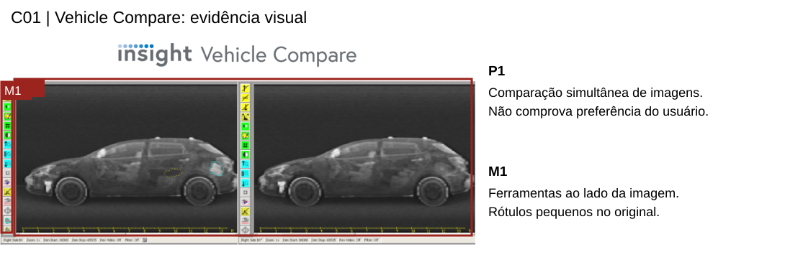
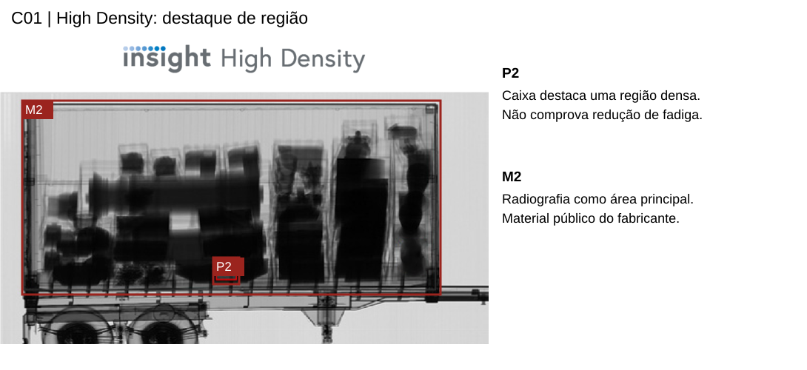
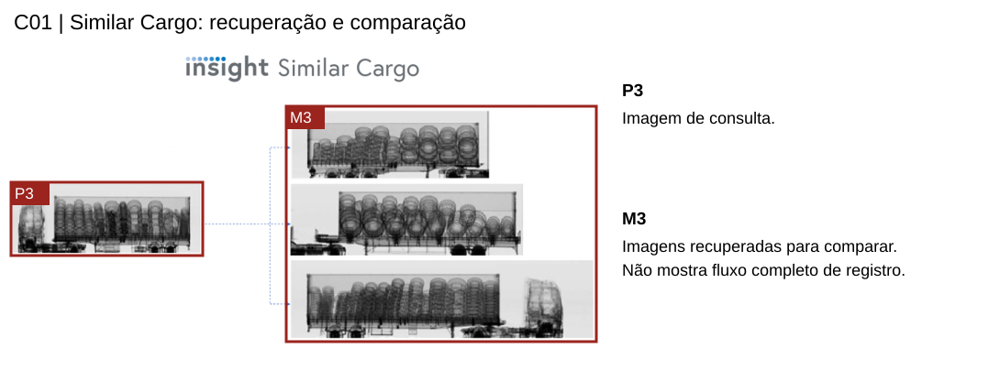
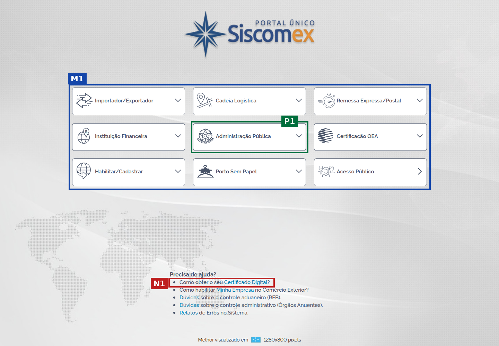
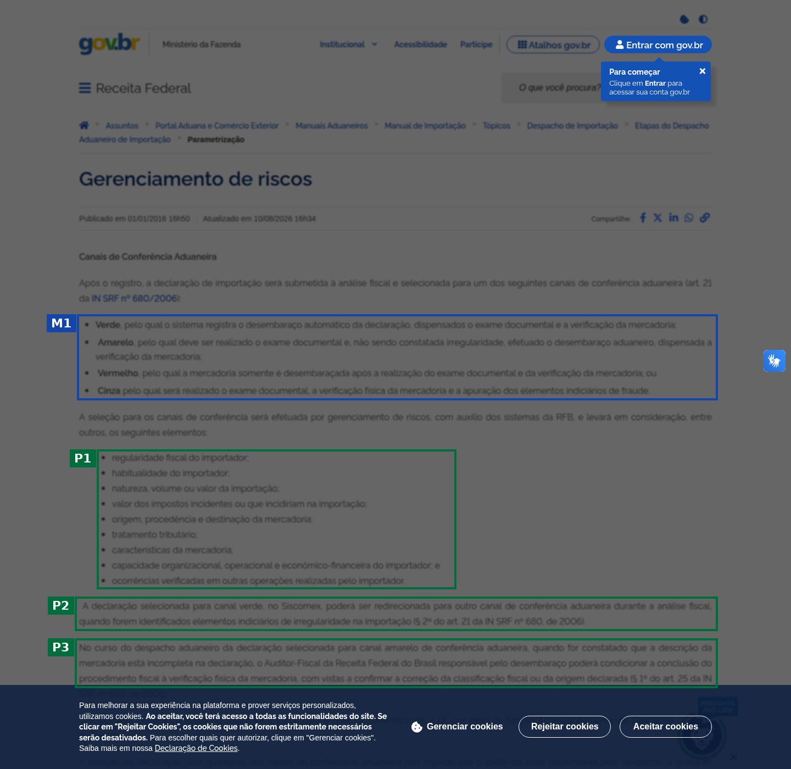
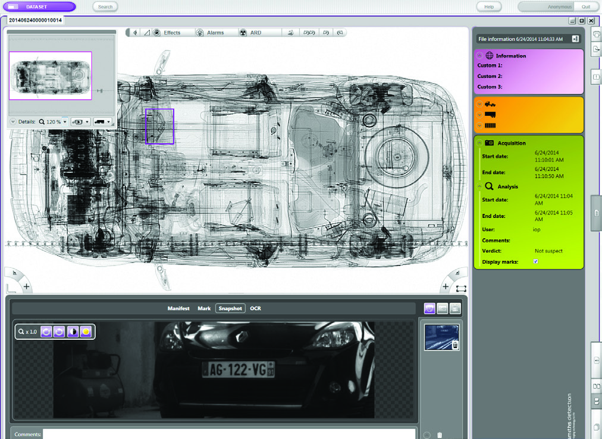
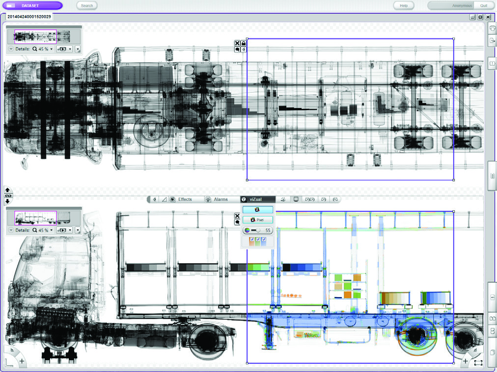
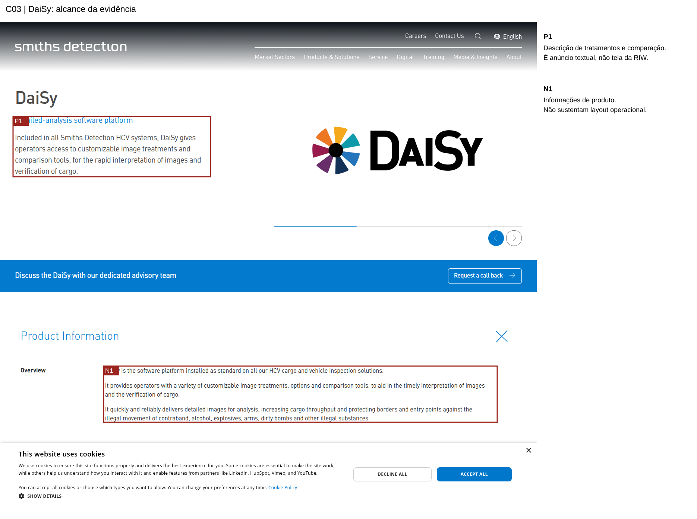
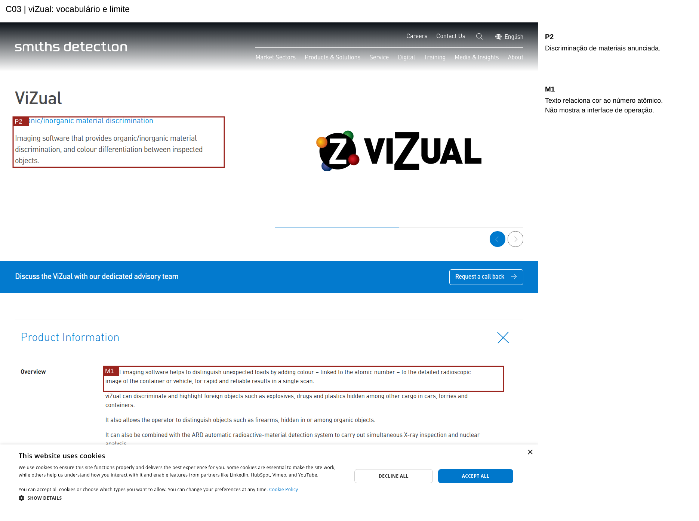

# Entrega 2 — Público-alvo e análise de concorrência

**Data:** 26/08/2026 (versão original)
**Revisão:** 15/11/2026, aplicação do [feedback do professor](../feedbacks_professor/Feedback_Professor_Entrega02_Equipe09.md)
**Status:** 🟦 revisada após feedback
**Responsabilidade mínima:** cada integrante analisa pelo menos 1 concorrente/interface representativa; a equipe produz síntese comparativa.

## Objetivo da atividade

Compreender soluções do mesmo domínio **e também interfaces familiares ao público-alvo**. O objetivo não é copiar telas, mas identificar convenções, padrões, affordances percebidas, problemas recorrentes, expectativas e oportunidades de design.

> **Concorrente não precisa ser idêntico ao produto.** Pode atuar na mesma área, resolver objetivo semelhante ou disputar a mesma necessidade. Quando não houver concorrente direto, use produtos análogos e softwares que o público já utiliza.

### Para TCCs que não previam interface

Não procure apenas um “concorrente do algoritmo”. Investigue **interfaces profissionais que materializam atividades semelhantes** às que o usuário escolhido precisaria realizar.

Exemplos:

- TCC de banco de dados → consoles de administração, ferramentas para DBA, monitoramento e análise de consultas;
- TCC de LLM/ML → painéis de experimentos, gestão de modelos/datasets, comparação de métricas, revisão de resultados;
- TCC de análise de dados → dashboards, ferramentas de BI, filtros, relatórios e exploração;
- TCC de infraestrutura/API → portais administrativos, observabilidade, logs, gestão de credenciais e uso;
- TCC de cibersegurança → consoles de alertas, triagem, histórico e auditoria.

A pergunta é: **“que convenções esse perfil já conhece para executar tarefas equivalentes?”**

## Entrada obrigatória da Entrega 1

Retome o mapa inicial de alternativas e produtos citado na Entrega 1. Aqui a equipe deixa de trabalhar apenas com impressão inicial e passa a **investigar sistematicamente** cada solução.

| Item citado na Entrega 1                                                    | Tipo                                                | Por que foi citado                                                                                          | Status inicial                   | Decisão nesta entrega |
| --------------------------------------------------------------------------- | --------------------------------------------------- | ----------------------------------------------------------------------------------------------------------- | -------------------------------- | ---------------------- |
| Softwares proprietários dos fabricantes de scanners, como Rapiscan Systems | concorrente / interface profissional representativa | Representam soluções comerciais reais usadas em inspeção de cargas, veículos e contêineres por raio-X | [F] Produto existente no mercado | analisar               |
| Sistemas ERP alfandegários (Siscomex / Portal Único Siscomex) | interface profissional que o público já utiliza | Citado na Entrega 1 (§6.3, H21) como sistema que o público-alvo conhece; concentra fila de despacho, parametrização por canal de risco e registro formal de decisões | [H21] | analisar |
| Sistemas de gerenciamento de carga portuária (TOS) | produto da mesma área, não equivalente | Citado na Entrega 1 (§6.2, H20) como ecossistema em que a inspeção se insere | [H20] | não analisar nesta entrega — foco no fluxo de decisão, não na gestão logística |

Se uma hipótese da Entrega 1 for confirmada ou refutada durante esta análise, atualize `H01`, `H02`... em [`../RASTREABILIDADE.md`](../RASTREABILIDADE.md).

## 1. Público-alvo desta análise

O público-alvo retomado da Entrega 1 é o **operador da estação de imagem de raio-X** (H01), que examina a radiografia de cada contêiner e produz um apontamento sobre o que encontrou. A decisão formal de liberar, reter ou encaminhar a carga para verificação física pode caber a outro cargo, o **Auditor-Fiscal** (H39), que por isso também interessa a esta análise.

Como o TCC não previa uma interface original, esta entrega investiga três interfaces profissionais do mesmo domínio operacional: dois softwares de apoio à interpretação de imagens de raio-X em inspeção de cargas (C01 e C03) e o sistema em que o despacho aduaneiro é formalizado (C02). O objetivo é observar convenções de interface, formas de destacar anomalias, comparação entre imagens e apoio à decisão do operador.

## 2. Concorrentes diretos/indiretos

### Análise C01 — Rapiscan Systems / AS&E InSight Intelligent Image Analytics

**Autor(a):** Kawan Mark Geronimo Da Silva — 22.222.010-5
**Tipo:** concorrente indireto / interface profissional representativa
**Link oficial:** https://www.rapiscan-ase.com/products/software/insight-operator-assist-tools
**Data de acesso:** 26/08/2026

#### Contexto e proposta

A Rapiscan Systems é uma empresa do grupo OSI Systems voltada a soluções de inspeção de segurança, incluindo equipamentos de raio-X para cargas, veículos, portos, fronteiras e infraestrutura crítica. Dentro do portfólio de inspeção de carga e veículos, a linha **AS&E InSight Intelligent Image Analytics** é apresentada como um conjunto de ferramentas inteligentes para apoiar operadores na interpretação de imagens.

Segundo a página oficial da Rapiscan AS&E, o InSight utiliza processamento avançado de imagens e técnicas de aprendizado de máquina/deep learning para destacar ameaças e contrabando potenciais, permitindo que analistas foquem em áreas suspeitas e maximizem a detecção. Isso se relaciona diretamente ao escopo de IHC do nosso projeto, pois também tratamos da tradução de resultados de IA em sinais visuais compreensíveis para o fiscal aduaneiro.

Para nossa análise, o InSight não será tratado como concorrente idêntico ao TCC, mas como **referência profissional de mercado** para tarefas semelhantes: análise de raio-X, apoio visual à detecção, comparação de imagens, identificação de alta densidade e triagem de cargas suspeitas.

#### Funcionalidades relevantes

| Funcionalidade                  | Como é realizada                                                                                                                                                         | Evidência/print                                                       | Observação de IHC                                                                                                                                                   |
| ------------------------------- | ------------------------------------------------------------------------------------------------------------------------------------------------------------------------- | ---------------------------------------------------------------------- | --------------------------------------------------------------------------------------------------------------------------------------------------------------------- |
| Comparação de veículo/carga  | A ferramenta**InSight Vehicle Compare** compara a imagem atual com uma imagem de referência anterior e destaca objetos adicionados ou removidos.                   | `../assets/02_concorrencia/c01_rapiscan_insight_vehicle_compare.png` | Mostra que comparar imagens é um padrão presente no produto. Não mostra a preferência dos analistas entre lado a lado e sobreposição. Relaciona-se à hipótese H30 da Entrega 1.                                    |
| Detecção de alta densidade    | A ferramenta**InSight High Density** processa imagens de raio-X de transmissão e destaca objetos densos no contêiner, reboque ou caixa de carga.                  | `../assets/02_concorrencia/c01_rapiscan_insight_high_density.png`    | [F] O material destaca uma região densa. [H] Reduzir esforço de varredura e favorecer eficiência são benefícios a avaliar (H34), sem medição de usabilidade nesta fonte.                                    |
| Busca por cargas semelhantes    | A ferramenta **InSight Similar Cargo** recupera imagens salvas semelhantes à imagem atual e as exibe para comparação pelo analista.                             | `../assets/02_concorrencia/c01_rapiscan_insight_similar_cargo.png`   | Sugere que histórico e comparação com casos anteriores podem apoiar decisão, auditoria e treinamento do operador.                                                 |
| Apoio à interpretação por IA | O produto oferece ferramentas específicas para identificar padrões como contêiner vazio, carga não homogênea, garrafas, cigarros, armas, ocupantes e alta densidade. | Página oficial do InSight                                             | A interface parece organizar a IA em ferramentas operacionais orientadas a tarefas, e não apenas em métricas técnicas. Essa abordagem é útil para nosso projeto. |

#### Experiência do usuário e opiniões

Use avaliações públicas, relatos, estudos, testes próprios ou outra fonte identificável. Não trate opinião isolada como verdade universal.

A análise foi baseada em informações públicas da página oficial do produto e nas imagens disponibilizadas pela própria Rapiscan AS&E. Não foram encontradas avaliações públicas detalhadas de operadores sobre a usabilidade do InSight, provavelmente por se tratar de um sistema comercial de segurança, vendido em contexto institucional e com acesso restrito.

Mesmo sem relatos diretos de usuários, a proposta declarada do produto permite observar uma preocupação de IHC: **diminuir a carga interpretativa do operador**. A linguagem do produto enfatiza apoio à interpretação, foco em áreas suspeitas e aumento da eficiência do analista. Isso reforça a hipótese de que, em sistemas de inspeção por raio-X, a interface deve evitar apresentar apenas a imagem bruta e precisa transformar achados computacionais em evidências visuais claras.

Limitação da análise: os prints disponíveis são materiais públicos de divulgação e não necessariamente representam todos os estados reais da interface em operação, como falhas, filas, auditoria, permissões ou registro de veredito.

#### Preço/modelo de negócio

O preço não é divulgado publicamente. O modelo de negócio aparenta ser **B2B / institucional**, com venda consultiva para governos, portos, fronteiras, forças de segurança e operadores de infraestrutura crítica. O software InSight parece ser oferecido como componente complementar ao ecossistema de equipamentos de inspeção de carga e veículos da Rapiscan/AS&E, não como aplicativo de consumidor final.

Essa característica é importante para o nosso projeto: a interface de IHC deve considerar um ambiente profissional, com alto custo de erro, treinamento de operadores, suporte técnico, rastreabilidade e possível integração com scanners e sistemas aduaneiros.

#### Padrões e tendências percebidos

- Uso de **destaques visuais sobre imagens radiográficas** para indicar regiões suspeitas.
- Comparação entre imagem atual e referência ou caso semelhante.
- Organização da IA por tarefas reconhecíveis pelo operador, como alta densidade, contêiner vazio, carga não homogênea, armas, cigarros e garrafas.
- Linguagem voltada ao apoio da interpretação humana, não à substituição completa do operador.
- Forte dependência de visualização de imagem como centro da tarefa.
- Necessidade provável de treinamento e suporte, já que o sistema opera em contexto de segurança crítica.

#### Pontos positivos, limitações e lições

| Ponto                                                                       | Evidência                                                                                                                  | Implicação para nosso projeto                                                                                       |
| --------------------------------------------------------------------------- | --------------------------------------------------------------------------------------------------------------------------- | --------------------------------------------------------------------------------------------------------------------- |
| Ponto positivo: IA apresentada como apoio ao analista                       | Página oficial afirma que o InSight ajuda operadores a focar áreas suspeitas e maximizar detecção.                      | A IA deve ser apresentada como apoio a quem examina a imagem, sem substituir seu julgamento (RC02).   |
| Ponto positivo: comparação visual é recurso central                      | InSight Vehicle Compare e Similar Cargo usam comparação entre imagens.                                                    | Reforça a hipótese H30 e justifica explorar visualizador comparativo no protótipo.                                 |
| Ponto positivo: destaque de alta densidade/anomalia                         | InSight High Density destaca objetos densos em contêineres e trailers.                                                     | Nosso mapa residual deve destacar regiões relevantes sem esconder a imagem original.                                 |
| Limitação: pouca transparência pública sobre fluxo completo de decisão | A página pública mostra ferramentas e imagens, mas não detalha auditoria, fila operacional ou justificativa de veredito. | A ausência não demonstra necessidade. A rastreabilidade do registro tem origem em C02 (RC04).               |
| Lição de IHC: ferramentas devem ser orientadas à tarefa do fiscal        | InSight separa funções como Empty Container, High Density, Similar Cargo e Vehicle Compare.                               | Evitar interface genérica; organizar o protótipo em torno das tarefas que a investigação sustentar (H04, H05, H06). |

#### Evidências visuais de C01, com marcações

[F] As figuras preservam as imagens públicas já coletadas, com seu contexto. As marcas ligam o elemento observado às funcionalidades; não constituem teste de usabilidade. A resolução original de 660 pixels limita a leitura de comandos pequenos. Abrir o arquivo permite examinar os destaques; não há base para afirmar a usabilidade desses comandos nem inferir prevenção de erros ausente do material público.

| Marca | O que sustenta | Limite |
|---|---|---|
| P1/M1 | Comparação simultânea e ferramentas junto da imagem. | Não demonstra preferência entre mapas sobrepostos e lado a lado. |
| P2/M2 | Destaque de região densa e centralidade da radiografia. | Não demonstra ganho medido de eficiência ou menor fadiga. |
| P3/M3 | Consulta de imagem e exibição de referências semelhantes. | Não mostra registro, auditoria ou estados de erro. |

### Análise C02 — Portal Único Siscomex (fluxo de despacho, canal de risco e registro de decisão)

**Autor(a):** Gabriel Albertini Pinheiro — 22.122.094-8
**Tipo:** interface profissional representativa / sistema que o público-alvo já utiliza
**Link oficial:** https://portalunico.siscomex.gov.br/portal/
**Data de acesso:** 27/08/2026

> **Recorte desta análise:** enquanto a C01 investiga *como a IA é apresentada sobre a imagem*, esta análise investiga *o que acontece antes e depois da imagem*: como o fiscal recebe o que precisa examinar, como registra a decisão e como essa decisão fica rastreável. É o eixo que a C01 não conseguiu evidenciar (ver limitação registrada na C01) e a origem principal da recomendação RC04.

#### Contexto e proposta

O Portal Único Siscomex é o ambiente eletrônico único por onde tramitam as operações de comércio exterior brasileiras, mantido pela Receita Federal do Brasil em conjunto com a Secretaria de Comércio Exterior. Ele concentra o fluxo de importação (Declaração Única de Importação — DUIMP) e de exportação (DU-E), consolidando em um mesmo lugar o que antes se dividia entre sistemas separados e entre os diversos órgãos anuentes (ANVISA, MAPA, Inmetro e outros).

A documentação oficial organiza o sistema em módulos, entre os quais interessam a esta análise: **Importação** (funções *Elaborar Duimp* e *Consultar Duimp*), **Visão Integrada** (*Informações Gerais*, *Operações em Andamento*, *Consultar LI*, *Consultar DI*) e **Anexação de Documentos** (*Anexar Documento*, *Consultar Documento*, *Consultar Dossiê*). O Auditor-Fiscal da Receita Federal está entre os usuários do sistema, e é nele que o resultado da conferência aduaneira — incluindo a decisão sobre liberar a carga ou submetê-la a exame — é formalizado.

O Portal Único **não é concorrente do TCC**: ele não analisa imagens de raio-X nem detecta anomalias. Ele é o sistema no qual a decisão que nosso protótipo pretende apoiar já é registrada hoje, com valor jurídico. Por isso a análise se concentra no que a C01 não conseguiu evidenciar: a fila de trabalho, a classificação de risco, o registro formal do veredito e a rastreabilidade do processo.

#### Funcionalidades relevantes

| Funcionalidade | Como é realizada | Evidência/print | Observação de IHC |
| --- | --- | --- | --- |
| Linha do tempo do processo | O acompanhamento do despacho exibe a sequência de marcos do processo: *Registro da Declaração → Parametrização → Distribuição para Auditor → Exigência Fiscal → Desembaraço Aduaneiro*. | Guia de acompanhamento do despacho (ver Referências). Sem print: a tela de acompanhamento não é pública | O processo tem uma **espinha dorsal cronológica** explícita. Sustenta H18 (histórico) e sugere que o histórico do contêiner no nosso protótipo seja uma linha do tempo de eventos, não uma tabela solta. |
| Distribuição para auditor | Existe uma etapa formal de atribuição da declaração a um auditor responsável, entre a parametrização e a conferência. | Guia de acompanhamento do despacho; print da tela de decisão não acessível (ver ressalva) | Mostra que **atribuir processos a um responsável** é um conceito do domínio. Relaciona-se a H04 e H25, sem mostrar fila de trabalho nem frequência, e dá sustentação parcial a H17 (identificação do responsável). |
| Canal de parametrização por risco | O gerenciamento de risco classifica a declaração em quatro canais: **verde** (desembaraço automático, sem exame), **amarelo** (exame documental), **vermelho** (exame documental + verificação física) e **cinza** (exame, verificação física e procedimento especial por indício de fraude). Quando vários órgãos avaliam a mesma declaração, aplica-se o controle mais rigoroso. | [`c02_siscomex_canais_parametrizacao.png`](../assets/02_concorrencia/c02_siscomex_canais_parametrizacao.png) — Manual de Despacho de Importação da RFB | Evidência forte para **H24**: o código de cores dos canais não é uma metáfora inventada por nós, é a convenção legal do domínio. **Achado que contraria nossa premissa:** são quatro níveis, não três — ver "Pontos positivos, limitações e lições". |
| Registro de exigência fiscal | Quando o auditor precisa de correção ou documento complementar, registra uma **exigência fiscal**, que aparece ao administrado como mensagem formal com prazo de resposta. | Guia de acompanhamento do despacho; print da tela de decisão não acessível (ver ressalva) | Sustentação parcial de **H19** e indício para **H06**: no despacho, a decisão é um **ato comunicado, motivado e com prazo**. Não mostra se quem examina a imagem registra algo. Se houver registro na interface, destinatário, motivo e efeito são elementos a considerar (RC07). |
| Dossiê de documentos | Documentos do despacho são anexados digitalmente e consultados como *dossiê* vinculado ao processo (*Anexar Documento*, *Consultar Documento*, *Consultar Dossiê*). | Documentação dos módulos do Portal Único (ver Referências). Sem print: a função exige acesso autenticado | Relaciona-se a H11: a decisão se apoia em evidência documental além da imagem. O mapa residual seria mais uma peça de evidência anexável ao processo. |
| Consulta e localização de processos | O acompanhamento se dá pela função *Acompanhamento do Despacho* (menu *Operações → Despacho Importação → Consultas*), informando o número da declaração e consultando. | Instruções de consulta do canal (ver Referências). Sem print: a função exige acesso autenticado | Evidência **parcial** para H29: a chave de navegação é o **identificador do processo**, não o risco nem a data. Não encontramos evidência de busca por faixa de risco — ver limitações. |
| Vocabulário do domínio | Rótulos e status usam termos normativos: DUIMP, DI, LI, LPCO, canal, parametrização, distribuição, exigência, desembaraço, dossiê, anuência. | [`c02_siscomex_canais_parametrizacao.png`](../assets/02_concorrencia/c02_siscomex_canais_parametrizacao.png) — vocabulário normativo no texto oficial | Alimenta **RC03**: o vocabulário da nossa interface deve vir daqui, não da terminologia de machine learning. "Anomalia residual" não é termo do fiscal; "indício" e "exigência" são. |

**Prints desta análise** (capturados em 03/09/2026, em `../assets/02_concorrencia/`). Os dois têm naturezas diferentes e sustentam coisas diferentes:

| Print | Natureza | O que mostra | O que sustenta e o que não sustenta |
| --- | --- | --- | --- |
| [`c02_siscomex_portal_perfis.png`](../assets/02_concorrencia/c02_siscomex_portal_perfis.png) | Tela de interface real e corrente, em nível de entrada | Entrada do Portal Único organizada por **perfil de usuário** (Importador/Exportador, Cadeia Logística, Administração Pública, Acesso Público, Habilitar/Cadastrar e outros), com link de ajuda sobre certificado digital. | Sustenta que o sistema é segmentado por papel antes de qualquer tarefa, o que reforça a necessidade de definir o perfil do nosso usuário (?01, H39). Não mostra nenhuma tela de trabalho do Auditor-Fiscal. |
| [`c02_siscomex_canais_parametrizacao.png`](../assets/02_concorrencia/c02_siscomex_canais_parametrizacao.png) | Documentação normativa, não tela de interface | Página oficial "Gerenciamento de riscos" do Manual de Despacho de Importação, com a definição dos **quatro canais** (verde, amarelo, vermelho, cinza) e os elementos considerados na seleção. | Sustenta linguagem, estados normativos e regras do despacho, e revisa **H24**. Não sustenta nada sobre layout ou usabilidade da tela operacional. |

> **Ressalva:** as telas de trabalho do Auditor-Fiscal não são publicamente acessíveis, porque o perfil exige certificado digital e vínculo institucional. Esta análise tem, portanto, uma única captura de interface (a entrada do Portal) e uma captura de documentação. O requisito de prints de telas e estados relevantes fica **parcialmente atendido** em C02. As conclusões sobre o Siscomex tratam de processo e vocabulário, e não de layout, densidade de informação ou sequência de uso.

**Marcações nos prints.** As versões marcadas indicam qual parte da captura comprova cada ponto. `P` é ponto positivo ou evidência, `N` é limitação e `M` é padrão ou convenção.

| Marca | Elemento na captura | Ponto que comprova |
| --- | --- | --- |
| M1 | Grade de perfis na entrada do Portal | [F] Padrão: o acesso é segmentado por papel antes de qualquer tarefa. |
| P1 | Perfil "Administração Pública" | [H] Entrada provável dos servidores, entre eles o Auditor-Fiscal. O conteúdo não é acessível sem certificado. |
| N1 | Link "Como obter o seu Certificado Digital?" | [F] Limitação: o acesso depende de certificado digital, e por isso as telas de trabalho não foram observadas. |

| Marca | Elemento na captura | Ponto que comprova |
| --- | --- | --- |
| M1 | Lista dos quatro canais de conferência aduaneira | [F] Convenção normativa: verde, amarelo, vermelho e cinza, cada um com nome textual e procedimento definido (H24). |
| P1 | Lista dos elementos considerados na seleção do canal | [F] Os critérios são fiscais e documentais (regularidade fiscal, habitualidade, natureza e valor da importação, origem, características da mercadoria). Nenhum deles é resultado de imagem. |
| P2 | Parágrafo sobre redirecionamento da declaração em canal verde | [F] O canal pode mudar durante a análise fiscal, quando são identificados indícios de irregularidade. |
| P3 | Parágrafo que cita o Auditor-Fiscal responsável pelo desembaraço | [F] A responsabilidade pelo desembaraço é do Auditor-Fiscal da Receita Federal (H17, H39). |

#### Experiência do usuário e opiniões

As fontes utilizadas são de dois tipos, com pesos diferentes:

- **Documentação oficial** (Receita Federal e Portal Único): descreve estrutura de menus, etapas do despacho e a definição normativa dos canais. É confiável quanto ao que o sistema faz, mas descreve o processo, não a experiência de uso.
- **Material de mercado** (consultorias e blogs especializados em comércio exterior, voltados a importadores e despachantes): descreve o Portal Único como uma interface "mais intuitiva e centralizada" frente aos sistemas anteriores, e detalha a rotina de acompanhamento. São fontes com interesse comercial e sem método de avaliação declarado — tratamos essa afirmação como **indício, não como resultado de usabilidade**.

Um relato recorrente nessas fontes é a pressão de prazo associada à exigência fiscal, que requer resposta em prazo curto. Isso é coerente com o contexto de pressão temporal levantado na Entrega 1 (H16), embora aqui a pressão recaia sobre o administrado, e não sobre o fiscal.

**Limitações desta análise:**

1. Não houve acesso ao sistema em operação. O perfil de Auditor-Fiscal depende de certificado digital e vínculo institucional.
2. Praticamente toda a documentação pública é escrita **da perspectiva do importador/despachante**, não do fiscal. Sabemos que existe a etapa "Distribuição para Auditor", mas não como a lista de trabalho se apresenta a ele.
3. Não foram encontradas avaliações de usabilidade formais, nem material sobre acessibilidade do sistema.
4. Consequentemente, as hipóteses H17, H32 e boa parte de H29 permanecem **sem evidência direta** mesmo após esta análise.
5. A busca por manuais, vídeos ou materiais de treinamento que exibam a tela de trabalho do Auditor-Fiscal não encontrou material público. Foram localizadas normas da RFB sobre o uso de escâner, listadas nas Referências da Entrega 3. Elas descrevem o processo e os requisitos do software, e não a tela.

#### Preço/modelo de negócio

Não há preço: é sistema público de governo, de uso **obrigatório** por força normativa para operar comércio exterior no Brasil. O acesso é controlado por certificado digital e por perfis distintos (importador, despachante, órgão anuente, auditor), cada um enxergando um subconjunto das funções.

Isso muda a relação do usuário com a interface de um modo que importa ao nosso projeto: **o usuário não escolheu a ferramenta e não pode abandoná-la**. Adoção não é um problema de design aqui — mas também não há pressão de mercado corrigindo atrito de uso, e o custo de um erro é jurídico, não comercial. Um sistema obrigatório tende a acumular funções e jargão normativo ao longo do tempo, o que é consistente com a caracterização de "interfaces densas e legadas" feita na Entrega 1 (H23).

#### Padrões e tendências percebidos

- **Linha do tempo de marcos** como estrutura central do acompanhamento de um processo.
- **Classificação por canal de cor** que determina quanto esforço de conferência a carga vai receber — o risco não é só informação, é o que define o trabalho a ser feito.
- **Atribuição explícita a um responsável** ("Distribuição para Auditor") antes da conferência.
- **Decisão como ato formal comunicado**, com motivo e prazo, e não como simples mudança de estado.
- **Consolidação multiórgão** em visão única, com aplicação do controle mais rigoroso entre os órgãos.
- **Documento como dossiê** vinculado ao processo.
- **Identificador único do processo** como chave primária de navegação.

#### Pontos positivos, limitações e lições

| Ponto | Evidência | Implicação para nosso projeto |
| --- | --- | --- |
| Ponto positivo: o código de cores por risco é convenção normativa consolidada | Canais verde, amarelo, vermelho e cinza definidos no despacho de importação. | **H24 sustentada quanto à convenção.** O fiscal conhece os quatro canais e seu significado. Se o canal aparecer na interface, deve seguir a semântica oficial e ficar separado do resultado da IA (RC05). |
| Achado que contraria nossa premissa: são **quatro** canais, não três | O canal **cinza** existe e significa suspeita de fraude, com procedimento especial. | A Entrega 1 (H24) assumiu três cores. A convenção do domínio tem quatro canais, e o cinza trata indício de fraude. Isso corrige o vocabulário, mas não define quantos níveis o resultado da IA deve ter (?08). |
| Ponto positivo: a decisão é um ato motivado e com prazo | A exigência fiscal é registrada e comunicada com prazo de resposta. | **Origem principal de RC04 e RC07.** O registro do resultado precisa de justificativa, destinatário e efeito. |
| Ponto positivo: existe responsável nomeado pelo processo | Etapa "Distribuição para Auditor". | Sustentação parcial de H17. Possibilidade a investigar: vincular cada registro a quem o produziu. |
| Ponto positivo: histórico é cronológico e vai além da decisão | A linha do tempo segue até o comprovante de importação. | Hipótese de design (RC08): apresentar o histórico do contêiner como linha do tempo de eventos. |
| Limitação: navegação centrada no número da declaração | A consulta se faz informando o número da DI/DUIMP. | Não há evidência de fila priorizada para o fiscal. Isso é um vazio na documentação, não uma necessidade demonstrada: a função pode existir sem estar documentada, ocorrer em outro sistema ou não fazer sentido no processo. Fica como hipótese de design (RC06, H25, H41). |
| Limitação: documentação escrita para o importador, não para o fiscal | Manuais e material de mercado descrevem o acompanhamento pelo lado do administrado. | H29 e H32 seguem sem evidência direta; devem ser investigadas por entrevista na Entrega 7, não por análise documental. |
| Limitação: nenhuma evidência sobre acessibilidade | Não foram localizados relatórios ou declarações de acessibilidade. | Mesma lacuna registrada na C01 — a equipe não deve concluir nada sobre acessibilidade do domínio a partir dos concorrentes. |
| Lição de IHC: nosso sistema conviveria com o Siscomex, não o substituiria | O Portal Único é de uso obrigatório e detém o valor jurídico da decisão. | O veredito do nosso protótipo precisa ter correspondência com os atos que já existem (canal, exigência, desembaraço), sob pena de criar trabalho duplicado para o fiscal. |

### Análise C03 — Smiths Detection / DaiSy CargoVision e viZual (ferramentas de ajuste de imagem e filtros radiográficos)

**Autor(a):** Alexandre Domiciano Pierri — 22.125.061-6
**Tipo:** concorrente direto / interface profissional representativa
**Link oficial:** https://www.smithsdetection.com/products/daisy/ e https://www.smithsdetection.com/products/vizual/
**Data de acesso:** 30/08/2026

#### Contexto e proposta

A Smiths Detection é uma das principais concorrentes globais da Rapiscan no fornecimento de sistemas de inspeção por raio-X e tomografia para portos, aeroportos e postos de fronteira. A suite de softwares operacionais da empresa (como o **CargoVision** e o sistema **Hi-TRAX**) é projetada para ser a interface primária do operador de scanner durante a varredura contínua de contêineres e veículos pesados.

Enquanto a análise C01 focou na detecção automática por IA e a C02 no fluxo processual do governo, esta análise foca no **manipulador visual primário da imagem radiográfica**: como a interface permite que o fiscal altere contraste, aplique filtros de número atômico, inverta cores e isole níveis de penetração do feixe para identificar itens ocultos sob materiais densos.

Esta análise é fundamental para o nosso projeto de IHC pois a nossa solução baseada em modelo residual precisará conviver com os hábitos visuais que o operador já possui para manipular e inspecionar a imagem bruta.

| Funcionalidade | Como é realizada | Evidência documental / Fonte | Observação de IHC |
| --- | --- | --- | --- |
| Colorização por Número Atômico ($Z_{eff}$) | Atribuição de cores falsas (*pseudo-color*) com base na absorção do feixe de raios-X de dupla energia, permitindo a separação entre materiais orgânicos, inorgânicos e mistos. | Datasheet *HCVG viZual Series* (*Dual energy material discrimination / Organic/inorganic/mixed material colorization based on equivalent atomic numbers*). | Confirma a convenção visual padrão do domínio. A apresentação do mapa residual não deve conflitar com essa paleta de cores. Como fazer isso é alternativa a testar (RC09). |
| Ajuste de Contraste e Equalização de Histograma | Manipulação do alcance dinâmico e aplicação de *histogram equalization* para esticar o contraste em regiões de alta densidade e isolar detalhes ocultos. | Datasheets *HCVP e series*, *HCVM e35*, *HCVG viZual* e *HCVM e35 T* (*DaiSy CargoVision Software: Contrast enhancement, histogram equalization*). | [H] O operador alternaria filtros por atalhos na estação (RIW). Os datasheets listam os filtros, mas não mostram como são acionados. |
| Realce de Bordas (*Edge Enhancement*) | Filtro de convoluição que acentua os contornos e gradientes de densidade de objetos escondidos atrás de blindagens metálicas ou paredes do contêiner. | Datasheets *HCVP e series*, *HCVM e35*, *HCVG viZual* e *HCVM e35 T* (*DaiSy CargoVision Software: Edge enhancement and image filters*). | A camada de IA não deve encobrir as bordas destacadas pelo operador. Controle de opacidade é uma das alternativas a testar (RC09). |
| Medição e Ferramentas de Anotação | Medição direta de dimensões reais de objetos na imagem (*objects measurement*), inserção de marcações (*marks and annotations*) e cruzamento com o manifesto. | Datasheets *HCVP e series*, *HCVM e35*, *HCVG viZual* e *HCVM e35 T* (*DaiSy CargoVision Software: Objects measurement, marks, annotations and manifest comparison*). | Relaciona-se a H11: a estação cruza a imagem com os dados do manifesto e permite anotações. |

#### Experiência do usuário e opiniões

A análise foi realizada com base nas especificações técnicas e datasheets oficiais das estações de trabalho de análise de imagem (**RIW - Review/Image Workstation**) da Smiths Detection.

Em sistemas de inspeção radiográfica de alto tráfego (com capacidade de escaneamento de até 80 caminhões por hora no modo *pass-through*), a experiência do usuário é dominada pela **velocidade de varredura visual e redução da fadiga ocular**. As estações de trabalho contam com monitores dedicados de 22" a 24" (*flat screen workstation*) e softwares projetados para aplicação imediata de filtros de imagem e comparação direta com o banco de dados SQL e documentos de manifesto.

Limitação da análise: os softwares de inspeção da Smiths Detection são proprietários e de uso restrito por órgãos de segurança e alfândegas, não havendo versão trial pública.

**Prints desta análise** (capturados em 03/09/2026, em `../assets/02_concorrencia/`):

| Print | O que mostra | Por que importa |
| --- | --- | --- |
| [`c03_smiths_daisy_plataforma.png`](../assets/02_concorrencia/c03_smiths_daisy_plataforma.png) | Página oficial da plataforma **DaiSy**, descrita como o software instalado por padrão em todos os sistemas HCV, com "customizable image treatments, options and comparison tools". | Confirma que o tratamento de imagem e as ferramentas de comparação são o núcleo do software do operador, e não um acessório. |
| [`c03_smiths_vizual_discriminacao.png`](../assets/02_concorrencia/c03_smiths_vizual_discriminacao.png) | Página oficial do **viZual**, que adiciona cor ligada ao número atômico à imagem radioscópica para discriminar orgânico/inorgânico e destacar objetos estranhos. | Evidência de que a cor já carrega significado de material na tela do operador — o mapa residual da nossa IA não pode competir com essa codificação. |

> **Ressalva:** as duas capturas são páginas de produto do fabricante, não telas da estação de trabalho em operação. Não houve acesso interativo à estação RIW. As capturas operacionais complementares da brochura oficial, descritas abaixo, permitem observar elementos estáticos, sem demonstrar rotina, sequência completa ou versão atualmente instalada. O link oficial anterior desta análise estava quebrado (retornava 404 e apontava para um site de terceiros); foi substituído pelas páginas de produto verificadas.

#### Preço/modelo de negócio

Modelo **B2B / Governamental**, integrado à venda ou modernização dos complexos de escaneamento físico (sistemas fixos, móveis em chassis de caminhão ou pórticos gantry). O software é fornecido como licença proprietária de estação de trabalho (*Image Workstation RIW / Database Workstation DBW*), incluindo treinamento operacional formal e suporte contínuo.

#### Padrões e tendências percebidos

- **Paleta de cores padronizada por absorção de dupla energia** (discriminação orgânico/inorgânico por $Z_{eff}$).
- **Manipulação rápida via Workstation (RIW)** com ferramentas nativas de realce de bordas, equalização de histograma e zoom.
- **Integração direta entre radiografia e dados do manifesto** na mesma interface de análise.
- **Suporte a automações opcionais** (como reconhecimento de placas ALPR, códigos de contêiner ACCR e detecção de radiação ARD).

#### Pontos positivos, limitações e lições

| Ponto | Evidência | Implicação para nosso projeto |
| --- | --- | --- |
| Ponto positivo: discriminação de materiais e realce de bordas nativos | Módulos *viZual* e filtros *Edge Enhancement* em toda a linha DaiSy CargoVision. | **Lição direta:** o mapa de calor da nossa IA (mapa residual) não pode poluir visualmente nem conflitar com as cores padrão de discriminação de material ($Z_{eff}$). |
| Ponto positivo: integração de metadados e anotações na mesma tela | Recurso *Manifest data comparison and annotations* na estação RIW. | Possibilidade a investigar: dados da carga e marcações junto da imagem (H11, RC07). |
| Limitação: acúmulo de filtros na tela | O uso simultâneo de equalização de histograma, bordas e marcações pode poluir a imagem. | A camada de IA não deve somar mais poluição à imagem. Opacidade ajustável e alternância são alternativas a testar (RC09), não controles observados nesta captura. |
| Lição de IHC: centralidade na imagem radiográfica | A estação de trabalho (RIW com tela de 22"/24") prioriza a área de exibição do scanner. | [H] Priorizar a radiografia é orientação do projeto (RC10); posição dos metadados e ações deve ser experimentada, sem inferir layout da RIW a partir da página de produto. |

#### Complemento de evidência operacional pública de C03

[F] A busca no material público do fabricante localizou a brochura **Securing Vulnerable Borders**, seção *Image Analysis Solutions*, página 9, ligada à página oficial de DaiSy. As duas imagens abaixo foram extraídas integralmente do PDF, sem reconstruir a tela. O documento não informa data de publicação verificada; as capturas ilustram uma versão divulgada, sem confirmar a estação instalada hoje. Fonte: [brochura oficial, p. 9](https://www.smithsdetection.com/media/g1ypoand/securing-vulnerable-borders-brochure.pdf#page=9), acesso em 15/11/2026.

*C03-D1. A radiografia ocupa a área principal; vê-se a região marcada, ferramentas acima e painel de informação à direita. A parte inferior reúne outra vista. São elementos visíveis na captura, sem medir eficiência, carga cognitiva ou número de passos.*

*C03-D2. Duas vistas da mesma unidade e região selecionada; a vista inferior mostra discriminação cromática, enquanto a superior preserva tons de cinza. Isso documenta uma composição visual possível da versão ilustrada; não comprova preferência do operador nem a adequação de um mapa de atenção do TCC.*

[H] O aprendizado para o projeto é testar comparação e distinção das camadas (H30/RC09), mantendo a leitura da radiografia. [?] Fluxos de erro, permissões, registro completo e uso real da RIW continuam sem observação. A fonte de mercado não valida comportamentos, benefícios ou necessidades humanas.

#### Marcações das capturas de C03

[F] As marcas identificam o conteúdo realmente visível nas páginas de produto. P1/N1 (DaiSy) sustentam a existência anunciada de tratamentos/comparação e delimitam a evidência como descrição do fabricante. P2/M1 (viZual) ligam discriminação cromática e número atômico ao texto publicado. Não são observações de layout ou de comportamento na estação RIW.

## 3. Softwares que o público-alvo usa no cotidiano

Analise interfaces que moldam a expectativa do público, mesmo que não sejam concorrentes.

| Software | Por que o público usa | Padrões relevantes | Prints | O que aprender |
| --- | --- | --- | --- | --- |
| **Portal Único Siscomex** (Receita Federal) | Uso obrigatório por força normativa para operar comércio exterior no Brasil; é onde a decisão sobre a carga tem valor jurídico. O Auditor-Fiscal está entre seus perfis. | Linha do tempo de marcos do processo; classificação por canal de cor; atribuição a um responsável; dossiê de documentos; busca por identificador do processo. | Acesso restrito por certificado digital — ver ressalva na análise C02 | O vocabulário da nossa interface deve vir daqui (canal, exigência, desembaraço, indício), e o veredito precisa corresponder a atos que já existem, sob pena de duplicar trabalho. |
| **Estação de operação do scanner** (Rapiscan InSight; Smiths HCVM/RIW) | É a ferramenta onde o operador efetivamente examina a imagem radiográfica, analisada em detalhe em C01 e C03. | Centralidade da imagem; ferramentas organizadas por tarefa de inspeção; filtros de realce e pseudo-cor; anotações sobre a imagem; comparação com referência. | [`c01_rapiscan_insight_high_density.png`](../assets/02_concorrencia/c01_rapiscan_insight_high_density.png), [`c01_rapiscan_insight_similar_cargo.png`](../assets/02_concorrencia/c01_rapiscan_insight_similar_cargo.png), [`c01_rapiscan_insight_vehicle_compare.png`](../assets/02_concorrencia/c01_rapiscan_insight_vehicle_compare.png) | A imagem ocupa o centro da tela e as ferramentas orbitam em torno dela; o mapa residual da nossa IA precisa conviver com filtros que o operador já usa, e não competir com eles. |
| **Sistemas de gerenciamento portuário (TOS)** | Hipótese H20 da Entrega 1: seriam os softwares correlatos mais comuns no ecossistema do terminal. | Não levantados. | — | **Lacuna assumida:** a equipe optou por aprofundar o Siscomex (H21) nesta entrega. H20 segue aberta e deve ser verificada por entrevista na Entrega 7. |

## 3.1 Padrões de interface relevantes ao escopo de IHC

Registre somente padrões encontrados nas soluções analisadas e que possam ter relação com objetivos reais da equipe.

| Padrão observado          | Produto(s)                                                                                       | Para qual tarefa serve                                                     | Vantagem percebida                                                                 | Risco/limitação                                                                         | Aplicável ao nosso escopo? |
| -------------------------- | ------------------------------------------------------------------------------------------------ | -------------------------------------------------------------------------- | ---------------------------------------------------------------------------------- | ----------------------------------------------------------------------------------------- | --------------------------- |
| dashboard                  | Não observado em C01, C02 nem C03 | Nenhuma das três soluções oferece painel geral ou fila de trabalho priorizada; no Siscomex (C02) a navegação é pelo número da declaração | Não observado. A ausência não demonstra necessidade: pode ser oportunidade, função não documentada, atividade de outro sistema ou algo desnecessário | Não concluir que dashboard é necessário apenas por ser comum; ele só se justifica se a triagem por risco (H25/H35) se confirmar como tarefa real | talvez, como hipótese de design (RC06) |
| relatório                 | Rapiscan InSight (inferido, não detalhado na página pública); Siscomex (C02) trabalha com dossiê de documentos, não com laudo de inspeção | Registrar evidências de inspeção e apoiar auditoria | Pode consolidar decisão e evidências visuais; no Siscomex o documento fica vinculado ao processo | Não há evidência pública sobre o formato do relatório em nenhuma das soluções (H28 segue aberta) | talvez |
| histórico + filtros       | Rapiscan InSight Similar Cargo (C01); acompanhamento do despacho no Siscomex (C02) | Recuperar imagens semelhantes (C01) e acompanhar a evolução de um processo ao longo do tempo (C02) | Apoia comparação com casos anteriores; a linha do tempo do Siscomex mostra que o histórico do domínio é cronológico e vai até o desfecho | Pode aumentar carga cognitiva se trouxer muitos casos sem priorização; busca por faixa de risco não existe hoje (C02) | sim |
| administração/CRUD       | Não observado em C01, C02 nem C03 | Não houve evidência pública suficiente para justificar esse padrão | Não se aplica nesta análise | Não deve ser incluído sem tarefa real que justifique; ?01 e ?03 (perfil administrador, ajuste de threshold) seguem lacunas abertas | não |
| comparação de resultados | Rapiscan InSight Vehicle Compare e Similar Cargo (C01); comparação com dados do manifesto na estação RIW (C03) | Comparar imagem atual com referência, com imagem semelhante ou com o que a carga declara ser | Facilita identificação de diferenças, objetos adicionados/removidos e anomalias, e liga a imagem ao documento | Comparações mal alinhadas podem induzir interpretação errada; acúmulo de filtros polui a imagem (C03) | sim |
| linha do tempo de processo | Portal Único Siscomex (C02) | Acompanhar em que etapa o processo está: registro → parametrização → distribuição → exigência → desembaraço | Torna o estado do processo legível sem exigir interpretação; é a estrutura mental que o domínio já usa | Só funciona se os eventos forem poucos e nomeados com o vocabulário oficial | sim |
| classificação por canal de cor | Portal Único Siscomex (C02) | Comunicar quanto esforço de conferência a carga vai receber (verde, amarelo, vermelho, cinza) | Convenção normativa consolidada: é lida corretamente sem treinamento | São quatro canais, não três. A cor é muito presente, embora cada canal tenha nome textual. É classificação do despacho, não do resultado da IA (RC05) | sim |
| atribuição a um responsável | Portal Único Siscomex (C02) | Vincular o processo ao auditor que vai conferi-lo ('Distribuição para Auditor') | Sustenta a trilha de auditoria e a responsabilidade legal sobre a decisão (H17, H32) | Não há evidência de como essa carga de trabalho se apresenta ao fiscal — investigar na Entrega 7 | sim |
| realce e pseudo-cor sobre a imagem | Rapiscan InSight High Density (C01); viZual / Edge Enhancement na linha DaiSy CargoVision (C03) | Destacar material suspeito e contornos sem substituir o julgamento do operador | Direciona a atenção para a região relevante, apoiando H34 e H37 | O mapa residual da IA pode conflitar com as cores de discriminação de material já usadas. Como distinguir as camadas é alternativa a testar (RC09) | sim |
| anotação sobre a imagem | Estação RIW / manifest data comparison and annotations (C03) | Marcar a anomalia observada e registrar a interpretação junto da evidência visual | Mantém justificativa e evidência no mesmo artefato, o que serve à trilha de auditoria | Anotações acumuladas podem poluir a imagem tanto quanto os filtros | sim |

> O objetivo não é concluir “todo concorrente tem dashboard, então teremos um”. O padrão só será adotado se apoiar uma tarefa rastreável.

## 4. Síntese comparativa da equipe

| Critério                         | C01                                                                                                                  | C02 | C03 | Oportunidade para o projeto                                                                     |
| --------------------------------- | -------------------------------------------------------------------------------------------------------------------- | --- | --- | ----------------------------------------------------------------------------------------------- |
| Navegação                       | Ferramentas organizadas por tarefa de inspeção: Vehicle Compare, High Density, Similar Cargo, Empty Container etc. | Organizada por módulos normativos (Importação, Visão Integrada, Anexação de Documentos) e pela linha do tempo do despacho; a chave de acesso ao processo é o número da declaração (DI/DUIMP), não uma fila de trabalho. |Interface focada na estação de trabalho (RIW), com centralidade na imagem radiográfica e atalhos rápidos para alternar filtros e camadas sem desviar do fluxo principal.     | Organizar o protótipo pelas tarefas de quem examina a imagem. A ordem de exame por nível de anomalia é hipótese de design (RC06), e a busca pelo número da declaração é convenção a preservar. |
| Feedback/estado                   | Destaca visualmente regiões de interesse na imagem e indica resultados de ferramentas analíticas.                  | Estado comunicado por marcos do processo (registro → parametrização → distribuição → exigência → desembaraço) e pelo canal de cor atribuído à declaração; feedback textual e normativo, não visual. |Feedback visual direto via colorização por número atômico ($Z_{eff}$) em pseudo-color, realce de bordas (Edge Enhancement) e indicação de densidade por equalização de histograma.     | Usar feedback visual direto no mapa residual, evitando depender apenas de números. Linha do tempo do contêiner é hipótese de design (RC08). |
| Prevenção/recuperação de erro | A página pública não detalha fluxos de erro, confirmação ou reversão de decisão.                              | A exigência fiscal é o mecanismo formal de correção: o auditor registra o motivo, o administrado responde em prazo definido e o processo retoma — o erro é tratado como ato comunicado e rastreável. |Suporte a anotações e marcações de anomalias diretamente na tela (marks and annotations), reduzindo erros de interpretação ao cruzar dados do manifesto.     | Registro do resultado com justificativa e rastreável a quem o produziu (RC04). Confirmação antes de ações sem volta é possibilidade a investigar (H08).     |
| Terminologia                      | Usa termos operacionais do domínio: cargo, container, high density, similar cargo, threats, contraband.             | Vocabulário normativo brasileiro: DUIMP, DI, LI, LPCO, canal, parametrização, distribuição, exigência, desembaraço, dossiê, anuência. Nenhum termo de IA. |Utiliza termos do domínio e especificações de inspeção: Zeff, material discrimination, organic/inorganic/mixed, edge enhancement, manifest comparison.     | Usar o vocabulário normativo do fiscal (canal, exigência, desembaraço, indício) e evitar jargão técnico de IA na interface principal. |
| Acessibilidade                    | Não há evidência pública suficiente sobre acessibilidade da interface.                                           | Não foram localizados relatórios ou declarações de acessibilidade. A cor é muito presente, mas os canais têm nome textual e significado normativo. |Exibição em monitores dedicados de 22" a 24" para reduzir a fadiga ocular; porém, depende fortemente de mapa de cores (pseudo-color) para discriminação de materiais.     | Avaliar contraste, legibilidade e redundância à cor, por princípio de acessibilidade (RC11). |
| Eficiência                       | A proposta do InSight é tornar analistas mais eficientes ao focar áreas suspeitas.                                 | Ganho vem da centralização multiórgão e do fim dos sistemas paralelos; não há evidência de fila priorizada por risco para o fiscal, e não se sabe se decidir o que examinar primeiro é tarefa dele nem onde ela acontece. |Projetado para alto tráfego (até 80 caminhões/h no pass-through), permitindo aplicação imediata de filtros de imagem e comparação rápida no banco SQL.     | Evitar duplicar o registro que já é feito no Siscomex. Fila por nível de anomalia e número de passos são hipóteses a testar (RC06). |

## 5. Recomendações derivadas

Liste recomendações com origem explícita.

Cada recomendação traz a classificação da sua base:

- **PM**: padrão observado em mercado, visível nas soluções analisadas.
- **AP**: achado ou problema observado em uma solução ou na documentação do domínio.
- **HD**: hipótese de design derivada, que ainda precisa ser validada no projeto.
- **TIHC**: recomendação sustentada principalmente pela teoria de IHC.

Quando há duas classificações, a primeira vale para o princípio e a segunda para a solução concreta citada. Ausência de um recurso no concorrente não é tratada como prova de necessidade.

- **RC01 [PM]:** O visualizador principal deve permitir comparação clara entre imagem original e evidência gerada pela IA — derivada de C01 / InSight Vehicle Compare e InSight Similar Cargo.
- **RC02 [PM]:** O sistema deve destacar regiões suspeitas sem substituir o julgamento de quem examina a imagem — derivada de C01 / InSight High Density.
- **RC03 [PM]:** A interface deve usar a linguagem operacional do domínio aduaneiro e de inspeção, e não expor métricas técnicas de IA como elemento principal. Derivada de C01 (ferramentas do InSight nomeadas pela tarefa de inspeção), C02 (vocabulário normativo brasileiro: canal, parametrização, exigência, desembaraço, dossiê) e C03 (terminologia de inspeção: discriminação de material, realce de bordas, comparação com manifesto). Para a terminologia normativa do fiscal, a referência é C02.
- **RC04 [AP]:** O registro do resultado da análise deve incluir justificativa e ficar rastreável a quem o produziu. Derivada principalmente de C02: a exigência fiscal é um ato formal com motivo e prazo, o processo é distribuído a um auditor responsável e o despacho é acompanhado como linha do tempo. Relacionada a H17, H18, H19 e H32. A C01 não mostra essa dimensão em seu material público, o que serve apenas de contraste e não de origem. O formato concreto da trilha segue aberto (H32).
- **RC05 [AP]:** Quando o canal de parametrização da declaração for exibido, a interface deve preservar a semântica oficial dos quatro canais (verde, amarelo, vermelho e cinza) e não usá-los para representar o resultado do modelo de IA. O canal é uma classificação normativa do despacho e do tipo de conferência. O resultado do modelo é evidência de anomalia radiográfica. As duas informações ficam separadas até que a relação entre elas seja investigada (?08). Derivada de C02, parametrização do despacho de importação. Relacionada a H24.
- **RC06 [HD]:** Hipótese de design: oferecer uma ordem de exame por nível de anomalia, mantendo a busca pelo identificador do contêiner ou da declaração. A C02 não mostra fila priorizada para o fiscal. Essa ausência pode ser uma oportunidade real, uma função existente e não documentada, uma atividade feita em outro sistema, uma função desnecessária ou uma prática incompatível com o processo institucional. Vinculada a H25, H33 e H35. Só vira recomendação se a investigação mostrar que o usuário decide o que examinar primeiro e tem autonomia para alterar essa ordem (H41).
- **RC07 [AP]:** O registro de veredito deve capturar motivo, destinatário e efeito, e não apenas o estado final, espelhando a estrutura da exigência fiscal — derivada de C02 / a decisão no domínio é um ato motivado, comunicado e com prazo.
- **RC08 [HD]:** O histórico do contêiner deve ser apresentado como linha do tempo de eventos, com o vocabulário normativo do domínio, e não como lista de vereditos — derivada de C02 / acompanhamento do despacho.
- **RC09 [AP + HD]:** A camada de IA deve poder ser distinguida dos tratamentos radiográficos que o operador já usa (pseudo-cor por material, realce de bordas, equalização) e não deve ocultar a imagem. Derivada de C03, que mostra essas codificações visuais na estação de trabalho. Hipótese de solução a testar na prototipação: opacidade ajustável, alternância liga e desliga, comparação lado a lado ou outra alternativa (H30). Nenhuma delas foi observada como padrão de mercado.
- **RC10 [PM + HD]:** A imagem radiográfica deve ter a maior prioridade visual da tela de análise. Derivada de C01 e C03, em que a imagem ocupa o centro e as ferramentas ficam ao redor. Onde ficam metadados, manifesto e ações é alternativa de layout a experimentar depois (painéis laterais fixos ou retráteis, faixa inferior ou outra disposição).
- **RC11 [TIHC]:** Nenhuma informação crítica deve ser transmitida apenas por cor: canal e discriminação de material precisam de rótulo textual ou padrão redundante. Recomendação sustentada por princípio de acessibilidade de IHC (uso de cor, WCAG 2.1, critério 1.4.1). A preocupação foi despertada pela forte presença de codificação cromática em C02 e C03, mas não está demonstrado que essas interfaces dependam exclusivamente de cor: no Siscomex os canais têm nome textual e significado normativo, e em C03 as páginas de produto mostram pseudo-cor sem mostrar a interface completa.

## Referências

- RAPISCAN AS&E. **InSight Intelligent Image Analytics**. Disponível em: https://www.rapiscan-ase.com/products/software/insight-operator-assist-tools. Acesso em: 26/08/2026.
- RAPISCAN SYSTEMS. **Security Screening, Threat Detection, and Metal Detectors**. Disponível em: https://www.rapiscansystems.com/. Acesso em: 26/08/2026.
- GAIKWAD, B.; PATRA, A.; CRAWFORD, C. R.; MILLER, E. L. **Self-supervised anomaly detection and localization for X-ray cargo images: generalization to novel anomalies**. Engineering Applications of Artificial Intelligence, 2025. DOI 10.1016/j.engappai.2024.109675. Referência utilizada no TCC.

Fontes da análise C02 (Portal Único Siscomex):

- BRASIL. Receita Federal. **Despacho de Importação — Parametrização (gerenciamento de riscos)**. Disponível em: https://www.gov.br/receitafederal/pt-br/assuntos/aduana-e-comercio-exterior/manuais/despacho-de-importacao/topicos-1/despacho-de-importacao/etapas-do-despacho-aduaneiro-de-importacao/parametricao. Acesso em: 27/08/2026.
- BRASIL. Receita Federal. **Portal Único Siscomex — módulos e funcionalidades (sistema PUCOMEX)**. Disponível em: https://www.gov.br/receitafederal/pt-br/assuntos/aduana-e-comercio-exterior/manuais/despacho-de-importacao/sistemas/duimp/sistema-pucomex. Acesso em: 27/08/2026.
- BRASIL. **Portal Único Siscomex**. Disponível em: https://portalunico.siscomex.gov.br/portal/. Acesso em: 27/08/2026.
- BRASIL. Siscomex. **Manuais**. Disponível em: https://www.gov.br/siscomex/pt-br/informacoes/manuais. Acesso em: 27/08/2026.
- TOEXCEED. **Acompanhamento do Despacho no Siscomex: guia prático de gestão**. Disponível em: https://toexceed.com.br/blog/2026/01/15/acompanhamento-do-despacho-no-siscomex-guia-pratico-de-gestao/. Acesso em: 27/08/2026. *(fonte de mercado, sem método declarado — usada como indício, conforme registrado na C02)*
- FAZCOMEX. **Canais de parametrização na importação e na DUIMP**. Disponível em: https://www.fazcomex.com.br/npi/canais-de-parametrizacao/. Acesso em: 27/08/2026. *(fonte de mercado)*
- Smiths Detection Group Ltd.** *HCVP™e series - Medium Energy Pass Through, X-Ray Screening System* [Datasheet]. Documento nº 95595556, 2017.
- **Smiths Detection Group Ltd.** *HCVM™ e35 - Light Weight Medium Energy X-Ray Mobile Screening System* [Datasheet]. Documento nº 95593679, 2018.
- **Smiths Detection Group Ltd.** *HCVG viZual™ - High Energy X-Ray Gantry Series with Material Discrimination* [Datasheet]. Documento nº 95591819, 2017.
- **Smiths Detection Group Ltd.** *Technical Data HCVM e35 T - Pass through x-ray system* [Technical Data Sheet]. Documento nº 95594380 / 168960-388, 2013.
- SMITHS DETECTION. **DaiSy — detailed-analysis software platform**. Disponível em: https://www.smithsdetection.com/products/daisy/. Acesso em: 03/09/2026.
- SMITHS DETECTION. **viZual — organic/inorganic material discrimination**. Disponível em: https://www.smithsdetection.com/products/vizual/. Acesso em: 03/09/2026.

## Checklist

- [x] O mapa inicial de alternativas da Entrega 1 foi revisitado e aprofundado.
- [x] Hipóteses relevantes sobre mercado/padrões foram atualizadas na rastreabilidade quando surgiram evidências.
- [x] Há pelo menos uma análise completa por integrante.
- [x] Cada análise contém prints legíveis da interface.
- [ ] Prints mostram telas/estados relevantes, não apenas logos/homepage.
- [x] Foram analisados concorrentes e/ou interfaces representativas ao público.
- [x] Em TCC sem interface original, foram investigadas ferramentas profissionais análogas às atividades do usuário escolhido.
- [x] Padrões como dashboard, relatório, filtros e CRUD foram analisados como soluções para tarefas, não como requisitos automáticos.
- [x] Opiniões de UX têm fonte.
- [x] A síntese compara critérios comuns e produz recomendações.
- [x] Não há “copiar porque o concorrente faz”; há justificativa de adequação ao público/contexto.

> **Sobre o item não marcado (prints de telas/estados):** o requisito está parcialmente atendido. As capturas de C01 mostram recursos da própria interface analisada (High Density, Similar Cargo, Vehicle Compare). As de C02 combinam uma tela pública de entrada do Portal Único com uma página de documentação normativa, e não incluem a tela de trabalho do Auditor-Fiscal, que exige certificado digital. As de C03 combinam páginas de produto e reproduções da interface na brochura oficial consultada em 15/11/2026; permitem observar elementos estáticos da versão ilustrada, sem avaliação de uso ou confirmação de versão corrente. O item permanece parcialmente atendido por C02, sem acesso à tela de trabalho do Auditor-Fiscal. Não se generaliza sobre usabilidade a partir das capturas de divulgação.

## Histórico de revisões

| Data | O que mudou | Motivo |
|---|---|---|
| 06/10/2026 | Natureza e marcações dos prints de C02, origem e classificação das recomendações RC03 a RC11, separação entre canal aduaneiro e resultado da IA. | [Parecer do professor](../feedbacks_professor/Feedback_Professor_Entrega02_Equipe09.md), com o tratamento de cada item anotado no próprio parecer. |
| 12/10/2026 | Público-alvo da seção 1 alinhado a H01 e H39. Em C01, C02 e C03, células que prescreviam solução ou afirmavam sustentação maior que a da matriz passaram a hipótese ou alternativa a testar. Duas células da seção 4 e o título de C03 ajustados. As mudanças em C01 e C03 foram feitas por Gabriel e ficam sujeitas à conferência de Kawan e Alexandre. | Auditoria de coerência de 12/10/2026 (AC-004, AC-005, AC-016). |
| 15/11/2026 | Marcações dos prints de C01/C03, limites das inferências e capturas operacionais de DaiSy/viZual extraídas da brochura oficial (p. 9). C02 mantém limitação de acesso. | [Feedback do professor](../feedbacks_professor/Feedback_Professor_Entrega02_Equipe09.md), complementos desta rodada. |
