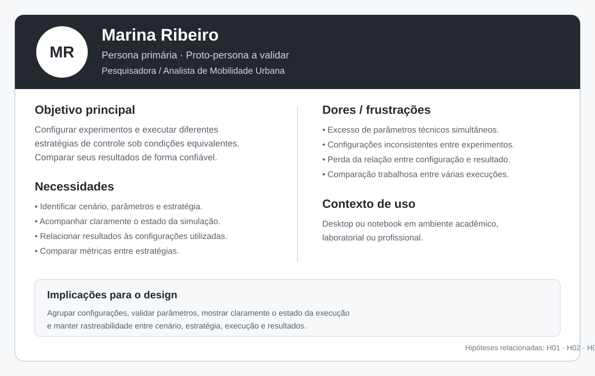
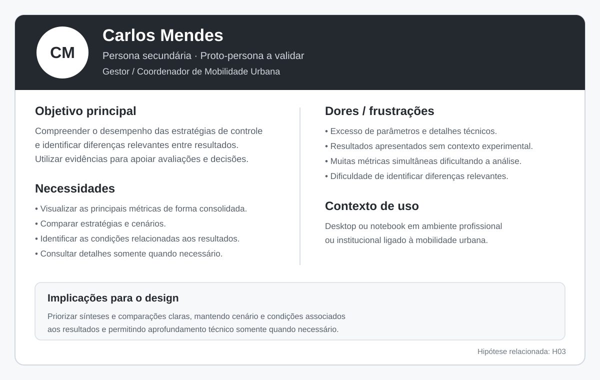

# Entrega 3 — Personas, mapa de empatia, contexto de uso e jornada

**Data:** 02/09/2026  
**Status:** 🟦 revisada após feedback  
**Revisão:** 12/11/2026  
**Responsabilidade:** 1 persona por integrante; 1 mapa de empatia, 1 contexto de uso consolidado e 1 jornada por equipe (salvo orientação diferente do docente).  
## Objetivo da atividade

Representar grupos de usuários de forma útil para decisões de design. Persona não é personagem decorativo: suas características devem alterar requisitos, prioridades, linguagem, fluxos ou critérios de avaliação.

## Atenção a projetos técnicos

Em TCCs sem interface original, a persona pode representar um **profissional que se apropria da contribuição técnica**: DBA, analista, cientista de dados, administrador, pesquisador, técnico, operador, gestor ou especialista de domínio.

Não escolha um perfil apenas porque “parece combinar” com a tecnologia. Explique **qual objetivo esse perfil teria e qual parte da contribuição do TCC produziria valor para ele**. Se ainda for hipótese, mantenha como hipótese/proto-persona a validar.

Também considere papéis diferentes quando houver tarefas distintas, por exemplo:

- operador que executa análises;
- administrador que configura e gerencia permissões;
- especialista que interpreta resultados;
- gestor que consulta relatórios e decide;
- auditor que revisa histórico.

## Continuidade com a Entrega 1 e hipóteses acrescentadas

Antes de criar personas, retome os tipos de usuários, características relevantes, objetivos e hipóteses registradas na Entrega 1. A persona **não deve transformar uma hipótese inicial em fato por meio de uma história fictícia**.
As hipóteses abaixo são descritas por extenso. A versão anterior reutilizava códigos com significados diferentes dos da Entrega 1; a correspondência e o histórico foram preservados na [matriz](../RASTREABILIDADE.md).

| Tema e origem | Status | Evidência disponível | Tratamento nesta entrega |
|---|---|---|---|
| Previsão de demanda e comparação de modelos — Entrega 1, seções 0 e 1 | [F] Proposta registrada pela equipe | README e Entrega 1 | Base técnica; não comprova recomendação de compra implementada |
| Responsável pelo estoque como usuário prioritário — Entrega 1, seção 2 | [H] | Ainda sem pesquisa primária | P01 é uma representação provisória, não validação do perfil |
| Participação de vendas online — refinamento desta entrega | [H] | Recorte construído pela equipe | Investigar ocorrência e integração com o comércio presencial |
| Acúmulo de tarefas e pouco tempo — refinamento do contexto da Entrega 1 | [H] | Sem observação de frequência/duração | Investigar interrupções e retomada |
| Registros distribuídos entre ferramentas — possibilidade da Entrega 1 | [H] | Nenhuma ferramenta da loja confirmada | Investigar caderno, planilha, marketplace e PDV, sem exigir importação |
| Familiaridade com métricas de ML — Entrega 1, seção 2.4 | [H] | Vocabulário do público não pesquisado | Testar linguagem operacional e explicações |
| Controle humano da decisão — refinamento desta entrega | [H] Necessidade; decisão provisória de design | Risco de compra inadequada e distinção entre previsão e decisão | Revisão pelo usuário é proposta própria, não comportamento comprovado nos concorrentes |
| Apoio de auxiliar — refinamento dos papéis possíveis da Entrega 1 | [?]/[H] | Papel separado não confirmado | P02 é primária no recorte operacional proposto; existência do papel e recorrência de uso permanecem hipóteses |
| Pouca familiaridade digital de Mariana — nova hipótese desta entrega | [H] | Perfil construído pela equipe | Não inferir limitação por idade nem generalizar para o público |
| Histórico de previsões — Entrega 1, seção 5.5 | [H] | Necessidade comercial não validada | Investigar consulta posterior; não confundir com avaliação técnica do TCC |

**Limite de escopo:** as menções a sete dias, quantidade sugerida, salvamento de lista, cadastro, permissões e importação representam alternativas de prototipação. O artigo técnico citado na versão anterior não integra as evidências verificadas desta revisão. Horizonte de previsão, dados mínimos e eventual regra de recomendação devem ser confirmados com o orientador. Na ausência de recomendação calculada, a jornada continua possível com estimativa de demanda e quantidade de compra definida por Mariana. As decisões DP01–DP18 são candidatas, sujeitas à investigação e à viabilidade técnica.

## 1. Personas

### Persona P01 — Mariana Alves

**Autor(a):** Paulo Andre de Oliveira Hirata — 22.125.072-3
**Tipo:** primária — persona de expectativa/proto-persona a validar
**Base de construção:** recorte registrado na Entrega 1, referências documentais da Entrega 2 e orientação da equipe para representar uma senhora com pouca experiência tecnológica. Não houve entrevista, questionário ou observação; referências à literatura/artigo do TCC sem fonte anexada não são tratadas como evidência verificada.
**Hipóteses relacionadas:** usuário prioritário, compreensão dos resultados e conhecimento comercial, retomados da Entrega 1; acúmulo de tarefas, registros distribuídos, controle humano e apoio operacional refinados nesta entrega.
**Hipótese acrescentada na construção da persona:** pouca familiaridade digital no perfil de Mariana
**Frase-síntese:** “Conheço meus produtos, mas preciso que o sistema me mostre, com clareza, o que comprar e como confirmar.”

| Campo | Descrição |
|---|---|
| Faixa etária / contexto relevante | Senhora de 65 anos, idade fictícia dentro do recorte de 60 a 70 anos. Tem longa vivência no comércio e passou a incluir vendas online com apoio operacional. A baixa familiaridade digital e a rotina dividida entre atendimento e gestão são os fatores que orientam o design.  |
| Ocupação/papel | Proprietária de um pequeno comércio que também vende pela internet. Conhece os clientes e fornecedores, define as compras e controla o orçamento. Pode contar com Rafael para registros e tarefas digitais, mas continua responsável pela decisão de reposição.  |
| Conhecimento do domínio | Tem experiência prática com produtos, negociação, giro de mercadorias e épocas de maior procura. Reconhece problemas pela observação das prateleiras e pelas anotações. Não costuma expressar esse conhecimento em métricas estatísticas ou relatórios analíticos. |
| Experiência tecnológica | Usa o celular principalmente para ligações, mensagens e áudios. Faz anotações em caderno e utiliza calculadora; tem pouca prática com computador, planilhas, filtros e gráficos. Precisa de orientação no primeiro uso e aprende melhor repetindo um caminho curto com instruções visíveis. |
| Objetivos | Saber o que, quando e quanto comprar; evitar faltar produto ou comprometer o caixa; consultar as recomendações com autonomia crescente; conseguir revisar e confirmar uma lista sem depender de ajuda a cada compra. |
| Necessidades | Orientação inicial passo a passo; poucas opções por vez; nomes de produtos e unidades claros; botões com rótulos como “Ver sugestão” e “Salvar lista”; explicações curtas; ajuda no ponto da dúvida; resumo antes da confirmação e retorno visível após salvar.  |
| Dores/frustrações | Faltar mercadoria ou acumular itens parados; não saber por onde começar em um sistema novo; recear apagar registros ou comprar por engano; perder-se em menus e siglas; não entender um gráfico; precisar pedir ajuda para repetir tarefas simples.  |
| Motivadores | Manter o negócio organizado, preservar a confiança dos clientes, proteger o dinheiro disponível e sentir que consegue usar a ferramenta sem abrir mão de sua experiência e da decisão final. |
| Restrições/acessibilidade | Pouca familiaridade com navegação e termos digitais, insegurança ao experimentar e interrupções no atendimento. A interface deve ter texto legível, bom contraste e áreas de toque confortáveis. Não há evidência de deficiência visual, motora ou cognitiva específica; essas necessidades serão investigadas. |
| Ambiente típico de uso | Balcão ou pequena área administrativa próxima ao estoque, com caderno e calculadora à mão. Usa um celular familiar para consultas simples e pode recorrer ao computador com apoio inicial. Clientes, chamadas e recebimento de mercadorias interrompem a atividade.  |
| Comportamentos relevantes | Confere produtos fisicamente, anota vendas e faltas, pede demonstração antes de usar uma função nova e repete caminhos conhecidos. Prefere ler quantidades e frases curtas; consulta ajuda quando não entende e revisa o resultado antes de confirmar.  |

**Retrato do cotidiano:** Mariana construiu seu conhecimento do estoque trabalhando com os produtos e conversando com clientes e fornecedores. As vendas online ampliaram sua rotina, mas ela ainda se sente mais segura com o caderno e a calculadora. Quer aprender a consultar o sistema do TCC para planejar a reposição; valoriza uma demonstração inicial e indicações claras do próximo passo. Sua autonomia comercial já está estabelecida, enquanto a autonomia no uso da ferramenta precisa ser construída. **[H] Narrativa hipotética sobre pouca familiaridade digital.**

**Propostas de design influenciadas por P01:**

- **DP01:** iniciar por poucos produtos prioritários, com nome, quantidade e aviso textual como “Pode faltar”; combinar texto e símbolos sem depender apenas de cor.
- **DP02:** organizar um caminho curto e consistente: **conferir aviso → entender sugestão → revisar quantidade → salvar lista**. Indicar o próximo passo e manter a opção de voltar.
- **DP03:** mostrar saldo, estimativa de vendas para o horizonte informado (sete dias como exemplo a confirmar), quantidade sugerida somente se houver regra confirmada, e última atualização em frases e unidades compreensíveis; deixar gráficos como complemento opcional.
- **DP04:** usar termos do comércio, como “produto”, “quantidade” e “prazo de entrega”, e explicar palavras novas junto à informação, com exemplos curtos.
- **DP05:** avisar de forma concreta quando faltarem registros: informar qual dado precisa ser conferido e como corrigi-lo ou pedir ajuda.
- **DP06:** apresentar produto e quantidade em um resumo antes de salvar; permitir corrigir ou cancelar e distinguir a lista salva do pedido que será feito ao fornecedor.
- **DP07:** explicar o risco de faltar ou sobrar mercadoria e as limitações da estimativa; permitir confrontar a sugestão com o conhecimento comercial de Mariana.
- **DP08:** oferecer uma visão inicial pronta para uso, com busca por nome e poucos filtros opcionais, sem exigir que Mariana configure a análise para obter uma primeira resposta.
- **DP16:** oferecer orientação passo a passo no primeiro uso e ajuda que possa ser consultada novamente; dispensar tutoriais obrigatórios nas visitas seguintes.
- **DP17:** usar rótulos escritos nos botões, tipografia legível, contraste e áreas de toque confortáveis, evitando ações essenciais acessíveis apenas por ícones ou gestos pouco evidentes.
- **DP18:** confirmar claramente o que foi salvo, preservar o progresso após interrupções e permitir recuperar erros; apresentar mensagens que expliquem a próxima ação sem culpabilizar a usuária.

### Persona P02 — Rafael Costa

**Autor(a):** Victor Merker Binda — 22.125.075-6
**Tipo:** primária no recorte operacional — persona de expectativa/proto-persona a validar
**Base de construção:** hipótese de divisão de trabalho e de necessidade de conferir registros. Módulo de cadastro é possibilidade de solução, não evidência da existência ou frequência desse papel.
**Hipóteses relacionadas:** registros distribuídos, familiaridade com métricas e apoio operacional. O papel auxiliar é um refinamento ainda não validado.
**Frase-síntese:** “Se eu registrar tudo corretamente agora, a decisão de compra não será baseada em um saldo desatualizado depois.”

| Campo | Descrição |
|---|---|
| Idade / contexto relevante | 22 anos, adulto jovem, colaborador de uma operação pequena. O fator relevante é executar várias tarefas operacionais sob interrupção, não sua idade. |
| Ocupação/papel | Auxiliar operacional ou administrativo. Registra produtos e vendas, confere estoque físico, investiga divergências, corrige apenas o que estiver fundamentado e autorizado e comunica itens críticos à proprietária. Não assume sozinho a decisão financeira de compra.  |
| Conhecimento do domínio | Conhece códigos, nomes, variações dos produtos e a rotina de entrada e saída. Pode conhecer menos sobre contratos, caixa e critérios de reposição definidos pela proprietária.  |
| Experiência tecnológica | Tem familiaridade com formulários, busca, marketplace e planilhas. Aprende fluxos operacionais com rapidez, mas não precisa conhecer o funcionamento do modelo preditivo.  |
| Objetivos | Registrar dados sem retrabalho; localizar produtos rapidamente; corrigir erros; terminar a conferência do estoque; informar situações críticas com dados confiáveis.  |
| Necessidades | Busca sempre visível; cadastro curto; importação de planilha quando disponível; validação de campos; mensagens de erro que indiquem como corrigir; confirmação de salvamento; histórico de alterações e permissões adequadas ao papel.  |
| Dores/frustrações | Digitação repetitiva, produtos duplicados, códigos inconsistentes, tela que perde dados após interrupção, erro informado somente no final e dúvida sobre se uma venda alterou o saldo.  |
| Motivadores | Manter a operação organizada, evitar cobranças por divergência de estoque e fornecer uma base confiável para a proprietária decidir.  |
| Restrições/acessibilidade | Pode usar computador compartilhado, realizar a tarefa em blocos curtos e sofrer interrupções por separação de pedidos ou atendimento. Necessidades específicas de acessibilidade ainda são desconhecidas.  |
| Ambiente típico de uso | Bancada administrativa ou área próxima ao armazenamento de produtos, com alternância entre contagem física, embalagem, computador e comunicação por celular.  |
| Comportamentos relevantes | Pesquisa pelo nome ou código, registra atividades em sequência, deixa uma tarefa incompleta quando surge um pedido urgente e precisa retomar do ponto anterior. Confere totais antes de encerrar.  |

**Retrato do cotidiano — narrativa hipotética:** Rafael começou ajudando a separar encomendas e aprendeu com Mariana os nomes, as variações e as unidades comerciais dos produtos. Aos poucos passou a transcrever vendas e conferir o estoque, por ter familiaridade com planilhas e consultas online. Trabalha numa bancada compartilhada, alternando registros no computador, contagem física e embalagem. Quando uma anotação é ambígua, procura sua origem e confirma com quem a escreveu, em vez de substituir o saldo para fazê-lo coincidir. Sua autonomia é operacional: pode propor ou realizar uma correção somente quando houver evidência e autorização; a compra permanece com Mariana. Ao ser interrompido, precisa reconhecer quais registros já verificou e comunicar o que ficou pendente. Quer que seu trabalho tenha um resultado conferível e que a proprietária não interprete um item corrigido como todo o estoque validado. Essa história integra o perfil a uma rotina possível; não é biografia de pessoa entrevistada nem prova da existência do cargo no público.

**Propostas de design influenciadas por P02:**

- **DP09:** oferecer busca por nome, código e categoria e reduzir campos obrigatórios ao mínimo necessário.
- **DP10:** validar formato, duplicidade e consistência durante o preenchimento, mostrando como corrigir o problema.
- **DP11:** confirmar salvamento e atualização do saldo, além de permitir corrigir um registro sem recriar toda a operação.
- **DP12:** preservar rascunhos ou estado do formulário quando houver interrupção.
- **DP13:** separar permissões de cadastro das permissões de confirmação de reposição.
- **DP14:** registrar autor, data e alteração para que divergências possam ser rastreadas.
- **DP15:** permitir importação simples de arquivo, mas manter cadastro manual para negócios sem ERP ou integração com marketplace.

### Síntese das personas

**Mariana (P01)** tem 65 anos, conhece o comércio e decide as compras, mas possui pouca experiência com sistemas digitais. Precisa compreender a recomendação, aprender um caminho simples e ganhar autonomia para usá-lo. **Rafael (P02)** tem maior familiaridade com formulários, planilhas e registros e precisa de rapidez, prevenção de erros, retomada e rastreabilidade. Quando presente, pode apoiar a configuração inicial e os cadastros, sem assumir a decisão financeira de Mariana. A diferença entre as personas está nas tarefas, no conhecimento e na experiência tecnológica, além da idade.

**Classificação e justificativa do conjunto:** as duas personas são primárias no recorte de IHC proposto: P01 orienta a decisão comercial e P02 orienta a conferência operacional. A revisão de P02 não decorre de sua influência indireta na previsão: ela decorre da hipótese de que Rafael utiliza diretamente e de forma recorrente a interface para atingir seu próprio objetivo de conferir e registrar um desfecho rastreável, representado por T02 na E5. A recorrência é esperada quando surgem registros e divergências, mas sua frequência não foi medida. P01 utiliza a análise a cada ciclo de reposição, também com frequência ainda não medida.

| Persona primária | Objetivo próprio e uso direto previsto | Por que exige atenção específica do design |
|---|---|---|
| P01 — Mariana | Interpretar disponibilidade e estimativa, ponderar prazo/recursos e registrar uma decisão de reposição (T01) | Precisa de linguagem comercial, aprendizagem e revisão; uma interface centrada apenas em lançamentos não apoia sua decisão |
| P02 — Rafael | Localizar a origem de divergências e registrar correção autorizada ou pendência, comunicando o alcance (T02) | Precisa de vínculo com fontes, identificação de unidade, retomada e histórico; uma interface centrada apenas na previsão não permite conferir os dados |

Há, portanto, duas personas primárias e nenhuma secundária nesta composição. A classificação é uma decisão de projeto sustentada por objetivos distintos e pelos modelos de tarefas, **não uma validação empírica do público**. P01 continua como foco da jornada e da decisão de compra; isso não torna P02 secundária. Antes de consolidar permissões, importação ou papéis separados, investigar se o auxiliar existe e realiza esse uso direto. Se o proprietário acumular as atividades, adaptar os papéis e os modelos ao arranjo observado, sem criar outro cargo ou persona apenas para manter a contagem.

## 2. Mapa de empatia — equipe

**Persona escolhida:** P01 — Mariana Alves
**Justificativa:** é a principal beneficiária da contribuição do TCC e toma a decisão de compra. O perfil de uma comerciante de 65 anos com pouca familiaridade digital permite explorar como tornar as recomendações compreensíveis e favorecer a autonomia. O mapa aprofunda sua relação cotidiana com o problema e com a tecnologia, permanecendo hipotético até a validação com pessoas reais.

O mapa segue a organização do modelo fornecido pelo professor: pensa e sente acima da persona, ouve à esquerda, vê à direita, fala e faz abaixo e, na base, dores e necessidades. A idade de 65 anos corresponde ao perfil fictício definido nesta revisão; as falas, influências, sentimentos e comportamentos são hipóteses, não depoimentos coletados.

| Dimensão | Descrição | Natureza da informação | Consequência para o design |
|---|---|---|---|
| O que pensa e sente | Receia faltar produto ou comprar demais; teme clicar no lugar errado; confia no que aprendeu no comércio e quer usar o sistema com autonomia. | Sentimentos e aspirações hipotéticos, relacionados às hipóteses de controle humano e pouca familiaridade digital. | Explicar cada ação, oferecer revisão e correção e valorizar o conhecimento de Mariana na decisão. |
| O que ouve | Clientes perguntando por mercadorias, fornecedores informando prazos, orientações de quem ajuda no sistema, conselhos de outros comerciantes e áudios com pedidos no celular. | Influências e canais de comunicação hipotéticos; [H] acúmulo de tarefas; apoio operacional; pouca familiaridade digital. | Aproximar a linguagem do cotidiano e oferecer ajuda fácil de consultar durante a tarefa. |
| O que vê | Caderno com registros de vendas, produtos nas prateleiras, pedidos em mensagens, telas com menus e termos pouco familiares e pessoas mais habituadas ao digital ajudando a operação. | Ambiente cotidiano hipotético; [H] registros distribuídos; apoio operacional; pouca familiaridade digital. | Usar nomes e quantidades explícitos, organização previsível e poucas escolhas por vez. |
| O que fala e faz | “Mostre como faço, que quero aprender.” Anota vendas e faltas no caderno, confere fisicamente os produtos, pede demonstração de funções novas e revisa a quantidade antes de decidir. | Frase ilustrativa e comportamentos hipotéticos; [H] registros distribuídos; controle humano da decisão; pouca familiaridade digital. | Oferecer primeiro uso guiado, retomada da ajuda e resumo antes da confirmação. |
| Dores | Faltar produto ou deixar dinheiro parado; perder-se em menus e termos técnicos; recear apagar dados ou comprar por engano; depender de ajuda em tarefas simples. | Problemas propostos para esta persona; [H] usuário prioritário; familiaridade com métricas; pouca familiaridade digital, sem observação direta. | Prevenir erros, permitir desfazer/corrigir e apresentar instruções curtas e visíveis. |
| Necessidades | Saber o que, quando e quanto repor; compreender cada passo e a sugestão; corrigir erros e confirmar com segurança; ganhar autonomia e acompanhar o resultado da compra. | [H] Necessidades de apoio à decisão, controle humano e aprendizagem; a validar. Recomendação calculada depende de confirmação técnica. | Tornar a recomendação compreensível, apoiar o aprendizado e facilitar a consulta posterior. |

## 3. Contexto de uso — consolidação

| Dimensão | Contexto de uso hipotético |
|---|---|
| Usuários | P01, Mariana, 65 anos, comerciante experiente e iniciante no uso de sistemas; P02, possível auxiliar com maior familiaridade digital, responsável por cadastros e conferências. Ambos são personas de expectativa. |
| Tarefas | Com apoio inicial quando necessário, cadastrar produtos e vendas ou importar registros; conferir saldo; consultar prioridades; entender a sugestão; revisar quantidades; salvar uma lista; contatar o fornecedor e acompanhar a reposição. |
| Equipamentos | Celular familiar para mensagens e consultas simples; caderno e calculadora para conferência; computador compartilhado para cadastros, com apoio quando necessário. Planilha/CSV pode ser preparada por Rafael. **[H: registros distribuídos; apoio operacional; pouca familiaridade digital]** |
| Ambiente físico | Casa, escritório pequeno ou área administrativa junto ao estoque, com ruído, circulação, separação de pedidos e interrupções. **[H]** |
| Ambiente social/organizacional | Mariana alterna atendimento e gestão e pode solicitar ajuda a Rafael no primeiro uso ou em cadastros. Sua experiência comercial orienta a decisão final. A disponibilidade desse apoio varia e precisa ser investigada. **[H: acúmulo de tarefas; apoio operacional; pouca familiaridade digital]** |
| Papéis/permissões/governança | P01 pode cadastrar, analisar, ajustar e confirmar a reposição. P02 pode cadastrar e corrigir registros, mas a confirmação financeira permanece com P01. **[H]** |
| Volume de dados/histórico | Catálogo com diversos produtos, ritmos de venda diferentes e possibilidade de itens com menos de 30 dias ou histórico esparso. [H] Sete dias é um horizonte ilustrativo para a jornada; horizonte real e suficiência do histórico dependem de confirmação técnica. |

### Narrativa consolidada do contexto

Mariana, 65 anos, reserva alguns minutos entre o atendimento e o contato com fornecedores para conferir o caderno e observar o estoque. Seu negócio também recebe pedidos pela internet, com apoio operacional quando necessário. Ela usa ligações e mensagens no celular com mais segurança do que planilhas ou sistemas de gestão. Ao perceber que um item está acabando, quer decidir a compra sem comprometer o dinheiro disponível, mas pode hesitar diante de menus ou comandos desconhecidos.

[H] Na rotina considerada, Mariana consulta anotações e pode pedir a Rafael que reúna registros digitais. A disponibilidade desse apoio varia. O contexto não pressupõe aplicação web, tutoriais, importação ou gravação automática: esses recursos pertencem às alternativas de solução. As decisões comerciais podem continuar fora do sistema, em ligações e mensagens com fornecedores. A existência das ferramentas e a divisão de trabalho precisam de investigação.

### Implicações de design derivadas do contexto

As propostas abaixo são consequências a investigar e prototipar, separadas da descrição do contexto. Não são características observadas nem requisitos já validados.

| Origem no contexto | Implicação de design proposta, a validar |
|---|---|
| Usuários | Oferecer uma consulta guiada e compreensível a P01, mantendo um fluxo eficiente de registro para P02. |
| Tarefas | Separar preparação dos dados da decisão comercial e permitir que Mariana repita a consulta com autonomia crescente. |
| Equipamentos | Criar uma aplicação web responsiva, com texto legível, rótulos claros e poucas ações por etapa; deixar a importação como alternativa, sem exigir domínio de planilhas. |
| Ambiente físico | Salvar progresso, confirmar ações, manter o estado da análise e evitar tarefas longas sem retorno intermediário. |
| Ambiente social/organizacional | Tornar a ajuda acessível e a operação repetível; mostrar responsável e data dos dados e manter a decisão de compra com Mariana. |
| Papéis/permissões/governança | Investigar se existem papéis distintos antes de propor controle de acesso; avaliar histórico e confirmação conforme tarefas reais. |
| Volume de dados/histórico | Priorizar por exceção, permitir busca/filtros, informar insuficiência do histórico e não ocultar a maior incerteza dos itens novos ou irregulares. |

## 4. Jornada do usuário — equipe

**Persona:** P01 — Mariana Alves
**Objetivo da jornada:** apoiar Mariana, uma comerciante de 65 anos com pouca experiência tecnológica, a aprender uma consulta simples e decidir o que, quando e quanto repor, com controle financeiro e autonomia crescente.
**Início e fim da jornada:** começa **antes do uso**, quando vendas, mensagens de clientes ou o prazo do fornecedor despertam a preocupação com falta ou excesso; termina **depois do uso**, quando Mariana acompanha a chegada e as vendas posteriores para avaliar o resultado da decisão.

| Etapa | Situação/ação | Objetivo | Pensamento/emoção | Dor | Oportunidade de design | Evidência |
|---|---|---|---|---|---|---|
| 1 — Rotina anterior ao uso | Mariana atende clientes, recebe pedidos por mensagens e anota vendas e faltas no caderno. Confere as prateleiras e usa a calculadora para estimar uma compra. | Manter o negócio funcionando e perceber quais produtos precisam de atenção. | “Conheço o movimento, mas preciso conferir o que está acabando.” Confiança no comércio e atenção dividida. | Registros espalhados entre caderno, mensagens e contagem física. | Aproveitar a linguagem conhecida e facilitar o registro dos dados que alimentarão a recomendação. | **[H] acúmulo de tarefas; registros distribuídos; pouca familiaridade digital — rotina proposta, a validar.** |
| 2 — Motivação e gatilho | Um cliente procura um item quase esgotado e o fornecedor avisa o prazo para receber o próximo pedido. Mariana decide experimentar a consulta no sistema do TCC para planejar melhor a compra. | Evitar a falta sem prender dinheiro em mercadoria parada. | “Quero uma ajuda para comprar certo, mas será que vou saber usar?” Interesse acompanhado de insegurança digital. | Pressão do prazo e receio de uma ferramenta desconhecida. | Deixar claros o benefício e o ponto de partida, com orientação curta e ajuda visível. | **[H] apoio à decisão com previsão (recomendação calculada a confirmar); controle humano da decisão; pouca familiaridade digital**; sentimentos e gatilho são hipotéticos. |
| 3 — Preparação e primeiro uso | Mariana reúne suas anotações e confere produtos, saldo e prazos. Recebe orientação no cadastro e, quando Rafael está disponível, ele apoia a digitação ou importação dos registros. Ela acompanha o processo e identifica informações incorretas. | Começar com dados confiáveis e entender como consultar o resultado. | “Mostre o caminho uma vez para eu conseguir repetir.” Cautela e disposição para aprender. | Pouca prática com formulários e planilhas; dependência de explicações no início. | Oferecer cadastro guiado, exemplos nos campos, mensagens de correção e indicação da última atualização; manter importação opcional. | **[H] registros distribuídos; apoio operacional; pouca familiaridade digital**; disponibilidade de apoio a investigar. |
| 4 — Consulta das prioridades | Com o caminho demonstrado, Mariana consulta uma lista curta de produtos, identificados por nome e aviso escrito, como “Pode faltar”. Pode voltar à ajuda sem perder o que estava fazendo. | Identificar em quais produtos deve agir primeiro e conseguir repetir a consulta. | “Agora sei onde olhar primeiro.” Alívio, ainda conferindo se seguiu o caminho certo. | Muitos menus, ícones sem rótulo ou filtros obrigatórios podem dificultar a tarefa. | Mostrar uma visão inicial pronta, botões com texto, navegação consistente e poucos passos. | **[H] familiaridade com métricas; pouca familiaridade digital**; adaptação proposta para a interface do TCC. |
| 5 — Compreensão da sugestão | Mariana lê o saldo, a estimativa de vendas para um horizonte informado e, se essa capacidade for confirmada, a quantidade sugerida; caso contrário, ela define a quantidade de compra. Uma explicação curta relaciona os valores ao prazo de entrega; ela compara a sugestão com o que conhece dos produtos e pede ajuda se necessário. | Entender o motivo da reposição antes de decidir. | “Essa quantidade faz sentido para o meu movimento?” Usa sua experiência comercial para conferir. | Termos técnicos, números sem unidade e gráficos como única forma de explicação. | Priorizar frases e quantidades; manter gráficos opcionais, explicar limitações e oferecer ajuda junto ao dado. | **[H] apoio à decisão com previsão (recomendação calculada a confirmar); familiaridade com métricas; controle humano da decisão; pouca familiaridade digital**. |
| 6 — Decisão e ação | Mariana considera o caixa e o prazo do fornecedor, revisa a quantidade e lê um resumo antes de salvar a lista. Confere a mensagem de sucesso e faz o pedido por ligação ou mensagem, como já está acostumada. | Decidir com segurança, sabendo o que foi salvo e o que ainda precisa fazer. | “Posso conferir antes; salvar a lista ainda não faz a compra.” Maior segurança. | Medo de clicar errado, apagar dados ou enviar um pedido sem querer. | Permitir corrigir e cancelar, rotular claramente a confirmação e distinguir “lista salva” de “pedido feito ao fornecedor”. | **[H] controle humano da decisão; pouca familiaridade digital**; confirmação humana e rótulos são decisões de design. |
| 7 — Retomada da rotina | Um atendimento interrompe Mariana. Ao voltar, ela encontra a lista salva no mesmo lugar e confere o que combinou com o fornecedor, sem precisar repetir todo o processo. | Continuar a operação sem perder o trabalho e retomar o caminho aprendido. | “A lista continua aqui; consigo conferir de novo.” Confiança gradual. | Esquecer em qual etapa parou ou não saber se a ação foi concluída. | Preservar progresso, indicar o estado da lista e oferecer acesso previsível às consultas anteriores. | **[H] acúmulo de tarefas; pouca familiaridade digital**. |
| 8 — Resultado posterior | Quando a mercadoria chega, Mariana compara a entrega com a lista e registra a entrada com ajuda, se necessário. Nos dias seguintes, acompanha vendas, faltas e sobras em um resumo simples; na próxima compra, tenta repetir a consulta com menos apoio. | Avaliar a reposição e sua autonomia para utilizar a ferramenta no cotidiano. | “Consegui conferir a compra. A quantidade foi suficiente? Já sei fazer a próxima consulta?” Satisfação ou identificação de dúvidas restantes. | Dificuldade para interpretar o resultado ou lembrar os passos após um intervalo. | Mostrar previsto e vendido em quantidades e frases, permitir consultar o histórico e repetir a ajuda inicial. | **[H] apoio à decisão com previsão (recomendação calculada a confirmar); pouca familiaridade digital**; ganhos de estoque e autonomia são resultados esperados, ainda não medidos. |

> A jornada descreve a atividade cotidiana completa e não uma sequência de telas. O produto do TCC aparece como apoio no centro da jornada; a motivação surge antes da abertura do sistema e o resultado somente pode ser avaliado depois da decisão e da reposição.

## Síntese

As próximas entregas devem preservar a distinção entre hipótese e evidência. As seguintes orientações de design são candidatas a validação:

- o objetivo de identificar **o que, quando e quanto repor**;
- a motivação anterior ao uso, ligada a risco de falta, excesso, prazo do fornecedor e limitação de caixa;
- a priorização de poucos produtos críticos, sem obrigar a revisão de todo o catálogo;
- a verificação da qualidade, suficiência e data de atualização dos dados;
- a explicação da previsão em linguagem operacional, sem apresentar o modelo como infalível;
- o primeiro uso guiado, a ajuda fácil de reencontrar e o aprendizado de um caminho curto que Mariana consiga repetir;
- a apresentação de quantidades e explicações textuais sem depender da interpretação de gráficos;
- botões com rótulos escritos, boa legibilidade e confirmação clara do que foi salvo, com possibilidade de correção;
- a comparação entre saldo, histórico e demanda prevista; quantidade recomendada somente se a capacidade for confirmada;
- a revisão e confirmação humana antes de transformar a recomendação em compra;
- a retomada após interrupções e a rastreabilidade de cadastros e decisões;
- o acompanhamento posterior do resultado, comparando previsto e realizado e observando ruptura e excesso;
- a validação futura de P01, P02, mapa de empatia, contexto e jornada com microempreendedores reais.

## Checklist

- [x] Existe pelo menos uma persona por integrante.
- [x] As personas não são apenas diferenças demográficas superficiais.
- [x] Está claro o que é dado real e o que é hipótese/proto-persona.
- [x] A persona não “validou por ficção” uma hipótese da Entrega 1; afirmações continuam marcadas como hipótese quando não há evidência.
- [x] Objetivos e dores têm consequência para o design.
- [x] Contexto de uso está coerente com a Entrega 1.
- [x] Em TCC sem interface original, a persona possui relação explícita com a contribuição técnica.
- [x] Papéis administrativos, técnicos e decisórios só foram criados quando possuem objetivos/tarefas diferentes.
- [x] Jornada possui etapas, dores e oportunidades e não é apenas wireflow.
- [x] IDs das personas foram adicionados à rastreabilidade.

**Revisão de 12/11/2026:** classificação fundamentada de P02, narrativa biográfica hipotética, separação entre contexto e solução e três artefatos SVG locais coerentes com o texto. A conclusão refere-se à entrega documental; pesquisa primária e confirmação do escopo continuam pendentes.
