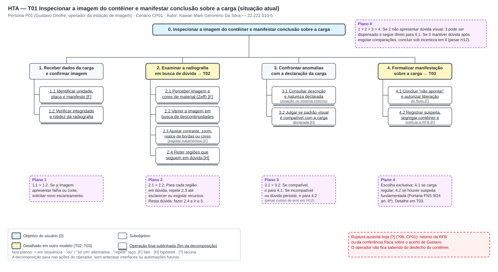
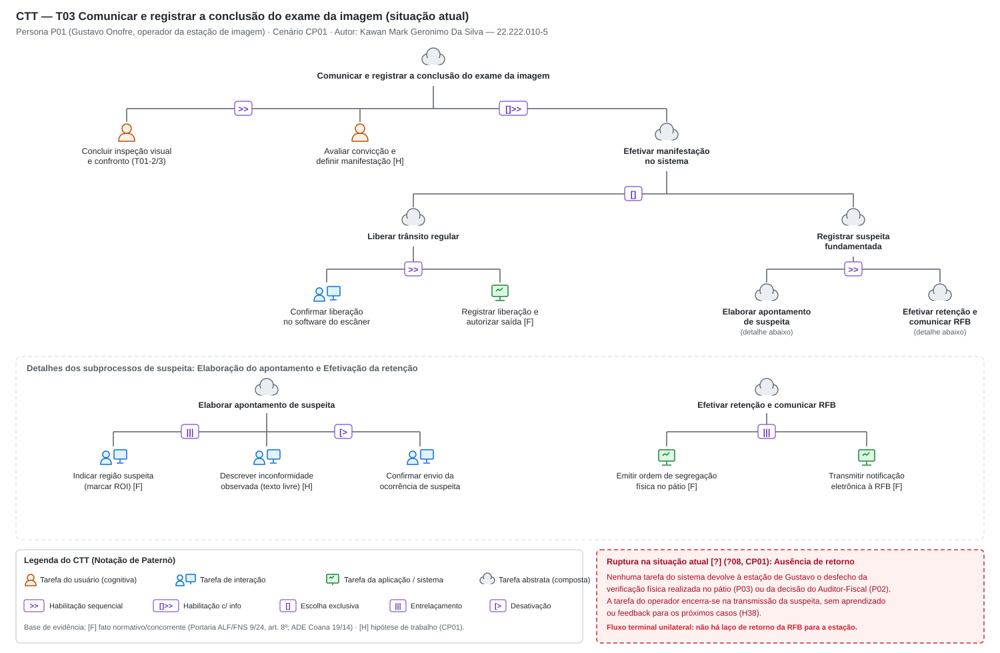
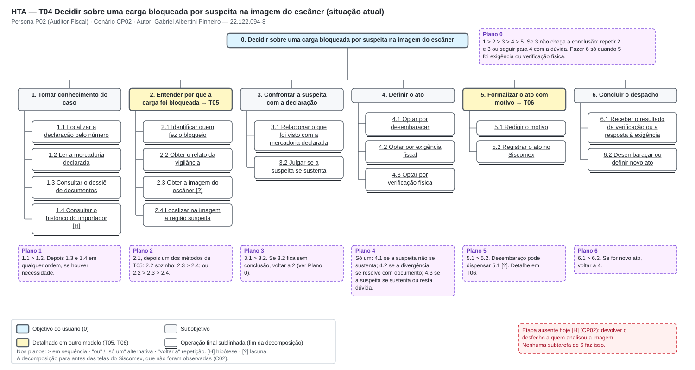
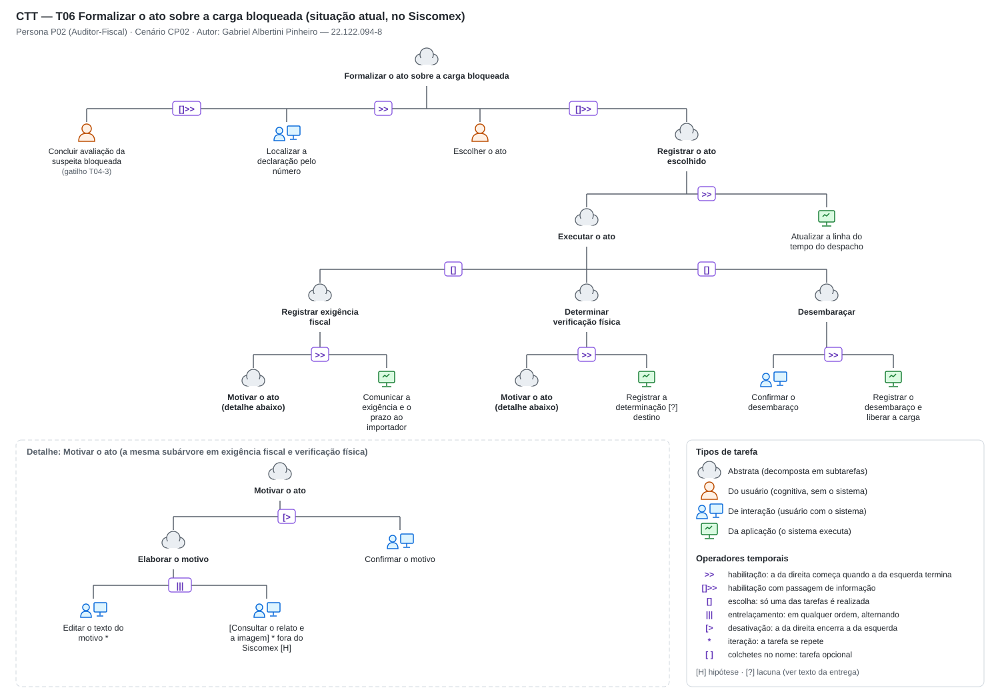
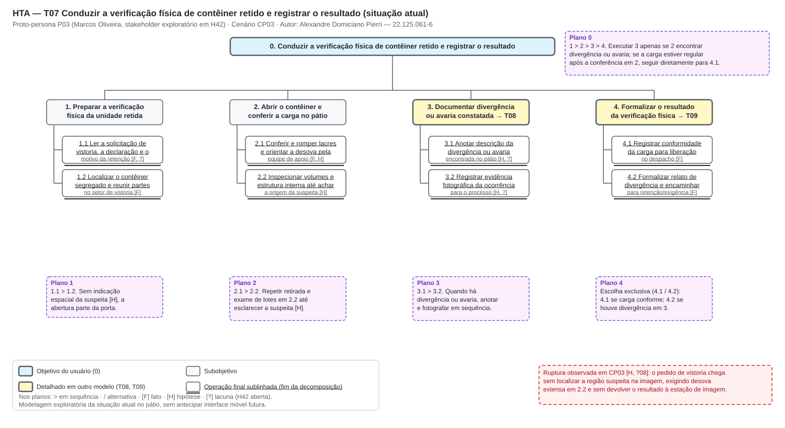
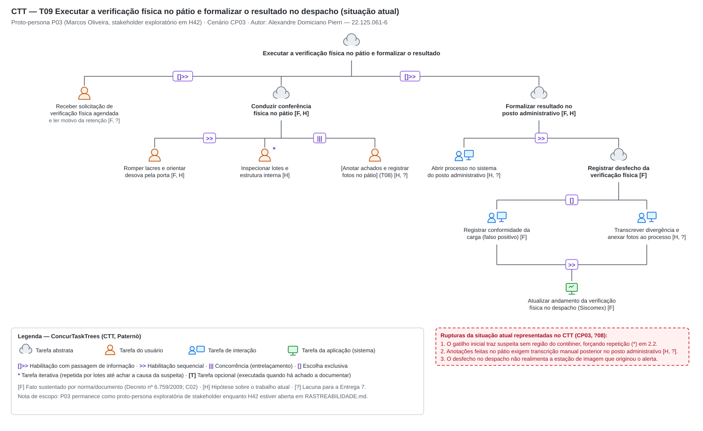

# Entrega 5 — Análise de tarefas: HTA, GOMS e CTT

**Data:** 22/10/2026 (versão original)
**Revisão:** 15/11/2026, aplicação do [feedback do professor](../feedbacks_professor/Feedback_Professor_Entrega05_Equipe09.md)
**Status:** 🟦 revisada após feedback
**Responsabilidade:** cada integrante modela pelo menos 1 HTA, 1 GOMS e 1 CTT. As três técnicas podem abordar a mesma funcionalidade ou funcionalidades distintas, conforme a orientação da disciplina.

## Objetivo da atividade

Modelar tarefas importantes sob perspectivas complementares: decomposição hierárquica (HTA), estrutura de metas/métodos/operações (GOMS) e relações temporais entre tarefas (CTT). O diagrama deve ser acompanhado de interpretação textual.

## Para projetos cujo TCC não previa interface

Modele **tarefas humanas relacionadas ao uso da contribuição técnica**, e não a implementação interna do algoritmo. Exemplos de boas tarefas para análise:

- investigar uma consulta de baixo desempenho;
- configurar uma análise e selecionar parâmetros;
- submeter um dataset e verificar sua validade;
- acompanhar uma execução demorada;
- comparar dois resultados/modelos;
- interpretar uma recomendação e decidir se a aceita;
- localizar uma execução anterior usando busca/filtros;
- gerar e compartilhar um relatório;
- administrar papéis/permissões quando isso for parte do trabalho real;
- revisar um alerta e registrar uma decisão.

Um CRUD pode gerar tarefas relevantes, mas “cadastrar usuário” só merece modelagem se tiver significado no domínio (papéis, validações, riscos, permissões, dependências).

## Seleção das tarefas

Cada integrante modela três tarefas, uma por técnica. A numeração segue a ordem dos autores na equipe, como nos cenários da Entrega 4: T01 a T03 para Kawan, T04 a T06 para Gabriel e T07 a T09 para Alexandre.

| ID | Tarefa | Persona/cenário de origem | Frequência/criticidade | Autor responsável |
|---|---|---|---|---|
| T01 | Inspecionar a imagem do contêiner e manifestar conclusão sobre a carga (HTA) | P01 / CP01 | [F] Contínua (fluxo de escaneamento na entrada do terminal, Portaria RFB nº 143/2022). [H] Alta criticidade: o erro pode liberar ilícito ou causar retenção injustificada (H12). | Kawan Mark Geronimo Da Silva |
| T02 | Examinar a imagem de um contêiner e concluir se há motivo para apontar suspeita (GOMS) | P01 / CP01, subobjetivo 2 de T01 | [H] Alta / Crítica: repete a cada contêiner (H05) e o erro tem custo nos dois sentidos (H12) | Kawan Mark Geronimo Da Silva |
| T03 | Comunicar e registrar a conclusão do exame da imagem (CTT) | P01 / CP01, subobjetivo 4 de T01 | [F] Ocorre a cada contêiner examinado. [F] O apontamento retém e segrega a carga por até 3 dias úteis perante a RFB (Portaria ALF/FNS nº 9/2024, art. 8º). | Kawan Mark Geronimo Da Silva |
| T04 | Decidir sobre uma carga bloqueada por suspeita na imagem do escâner (HTA) | P02 / CP02 | `[?]` Frequência desconhecida (CP02, Q9). `[H08]` Criticidade alta: o erro libera carga ilícita ou retém carga regular | Gabriel Albertini Pinheiro |
| T05 | Entender por que a carga foi bloqueada (GOMS) | P02 / CP02, subobjetivo 2 de T04 | Ocorre em todo caso de T04. `[H]` É onde o cenário mostra a maior perda de informação | Gabriel Albertini Pinheiro |
| T06 | Formalizar o ato sobre a carga bloqueada (CTT) | P02 / CP02, subobjetivo 5 de T04 | Ocorre em todo caso de T04. `[F]` O ato tem valor jurídico e é registrado no Siscomex (C02) | Gabriel Albertini Pinheiro |
| T07 | Conduzir a verificação física de contêiner retido e registrar o resultado (HTA) | P03 (stakeholder exploratório em H42) / CP03 | `[?]` Frequência dependente do volume de retenções. `[H]` Alta criticidade operacional na ponta física quando a suspeita chega sem localização espacial (?08) | Alexandre Domiciano Pierri |
| T08 | Documentar e comunicar divergência ou achado na verificação física (GOMS) | P03 (stakeholder exploratório em H42) / CP03, subobjetivo 3 de T07 | `[H, ?]` Ocorre quando há divergência ou necessidade de documentar a causa física da suspeita no pátio | Alexandre Domiciano Pierri |
| T09 | Executar a verificação física no pátio e formalizar o resultado no despacho (CTT) | P03 (stakeholder exploratório em H42) / CP03, subobjetivo 4 de T07 | `[F]` O resultado formaliza a conferência física no despacho (C02). `[H]` Papel direto na interface condicionado a H42 | Alexandre Domiciano Pierri |

> Priorize tarefas necessárias para que o usuário alcance objetivos centrais. Não desperdice a modelagem em ações triviais isoladas, como “clicar em login”, se o objetivo relevante é maior. Da mesma forma, não modele o funcionamento interno do algoritmo como se fosse uma tarefa humana.

---

## Kawan — T01 a T03

As três tarefas partem do cenário de problema CP01 (Entrega 4) e da persona primária P01 (Gustavo Onofre), abordando a atividade de inspeção não intrusiva de contêineres na estação de análise do terminal portuário. O HTA (T01) cobre a tarefa macro do operador: receber os dados, examinar a radiografia, confrontar com a carga declarada e manifestar a conclusão. O GOMS (T02) e o CTT (T03) aprofundam os dois subobjetivos críticos em que o cenário evidencia as maiores dificuldades cognitivas e operacionais: o exame visual minucioso na estação do fabricante (T02) e a formalização/comunicação da conclusão à autoridade aduaneira (T03).

**Situação atual, não a solução.** Os modelos descrevem estritamente o trabalho como é realizado hoje, utilizando os recursos dos softwares dos fabricantes do escâner (C01, C03) e os procedimentos normativos vigentes (Portaria ALF/FNS nº 9/2024, Portaria RFB nº 143/2022, ADE Coana nº 19/2014), sem antecipar telas da disciplina nem bounding boxes da IA.

**Base de evidência.** P01 é persona primária do projeto. Como nenhum operador de escâner foi entrevistado diretamente até o momento, a estrutura das tarefas fundamenta-se nas especificações técnicas de estações de inspeção (C01, C03), em normas da Receita Federal e na literatura técnica de triagem radiográfica. As etapas e operações estão identificadas com fatos `[F]`, hipóteses de trabalho `[H]` ou lacunas `[?]` a averiguar na Entrega 7.

### HTA — T01 Inspecionar a imagem do contêiner e manifestar conclusão sobre a carga

**Autor(a):** Kawan Mark Geronimo Da Silva — 22.222.010-5

#### Descrição da tarefa

- **Objetivo:** Inspecionar a imagem radiográfica de um contêiner gerada pelo escâner e manifestar formalmente uma conclusão sobre a regularidade da carga (não apontar suspeita e liberar o fluxo do veículo, ou apontar suspeita fundamentada e segregar a unidade para a Receita Federal).
- **Ponto de início:** Disponibilização da radiografia na estação após a passagem do caminhão pelo portal de escaneamento. `[F]` As imagens são transmitidas em tempo real pelo recinto (Portaria RFB nº 143/2022, art. 14).
- **Conclusão esperada:** Conclusão formalizada e registrada no sistema da estação/terminal, permitindo o prosseguimento da viagem do veículo ou a retenção física e segregação da carga com notificação à Receita Federal (Portaria ALF/FNS nº 9/2024, art. 8º).
- **Contexto:** Estação de análise de imagens do terminal alfandegado (recinto), em monitor dedicado de 22" a 24" (C03). Gustavo opera sob fluxo contínuo de veículos, em plantão com pressão de tempo para evitar formação de filas no gate (CP01, H10, H13).

#### Diagrama

*Figura 1 — HTA da tarefa T01, situação atual. Fonte: elaboração do autor a partir do cenário CP01, das análises de mercado C01/C03 e das normas aduaneiras.*

#### Decomposição e planos

| ID | Objetivo/operação | Plano/ordem | Problema ou decisão de design observada |
|---|---|---|---|
| 0 | Inspecionar a imagem do contêiner e manifestar conclusão sobre a carga | **Input:** radiografia disponível na estação após a passagem do veículo pelo escâner e dados de identificação da unidade de carga `[F]` (Portaria RFB nº 143/2022, art. 14). **Feedback:** confirmação do registro da manifestação na estação, liberando o fluxo do veículo ou iniciando a retenção com segregação física e notificação à RFB `[F]` (Portaria ALF/FNS nº 9/2024, art. 8º). **Plano 0:** 1 > 2 > 3 > 4. Se 2 não apresentar dúvida visual: 3 pode ser dispensado e segue direto para 4.1. Se 3 mantiver dúvida após esgotar comparações, concluir sob incerteza em 4 (pesar custos de H12) | O operador trabalha sob incerteza (H38). Se liberar com dúvida, há risco de evasão ilícita; se reter sem fundamento, gera atrito e bloqueia o pátio por até 3 dias úteis (H12, Portaria ALF/FNS nº 9/2024) |
| 1 | Receber dados da carga e confirmar imagem | 1.1 > 1.2. Se a imagem apresentar falha de captura ou corte, solicitar novo escaneamento | `[F]` O fluxo de entrada exige passagem pelo portal (Portaria RFB nº 143/2022). Os dados de manifesto nem sempre estão integrados na mesma tela da estação (H11) |
| 1.1 | Identificar unidade, placa e manifesto | — | `[F]` Número do contêiner e placa são indexadores legais de busca e conferência (Portaria ALF/FNS nº 9/2024, art. 5º) |
| 1.2 | Verificar integridade e nitidez da radiografia | — | Falhas na varredura mecânica do escâner podem exigir reescaneamento imediato antes da liberação do caminhão do portal |
| 2 | Examinar a radiografia em busca de dúvida → T02 | 2.1 > 2.2. Para cada região em dúvida, repetir 2.3 até esclarecer ou esgotar recursos. Se restar dúvida, fazer 2.4 e ir a 3 | Detalhado no GOMS T02. O software do fabricante não indica onde olhar; a varredura depende integralmente de atenção visual sustentada, sujeita a fadiga (H10, H13) |
| 2.1 | Perceber imagem e cores de material (Zeff) | — | `[F]` Classificação de materiais orgânicos, inorgânicos e metais por diferenciação de número atômico efetivo (C01, C03, ADE Coana nº 19/2014) |
| 2.2 | Varrer a imagem em busca de descontinuidades | — | Inspeção visual sem direcionamento automático de foco, consumindo tempo em áreas homogêneas da carga |
| 2.3 | Ajustar contraste, zoom, realce de bordas ou cores | — | `[F]` Recursos manuais previstos no software (ADE Coana nº 19/2014, item 1.2.8). O laço não possui critério objetivo de parada (H16) |
| 2.4 | Reter regiões que seguem em dúvida | — | `[H]` Esforço de memória do operador para manter as coordenadas visuais das áreas anômalas antes de checar a declaração |
| 3 | Confrontar anomalias com a declaração da carga | 3.1 > 3.2. Se compatível, ir para 4.1. Se incompatível ou dúvida persistir, ir para 4.2 (pesar custos de erro em H12) | O operador confronta a densidade observada com o conteúdo esperado. Dúvidas sutis exigem conhecimento empírico do tipo de embalagem e arranjo da carga (H11) |
| 3.1 | Consultar descrição e natureza declarada | — | `[F]` Campo de produtos no software (C03) ou consulta manual em outro sistema `[H]` (M2 vs M3 de T02) |
| 3.2 | Julgar se padrão visual é compatível com a carga declarada | — | Operação cognitiva complexa. Dificuldade em distinguir alterações legítimas de densidade (como madeira tratada) de objetos ocultos |
| 4 | Formalizar manifestação sobre a carga → T03 | Escolha exclusiva: 4.1 se carga regular; 4.2 se houver suspeita fundamentada (Portaria ALF/FNS nº 9/2024, art. 8º) | Detalhado no CTT T03. A retenção interrompe a logística e inicia procedimento formal perante a Receita Federal |
| 4.1 | Concluir "não apontar" e autorizar liberação do fluxo | — | `[F]` Permite o desengate ou a saída imediata do veículo do recinto aduaneiro |
| 4.2 | Registrar suspeita, segregar contêiner e notificar a RFB | — | `[F]` Procedimento de contenção obrigatório. A carga vai para área segregada no pátio e aguarda manifestação da RFB por até 3 dias úteis |

**Critério de parada.** A decomposição foi interrompida em operações que representam ações de trabalho completas e reconhecíveis pelo operador de raio-X (perceber cores Zeff, aplicar tratamentos de imagem, confrontar com declaração, registrar conclusão). Não desceu a eventos de nível motor elementar (como cliques em botões específicos da interface do fabricante), porque esses aspectos variam entre fornecedores e não foram observados in loco (lacuna reservada à Entrega 7). Pelo critério de probabilidade versus custo do HTA, as falhas com maior impacto ocorrem no exame visual (subobjetivo 2, detalhado em T02) e na comunicação/formalização da suspeita (subobjetivo 4, detalhado em T03).

**Verificação do HTA:**

- *O objetivo 0 representa uma meta do usuário?* Sim. Inspecionar a imagem e manifestar uma conclusão técnica é a meta de trabalho central de Gustavo (P01) e da atividade A02/A03.
- *As subtarefas são necessárias e suficientes?* Sim. Cobrem todo o ciclo operacional narrado em CP01 e fundamentado nas normas portuárias: entrada da imagem (1), análise da radiografia (2), confronto documental (3) e despacho operacional (4).
- *Os planos indicam ordem, alternativa, repetição ou condição?* Sim. O Plano 0 combina sequência, desvio condicional e critério sob incerteza; o Plano 1 é sequencial com tratamento de exceção; o Plano 2 possui laço de repetição com condição de parada; o Plano 3 prevê ramificação conforme compatibilidade; e o Plano 4 expressa escolha mutuamente exclusiva.
- *A decomposição parou em nível útil para projeto de interação?* Sim. As operações finais (`1.1`, `1.2`, `2.1`, `2.2`, `2.3`, `2.4`, `3.1`, `3.2`, `4.1` e `4.2`) estão sublinhadas no diagrama `hta_t01.svg` para indicar o fim da decomposição. A análise evidencia os gargalos de atenção visual não assistida (subobjetivo 2) e a fricção no registro formal de suspeitas (subobjetivo 4), fornecendo os requisitos exatos para o projeto da interface de IHC.

### GOMS — T02 Examinar a imagem de um contêiner e concluir se há motivo para apontar suspeita

**Autor(a):** Kawan Mark Geronimo Da Silva — 22.222.010-5

**Situação atual, não a solução.** O modelo descreve como P01 examina a imagem hoje, com os tratamentos do software do fabricante e sem a interface da disciplina. Isso segue a regra da Entrega 4 e a cobrança dos pareceres de não antecipar a solução. O exame com apoio da IA será modelado quando houver protótipo (Entregas 6 e 10).

**Nível de análise.** Os operadores são de ação do usuário: perceber, ajustar, comparar e decidir. Não chegam ao nível de teclas do KLM, porque o fluxo real das estações não foi observado (Entrega 7). Por isso o modelo não estima tempo e não desenha tela.

**Base de evidência.** P01 é persona primária, mas nenhum operador de estação de imagem foi entrevistado. Os passos de M1 vêm dos tratamentos oferecidos pelos softwares dos fabricantes (C01, C03; ADE Coana nº 19/2014, item 1.2.8) e do cenário CP01. Os demais passos trazem `[F]`, `[H]` ou `[?]`.

#### Descrição da tarefa

- **Persona e cenário:** P01 Gustavo Onofre, operador da estação de imagem; CP01. Atividade A02 (inspecionar).
- **Início:** a imagem do contêiner está disponível na estação e Gustavo vai examiná-la.
- **Fim:** Gustavo chega a uma conclusão, "apontar suspeita" ou "não apontar". A conclusão segue para o registro e para quem decide, o que corresponde a A03 e não é modelado aqui.
- **Papel de Gustavo:** ele examina e conclui se há motivo para apontar. Quem decide formalmente sobre a carga pode ser outra pessoa (H39), então a meta não é "decidir sobre a carga".

#### Goal

`G0: Concluir se há motivo para apontar suspeita na imagem de um contêiner`

**Submetas e ordem (M0):** `G1 >> G2 >> G3`. Se G1 não deixar nenhuma região em dúvida, G2 pode ser dispensada e G3 conclui "não apontar" `[H]`.

- `G1: Examinar a imagem e identificar regiões de dúvida`
- `G2: Confrontar a região em dúvida com a carga declarada`
- `G3: Decidir se aponta suspeita`

#### Métodos, operadores e regras de seleção

**Para G1 (examinar a imagem e identificar regiões de dúvida)**

- **Method M1: exame direto, com os tratamentos do software do fabricante** `[F]`
  1. Perceber a imagem inteira e as cores atribuídas a cada material (O1).
  2. Varrer a imagem em busca de regiões que diferem do esperado (O2).
  3. Para cada região em dúvida, repetir até conseguir dizer se faz parte da carga ou esgotar os tratamentos: ampliar e deslocar a imagem (O4); ajustar contraste e brilho (O3); ligar o realce de bordas (O5); alternar pseudo-cor ou inversão e comparar com a imagem original (O6).
  4. Reter quais regiões seguem em dúvida (O7).
  5. Verificar se toda a extensão do contêiner foi examinada e se as regiões que permanecem em dúvida estão delimitadas para o confronto documental (O13).
- G1 tem um único método, porque não há outro sustentado pelas fontes. Por isso não há regra de seleção para G1.

**Para G2 (confrontar a região com a carga declarada)**

- **Method M2: dados da declaração mostrados na própria estação** `[F]` para o campo de produtos no software do fabricante (C03), `[?]` para o que a unidade de Gustavo realmente mostra
  1. Ler a descrição e a natureza da carga declarada na própria estação (O8).
  2. Recordar o que essa carga deveria mostrar na imagem (O9).
  3. Comparar a região em dúvida com o padrão esperado para a mercadoria (O10).
  4. Verificar se os dados lidos na estação foram suficientes para avaliar a compatibilidade da região em dúvida (O13).
- **Method M3: consulta à declaração fora da estação** `[H]`
  1. Abrir a declaração em outro sistema ou janela auxiliar (O11).
  2. Ler e reter a descrição da carga declarada (O8, O9).
  3. Voltar à imagem na estação e comparar a região em dúvida com a descrição retida (O10).
  4. Verificar se a descrição consultada fora da estação foi retida sem perda e confrontada com todas as regiões em dúvida (O13).
- **Selection Rule SR1:** usar M2 quando a estação mostrar os dados da declaração; usar M3 quando não mostrar.

**Para G3 (decidir se aponta suspeita)**

- **Method M4: avaliar a compatibilidade sob incerteza e concluir** `[H]` (a estrutura vem do CP01; a possibilidade de segunda opinião permanece lacuna `[?]`)
  1. Avaliar o resultado da comparação entre a região em dúvida e a carga declarada (O10), aplicando o critério de decisão: se o padrão visual for compatível com a mercadoria declarada, definir a conclusão como "não apontar" (O12); se houver incompatibilidade evidente, definir a conclusão como "apontar" (O12).
  2. Caso a dúvida persista após o confronto, ponderar os custos operacionais e de segurança de falso positivo e falso negativo (H12), recorrer a segunda opinião se houver colega disponível na sala `[?]` e definir a conclusão ("apontar" ou "não apontar") (O12).
  3. Verificar se a conclusão final sobre o contêiner está formada e pronta para ser registrada na etapa seguinte (O13).

> M2 e M3 são métodos alternativos para atingir G2, escolhidos pela regra de seleção SR1. G1 e G3 possuem um único método cada na situação atual (M1 e M4), razão pela qual os critérios internos de decisão de G3 compõem diretamente os passos de M4, sem criar regra de seleção artificial.

#### Operadores

| ID | Operador (ação do usuário) | Tipo | Base |
|---|---|---|---|
| O1 | Perceber a imagem inteira e as cores atribuídas a cada material | perceptivo | `[F]` C01, C03 |
| O2 | Varrer a imagem em busca de região que difere do esperado | perceptivo | `[F]` C01, C03 |
| O3 | Ajustar contraste, brilho e equalização | motor e cognitivo | `[F]` C01, C03 |
| O4 | Ampliar e deslocar a imagem até uma região | motor | `[F]` C01, C03 |
| O5 | Ligar o realce de bordas | motor | `[F]` C01, C03 |
| O6 | Alternar pseudo-cor ou inversão e comparar com a imagem original | motor e perceptivo | `[F]` C01, C03 |
| O7 | Reter quais regiões seguem em dúvida | cognitivo | `[H]` |
| O8 | Ler os dados da declaração (na estação em M2, em outro sistema em M3) | perceptivo | `[F]` C03 na estação, `[?]` na unidade |
| O9 | Recordar o que a carga declarada deveria mostrar | cognitivo | `[H]` H11 |
| O10 | Comparar a região com o que a carga deveria mostrar | cognitivo | `[H]` H11 |
| O11 | Abrir a declaração em outro sistema | motor | `[H]` |
| O12 | Concluir "apontar" ou "não apontar" | cognitivo | `[H]` CP01 |
| O13 | Verificar internamente se o objetivo do método foi alcançado antes de encerrar | cognitivo | `[H]` controle cognitivo da tarefa |

#### Interpretação

O modelo mostra que o exame depende de três coisas ao mesmo tempo: do que Gustavo percebe na imagem (G1), do que ele sabe sobre a carga (G2) e de uma conclusão que ele precisa sustentar (G3). Nada na situação atual diz a Gustavo onde olhar: M1 depende de varrer a imagem inteira e de tratar cada região em dúvida até esgotar os tratamentos.

G2 é onde há escolha entre métodos. Se a estação mostra a declaração (M2), Gustavo confronta a região sem sair da imagem. Se não mostra (M3), ele troca de sistema e depende da memória.

#### Problemas e decisões de design observadas

Estas são observações do modelo, não soluções.

| # | Observação | Onde aparece | Base |
|---|---|---|---|
| 1 | A varredura depende de atenção sustentada e perde qualidade com cansaço. Nada indica a Gustavo onde olhar. | M1 passo 2 | `[H]` H10, H13 |
| 2 | O laço do passo 3 de M1 não tem critério de parada. Sem ele, Gustavo pode gastar tempo em uma região enquanto há contêineres esperando. | M1 passo 3 | `[H]` H16 |
| 3 | M3 obriga a trocar de sistema e a lembrar a descrição da carga ao voltar à imagem. | M3 | `[H]` H11 |
| 4 | O erro tem custo nos dois sentidos: apontar sem motivo atrasa a carga, e não apontar pode deixar passar um ilícito. | G3 | `[H]` H12 |
| 5 | Depois da conclusão, não está claro se Gustavo recebe retorno sobre o que aconteceu com a carga. | fim de G3 | `[?]` ?08, CP01 |

#### Verificação do GOMS

- **Goals:** G0 é uma meta de Gustavo (concluir se há motivo para apontar), não uma ação de tela. G1, G2 e G3 são metas, não passos.
- **Operators:** os operadores O1 a O13 são ações no nível definido (perceber, ajustar, comparar, decidir e verificar) e não dependem de componente de interface. Cada método (M1 a M4) encerra com o operador explícito de verificação cognitiva (O13).
- **Methods:** M2 e M3 atingem a mesma meta (G2) por caminhos diferentes. G1 e G3 têm um método cada, e isso está dito no modelo.
- **Selection Rules:** SR1 traz condição observável (a estação mostra a declaração?) para escolher entre M2 e M3 em G2. Como G3 possui apenas o método M4, os critérios de decisão integram os passos de M4 sem usar regra de seleção.
- **Origem:** M1 e M2 têm base em fato (C01, C03, ADE Coana nº 19/2014), M2 com a lacuna sobre a unidade. M3 e M4 são hipóteses sobre o trabalho atual e estão marcadas como tal.
- **Limites:** a tarefa não modela triagem (A01), registro (A03), nem o que o auditor faz depois. Também não assume que Gustavo decida sobre a carga (H39).

#### Rastreabilidade

| Elemento | Origem |
|---|---|
| Persona | P01 |
| Cenário | CP01 |
| Atividade | A02 |
| Hipóteses e lacunas | H05, H10, H11, H12, H13, H16, H38, H39, ?08 |
| Concorrentes | C01, C03 |

### CTT — T03 Comunicar e registrar a conclusão do exame da imagem

**Autor(a):** Kawan Mark Geronimo Da Silva — 22.222.010-5

#### Descrição

Modela o subobjetivo 4 de T01: após concluir o exame da radiografia e o confronto com os dados da carga, Gustavo formaliza a conclusão no sistema e direciona o contêiner. A tarefa inicia na ação humana que serve de gatilho externo ao registro (*Concluir inspeção visual e confronto*, vinda de T01-2/3), passa pela deliberação cognitiva (*Avaliar convicção e definir manifestação*) e termina quando o sistema autoriza a saída do veículo ou emite a ordem de segregação física no pátio com notificação eletrônica à Receita Federal.

A modelagem reflete a **situação atual**, fundamentada na Portaria ALF/FNS nº 9/2024 (art. 8º, que estabelece o procedimento de interrupção do fluxo, segregação física e comunicação à RFB) e na análise de estações de inspeção (C01, C03; ADE Coana nº 19/2014). Adota a notação ConcurTaskTrees (CTT) de Paternò, especificando categorias de tarefas (usuário, interação, aplicação e abstrata) e operadores temporais.

#### Diagrama

*Figura 2 — CTT da tarefa T03, situação atual. O detalhe inferior decompõe a elaboração do apontamento de suspeita e a efetivação da retenção. Fonte: elaboração do autor a partir do cenário CP01 e da Portaria ALF/FNS nº 9/2024.*

#### Legenda e relações temporais usadas

| Operador/relação | Significado no diagrama | Exemplo no modelo |
|---|---|---|
| `>>` habilitação sequencial | A tarefa da direita só pode iniciar após o término bem-sucedido da tarefa da esquerda | *Concluir inspeção visual e confronto (T01-2/3)* `>>` *Avaliar convicção e definir manifestação*. *Confirmar liberação no software do escâner* `>>` *Registrar liberação e autorizar saída* |
| `[]>>` habilitação com passagem de informação | Similar à habilitação, porém a tarefa da esquerda repassa um dado ou decisão essencial para a tarefa da direita | *Avaliar convicção e definir manifestação* `[]>>` *Efetivar manifestação no sistema*: a decisão (regular vs. suspeito) determina qual ramo de execução será ativado no sistema |
| `[]` escolha exclusiva | Uma única tarefa entre as alternativas é executada; assim que uma inicia, as demais são desabilitadas | *Liberar trânsito regular* `[]` *Registrar suspeita fundamentada*: o operador libera a carga ou inicia a retenção |
| `\|\|\|` entrelaçamento (concorrência) | As tarefas podem ser executadas em qualquer ordem ou alternadas entre si | *Indicar região suspeita (marcar ROI)* `\|\|\|` *Descrever inconformidade observada*: o operador pode marcar a anomalia visual na imagem, digitar a justificativa e retornar para ajustar a marcação. No sistema: *Emitir ordem de segregação física no pátio* `\|\|\|` *Transmitir notificação eletrônica à RFB* |
| `[>` desativação (interrupção) | A inicialização da tarefa da direita interrompe e encerra em definitivo a tarefa da esquerda | *Elaborar apontamento* (marcação de ROI e texto descritivo) `[>` *Confirmar envio da ocorrência*: o ato de confirmar encerra a edição e consolida o formulário |

Tipos de tarefa empregados no modelo:

- **Abstratas:** a raiz *Comunicar e registrar a conclusão do exame da imagem*, o nó intermediário *Efetivar manifestação no sistema*, os ramos principais *Liberar trânsito regular* e *Registrar suspeita fundamentada*, e os subprocessos *Elaborar apontamento de suspeita* e *Efetivar retenção e comunicar RFB*.
- **Do usuário (cognitiva):** *Concluir inspeção visual e confronto (T01-2/3)* (gatilho humano que antecede o registro) e *Avaliar convicção e definir manifestação* (deliberação humana que corresponde aos subobjetivos 3 e 4 do HTA T01 e à meta G3 do GOMS T02).
- **De interação:** *Confirmar liberação no software do escâner*, *Indicar região suspeita (marcar ROI na imagem)*, *Descrever inconformidade observada (texto livre)* e *Confirmar envio da ocorrência de suspeita*.
- **Da aplicação (sistema):** *Registrar liberação e autorizar saída*, *Emitir ordem de segregação física no pátio* e *Transmitir notificação eletrônica à RFB*.

#### Interpretação

- **Assimetria de custo e esforço operacional.** O ramo de liberação (*Liberar trânsito regular*) é direto e veloz: uma interação rápida de confirmação habilita a liberação física e do sistema. Em contrapartida, o ramo de suspeita (*Registrar suspeita fundamentada*) exige esforço substancial de interação concorrente (`|||`), com anotação geométrica manual da ROI e redação de justificativa em texto livre, gerando atrito para o operador que lida com fila de veículos no gate (CP01).
- **Ruptura de retroalimentação (fluxo unilateral terminal).** O modelo formaliza uma grave lacuna da situação atual: a tarefa encerra-se nas tarefas de aplicação de transmissão da ocorrência (*Transmitir notificação eletrônica à RFB*). Nenhuma tarefa do sistema recebe ou exibe ao operador o resultado posterior da conferência física ou a decisão final do Auditor-Fiscal (CP01, ?08, H38). Gustavo não sabe se sua desconfiança procedia, impedindo o aprendizado empírico para inspeções futuras.
- **Ato de desativação irreversível.** A relação `[>` evidencia que, uma vez acionada a confirmação do envio da ocorrência, o operador perde a possibilidade de retificação rápida, disparando imediatamente a retenção física no pátio e a comunicação externa com a autoridade aduaneira (Portaria ALF/FNS nº 9/2024, art. 8º).

---

## Gabriel — T04 a T06

As três tarefas vêm do cenário CP02 (Entrega 4), que já indicava na seção 5 as tarefas a analisar: entender por que a carga foi bloqueada, confrontar a imagem com a declaração e decidir e formalizar o ato. O HTA cobre a tarefa inteira. O GOMS e o CTT detalham os dois subobjetivos em que o CP02 mostra as rupturas: a chegada da suspeita ao auditor e o registro do ato.

**Situação atual, não a solução.** As três modelagens descrevem como a tarefa é feita hoje, com o Siscomex e sem a interface da disciplina. Isso segue a regra da Entrega 4 e a cobrança dos pareceres de não antecipar a solução. A tarefa com a interface proposta será modelada quando houver protótipo (Entregas 6 e 10).

**Base de evidência.** P02 é proto-persona e nenhum Auditor-Fiscal foi entrevistado. A estrutura das tarefas vem de documentos: Manual de Despacho e Portal Único (C02), normas da RFB e as matérias de A Tribuna citadas no CP02. Cada passo traz `[F]`, `[H]` ou `[?]` quando não for óbvio pela fonte. As telas de trabalho do auditor não são públicas (C02, ressalva). Por isso nenhum modelo desce ao nível de campos, botões ou teclas.

**Dependência de H39 e ?08.** Se a investigação da Entrega 7 mostrar que quem examina a imagem e quem decide são a mesma pessoa, T05 deixa de existir como tarefa separada e T04 precisa ser refeita.

### HTA — T04 Decidir sobre uma carga bloqueada por suspeita na imagem do escâner

**Autor(a):** Gabriel Albertini Pinheiro — 22.122.094-8

#### Descrição da tarefa

- **Objetivo:** decidir o que fazer com uma carga de importação bloqueada porque a imagem do escâner levantou suspeita, com base suficiente para sustentar a decisão (P02, objetivo prático 1).
- **Ponto de início:** a declaração com a carga bloqueada chega ao Auditor-Fiscal da equipe de despacho. `[F]` O despacho tem a etapa de distribuição para auditor (C02). `[?]` Como a suspeita acompanha essa distribuição não foi apurado (CP02, Q4, ?08).
- **Conclusão esperada:** ato registrado no Siscomex e despacho concluído com desembaraço, ou carga mantida depois da verificação.
- **Contexto:** Alfândega do Porto de Santos. A vigilância, que viu a imagem, e o despacho, que decide, ficam em divisões diferentes (CP02, Q1 e Q3). A carga fica parada enquanto a decisão não sai.

#### Diagrama

*Figura 1 — HTA da tarefa T04, situação atual. Fonte: elaboração do autor a partir do cenário CP02.*

#### Decomposição e planos

| ID | Objetivo/operação | Plano/ordem | Problema ou decisão de design observada |
|---|---|---|---|
| 0 | Decidir sobre uma carga bloqueada por suspeita na imagem do escâner | **Input:** declaração de importação distribuída ao Auditor-Fiscal com carga bloqueada por suspeita na imagem do escâner `[F, H]` (C02, CP02). **Feedback:** ato administrativo formalizado na linha do tempo do despacho no Siscomex (desembaraço, exigência fiscal ou determinação de verificação física) `[F]` (C02). **Plano 0:** 1 > 2 > 3 > 4 > 5. Se 3 não chega a conclusão, repetir 2 e 3 ou seguir para 4 com a dúvida. Fazer 6 só quando 5 foi exigência ou verificação física | A repetição de 2 e 3 é o ponto de atraso: cada volta depende de outra pessoa (ver T05). Seguir com a dúvida leva à verificação física por precaução (CP02) |
| 1 | Tomar conhecimento do caso | 1.1 > 1.2. Depois 1.3 e 1.4 em qualquer ordem, se houver necessidade | `[F]` Tudo o que está em 1 fica no Siscomex (C02). A suspeita não está entre essas informações |
| 1.1 | Localizar a declaração pelo número | — | `[F]` O número da declaração é a chave de consulta no Siscomex (C02, H29) |
| 1.2 | Ler a mercadoria declarada | — | É a referência que 3.1 usa para confrontar a suspeita (H11) |
| 1.3 | Consultar o dossiê de documentos | — | `[F]` O despacho se apoia no dossiê (C02, CP02 Q6) |
| 1.4 | Consultar o histórico do importador | — | `[H]` Escolha da proto-persona. `[F]` A habitualidade do importador entra na seleção do canal (C02), mas não sabemos se o auditor a consulta diante de uma suspeita de imagem |
| 2 | Entender por que a carga foi bloqueada | 2.1, depois um dos métodos de T05: 2.2 sozinho; 2.3 > 2.4; ou 2.2 > 2.3 > 2.4 | Detalhado no GOMS T05. Hoje todo método sai do Siscomex. O bloqueio chega sem explicação (CP02) |
| 2.1 | Identificar quem fez o bloqueio | — | `[?]` Não sabemos se o registro do bloqueio identifica o servidor (CP02, Q2) |
| 2.2 | Obter o relato da vigilância | — | `[H]` O relato é curto e depende da disponibilidade de quem o fez (CP02) |
| 2.3 | Obter a imagem do escâner | — | `[?]` Onde e como o auditor acessa a imagem (CP02, Q5). `[F]` A norma prevê estações de análise da RFB (ADE Coana nº 19/2014) |
| 2.4 | Localizar na imagem a região suspeita | — | `[?]` Exige prática de leitura de radiografia, que P02 talvez não tenha (P02, conhecimento do domínio) |
| 3 | Confrontar a suspeita com a declaração | 3.1 > 3.2. Se 3.2 fica sem conclusão, voltar a 2 (Plano 0) | O confronto junta duas fontes que hoje estão separadas: a declaração no Siscomex e o relato ou a imagem fora dele (H11) |
| 3.1 | Relacionar o que foi visto com a mercadoria declarada | — | É feito de memória ou com anotações, alternando entre fontes (P02, dor 1) |
| 3.2 | Julgar se a suspeita se sustenta | — | Operação cognitiva. É onde a falta de prática com a imagem pesa mais (CP02) |
| 4 | Definir o ato | Só um: 4.1 se a suspeita não se sustenta; 4.2 se a divergência se resolve com documento; 4.3 se a suspeita se sustenta ou resta dúvida | `[F]` Os três atos e o uso da exigência para documento ou correção vêm de C02. `[?]` Qual ato é usado quando a origem é a imagem (CP02, Q7). A regra "resta dúvida → 4.3" é a do cenário, não uma norma |
| 4.1 | Optar por desembaraçar | — | — |
| 4.2 | Optar por exigência fiscal | — | `[F]` Ato com motivo e prazo (C02) |
| 4.3 | Optar por verificação física | — | `[F]` Pode ser presencial ou remota (CP02, Q7). `[?]` Quem escolhe a modalidade |
| 5 | Formalizar o ato com motivo | 5.1 > 5.2. Desembaraço pode dispensar 5.1 `[?]` | Detalhado no CTT T06. O motivo é reescrito com as palavras do auditor, sem vínculo com a análise da imagem (CP02, Q10) |
| 5.1 | Redigir o motivo | — | Ver T06 |
| 5.2 | Registrar o ato no Siscomex | — | Ver T06 |
| 6 | Concluir o despacho | 6.1 > 6.2. Se for novo ato, voltar a 4 | Nenhuma subtarefa devolve o desfecho a quem analisou a imagem (ruptura do CP02, quadro tracejado no diagrama) |
| 6.1 | Receber o resultado da verificação ou a resposta à exigência | — | `[?]` Prazo e canal do resultado (CP02, Q8) |
| 6.2 | Desembaraçar ou definir novo ato | — | — |

**Critério de parada.** A decomposição para em operações que o auditor reconhece como passos do próprio trabalho (ler a mercadoria, obter o relato, registrar o ato). Descer mais exigiria descrever telas do Siscomex que não foram observadas. Também não valeria o custo: pelo critério de probabilidade × custo do HTA, os erros relevantes estão em 2, 3 e 5, e esses subobjetivos foram detalhados em T05 e T06.

**Verificação do HTA:**

- *O objetivo 0 representa uma meta do usuário?* Sim. É o objetivo prático 1 de P02 e o objetivo do CP02. Não é uma função de sistema.
- *As subtarefas são necessárias e suficientes?* As subtarefas 1 a 5 correspondem às ações extraídas do CP02 (seção 4). A subtarefa 6 cobre o desfecho narrado no cenário. Falta uma etapa, a de devolver o desfecho a quem analisou a imagem. Ela foi registrada como ausente porque o cenário mostra que hoje não acontece.
- *Os planos indicam ordem, alternativa, repetição ou condição?* Sim: sequência (Plano 1, 3, 5), alternativa exclusiva com condição (Plano 4), escolha de método (Plano 2), repetição (Planos 0 e 6) e condição de execução (Plano 0, para 6).
- *A decomposição parou em nível útil?* Sim. As operações finais (`1.1` a `1.4`, `2.1` a `2.4`, `3.1`, `3.2`, `4.1` a `4.3`, `5.1`, `5.2`, `6.1` e `6.2`) estão sublinhadas no diagrama `hta_t04.svg` para indicar o fim da decomposição. A análise parou no nível em que aparecem os problemas de interação do cenário, deixando os pontos que dependem de tela para o protótipo.

### GOMS — T05 Entender por que a carga foi bloqueada

**Autor(a):** Gabriel Albertini Pinheiro — 22.122.094-8

**Nível de análise.** Os operadores são de atividade: ler, contatar, perguntar, aguardar, procurar, comparar e decidir. Não chegam ao nível de teclas do KLM, porque as telas onde a imagem e o bloqueio aparecem não foram observadas (C02, CP02 Q5). Por isso o modelo não estima tempo. Ele compara métodos pelo número e pelo tipo de operadores, e pelo que cada um exige do auditor e de outras pessoas.

#### Goal

`G0: Entender por que a carga foi bloqueada (o que a vigilância viu na imagem, em que parte do contêiner e com que fundamento)`

#### Métodos, operadores e regras de seleção

- **Method M1: obter o relato de quem bloqueou**
  - Operators:
    1. ler na declaração os dados do bloqueio para identificar quem o efetuou `[?]`; se não identificarem o servidor, consultar a equipe de vigilância em plantão `[F]` (Eqvig, Portaria ALF/STS nº 197/2025, art. 34; CP02, Q1);
    2. contatar o servidor responsável pelo bloqueio `[?]` (telefone, mensagem ou sistema; o canal não foi apurado);
    3. perguntar o que foi visto na radiografia e em que parte do contêiner;
    4. aguardar a resposta;
    5. ler ou ouvir o relato recebido;
    6. reter o relato, de memória ou em anotação, para usar em T04-3 e T06;
    7. verificar internamente se o relato informa o que foi visto e onde no contêiner (se não informar, voltar ao operador 3).
  - Resultado: `[H]` descrição curta, de segunda mão (CP02).
- **Method M2: examinar a imagem pessoalmente**
  - Operators:
    1. localizar a imagem do contêiner no sistema onde está guardada `[H]` (fora do Siscomex, CP02 Q5);
    2. acessar o sistema e abrir a imagem `[?]`;
    3. percorrer a imagem;
    4. ajustar os tratamentos visuais, se disponíveis `[F]` (pseudo-cor por material e realce de bordas existem nas estações analisadas em C03);
    5. procurar uma região incompatível com a mercadoria declarada;
    6. decidir qual região provavelmente motivou o bloqueio;
    7. verificar internamente se a região identificada oferece base suficiente sobre o motivo do bloqueio para prosseguir ao confronto com a declaração.
  - Resultado: leitura do próprio auditor, sem saber se é a mesma região que a vigilância viu.
- **Method M3: examinar a imagem guiado pelo relato**
  - Operators:
    1. executar os operadores 1 a 6 de M1 para identificar quem bloqueou e obter o relato da vigilância;
    2. localizar e abrir a imagem (operadores 1 e 2 de M2);
    3. ir à região do contêiner indicada no relato;
    4. comparar o que vê na imagem com a descrição recebida;
    5. verificar internamente se a região observada na imagem e a descrição do relato coincidem e esclarecem o motivo do bloqueio (se não coincidirem, voltar ao operador 3 de M1).
  - Resultado: a suspeita entendida com a evidência à vista.
- **Selection Rule SR1:** usar M1 quando o auditor não tem acesso à imagem.
- **Selection Rule SR2:** usar M2 quando tem acesso à imagem e prática de leitura de radiografia, ou quando quem fez o bloqueio não está disponível.
- **Selection Rule SR3:** usar M3 quando tem acesso à imagem, mas não tem prática suficiente para achar a região sozinho.

> As três condições das regras de seleção são lacunas `[?]`: acesso à imagem (CP02, Q5), prática de leitura (P02, conhecimento do domínio) e disponibilidade de quem bloqueou (CP02, Q1). O auditor do CP02 não tem prática de leitura, o que o leva a M1 ou M3. Se nenhum método der resultado, G0 falha e o Plano 0 de T04 segue para a decisão com a dúvida, e daí para a verificação física.

#### Interpretação

| Método | Operadores | Depende de outra pessoa | Sai do Siscomex | O que o auditor obtém |
|---|---:|---|---|---|
| M1 | 7, com espera e possível repetição | sim, de quem bloqueou | sim, para contatar | relato de segunda mão |
| M2 | 7 | não | sim, para abrir a imagem | leitura própria, que exige prática |
| M3 | 11, com espera e possível repetição | sim | sim, duas vezes | relato e evidência juntos |

O que o modelo mostra:

- **Nenhum método começa pela suspeita.** Todos começam por buscar a suspeita, porque ela não chega com a declaração (CP02). O primeiro passo de M1 e M3 existe só porque a origem do bloqueio não vem explicada junto do processo.
- **O método mais confiável é o mais longo.** M3 junta relato e evidência, mas soma os operadores de M1 e M2 e herda a espera de M1. É o método indicado para quem não lê radiografia, que é o caso de P02.
- **A espera domina.** M1 e M3 dependem de alguém de outra divisão (CP02, Q3). O operador "aguardar a resposta" não tem duração conhecida (CP02, Q8).
- **O resultado se perde no caminho.** O operador M1-6, reter o relato, existe porque nada registra o que foi explicado. É a origem do motivo reescrito à mão em T06.

### CTT — T06 Formalizar o ato sobre a carga bloqueada

**Autor(a):** Gabriel Albertini Pinheiro — 22.122.094-8

#### Descrição

Modela o subobjetivo 5 de T04: depois de avaliar a suspeita e confrontá-la com a declaração, o auditor registra o ato no Siscomex com o motivo. Começa na tarefa do usuário que serve de gatilho para acionar o Siscomex (*Concluir avaliação da suspeita bloqueada*, vinda de T04-3), segue para a localização da declaração e a escolha do ato, e termina quando o sistema atualiza a linha do tempo do despacho. Os atos e as tarefas da aplicação vêm da documentação do Siscomex `[F]` (C02): exigência comunicada ao importador com motivo e prazo, desembaraço e linha do tempo de marcos. A forma e o número das tarefas de interação são `[H]`, porque as telas do auditor não foram observadas. A notação é a do CTT de Paternò, com os tipos de tarefa e os operadores temporais da legenda do diagrama.

#### Diagrama

*Figura 2 — CTT da tarefa T06, situação atual. O quadro inferior detalha a subtarefa "Motivar o ato", que aparece em dois ramos. Fonte: elaboração do autor a partir do cenário CP02 e da análise C02.*

#### Legenda e relações temporais usadas

| Operador/relação | Significado no diagrama | Exemplo no modelo |
|---|---|---|
| `>>` habilitação | A tarefa da direita só começa quando a da esquerda termina | *Localizar a declaração* `>>` *Escolher o ato*. *Motivar o ato* `>>` *Comunicar a exigência e o prazo ao importador* |
| `[]>>` habilitação com passagem de informação | Como `>>`, e a tarefa da esquerda entrega uma informação à da direita | *Concluir avaliação da suspeita bloqueada (gatilho T04-3)* `[]>>` *Localizar a declaração pelo número* (entrega o número do processo e a conclusão da análise). *Escolher o ato* `[]>>` *Registrar o ato escolhido* |
| `[]` escolha | Só uma das tarefas é realizada. Quando uma começa, as outras ficam indisponíveis | *Registrar exigência fiscal* `[]` *Determinar verificação física* `[]` *Desembaraçar* (Plano 4 de T04) |
| `\|\|\|` entrelaçamento | As tarefas acontecem em qualquer ordem e podem se alternar | *Editar o texto do motivo* `\|\|\|` *Consultar o relato e a imagem*: o auditor escreve, volta à fonte e escreve de novo |
| `[>` desativação | Quando a tarefa da direita começa, a da esquerda é encerrada | *Elaborar o motivo* `[>` *Confirmar o motivo*: confirmar encerra a edição |
| `*` iteração | A tarefa se repete até ser desativada | *Editar o texto do motivo* `*`. *Consultar o relato e a imagem* `*` |
| `[ ]` tarefa opcional | A tarefa pode não acontecer | *[Consultar o relato e a imagem]*: o auditor pode escrever o motivo só de memória |

Tipos de tarefa usados:

- **Abstratas:** a raiz, *Registrar o ato escolhido*, *Executar o ato*, os três atos, *Motivar o ato* e *Elaborar o motivo*.
- **Do usuário:** *Concluir avaliação da suspeita bloqueada (gatilho T04-3)* (gatilho humano que origina a necessidade de usar o Siscomex) e *Escolher o ato* (deliberação cognitiva correspondente ao subobjetivo 4 de T04).
- **De interação:** *Localizar a declaração*, *Editar o texto do motivo*, *Confirmar o motivo*, *Confirmar o desembaraço* e *Consultar o relato e a imagem*. Esta última acontece fora do Siscomex `[H]`.
- **Da aplicação:** *Comunicar a exigência e o prazo ao importador*, *Registrar a determinação*, *Registrar o desembaraço e liberar a carga* e *Atualizar a linha do tempo do despacho*.

Pontos em aberto no modelo:

- **Destino da determinação de verificação física** `[?]`: não sabemos para onde vai nem quem escolhe entre verificação presencial e remota (CP02, Q7). Por isso *Registrar a determinação* é uma única tarefa da aplicação.
- **Motivo no desembaraço** `[?]`: o modelo supõe que o desembaraço não exige motivo escrito. Se exigir, *Motivar o ato* entra também nesse ramo.
- **Prazo da exigência** `[?]`: C02 mostra que o importador recebe um prazo, mas não se é o auditor quem o define. Por isso o prazo aparece só na tarefa da aplicação.

#### Interpretação

- **A alternância entre sistemas aparece como entrelaçamento.** A única tarefa que traz a evidência para o ato, *Consultar o relato e a imagem*, é opcional, repetida e fica fora do Siscomex. É a dor 1 de P02 escrita em notação: o auditor escreve em um sistema e consulta em outro.
- **Nenhuma tarefa da aplicação liga o ato à análise da imagem.** O sistema registra o motivo como texto e atualiza a linha do tempo. Não há tarefa que anexe ou referencie o que a vigilância viu (CP02, Q10, H17 e H32).
- **A escolha do ato é a última tarefa do usuário.** Depois de *Escolher o ato*, só há interação e aplicação. Se a escolha foi feita com dúvida (T04, Plano 0), nada no restante da tarefa a registra.
- **Nada volta para a vigilância.** A tarefa termina na linha do tempo do despacho, que é do processo e não de quem analisou a imagem. É a mesma ruptura do subobjetivo 6 de T04.

---

## Alexandre — T07 a T09

**Enquadramento no escopo do projeto e situação atual.** Conforme registrado em [`RASTREABILIDADE.md`](../RASTREABILIDADE.md), o perfil P03 (Marcos Oliveira) é uma proto-persona exploratória de stakeholder secundário (H03), e a hipótese de que quem executa a verificação física no pátio utiliza diretamente a solução permanece aberta para a Entrega 7 (H42). Por isso, as modelagens T07 (HTA), T08 (GOMS) e T09 (CTT) têm caráter exploratório sobre a **situação atual** da conferência física no pátio (CP03), sem antecipar aplicativos móveis, mapas residuais nem marcações de ROI da solução futura. O objetivo é compreender que informações fazem falta na ponta física quando uma carga é retida a partir do escâner (R03).

### HTA — T07 Conduzir a verificação física de contêiner retido e registrar o resultado

**Autor(a):** Alexandre Domiciano Pierri — 22.125.061-6

#### Descrição da tarefa

- **Objetivo:** conduzir a verificação física de um contêiner retido após suspeita na inspeção por escâner, conferindo a mercadoria em relação à declaração e formalizando o resultado para o despacho aduaneiro `[F, H]` (Decreto nº 6.759/2009; C02; CP03).
- **Ponto de início:** recebimento da solicitação de verificação física agendada para contêiner segregado no recinto `[F]` (Portaria ALF/FNS nº 9/2024, art. 8º; C02).
- **Conclusão esperada:** contêiner inspecionado, eventuais divergências ou avarias documentadas e resultado da conferência registrado para subsidiar o desembaraço ou a retenção/exigência `[F]` (C02).
- **Contexto:** setor de verificação física em terminal portuário, sob iluminação artificial e ruído de maquinário pesado `[H]` (CP03), com presença do representante do importador e movimentação física realizada pela equipe do depositário `[F]` (Decreto nº 6.759/2009; C02).

#### Diagrama

*Figura 6 — HTA da tarefa T07, situação atual (exploratória, condicionada a H42). Fonte: elaboração do autor a partir do cenário CP03 e das normas aduaneiras.*

#### Decomposição e planos

| ID | Objetivo/operação | Plano/ordem | Problema ou decisão de design observada |
|---|---|---|---|
| 0 | Conduzir a verificação física de contêiner retido e registrar o resultado | **Input:** solicitação de verificação física agendada para contêiner retido e segregado após suspeita na inspeção por escâner, acompanhada dos dados da declaração `[F, H]` (Decreto nº 6.759/2009; C02; Portaria ALF/FNS nº 9/2024, art. 8º). **Feedback:** resultado da verificação física formalizado no processo de despacho, habilitando o desembaraço ou a exigência/apreensão `[F]` (C02). **Plano 0:** 1 > 2 > 3 > 4. Executar 3 apenas se 2 encontrar divergência ou avaria; se a carga estiver regular após a conferência em 2, seguir diretamente para 4.1 | `[H]` Sem informação sobre qual parte do contêiner motivou a suspeita na imagem (?08), a conferência física exige desova extensa e pode levar horas mesmo em cargas regulares (CP03) |
| 1 | Preparar a verificação física da unidade retida | 1.1 > 1.2. Sem indicação espacial da suspeita `[H]`, a abertura parte da porta | `[H]` A solicitação recebida traz observação genérica sobre a suspeita radiográfica, sem localizar a seção do contêiner (CP03, H28, ?08) |
| 1.1 | Ler a solicitação de vistoria, a declaração e o motivo da retenção | — | `[F]` Declaração e dossiê compõem o processo (C02). `[?]` Que detalhes da suspeita de imagem acompanham o pedido de vistoria (Entrega 7) |
| 1.2 | Localizar o contêiner segregado e reunir partes no setor de vistoria | — | `[F]` A unidade fica em área segregada (Portaria ALF/FNS nº 9/2024, art. 8º) e a conferência exige presença do importador ou representante (Decreto nº 6.759/2009) |
| 2 | Abrir o contêiner e conferir a carga no pátio | 2.1 > 2.2. Repetir retirada e exame de lotes em 2.2 até esclarecer a suspeita `[H]` | `[H]` Risco de desova manual prolongada de carga refrigerada quando não se sabe se a divergência está na porta, no meio, no fundo ou na estrutura do equipamento (CP03) |
| 2.1 | Conferir e romper lacres e orientar a desova pela equipe de apoio | — | `[F]` Movimentação executada pela equipe do depositário sob supervisão da fiscalização (C02). `[?]` Como o número do lacre é anotado em campo |
| 2.2 | Inspecionar volumes e estrutura interna até achar a origem da suspeita | — | `[H]` Esforço físico e exposição da carga refrigerada até identificar a causa da diferença de densidade (CP03) |
| 3 | Documentar divergência ou avaria constatada → T08 | 3.1 > 3.2. Quando há divergência ou avaria, anotar a descrição e registrar evidência fotográfica em sequência | Detalhado no GOMS T08. As duas suboperações são complementares (`3.1 > 3.2`) quando há achado irregular `[H]` |
| 3.1 | Anotar descrição da divergência ou avaria encontrada no pátio | — | `[H]` Anotação provisória realizada durante a vistoria no pátio antes da consolidação no sistema administrativo `[?]` (Entrega 7) |
| 3.2 | Registrar evidência fotográfica da ocorrência para o processo | — | `[H]` Captura de fotos da divergência para instruir o relato da verificação física `[?]` (meio utilizado em campo a confirmar na Entrega 7) |
| 4 | Formalizar o resultado da verificação física → T09 | Escolha exclusiva (`4.1 / 4.2`): 4.1 se carga conforme; 4.2 se houve divergência documentada em 3 | Detalhado no CTT T09. `[H]` Nenhuma etapa devolve automaticamente o resultado da vistoria a quem analisou a imagem na estação do escâner (?08) |
| 4.1 | Registrar conformidade da carga para liberação no despacho | — | `[F]` Permite o prosseguimento do despacho rumo ao desembaraço no Siscomex (C02) |
| 4.2 | Formalizar relato de divergência e encaminhar para retenção/exigência | — | `[F]` Subsidia exigência fiscal ou procedimento administrativo cabível no despacho (C02) |

**Verificação do HTA:**

- *O objetivo 0 representa uma meta do usuário?* Sim, expressa a meta completa de quem conduz a verificação física e registra seu resultado (CP03), com **Input**, **Feedback** e **Plano 0** explicitados na tabela auxiliar.
- *As subtarefas são necessárias e suficientes?* Sim, cobrem desde a preparação e leitura da solicitação (1), abertura e conferência física (2), documentação de divergências quando ocorrem (3) até a formalização do resultado (4).
- *Os **planos** indicam ordem, alternativa, repetição ou condição?* Sim: o Plano 0 traz sequência e condição para o ramo 3; o Plano 2 traz repetição por lotes; o Plano 3 é sequencial e complementar (`3.1 > 3.2`, pois anotar a divergência e fotografá-la se somam quando há irregularidade); e o Plano 4 é de escolha exclusiva (`4.1 / 4.2`).
- *A decomposição parou em nível útil para projeto de interação?* Sim. As operações finais (`1.1`, `1.2`, `2.1`, `2.2`, `3.1`, `3.2`, `4.1` e `4.2`) estão sublinhadas no diagrama `HTA_ALE.svg` e descrevem apenas a atividade atual, sem presumir telas futuras.

---

### GOMS — T08 Documentar e comunicar divergência ou achado na verificação física

**Autor(a):** Alexandre Domiciano Pierri — 22.125.061-6

**Situação atual, não a solução.** Em conformidade com o parecer da Entrega 5 e com `RASTREABILIDADE.md` (H42 aberta), este GOMS modela exclusivamente como a documentação e a comunicação de um achado na conferência física ocorrem hoje, sem incluir aplicativos móveis ou mapas residuais da solução futura. Como não houve observação de campo até o momento, os procedimentos no pátio estão marcados como hipóteses `[H]` ou lacunas `[?]` a investigar na Entrega 7.

#### Descrição da tarefa

- **Proto-persona e cenário:** P03 Marcos Oliveira (stakeholder exploratório em H42); cenário CP03. Subobjetivo 3 do HTA T07.
- **Início:** durante a verificação física do contêiner no pátio, é identificada uma divergência na carga ou a causa física da anomalia de densidade (como o acúmulo de gelo na estrutura de refrigeração em CP03).
- **Fim:** as anotações e evidências fotográficas do achado estão registradas e conferidas para compor o resultado da verificação física no despacho aduaneiro.
- **Nível de detalhe:** operadores no nível da ação do usuário (perceber, anotar, fotografar, comunicar, transcrever e verificar), sem estimativas de tempo via KLM.

#### Goal

`G0: Documentar e comunicar o achado da verificação física para instruir o despacho aduaneiro`

**Submetas e ordem (M0):** `G1 >> G2`.

- `G1: Registrar os dados e evidências do achado no pátio`
- `G2: Comunicar e consolidar o registro para o processo de despacho`

#### Métodos, operadores e regras de seleção

**Para G1 e G2 (caminhos alternativos na situação atual)**

- **Method M1: anotação no pátio e consolidação posterior no posto administrativo** `[H, ?]`
  1. Perceber a natureza da divergência ou do falso positivo estrutural e identificar os dados do contêiner e do lacre (O1).
  2. Anotar manualmente em formulário ou bloco de apoio a descrição do achado e a posição em que foi localizado no contêiner (O2).
  3. Capturar fotografias do achado e do estado da carga para instruir o processo (O3).
  4. Deslocar-se ao posto administrativo após o término da conferência no pátio e abrir o processo da carga no computador de mesa (O4).
  5. Transcrever o relato da verificação física e anexar os registros fotográficos ao processo (O5).
  6. Verificar internamente se todas as informações anotadas no pátio e as fotografias correspondentes estão completas e registradas sem omissão no processo (O8).
- **Method M2: comunicação imediata por rádio ou telefone à fiscalização seguida de formalização no posto administrativo** `[H, ?]`
  1. Perceber a divergência física crítica durante a abertura do contêiner e identificar os dados da unidade (O1).
  2. Anotar os dados essenciais da ocorrência no formulário ou bloco de pátio (O2).
  3. Acionar o rádio comunicador ou telefone para relatar imediatamente o achado à equipe de fiscalização/vigilância e alinhar a retenção ou continuidade da desova (O6).
  4. Aguardar a confirmação verbal da equipe e capturar as fotografias comprobatórias da divergência (O7, O3).
  5. Ao encerrar a etapa de pátio, acessar o posto administrativo e transcrever o relato detalhado no sistema (O4, O5).
  6. Verificar internamente se o relato formalizado coincide com o que foi comunicado verbalmente e documentado no pátio (O8).
- **Selection Rule SR1:** usar **M1** quando o achado na verificação física for uma divergência documental/volumétrica ordinária ou um falso positivo estrutural (como gelo no equipamento de refrigeração em CP03) que não exige interrupção imediata da operação para consulta `[H]`; usar **M2** quando for constatado indício grave de ocultação ou ilícito que demande comunicação imediata à fiscalização antes de prosseguir a movimentação no pátio `[H, ?]`.

#### Operadores

| ID | Operador (ação do usuário) | Tipo | Base |
|---|---|---|---|
| O1 | Perceber a divergência ou causa física da densidade atípica e conferir identificação do contêiner/lacre | perceptivo e cognitivo | `[F]` C02 (conferência física); `[H]` CP03 |
| O2 | Anotar manualmente a descrição do achado e do lacre em formulário ou bloco no pátio | motor | `[H, ?]` prática de campo a confirmar na Entrega 7 |
| O3 | Capturar fotografias da mercadoria ou da estrutura interna do contêiner | motor | `[H, ?]` meio fotográfico utilizado em campo a confirmar na Entrega 7 |
| O4 | Deslocar-se ao posto administrativo e abrir o processo no computador de mesa | motor | `[H, ?]` separação entre pátio e registro no sistema (CP03) |
| O5 | Transcrever o relato da verificação física e vincular evidências no sistema | motor e cognitivo | `[F]` C02 (registro do resultado da verificação); `[H]` retrabalho de transcrição |
| O6 | Comunicar verbalmente o achado por rádio ou telefone à equipe de fiscalização/vigilância | motor e verbal | `[H, ?]` canal de comunicação no pátio a confirmar na Entrega 7 |
| O7 | Aguardar orientação ou confirmação da equipe contatada | cognitivo (espera) | `[H, ?]` Entrega 7 |
| O8 | Verificar internamente se o achado de campo foi integralmente comunicado e registrado no processo | cognitivo | `[H]` controle cognitivo de encerramento do método |

#### Interpretação

A modelagem na situação atual evidencia que, independentemente de a comunicação ocorrer apenas ao final da conferência (M1) ou de forma imediata por rádio/telefone durante a abertura (M2), há desconexão entre a observação no pátio (O2, O3) e a formalização no sistema administrativo (O4, O5) `[H, ?]`. Além disso, nenhum dos dois métodos conta com um canal estruturado que devolva à estação de imagem do escâner o motivo real da divergência de densidade constatada no pátio (como o gelo acumulado no equipamento em CP03, `?08`).

---

### CTT — T09 Executar a verificação física no pátio e formalizar o resultado no despacho

**Autor(a):** Alexandre Domiciano Pierri — 22.125.061-6

#### Descrição

Modela as relações temporais da execução da verificação física no pátio e da formalização posterior do resultado no posto administrativo na **situação atual** (CP03, subobjetivos 2, 3 e 4 do HTA T07), sem presumir aplicativos móveis ou mapas residuais futuros. A tarefa começa no gatilho humano de recebimento e leitura da solicitação de verificação física agendada (`[F]` Decreto nº 6.759/2009; C02), passa pela conferência física no pátio (com desova iterativa `*` e anotação opcional de achados `[T]`) e encerra-se na formalização do resultado no processo de despacho no computador administrativo (`[F]` C02; `[H, ?]` separação entre pátio e sistema).

#### Diagrama

*Figura 7 — CTT da tarefa T09, situação atual (exploratória, condicionada a H42). Fonte: elaboração do autor a partir do cenário CP03 e das normas aduaneiras.*

#### Legenda e relações temporais usadas

| Operador/relação | Significado no diagrama | Exemplo no modelo |
|---|---|---|
| `[]>>` habilitação com passagem de informação | A tarefa da esquerda habilita a da direita entregando dados essenciais | *Receber solicitação de verificação física agendada e ler motivo da retenção* `[]>>` *Conduzir conferência física no pátio* `[]>>` *Formalizar resultado no posto administrativo* |
| `>>` habilitação sequencial | A segunda tarefa inicia após o término da primeira | *Romper lacres e orientar desova pela porta* `>>` *Inspecionar lotes e estrutura interna*. *Abrir processo no sistema do posto administrativo* `>>` *Registrar desfecho da verificação física* |
| `\|\|\|` entrelaçamento (concorrência) | As tarefas podem se alternar durante a conferência no pátio | *Inspecionar lotes e estrutura interna* `*` `\|\|\|` *[Anotar achados e registrar fotos no pátio]* |
| `[]` escolha exclusiva | Apenas um dos desfechos é registrado no despacho | *Registrar conformidade da carga (falso positivo)* `[]` *Transcrever divergência e anexar fotos ao processo* |
| `*` e `[T]` | Iteração por lotes (`*`) e tarefa opcional quando há achado (`[T]`) | *Inspecionar lotes e estrutura interna* `*` (repetida até localizar a origem da suspeita) e *[Anotar achados e registrar fotos no pátio]* |

Tipos de tarefa empregados no modelo:

- **Abstratas:** a raiz *Executar a verificação física no pátio e formalizar o resultado*, *Conduzir conferência física no pátio*, *Formalizar resultado no posto administrativo* e *Registrar desfecho da verificação física*.
- **Do usuário:** *Receber solicitação de verificação física agendada e ler motivo da retenção* (gatilho inicial), *Romper lacres e orientar desova pela porta*, *Inspecionar lotes e estrutura interna* e *[Anotar achados e registrar fotos no pátio]*.
- **De interação:** *Abrir processo no sistema do posto administrativo*, *Registrar conformidade da carga (falso positivo)* e *Transcrever divergência e anexar fotos ao processo*.
- **Da aplicação (sistema):** *Atualizar andamento da verificação física no despacho (Siscomex)* `[F]` (C02).

#### Interpretação

- **Iteração no pátio causada pela ausência de localização espacial.** Como o gatilho inicial (*Receber solicitação de verificação física agendada*) não informa em que parte do contêiner estava a suspeita radiográfica (`[H, ?08]`), a tarefa *Inspecionar lotes e estrutura interna* torna-se iterativa (`*`) a partir da porta, exigindo a retirada de grande parte da carga mesmo em casos de falso positivo estrutural (CP03).
- **Separação entre pátio e posto administrativo.** Na situação atual (`[H, ?]`), toda a etapa de pátio consiste em tarefas manuais do usuário, enquanto as tarefas de interação ocorrem depois, no posto administrativo, exigindo transcrição das anotações colhidas durante a desova.
- **Ausência de retorno à estação de imagem.** A tarefa da aplicação atualiza o despacho no Siscomex, mas não envia retorno à estação de raio-X sobre o que motivou a densidade atípica no contêiner (`?08`).

---

## Síntese da equipe

Quais problemas de interação, oportunidades e requisitos apareceram a partir das modelagens? Quais tarefas irão para o protótipo e para o teste de usabilidade?

### Contribuição de T01 a T03 (Kawan)

**Problemas de interação na situação atual.** A modelagem integrada de T01 (HTA), T02 (GOMS) e T03 (CTT) para P01 revelou quatro gargalos estruturais no posto de trabalho do operador:

1. **Atenção visual não direcionada:** O operador recebe uma imagem densa e precisa examiná-la integralmente sem qualquer indicação algorítmica de relevância ou anomalia, demandando atenção sustentada exaustiva que se degrada ao longo do plantão (T01-2, T02 M1, H10, H13).
2. **Laço de exploração sem critério de parada:** As ferramentas de tratamento do fabricante (zoom, contraste, Zeff, realce de bordas) são acionadas em ciclo repetitivo sem estimativa de certeza, fazendo o operador gastar tempo excessivo em regiões ambíguas sob fila de caminhões (T01-2.3, T02 M1 passo 3, H16).
3. **Fragmentação cognitiva no confronto documental:** Para comparar a anomalia percebida com os dados declarados da carga, o operador muitas vezes precisa alternar para sistemas externos ou depender de memória de trabalho (T01-3.1, T02 M3, H11).
4. **Assimetria de fricção e ausência de retorno:** Apontar uma suspeita exige redação descritiva manual e gera retenção por até 3 dias úteis (Portaria ALF/FNS nº 9/2024, art. 8º), enquanto liberar o contêiner exige apenas um clique. Além disso, o operador nunca recebe retorno sobre o que a fiscalização física de fato encontrou, impedindo o calibramento de suas futuras decisões (T01-4, T03 ruptura terminal, H12, H38, ?08).

**Oportunidades, como hipóteses de design (a explorar nas Entregas 6 e 9 e validar na Entrega 7):**

| Oportunidade (hipótese de design) | Problema acima | Hipóteses e recomendações ligadas |
|---|---|---|
| Apoiar a localização visual de regiões que destoam do padrão esperado da carga | 1, 2 | R01, H10, H34, RC01 |
| Disponibilizar os dados essenciais da mercadoria declarada junto da inspeção da imagem | 2, 3 | H11, H30, RC02, RC07 |
| Reduzir o esforço de registrar onde está a suspeita e o motivo do apontamento | 4 | R03, H06, H32, RC04 |
| Permitir que quem analisou a imagem tome conhecimento do desfecho das cargas apontadas | 4 | H18, H38, ?08 |

**Tarefas humanas candidatas ao protótipo e ao teste de usabilidade (formuladas pelo trabalho humano a apoiar, sem fixar a interface):**
- **T01-2 / T02 (Examinar a imagem de um contêiner e concluir se há motivo para apontar suspeita):** tarefa central de P01 (A02, R01), na qual se avaliará como apoiar a inspeção visual e o confronto com a declaração sob incerteza.
- **T01-4 / T03 (Comunicar e registrar a conclusão do exame da imagem):** tarefa crítica de transição (A03, R03), na qual se avaliará como registrar a região e o motivo da suspeita sem sobrecarregar o operador no fluxo do terminal.

**Informações a coletar na Entrega 7:**
- Como é organizada a escala e o rodízio na estação para mitigar a fadiga visual (H13, H16, ?07).
- Se a estação de trabalho utilizada na unidade possui os dados do manifesto em tela ou se exige terminal auxiliar (H11).
- Se existe canal informal ou formal de retorno aos operadores sobre o que foi apreendido nas cargas apontadas (H38, ?08).

### Contribuição de T04 a T06 (Gabriel)

**Problemas de interação na situação atual.** Os três modelos chegam ao mesmo ponto: a suspeita e a decisão ficam em lugares diferentes.

1. A suspeita não chega com a declaração. O auditor precisa buscá-la, e todo método de T05 começa por isso (T04-2, T05 M1/M3).
2. Entender a suspeita depende de outra pessoa ou de prática com a imagem. O método mais confiável para quem não lê radiografia é o mais longo e o que mais espera (T05, M3).
3. Confrontar a suspeita com a declaração exige alternar entre fontes e guardar o relato de memória (T04-3.1, T05 M1-6, T06 `|||`).
4. O ato é registrado sem vínculo com a evidência que o motivou (T06).
5. Nada devolve o desfecho a quem analisou a imagem (T04-6, T06).

**Oportunidades, como hipóteses de design.** Nenhuma é requisito antes da Entrega 7. Todas dependem de H39 e ?08.

| Oportunidade | Problema acima | Hipóteses e recomendações ligadas |
|---|---|---|
| A suspeita chegar ao auditor com o que foi visto, onde e por quem | 1, 2 | H11, H17, RC07, ?08 |
| Ver a região apontada junto da mercadoria declarada, sem depender de prática de leitura | 2, 3 | H11, H30, RC02, RC07 |
| O motivo do ato poder referenciar a análise da imagem, em vez de reescrevê-la | 3, 4 | H06, H32, RC04 |
| O desfecho voltar a quem analisou a imagem | 5 | H18, H34, H36 |

**Tarefas candidatas ao protótipo e ao teste.** **T04-3** (confrontar a suspeita apontada na imagem com a declaração) e **T06** (formalizar o ato sobre a carga bloqueada com motivo). São as tarefas humanas que concentram os problemas 2 a 4 (R03) e entram no protótipo se a Entrega 7 confirmar que o Auditor-Fiscal decide a partir do apontamento de imagem (H39).

**Informações a coletar na Entrega 7,** além das listadas no CP02:

- se o registro do bloqueio identifica quem o fez e por quê (T05, M1);
- por que canal o auditor contata a vigilância e quanto espera (T05, M1);
- se o auditor abre a imagem, em que sistema, e se tem treino para lê-la (T05, SR1 a SR3);
- que campos o Siscomex pede ao registrar exigência, verificação e desembaraço, e se aceita anexo (T06);
- quem define o prazo da exigência e a modalidade da verificação (T06).

### Contribuição de T07 a T09 (Alexandre)

**Problemas observados na situação atual (exploratórios, condicionados a H42).** A modelagem de T07 (HTA), T08 (GOMS) e T09 (CTT) mostrou que, quando uma carga vai para verificação física a partir de uma suspeita no escâner, três rupturas afetam o trabalho no pátio:

1. **Solicitação sem localização espacial da suspeita:** o pedido de vistoria não informa em qual seção do contêiner (porta, meio, fundo ou altura) a densidade divergiu, obrigando a equipe a esvaziar a unidade por lotes a partir da porta (`*` em T07-2.2 e T09) `[H, ?08]`.
2. **Desconexão entre a observação no pátio e o registro administrativo:** as constatações e fotos colhidas durante a abertura precisam ser transcritas posteriormente no computador do posto administrativo (T08 M1/M2, T09) `[H, ?]`.
3. **Ausência de retorno sobre falsos positivos estruturais:** quando a vistoria constata que a diferença de densidade decorria da estrutura do próprio contêiner (como gelo no sistema de refrigeração em CP03), esse achado encerra o despacho mas não realimenta quem examinou a imagem na estação (T07-4, T09) `[H, ?08]`.

**Implicações para o recorte e para a Entrega 7:** enquanto H42 permanecer aberta em [`RASTREABILIDADE.md`](../RASTREABILIDADE.md), T07 a T09 **não** geram telas móveis próprias no protótipo; sua contribuição direta para o projeto é demonstrar que o registro produzido nas tarefas de P01 e P02 (T03 e T06, ligadas a R03) precisa indicar claramente **onde** está a suspeita e **o que** foi observado na imagem, para que uma eventual verificação física subsequente não ocorra às cegas. Na Entrega 7, será investigado se quem executa a vistoria consulta diretamente algum sistema de imagem (H42) e que informações recebe hoje (H28, ?08).

## Referências

Fontes de T01 a T03:

- Cenário CP01 e fontes associadas (Portaria ALF/FNS nº 9/2024, arts. 3º, 5º e 8º; Portaria RFB nº 143/2022, art. 14; ADE Coana nº 19/2014, itens 1.2.8 e 1.2.9): referências completas nas Entregas 3 e 4.
- Análises de concorrentes de sistemas de escaneamento de contêineres e estações de análise de imagem C01 (Rapiscan InSight) e C03 (Smiths Detection HCVM e RIW): referências completas na Entrega 2.

Fontes de T04 a T06:

- Cenário CP02 e suas fontes (A Tribuna, 2013 e 2015; Portaria ALF/STS nº 197/2025): referências completas na Entrega 4.
- Manual de Despacho de Importação e Portal Único Siscomex (análise C02): referências completas na Entrega 2.
- ADE Coana nº 19/2014 e Portaria ALF/FNS nº 9/2024: referências completas na Entrega 3.

Fontes de T07 a T09:

- Cenário CP03 e suas fontes (Decreto nº 6.759/2009 — Regulamento Aduaneiro; Manual de Despacho de Importação — análise C02; Portaria ALF/FNS nº 9/2024, art. 8º): referências completas nas Entregas 2, 3 e 4.

Métodos:

- ANNETT, John; DUNCAN, Keith D. Task analysis and training design. **Occupational Psychology**, v. 41, p. 211–221, 1967. (HTA e critério de parada por probabilidade × custo)
- CARD, Stuart K.; MORAN, Thomas P.; NEWELL, Allen. **The Psychology of Human-Computer Interaction**. Lawrence Erlbaum, 1983. (GOMS)
- PATERNÒ, Fabio. **Model-Based Design and Evaluation of Interactive Applications**. Springer, 1999. (CTT)

## Checklist

- [x] Cada integrante produziu ao menos 1 HTA, 1 GOMS e 1 CTT.
- [x] Cada artefato identifica autor e tarefa.
- [x] Diagramas são legíveis e possuem fonte editável quando possível.
- [x] HTA contém planos, não apenas árvore de tópicos.
- [x] GOMS distingue Goals, Operators, Methods e Selection Rules.
- [x] CTT usa operadores temporais e tipos de tarefa coerentes.
- [x] Há texto explicando cada diagrama.
- [x] Tarefas estão ligadas a cenários/personas na rastreabilidade.
- [x] Em TCC técnico, as tarefas descrevem o que a pessoa faz com a contribuição/resultados, não passos internos do código.
- [x] CRUDs, relatórios, filtros e atividades administrativas foram escolhidos por relevância ao objetivo do usuário.

> Todas as tarefas (T01 a T09) foram modeladas pelos respectivos autores (Kawan, Gabriel e Alexandre). Os diagramas de HTA e CTT são disponibilizados em SVG vetorial editável em `assets/05_tarefas/` (abrem no draw.io, Inkscape e navegadores).

## Histórico de revisão

| Data | Versão | Alteração | Motivo |
|---|---|---|---|
| 22/10/2026 | 1.0 | Entrega original da análise de tarefas (T01 a T09 em HTA, GOMS e CTT). | Entrega 5 da disciplina. |
| 25/10/2026 | 1.1 | Sublinhado das operações finais nos diagramas HTA (`hta_t01.svg`, `hta_t04.svg`, `HTA_ALE.svg`); inclusão explícita de Input, Feedback e Plano na linha da tarefa 0 das tabelas auxiliares de T01, T04 e T07; ajuste do Plano 3 de T07 para sequência complementar (`3.1 > 3.2`); remoção do diagrama em GOMS T02, incorporação dos critérios de SR2 em M4 e adição de operador explícito de verificação no fim dos métodos de T02, T05 e T08; explicitação do gatilho humano inicial nos CTTs T03, T06 e T09; modelagem de T07 a T09 na situação atual sem antecipar aplicativo móvel, alinhada a H42 em `RASTREABILIDADE.md` e na síntese da equipe. | [Feedback do professor da Entrega 5](../feedbacks_professor/Feedback_Professor_Entrega05_Equipe09.md), correções 1 a 18. |
| 15/11/2026 | 1.2 | Conferência das correções registradas em 25/10/2026 e alinhamento do status para revisada após feedback; nove modelagens preservadas. | [Feedback do professor](../feedbacks_professor/Feedback_Professor_Entrega05_Equipe09.md), conferência das correções já registradas. |
