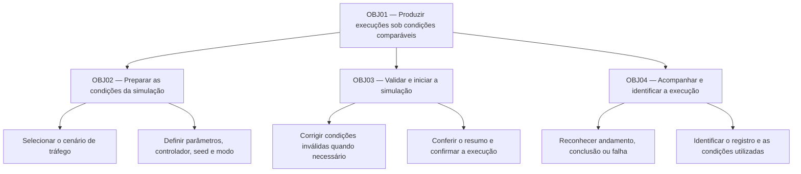

# Entrega 9 — Modelo conceitual e design centrado na comunicação

**Data:** {{dd/mm/aaaa}}  
**Status:** 🟨 em andamento  
**Responsabilidade:** soluções individuais, com consolidação da equipe para mapa de objetivos e esquema de signos.

## Objetivo da atividade

Passar do cenário de problema para uma concepção da interação, explicitando os objetivos do usuário, os tópicos de conversa, as falas e os signos que a interface precisa comunicar ao longo das tarefas.

## Transformando resultados técnicos em conceitos compreensíveis

No projeto, o usuário precisa saber em quais condições uma simulação será executada e reconhecer essas mesmas condições ao consultar seu resultado. Para apoiar essa tarefa, o modelo utiliza conceitos do domínio, como cenário de tráfego, controlador, seed, modo de execução e estado da simulação.

A **seed** identifica a condição de aleatoriedade usada na simulação e ajuda a repetir as condições do experimento. O **controlador** indica a estratégia de controle semafórico escolhida. O **modo de execução** informa se a simulação será acompanhada pela interface gráfica do SUMO (**Visual**) ou executada sem abrir essa interface (**Headless**). Esses termos aparecem junto à decisão que o usuário precisa tomar.

## 1. Cenários de interação

### CI01 — Preparar e executar experimentos sob condições comparáveis

**Autor:** Gabriel Koiama de Rocha Lira — 22.125.067-3  
**Origem:** cenário de problema C01, da Entrega 4.  
**Persona:** P01 — Marina Ribeiro.  
**Tarefas relacionadas:** T01 a T05.

Os trechos em **negrito** indicam os acréscimos e as alterações em relação ao cenário refinado C01.

Marina Ribeiro é pesquisadora e analista de mobilidade e está realizando um estudo experimental para comparar o comportamento do controle de tempo fixo, do Max Pressure convencional e do método híbrido Max Pressure + actuated em uma interseção com demanda desbalanceada.

**Para preparar o primeiro experimento, Marina abre o catálogo e seleciona o cenário de tráfego correspondente à interseção estudada. A interface identifica o cenário selecionado antes de apresentar a configuração da simulação. Marina define o controlador, informa a seed e escolhe o modo de execução. Quando precisa conferir um parâmetro específico, ela abre a configuração avançada e depois volta à revisão das condições do experimento.**

**Ao solicitar a execução, Marina recebe o retorno da validação. Se uma condição for inválida, a mensagem proposta identifica o parâmetro relacionado e orienta o que precisa ser corrigido. Marina volta à configuração, faz o ajuste e solicita uma nova validação. Quando a configuração é aceita, a interface apresenta um resumo com cenário, controlador, seed e modo de execução. Marina pode voltar para ajustar uma escolha ou confirmar o início da simulação.**

**Depois da confirmação, Marina acompanha o estado da execução. No modo Visual, ela também pode observar a simulação no SUMO-GUI. Na evolução proposta da interface, o estado principal aparece em linguagem direta, como “Inicializando”, “Executando”, “Concluída” ou “Falha”, com os logs disponíveis para consulta de detalhes. Em caso de falha, Marina verifica a informação apresentada e decide se precisa revisar a configuração antes de tentar novamente.**

**Para executar a próxima estratégia, Marina prepara uma nova simulação, troca o controlador e confere no resumo se o cenário, a seed e os demais parâmetros que deveriam permanecer equivalentes foram preservados. Ao término, o registro da execução mantém o vínculo com as condições utilizadas, permitindo identificar depois qual experimento produziu cada resultado.**

Caso Marina compare resultados produzidos sob condições que não eram equivalentes, poderá atribuir à estratégia de controle uma diferença que, na realidade, foi causada pela configuração experimental. Nesse caso, o problema não afeta diretamente uma interseção real, pois o trabalho ocorre em simulação, mas pode comprometer a validade do estudo e levar a conclusões inadequadas sobre o comportamento dos métodos avaliados.

#### Diferenças relevantes

| Alteração | Por que foi necessária | Evidência/artefato que justifica |
|---|---|---|
| Seleção do cenário no catálogo antes de configurar o experimento. | Permite identificar o cenário que orienta as escolhas seguintes. | E5, T01/T02. E6, PP01/PP02 e O01. |
| Configuração de controlador, seed e modo, com acesso separado aos parâmetros avançados. | Facilita a conferência das condições principais e mantém os parâmetros mais especializados disponíveis quando necessários. | E5, T02/T03. E6, PP02 e O02/O03. E8, PG02/PG03. |
| Validação com orientação de correção e confirmação após revisão do resumo. | Permite corrigir uma condição inadequada antes de iniciar e verificar se a execução corresponde ao planejado. | E6, PP03 e O04/O05. E8, PG01/PG04 e MU02. |
| Apresentação do estado principal da simulação e dos logs como detalhe. | Ajuda Marina a reconhecer inicialização, execução, conclusão ou falha durante o acompanhamento. | E6, PP04/PP05 e O06/O07. E8, PG05 e MU04. |
| Conferência das condições a cada nova execução e vínculo entre configuração e registro. | Ajuda a manter a equivalência experimental e a recuperar a origem dos resultados para a análise posterior. | E4, C01. E6, PP06/PP07 e O08/O09. E8, PG01 e MQ05. |

### CI02 — {{título}}

**Autor(a):** {{nome — matrícula}}  
**Origem:** cenário de problema C02.

{{cenário de interação com alterações marcadas}}

#### Diferenças relevantes

| Alteração | Por que foi necessária | Evidência/artefato que justifica |
|---|---|---|
| {{...}} | {{...}} | {{...}} |

## 2. Design centrado na comunicação

**Convenção.** `U` representa o usuário e `D` representa o preposto do designer na interface. As falas abaixo exemplificam a comunicação modelada para o cenário de interação.

### CI01 — Preparar e executar experimentos sob condições comparáveis

| Tópico > subtópico | Falas e signos envolvidos | Intenção/efeito esperado |
|---|---|---|
| Preparação do experimento > seleção do cenário | `U: Quero simular esta interseção.` / `D: Este é o cenário selecionado para o experimento.` **Signos:** catálogo, cenário selecionado. | Confirmar qual cenário será usado nas etapas seguintes. |
| Preparação do experimento > condições da simulação | `U: Vou usar o controlador híbrido com a seed definida para este experimento.` / `D: Estas são as condições configuradas. Você pode consultar os parâmetros avançados, se precisar.` **Signos:** controlador, seed, modo de execução, parâmetros avançados. | Permitir que Marina identifique e confira as escolhas que caracterizam a execução. |
| Validação > condição inválida | `U: Quero iniciar com esta configuração.` / `D: Há um parâmetro inválido. Revise o campo indicado e solicite a validação novamente.` **Signos:** parâmetro inválido, mensagem de validação e orientação de correção. | Tornar a inconsistência identificável e indicar como recuperar a tarefa. |
| Confirmação > revisão das condições | `U: Quero conferir o que será executado.` / `D: Revise o cenário, o controlador, a seed e o modo de execução. Você pode confirmar ou voltar à configuração.` **Signos:** resumo da configuração, confirmação e retorno. | Dar a Marina a oportunidade de corrigir uma escolha antes de iniciar. |
| Acompanhamento > estado da simulação | `U: A simulação já começou?` / `D: A simulação está em execução.` **Signos:** estado da execução, modo Visual e log técnico. | Permitir que Marina reconheça o andamento e consulte detalhes quando necessário. |
| Acompanhamento > falha | `U: O que aconteceu com a execução?` / `D: A execução falhou. Consulte os detalhes para decidir o que revisar antes de tentar novamente.` **Signos:** estado de falha, detalhes da execução e retorno à configuração. | Comunicar a interrupção e oferecer um caminho para retomar a tarefa. |
| Encerramento > identificação da execução | `U: Como identifico depois a simulação que acabei de executar?` / `D: A execução concluída está associada ao cenário, ao controlador e à seed utilizados.` **Signos:** registro da execução, cenário, controlador e seed. | Preservar a origem experimental do resultado para consulta posterior. |

### CI02 — {{título}}

| Tópico > subtópico | Falas e signos envolvidos | Intenção/efeito esperado |
|---|---|---|
| {{objetivo}} | `U: ...` / `D: ...` | {{...}} |
| > {{subtópico}} | {{...}} | {{...}} |

## 3. Mapa de objetivos

### Mapa individual — Gabriel Koiama de Rocha Lira

**Cenário:** CI01.  
**Persona:** P01 — Marina Ribeiro.

| ID | Objetivo | Persona(s) | Cenário(s) | Prioridade |
|---|---|---|---|---|
| OBJ01 | Produzir execuções sob condições comparáveis. | P01 | CI01 | Alta |
| OBJ02 | Preparar as condições da simulação. | P01 | CI01 | Alta |
| OBJ03 | Validar e iniciar a simulação. | P01 | CI01 | Alta |
| OBJ04 | Acompanhar o estado e identificar a execução associada às condições utilizadas. | P01 | CI01 | Alta |

### Mapa individual — {{nome do integrante}}

{{mapa individual de CI02}}

### Mapa consolidado — equipe

{{mapa consolidado após a revisão dos dois mapas individuais}}

### Dicionário de objetivos

| ID | Objetivo | Persona(s) | Cenário(s) | Prioridade |
|---|---|---|---|---|
| {{...}} | {{...}} | {{...}} | {{...}} | {{...}} |

## 4. Esquema conceitual de signos

{{consolidação da equipe em uma tabela única após a elaboração de CI01 e CI02}}

| Grupo | Signo | Origem | Observações/semântica | Tipo de conteúdo | Restrição | Valor padrão | Prevenção | Recuperação |
|---|---|---|---|---|---|---|---|---|
| {{...}} | {{...}} | {{...}} | {{...}} | {{...}} | {{...}} | {{...}} | {{...}} | {{...}} |

### Regras para os signos

- Usar o vocabulário do domínio do usuário.
- Usar a mesma denominação quando o signo aparecer em mais de um fluxo.
- Identificar se a informação é fornecida pelo usuário, produzida pelo sistema ou derivada do domínio.
- Registrar restrições, valores padrão, prevenção e recuperação quando forem aplicáveis.

## Síntese

No MoLIC de CI01, devem aparecer os tópicos **seleção do cenário**, **configuração da simulação**, **validação**, **confirmação** e **acompanhamento da execução**. O caminho principal vai da seleção do cenário à identificação da execução concluída. Os caminhos de recuperação devem contemplar condição inválida, retorno à configuração antes da confirmação e falha durante a execução.

Os principais signos de CI01 para a Entrega 10 são **cenário, controlador, seed, modo de execução, parâmetros avançados, mensagem de validação, resumo da configuração, estado da execução e registro da execução**. O cenário, o controlador e a seed devem permanecer reconhecíveis na transição entre a preparação e a consulta posterior do registro.

{{síntese de CI02 e revisão conjunta dos objetivos e signos}}

## Checklist

- [ ] Os dois cenários de interação mostram alterações em relação aos cenários de problema.
- [ ] As duas soluções individuais identificam autor e cenário de origem.
- [ ] Os tópicos, falas e signos dos dois cenários são coerentes com os objetivos do usuário.
- [ ] Os mapas individuais foram consolidados.
- [ ] O esquema de signos está em uma tabela única e sem duplicações conceituais.
- [ ] Os nomes de objetivos e signos serão reutilizados na Entrega 10.
- [ ] Os signos representam conceitos do domínio compreensíveis ao usuário.
- [ ] Os padrões de interface presentes no escopo possuem objetivos e signos correspondentes.
- [ ] A interface comunica o resultado técnico e seu significado para a tarefa.
