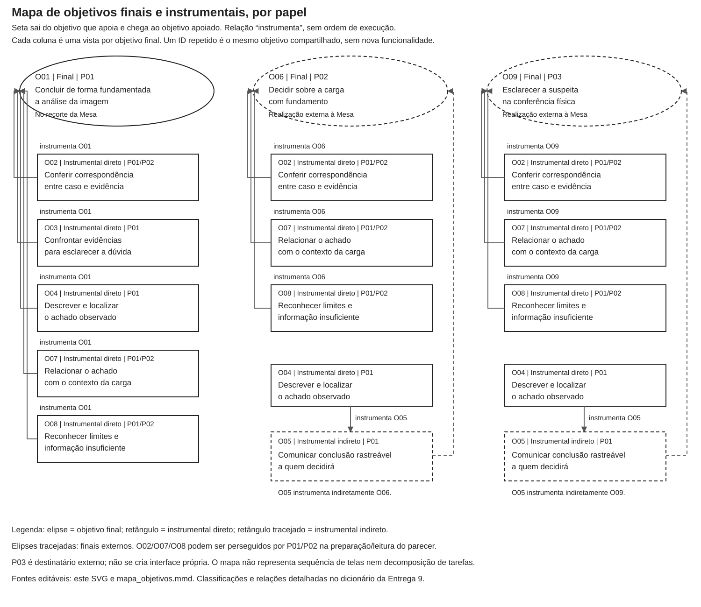

# Entrega 9 — Modelo conceitual e design centrado na comunicação

**Data:** 04/11/2026 (versão original)
**Revisão:** 15/11/2026, aplicação do [feedback do professor](../feedbacks_professor/Feedback_Professor_Entrega09_Equipe09.md)
**Status:** 🟦 revisada após feedback
**Responsabilidade:** soluções individuais e consolidação da equipe

## Objetivo e base do projeto

Definir como a Mesa de inspeção comunica o resultado do modelo e permite registrar um parecer. Os cenários abaixo partem de [CP01–CP03](04_cenarios_problema.md), das tarefas T01–T09, dos fluxos PF01/PF02 e das [metas MU01–MU06](08_engenharia_usabilidade.md).

[H] O sistema apoia a análise e produz um parecer técnico; não autoriza desembaraço. A construção textual e os limites de cada cenário estão explicitados na seção 1.

## 1. Soluções individuais

[H] Os cenários são propostas, sem sessões profissionais realizadas. A base textual integral é a seção **3. Cenário refinado** de cada CP da Entrega 4. As marcações `NOVO [Qn]` pertencem ao refinamento documental do cenário de problema; foram mantidas sem negrito. Somente **[Intervenção: ...]** destaca a solução e **[Limite/Fronteira...]** delimita seu alcance. As hipóteses de turno, fadiga, comunicação e sequência profissional continuam abertas. As questões de refinamento da Entrega 4 servem de apoio e não substituem esta transformação.

### CI01 — examinar a imagem e registrar uma suspeita

**Autor(a):** Kawan Mark Geronimo Da Silva — 22.222.010-5 
**Origem textual:** [CP01, cenário refinado](04_cenarios_problema.md#cenário-cp01--dúvida-diante-de-uma-imagem-de-contêiner-no-meio-do-plantão).

Gustavo Onofre opera a estação de imagem de raio-X de um terminal portuário. [NOVO [Q1]: [F] Na unidade usada como referência (Portaria ALF/FNS nº 9/2024, Imbituba), o escâner é operado por operadores designados pelo recinto alfandegado, em sala com acesso restrito às pessoas autorizadas, e não por servidores da Receita Federal. [H] Este cenário adota esse modelo como referência exploratória, sem afirmar que vale para outros terminais. Em Santos há indício de outro modelo, com a imagem analisada por servidores da vigilância da RFB em uma central (CP02). [?] Ainda não sabemos em qual modelo Gustavo estaria nem que cargo da RFB examina as imagens (H01, H39).] Está no meio de um plantão noturno e, por volta das três da manhã, já examinou centenas de imagens de contêineres e caminhões que passaram pelo escâner. [NOVO [Q4]: [?] Não sabemos qual é a duração formal da escala, a meta de atendimento por hora nem as condições reais de iluminação e ruído da sala (H13, H14, H16, ?07); a hora e o volume exato permanecem suposições do cenário exploratório.] A cada imagem, ele tem poucos segundos para decidir se há alguma coisa ali que justifique desconfiar da carga. Faz isso olhando a imagem no software do fabricante do escâner, [NOVO [Q3, Q4]: [F] em um monitor dedicado de 22" a 24" (C03). [F] Para planejar e conduzir o exame, o software oferece zoom, inversão, realce de contornos, colorização por densidades, brilho, contraste e equalização (ADE Coana nº 19/2014, item 1.2.8) e, nos produtos analisados, visualização de dados do manifesto e anotações sobre a imagem (C03).] que oferece cores por tipo de material, realce de bordas e ajuste de contraste, **[Intervenção: [H] Na Mesa demonstrativa, Gustavo vê o estado da análise e, quando concluída, o destaque aproximado do modelo. Ele o usa como ponto de atenção, sem deixar de examinar a radiografia inteira nem tomar o resultado como prova de ilícito (H31/H37).]** [NOVO [Q5]: [H] Os eventos de chegada das imagens acompanham a passagem dos veículos pelo escâner na ordem de chegada. [F] As imagens são transmitidas em tempo real à unidade da RFB (Portaria RFB nº 143/2022, art. 14), de modo que Gustavo não é o único que pode vê-las. [?] Não sabemos se existe fila configurável nem quem controla a ordem de atendimento (H04, H41).]

Chega a imagem de um contêiner declarado como carregado de paletes de madeira. A imagem é densa, com muitos objetos sobrepostos. Em uma região, o material parece um pouco mais denso que no restante, mas a diferença é pequena e Gustavo já viu variações assim em cargas de madeira que eram regulares. **[Intervenção: [H] Ele ajusta a visualização sem alterar o original, consulta a identificação e a descrição da carga fornecidas no caso demonstrativo e compara a região com o mapa oculto ou visível, mantendo a comparação ao marcar (H11/H30). A origem institucional desses dados continua em investigação.]** [NOVO [Q3, Q6]: [H] Ele procura conferir a imagem com a descrição da carga na declaração. [?] Não sabemos que informações da declaração ele tem diante dos olhos nesse momento, nem se precisa buscá-las em outro sistema ou janela (H11).] Os caminhões seguintes já esperam e a próxima imagem está pronta. Cansado, ele não consegue afirmar se aquela região faz parte da carga ou se há algo escondido ali. [NOVO [Q2, Q5, Q6]: O objetivo de Gustavo é chegar a uma conclusão defensável dentro do limite de sua função, mas ele tem duas saídas e nenhuma é sem custo. [F] Se desconfiar, sua ação é comunicar a suspeita à RFB, evento que interrompe imediatamente o fluxo daquele veículo e mantém a carga retida e segregada até a manifestação da fiscalização; sem manifestação nem bloqueio no Siscomex Carga em 3 dias úteis, a carga segue (Portaria ALF/FNS nº 9/2024, art. 8º). [H] Se comunicar sem base suficiente, ele retém uma carga regular e gera atrito com quem espera pela liberação (H12). [H] Se deixar seguir e houver algo escondido, a carga entra no país sem que ninguém tenha visto (H12). [H] Pedir a opinião de um colega antes de apontar é uma ação plausível, mas não há fonte sobre essa prática na unidade.]

**[Intervenção: [H] Gustavo registra a região em dúvida, comenta a diferença de densidade e informa sua conclusão técnica e justificativa, separadas do resultado automático. A Mesa indica campos ausentes e preserva os dados para correção. Ele revisa caso, região, comentário e responsável e emite um parecer local destinado a P02. A emissão não libera nem retém a carga.]** Ele não sabe se acertou. No resto do plantão, não terá como descobrir o que havia naquela região. [NOVO [Q7]: [F] As imagens ficam disponíveis por 180 dias e podem ser buscadas por unidade de carga, data, hora ou placa (Portaria ALF/FNS nº 9/2024, art. 5º). Isso permite rever a imagem armazenada, mas não mostra o que a verificação física da carga encontrou para avaliar o acerto da decisão. [?] Não sabemos se quem examina a imagem recebe algum retorno sobre os casos que apontou ou deixou de apontar (H38, ?08). [H] Sem avaliação de desfecho, ele não aprende com o resultado e o próximo caso parecido recomeça do mesmo ponto.]

**[Limite da intervenção: o registro torna o achado comunicável; a Mesa não resolve o retorno do desfecho. Gustavo continua sem saber se sua suspeita se confirma até receber informação externa, conforme H38/?08.]**

| Momento do problema | Intervenção ou limite | Base |
|---|---|---|
| Onde começar e o que a carga declara | Estado da análise, destaque aproximado e contexto do caso. | R01; H11/H30/H31; OBS-01–OBS-03 |
| Conclusão não comunicada com contexto | Região comentada, conclusão técnica, validação e PDF. | R03; T03; MU03/MU05 |
| Ausência de retorno | Permanece fora da Mesa; não se presume conhecer o desfecho. | H38; ?08 |

### CI02 — compreender o parecer antes de decidir

**Autor(a):** Gabriel Albertini Pinheiro — 22.122.094-8 
**Origem textual:** [CP02, cenário refinado](04_cenarios_problema.md#cenário-cp02--decidir-sobre-uma-carga-bloqueada-por-suspeita-na-imagem-do-escâner).

Atores: Dr. Eduardo Resende (Auditor-Fiscal), servidor da vigilância que analisou a imagem, importador.

Dr. Eduardo Resende, Auditor-Fiscal na Alfândega do Porto de Santos, [NOVO [Q3]: [F] responde formalmente pela decisão do despacho aduaneiro (C02) e [H] atua na equipe de despacho de importação (Edaim), que fica em uma divisão diferente da equipe de vigilância (Eqvig) [F] (Portaria ALF/STS nº 197/2025)]. Ele recebe uma declaração de importação cuja carga está bloqueada porque a imagem do escâner levantou suspeita. [NOVO [Q1, Q2, Q9]: [F] Segundo registros históricos de Santos (A Tribuna, 2013 e 2015), a imagem era analisada por servidores da Receita na Central de Operações e Vigilância (COV), em plantão de 24 horas, com atribuição para bloquear a carga, competindo hoje à Eqvig a vigilância remota (Portaria ALF/STS nº 197/2025, art. 34). [?] Não sabemos se a COV segue operando do mesmo modo nem com que frequência esses bloqueios chegam hoje ao despacho.]

Ele precisa decidir o que fazer com essa carga e formalizar a decisão. Abre a declaração no Siscomex e lê o que a mercadoria declara ser, [NOVO [Q6]: [F] planejando a conferência a partir dos documentos do dossiê, da natureza da mercadoria, da origem e do histórico do importador (C02), [?] embora ainda não saibamos quais desses itens ele prioriza diante de uma suspeita radiográfica]. **[Intervenção: [H] Além da declaração, Eduardo recebe externamente o PDF estático produzido por P01 na Mesa. Confere identificação do caso, responsável e data e localiza a região numerada, o comentário e a conclusão humana para compreender o fundamento da suspeita.]** [NOVO [Q4]: **[Intervenção: [H] Nesta proposta, o PDF acompanha a comunicação do achado, sem envio automático ao Siscomex e sem substituir o procedimento institucional;]** [?] como a suspeita passa da vigilância para o despacho em Santos é uma lacuna que a equipe ainda precisa apurar na Entrega 7 (?08).]

A imagem não está junto da declaração. [NOVO [Q5]: [F] Embora haja registro histórico de que o servidor do despacho pode se apoiar na imagem do escâner para formar convicção (A Tribuna, 2013) e previsão normativa de software de análise em estações da RFB (ADE Coana nº 19/2014), [H] a equipe supõe que, para isso, ele precisa buscá-la fora do Siscomex, em outro sistema; [?] onde e como o auditor acessa a imagem atualmente segue sem resposta.] **[Intervenção: [H] Relaciona a descrição do achado no parecer com a mercadoria declarada. Se o caso divergir ou a informação for insuficiente, procura quem fez o apontamento por canal institucional externo. O documento não responde dinamicamente nem efetua atos no despacho.]** Sem prática de leitura de radiografia, não consegue avaliar sozinho se a suspeita se sustenta.

[NOVO [Q7, Q8]: [F] As ações formais de que ele dispõe no Siscomex são registrar uma exigência fiscal com motivo e prazo, determinar a verificação física ou desembaraçar a declaração (C02). [?] Enquanto não decide, a carga permanece retida no terminal por prazo que ainda não foi apurado para Santos (H08).] Na dúvida, determina a verificação física. [NOVO [Q10]: **[Intervenção: [H] Ao justificar o ato no Siscomex, escreve o motivo com as próprias palavras, usando o parecer como apoio, sem presumir vínculo automático entre análise e declaração;]** [?] se esse vínculo existe hoje é pergunta em aberto.]

A verificação não encontra irregularidade, a carga é liberada com atraso, e quem analisou a imagem não fica sabendo do resultado. [NOVO [Q10]: [F] A decisão fica registrada no Siscomex (C02) e há referência histórica de guarda das imagens por 90 dias na COV (A Tribuna, 2013), mas [H] nada vincula a imagem ao resultado da verificação física para permitir a avaliação do acerto por quem originou o alerta [?] (?08).]

A base de cada trecho novo está na tabela da seção 2, na questão indicada entre colchetes ([Q1] a [Q10]), com [F], [H] ou [?].

**[Fronteira da interação proposta: P02 lê o PDF em um leitor externo; não abre a Mesa. A interação de P01 com a Mesa termina na exportação. Conferência física, decisão e registro no Siscomex permanecem externos; o cenário não afirma que o parecer elimina a dúvida ou evita a verificação.]**

| Momento do problema | Intervenção ou limite | Base |
|---|---|---|
| Motivo do bloqueio sem detalhe | PDF com caso, região e comentário. | R03; H28; MU02/MU03 |
| Buscar explicação externa | Parecer reduz a falta de contexto proposta; esclarecimento ainda externo. | T05; ?08 |
| Decidir e formalizar | Permanece no Siscomex, sem interface de P02 na Mesa. | H39; T04/T06 |

### CI03 — usar o resultado da intervenção na conferência física

**Autor(a):** Alexandre Domiciano Pierri — 22.125.061-6 
**Origem textual:** [CP03, cenário refinado](04_cenarios_problema.md#cenário-cp03--verificação-física-no-pátio-sem-localização-da-suspeita-apontada-na-imagem).

Durante o turno da noite em um terminal portuário, Marcos Oliveira (P03) recebe uma solicitação de verificação física para um contêiner refrigerado (*reefer*) mantido em retenção após passar pelo escâner. [NOVO [Q1, Q3]: [F] Na referência normativa de Imbituba, quando há suspeita na inspeção não invasiva, o fluxo do veículo é interrompido e a carga fica retida e segregada aguardando manifestação da RFB (Portaria ALF/FNS nº 9/2024, art. 8º), e no fluxo do despacho a verificação física passa por agendamento e exige a presença do importador ou de seu representante ao lado da fiscalização e da equipe do depositário que movimenta a carga (Decreto nº 6.759/2009; C02). [?] Ainda não sabemos qual é o cargo exato de quem conduz a vistoria em campo nem como o agendamento ocorre nos casos vindos do escâner (H42).] **[Intervenção: [H] Antes do encaminhamento externo, P01 revê na Mesa a identificação do caso, a região numerada e seu comentário, completa omissões e emite o parecer técnico. Marcos recebe esse PDF pelo procedimento institucional; o documento descreve o que foi observado na radiografia, sem converter a posição na imagem em coordenada física exata.]** [NOVO [Q4]: [F] Os dados da mercadoria declarada e do dossiê existem no processo de despacho (C02), mas **[Intervenção: [H] a intervenção propõe acompanhar a observação com a região da radiografia e seu comentário no parecer;]** [?] que informações exatas chegam a quem executa a vistoria é uma lacuna a investigar na Entrega 7 (H28, H31, ?08).]

Marcos desloca-se até o pátio sob iluminação artificial precária e ruído intenso de maquinário pesado. [NOVO [Q5]: [F] Há registro histórico em Santos de que a conferência física em terminais pode ocorrer de forma presencial ou com acompanhamento remoto por câmeras a partir da central de vigilância (A Tribuna, 2013). [?] Não sabemos em que condições físicas de área coberta, temperatura e comunicação ocorrem hoje as verificações presenciais de contêineres refrigerados na unidade estudada.] Acompanhado pela equipe de apoio, [NOVO [Q2, Q6]: [F] cujo objetivo formal é verificar a identidade e a conformidade da mercadoria declarada para subsidiar a decisão do despacho (C02), **[Intervenção: [H] Marcos consulta a indicação visual e o comentário recebidos, confirma com a fiscalização o alcance dessa referência e esclarece dúvidas pelo canal externo. A sequência de abertura é definida pelo procedimento profissional, não pelo mapa do modelo.]** [?] Não sabemos se há procedimento operacional padrão que defina desova parcial ou total nesses casos.] Ele precisa romper os lacres e acompanhar o descarregamento manual de dezenas de caixas de carne congelada na tentativa de localizar o ponto que motivou a suspeita. **[Intervenção: [H] Com a referência do parecer, a equipe pode confrontar a dúvida radiográfica com a estrutura de refrigeração e constatar o acúmulo de gelo, sem irregularidade na mercadoria. Essa é uma possibilidade de apoio comunicativo: não há evidência para afirmar redução das três horas ou da quantidade de caixas movimentadas no episódio de CP03.]** [NOVO [Q4, Q6]: [H] Se a comunicação da suspeita informasse que a diferença de densidade estava concentrada junto à parede do fundo, na altura do equipamento de refrigeração, a conferência poderia ter direcionado a atenção para essa estrutura antes de retirar a maior parte da carga.]

O processo prolonga a permanência da carga no pátio, gera atrito com o operador logístico pelo risco à conservação do produto refrigerado e exige esforço físico elevado na movimentação de uma carga regular. Ao concluir a conferência e registrar o resultado [NOVO [Q6, Q7]: [F] para que o despacho siga no Siscomex rumo ao desembaraço (C02), [?] ainda não sabemos se Marcos faz anotações em papel ou formulário próprio no pátio antes do registro no sistema na mesa de trabalho (H37, H42), nem se quem apontou a suspeita na estação de imagem recebe retorno de que o caso era apenas gelo acumulado no equipamento (H17, H38, ?08)], **[Intervenção: [H] Marcos dispõe de uma explicação do achado para a conferência, mas a equipe ainda precisa investigar se ela ajuda no trabalho real e como o resultado retorna a quem analisou a imagem. Não se afirma desova evitada ou ganho de tempo medido.]**

**[Fronteira da interação proposta: CI03 descreve o uso do resultado da intervenção por P03. Somente P01 prepara/revisa o parecer na Mesa; P02 decide e encaminha externamente. Marcos não mantém conversa com a Mesa nem recebe tela móvel (H42).]**

| Momento do problema | Intervenção ou limite | Base |
|---|---|---|
| Solicitação sem referência | P01 prepara região comentada e identificação no PDF. | R03; H28/?08 |
| Desova extensa no exemplo | Referência radiográfica apoia a compreensão; não garante localização física nem economia de tempo. | CP03; H31/H37 |
| Registro e retorno | Procedimentos externos, sem tela de P03 ou integração automática. | H42; T07–T09 exploratórias |

## 2. Design centrado na comunicação

**Convenção:** `U` = usuário; `D` = preposto do designer/sistema. As falas representam somente intenções que podem ser expressas à Mesa. PDF estático transmite conteúdo fixo; sua leitura não gera resposta dinâmica do sistema.

### DCC01 — CI01, exame e registro

**Autor(a):** Kawan Mark Geronimo Da Silva — 22.222.010-5. 
**Usuário/papel:** P01, operador da estação de imagem.

| Tópico > subtópico | Falas e signos | Intenção |
|---|---|---|
| Caso > identificação | U: “Quero examinar este caso.” D: “Esta é a imagem e a carga informada.” S01/S02/S13 | Conferir correspondência e contexto. |
| Análise > andamento | D: “Analisando imagem”; ou “Não foi possível analisar. Tente novamente.” S03 | Distinguir espera, resultado e falha. |
| Análise > resultado | U: “Quero consultar a indicação do modelo.” D: “Este resultado e mapa são apoios aproximados, sem prova de ilícito.” S04/S05; S14/S15 somente se o candidato numérico for avaliado | Comunicar o alcance do resultado. |
| Comparação > visualização | U: “Quero comparar sem o mapa cobrir a imagem.” D: “Oculte o mapa ou escolha a vista lado a lado.” S02/S05/S06/S16/S17 | Preservar original e controle da visualização. |
| Registro > achado | U: “Quero registrar esta região e minha observação.” D: “Região numerada e comentário editável.” S07/S08 | Vincular o achado à marcação humana. |
| Registro > conclusão | U: “Quero concluir o parecer.” D: “Informe conclusão, justificativa e responsável.” S09/S10/S11 | Separar julgamento humano e modelo. |
| Exportação > revisão/erro | U: “Quero emitir o parecer.” D: “Revise o caso”; “Preencha o responsável”; ou “Falha ao exportar; seus dados foram mantidos.” S01/S07–S12/S18 | Prevenir omissões e apoiar recuperação. |

### DCC02 — CI02, leitura do artefato comunicativo

**Autor(a):** Gabriel Albertini Pinheiro — 22.122.094-8. 
**Papel:** P02, destinatário externo. **Suporte:** PDF estático em leitor externo; nenhuma conversa dinâmica de P02 com a Mesa.

| Tópico > subtópico | Ação do destinatário / informação fixa comunicada | Signos e intenção |
|---|---|---|
| Consulta > identificação | Abre o PDF recebido e localiza caso, responsável e data. | S01/S11/S18/S12: reconhecer a correspondência do documento. |
| Consulta > fundamento | Lê região, comentário, contexto da carga e conclusão. O conteúdo não muda em resposta à leitura. | S07/S08/S09/S13: compreender a origem da suspeita. |
| Consulta > limites | Lê a distinção entre resultado automático e parecer, sem autorização de desembaraço. | S04/S05/S09/S12: reconhecer o alcance e a insuficiência da evidência. |
| Consulta > informação insuficiente | Interrompe o uso do documento e solicita esclarecimento por canal institucional externo. | Nenhum comando da Mesa. Não inventar resposta ou tela de decisão. |

### DCC03 — CI03, preparação do resultado na origem

**Autor(a):** Alexandre Domiciano Pierri — 22.125.061-6. 
**Usuário/papel da Mesa:** P01 prepara/revisa. **Destinatários externos:** P02 decide e encaminha; P03 usa o resultado, sem interface própria.

| Tópico > subtópico | Falas e signos da interação efetiva | Intenção |
|---|---|---|
| Revisão > caso | U (P01): “Quero conferir o caso deste parecer.” D: “Esta identificação acompanha esta imagem.” S01/S02/S13 | Evitar troca de documento ou caso. |
| Revisão > referência | U (P01): “Quero corrigir a região ou o comentário.” D: “Edite ou exclua a marcação e o texto correspondente.” S07/S08 | Tornar a referência radiográfica comunicável, sem prometer coordenada física exata. |
| Emissão > integridade | U (P01): “Quero emitir o parecer revisado.” D: “Complete o campo indicado”; ou “Parecer exportado localmente.” S09–S12/S18 | Verificar conteúdo e preservar o registro em falha. |
| Encaminhamento > uso externo | P02 e P03 leem o conteúdo fixo e seguem o procedimento institucional, fora da Mesa. | S12: limite da conversa; sem envio automático nem diálogo de P03 com o sistema. |

## 3. Mapas de objetivos

[H] Os objetivos representam intenções humanas, independentemente de mapa, widget ou exportação. **Final** é a razão para a atividade; **instrumental direto** apoia a realização durante a atividade; **instrumental indireto** prepara informação para uma atividade posterior. A seta `instrumenta` sai do objetivo que apoia e chega ao objetivo apoiado; não indica ordem de passos nem relação “é parte de”.

O título do diagrama é apenas um agrupamento conceitual, sem objetivo raiz adicional. O01 é final de P01 no recorte da Mesa. O06 e O09 são finais externos de P02/P03; mostrá-los delimita quem recebe valor do parecer e não acrescenta telas. O05 é indireto porque P01 prepara a informação usada depois por esses atores.

| Contribuição individual | Final considerado | Instrumentação proposta |
|---|---|---|
| Kawan, CI01 | O01, P01 | O02/O03/O04/O07/O08 instrumentam a conclusão; O05 prepara a comunicação posterior. |
| Gabriel, CI02 | O06, P02, fora da Mesa | O02/O07/O08 apoiam a compreensão da evidência; O05 de P01 instrumenta indiretamente a decisão futura. |
| Alexandre, CI03 | O09, P03, fora da Mesa | A preparação por P01 em O04/O05, com conferência O02/O07/O08, apoia a comunicação para a conferência física. |

[Fonte Mermaid editável](../assets/09_modelo_conceitual/mapa_objetivos.mmd). Elipses são finais, retângulos são instrumentais diretos e retângulos tracejados são indiretos. O papel aparece em cada objetivo; moldura tracejada de finais identifica sua realização fora da Mesa. Cores são dispensáveis para a leitura. No SVG, cada coluna mostra as relações com um final; IDs repetidos representam objetivos compartilhados, não novos objetivos.

### Dicionário de objetivos

| ID | Objetivo humano | Classificação | Papel | Cenário | Prioridade | Instrumenta |
|---|---|---|---|---|---|---|
| O01 | Concluir de forma fundamentada a análise da imagem | Final | P01 | CI01 | alta |  |
| O02 | Conferir correspondência entre caso e evidência | Instrumental direto | P01/P02 | CI01–CI03 | alta | O01/O06/O09 |
| O03 | Confrontar evidências para esclarecer a dúvida | Instrumental direto | P01 | CI01 | alta | O01 |
| O04 | Descrever e localizar o achado observado | Instrumental direto | P01 | CI01/CI03 | alta | O01/O05 |
| O05 | Comunicar uma conclusão rastreável a quem decidirá | Instrumental indireto | P01 | CI01/CI03 | alta | O06/O09, ações posteriores externas |
| O06 | Decidir sobre a carga com fundamento | Final externo | P02 | CI02 | alta |  |
| O07 | Relacionar o achado com o contexto da carga | Instrumental direto | P01/P02 | CI01–CI03 | alta | O01/O06/O09 |
| O08 | Reconhecer limites e informação insuficiente | Instrumental direto | P01/P02 | CI01–CI03 | alta | O01/O06/O09 |
| O09 | Esclarecer a suspeita na conferência física | Final externo | P03, destinatário; P01 prepara informação | CI03 | média |  |

[H] A classificação é proposta de design a avaliar. As tarefas T04–T06 e T07–T09 continuam externas à Mesa; O09 não pressupõe interface de P03.

## 4. Esquema conceitual de signos

A classificação segue as páginas 5–6 da aula de signos: **PP**, prevenção passiva (explicação); **PA**, prevenção ativa (impedimento de entrada inválida); **AL**, alerta para decisão informada; **RA**, recuperação apoiada após uma ruptura; **CE**, captura de erro cuja solução depende de ação fora do sistema. “—” indica que não há mecanismo específico: uma ação normal, como ocultar o mapa, não é por si uma recuperação de ruptura.

**Origem** usa somente domínio, usuário ou aplicação. Domínio descreve informação do caso; usuário fornece escolhas/anotações; aplicação produz estados, resultados e data. As observações detalham a fonte e eventual simulação; não demonstram integração.

A tabela mantém IDs e decompõe composições: S01/S13 (identificação/descrição), S04/S14/S15 (resultado/índice/limiar), S06/S16/S17 (modo/zoom/ajustes), S11/S18 (responsável/data). [H] São signos propostos; casos e responsáveis são fictícios. A existência do signo não prova integração nem necessidade validada.

| ID / grupo | Signo | Origem | Significado | Conteúdo | Restrição | Padrão | Prevenção | Recuperação |
|---|---|---|---|---|---|---|---|---|
| S01 / caso | Identificação do caso | domínio | Vincula imagem e parecer à unidade informada. | Identificador textual | Obrigatório para exportar. | Sem caso | PP: identificação visível; AL: avisar descarte ao trocar caso. | RA: corrigir vínculo ou identificação mantendo o registro. |
| S02 / imagem | Radiografia original | domínio | Evidência visual de referência. | Imagem | Formato compatível; preservar arquivo original. | Vazia | PP: informar formatos aceitos; PA: impedir análise de arquivo inválido. | RA: selecionar outro arquivo; CE: se corrompido, obter nova cópia na origem. |
| S03 / análise | Estado da análise | aplicação | Informa se há espera, resultado ou falha. | Estado textual | Não apresentar falha ou ausência como “sem indício”. | Aguardando imagem | PP: explicar o estado; PA: impedir uso de resultado inexistente. | RA: repetir análise após falha; CE: se o serviço não responder, verificar o serviço local e retomar. |
| S04 / modelo | Resultado qualitativo do modelo | aplicação | Indício da versão demonstrada, separado da conclusão humana. | Categoria textual | Não classificar tipo de ilícito ou canal aduaneiro. | Sem resultado | PP: explicar limites do apoio automático. | Falha de análise é tratada em S03. |
| S05 / modelo | Mapa de atenção | aplicação | Regiões relevantes para a predição. | Camada visual | Não é contorno exato nem mapa residual. | Visível após análise válida | PP: explicar o alcance do mapa e distingui-lo da imagem original. | —; ocultar/reexibir é operação normal de visualização. |
| S06 / visualização | Modo de comparação | usuário | Organiza original e mapa para comparação (H30). | Escolha de vista | Manter estado sem segurar tecla; não alterar original. | Sobreposta, proposta a comparar com lado a lado | PP: indicar modo ativo. | —; alternar vista é operação normal. |
| S07 / achado | Região marcada | usuário | Área numerada que o analista deseja registrar. | Retângulo e número | Dentro da imagem; ao menos uma para “Suspeita apontada”. | Nenhuma | PP: distinguir marca humana do mapa; PA: impedir região fora da imagem. | RA: corrigir ou excluir marcação feita incorretamente. |
| S08 / achado | Comentário da região | usuário | O que foi observado naquela área. | Texto | Obrigatório em cada região exportada; não aceitar apenas espaços. | Vazio | PP: explicar o comentário; PA: impedir exportação de região sem comentário válido. | RA: identificar a omissão e permitir completar o comentário. |
| S09 / parecer | Conclusão da análise | usuário | “Sem ressalvas na imagem” ou “Suspeita apontada”. | Escolha única | Não equivale a liberar/reter carga. | Não selecionada | PP: explicar o alcance da conclusão; PA: exigir escolha explícita. | RA: corrigir a escolha antes de emitir novamente o parecer. |
| S10 / parecer | Justificativa | usuário | Fundamenta a conclusão geral. | Texto | Obrigatória; confirmar revisão se a conclusão divergir do indício do modelo. | Vazia | PP: indicar obrigatoriedade; PA: impedir emissão sem texto; AL: pedir revisão em divergência com o modelo. | RA: destacar a omissão e manter os demais dados para correção. |
| S11 / autoria | Responsável pelo parecer | usuário | Autoria declarada pelo analista. | Texto | Obrigatório; não aceitar apenas espaços; sem autenticação institucional no protótipo. | Vazio | PP: indicar autoria declarada; PA: exigir preenchimento. | RA: completar ou corrigir antes da emissão. |
| S12 / documento | Parecer de apoio | aplicação | Reúne caso, imagem, regiões, comentários, conclusão, autoria declarada, data/hora da emissão e resultado do modelo. | PDF | Exportação local; sem protocolo de envio institucional. | Não emitido | PP: explicar exportação local; PA: validar dados obrigatórios antes de emitir. | RA: informar falha de exportação e permitir repetir sem perder dados; CE: se depender do destino local, orientar verificar permissões/espaço e tentar novamente. |
| S13 / caso | Descrição da carga declarada | domínio | Contexto textual fornecido para a radiografia. | Texto | Descrição não disponível deve ser sinalizada, sem inventar conteúdo. | Não informada | PP: indicar ausência e origem dos dados. | CE: obter esclarecimento na origem; não pressupor edição do manifesto na Mesa. |
| S14 / modelo | Índice numérico candidato | aplicação | Valor candidato à apresentação (H31/H37), com semântica dependente da versão técnica. | Número, unidade e significado a definir | Não apresentar como probabilidade comprovada de ilícito nem exigir sua presença no produto. | Não exibido até definição do candidato | PP: se avaliado, declarar valor ilustrativo e significado técnico verificado. | —; remover/substituir a apresentação é alternativa de design. |
| S15 / modelo | Limiar candidato | aplicação | Referência técnica de classificação candidata, não regra do despacho. | Número dependente da versão | Sem alegar calibração operacional; utilidade ainda não validada. | Não exibido | PP: não confundir com autorização humana ou canal. | CE: esclarecer configuração na origem técnica, fora do perfil P01. |
| S16 / visualização | Ampliação da imagem | usuário | Escala de visualização para examinar detalhes. | Número positivo | Preservar original e limites da versão prototipada. | Imagem enquadrada | PP: indicar ampliação ativa. | —; reenquadrar é operação normal. |
| S17 / visualização | Ajustes visuais candidatos | usuário | Composição de controles visuais H43: cada controle terá valor e faixa próprios na versão avaliada. | Valores por tratamento | Não alterar arquivo original nem executar nova inferência; validar necessidade de cada filtro. | Valor neutro de cada controle | PP: informar efeito e estado de cada ajuste. | —; restaurar ajustes é operação normal de visualização. |
| S18 / autoria | Data e hora da emissão | aplicação | Momento da geração do documento, separado da autoria declarada. | Data/hora com fuso | Derivada do relógio da aplicação na emissão; sem alegação de certificação de tempo. | Preenchida na emissão | PP: identificar fuso e caráter demonstrativo. | CE: se relógio estiver incorreto, corrigir na origem antes de nova emissão. |

O parecer é o relatório justificado por AC03/R03. Não há objetivo demonstrado para dashboard, fila priorizada, histórico agregado, administração ou CRUD; esses padrões continuam fora do recorte. Dados do caso são contexto da análise, não um cadastro novo.

## Síntese para a Entrega 10

Os diagramas MoLIC deverão reutilizar **O01–O09 e S01–S18**, respeitando a classificação do mapa e o caráter candidato de S14/S15/S17, cobrindo abertura do caso, processamento, comparação, anotação, revisão e exportação. Devem incluir arquivo inválido, falha de análise, campo incompleto, conclusão divergente do modelo, troca de caso com dados não exportados e falha de exportação.

Cada integrante terá um foco: CI01, exame e registro; CI02, conferência do fundamento e leitura do parecer; CI03, preparação e revisão do conteúdo destinado à conferência física. Leitura do PDF e procedimentos externos devem ser identificados como limites da interação, sem inventar tela de decisão formal ou aplicativo de campo.

## Checklist

- [x] Três cenários derivados do texto integral dos cenários refinados CP01–CP03, com intervenções destacadas.
- [x] Cenários descrevem ações e respostas sem antecipar rótulos ou widgets.
- [x] Autor e cenário de origem identificados em cada contribuição.
- [x] Tópicos, falas e signos ligados aos objetivos do usuário.
- [x] Mapas individuais e mapa consolidado apresentados.
- [x] Esquema de signos em tabela única, com origem, semântica e PP/PA/AL/RA/CE quando aplicáveis.
- [x] Identificadores definidos para reutilização na Entrega 10.
- [x] Resultados técnicos traduzidos para a tarefa, com limites claros.
- [x] Relatório justificado por objetivo; demais padrões fora do recorte.
- [x] Cenários propostos diferenciados de pesquisa ou avaliação realizada.

## Referências

- AQUINO JR., Plinio T. *Projeto de IHC e modelos conceituais*, págs. 5–6 e 19; *Esquema Conceitual de Signos*, págs. 3–8. Materiais da aula 9, baseados em Barbosa e Silva (2010). Cópia local: `Estudos/FEI_CC8122_IHC/09 - Tópico 9/`.

- Entregas [4](04_cenarios_problema.md), [5](05_analise_tarefas.md), [6](06_prototipacao_papel.md), [7](07_coleta_dados.md) e [8](08_engenharia_usabilidade.md); [rastreabilidade](../RASTREABILIDADE.md).
- BARBOSA, S. D. J.; SILVA, B. S. *Interação Humano-Computador*. Elsevier/Campus.
- DE SOUZA, C. S. *The Semiotic Engineering of Human-Computer Interaction*. MIT Press, 2005. Referências conceituais indicadas na [bibliografia da disciplina](../BIBLIOGRAFIA.md).

## Histórico de revisões

| Data | Alteração | Origem |
|---|---|---|
| 15/11/2026 | Cenários como transformação dos CPs completos; DCCs identificados com conversa efetiva versus documento estático; objetivos finais/instrumentais por papel; signos desagregados e origem padronizada; R01/R03 e terminologia técnica atualizados. | [Feedback do professor](../feedbacks_professor/Feedback_Professor_Entrega09_Equipe09.md). |
