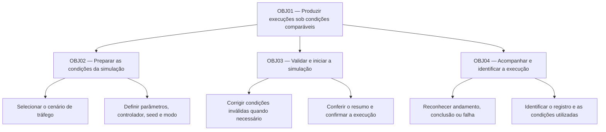
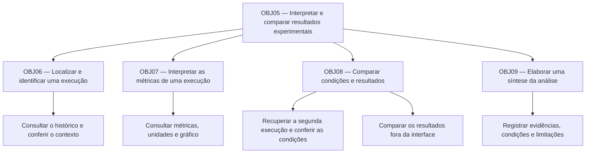
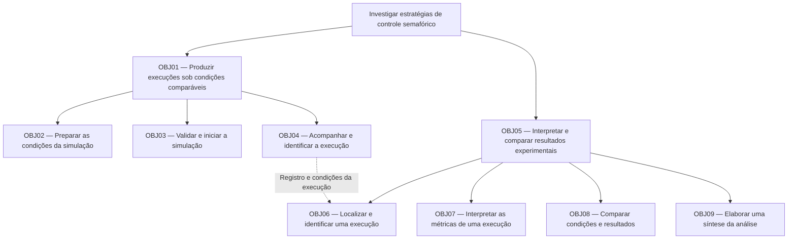

# Entrega 9 — Modelo conceitual e design centrado na comunicação

**Data:** 17/11/2026  
**Status:** 🟩 conteúdo concluído  
**Responsabilidade:** soluções individuais, com consolidação da equipe para mapa de objetivos e esquema de signos.

## Objetivo da atividade

Passar do cenário de problema para uma concepção da interação, explicitando os objetivos do usuário, os tópicos de conversa, as falas e os signos que a interface precisa comunicar ao longo das tarefas.

## Transformando resultados técnicos em conceitos compreensíveis

No projeto, o usuário precisa saber em quais condições uma simulação será executada e reconhecer essas mesmas condições ao consultar seu resultado. Para apoiar essa tarefa, o modelo utiliza conceitos do domínio, como cenário de tráfego, controlador, seed, modo de execução e estado da simulação.

A **seed** identifica a condição de aleatoriedade usada na simulação e ajuda a repetir as condições do experimento. O **controlador** indica a estratégia de controle semafórico escolhida. O **modo de execução** informa se a simulação será acompanhada pela interface gráfica do SUMO (**Visual**) ou executada sem abrir essa interface (**Headless**). Esses termos aparecem junto à decisão que o usuário precisa tomar.

## 1. Cenários de interação

### CI01 — Preparar e executar experimentos sob condições comparáveis

**Autor:** Gabriel Koiama de Rocha Lira — 22.125.067-3  
**Origem:** cenário de problema C01, da Entrega 4.  
**Persona:** P01 — Marina Ribeiro.  
**Tarefas relacionadas:** T01 a T05.

Os trechos em **negrito** indicam os acréscimos e as alterações em relação ao cenário refinado C01.

Marina Ribeiro é pesquisadora e analista de mobilidade e está realizando um estudo experimental para comparar o comportamento do controle de tempo fixo, do Max Pressure convencional e do método híbrido Max Pressure + actuated em uma interseção com demanda desbalanceada.

**Para preparar o primeiro experimento, Marina abre o catálogo e seleciona o cenário de tráfego correspondente à interseção estudada. A interface identifica o cenário selecionado antes de apresentar a configuração da simulação. Marina define o controlador, informa a seed e escolhe o modo de execução. Quando precisa conferir um parâmetro específico, ela abre a configuração avançada e depois volta à revisão das condições do experimento.**

**Ao solicitar a execução, Marina recebe o retorno da validação. Se uma condição for inválida, a mensagem proposta identifica o parâmetro relacionado e orienta o que precisa ser corrigido. Marina volta à configuração, faz o ajuste e solicita uma nova validação. Quando a configuração é aceita, a interface apresenta um resumo com cenário, controlador, seed e modo de execução. Marina pode voltar para ajustar uma escolha ou confirmar o início da simulação.**

**Depois da confirmação, Marina acompanha o estado da execução. No modo Visual, ela também pode observar a simulação no SUMO-GUI. Na evolução proposta da interface, o estado principal aparece em linguagem direta, como “Inicializando”, “Executando”, “Concluída” ou “Falha”, com os logs disponíveis para consulta de detalhes. Em caso de falha, Marina verifica a informação apresentada e decide se precisa revisar a configuração antes de tentar novamente.**

**Para executar a próxima estratégia, Marina prepara uma nova simulação, troca o controlador e confere no resumo se o cenário, a seed e os demais parâmetros que deveriam permanecer equivalentes foram preservados. Ao término, o registro da execução mantém o vínculo com as condições utilizadas, permitindo identificar depois qual experimento produziu cada resultado.**

Caso Marina compare resultados produzidos sob condições que não eram equivalentes, poderá atribuir à estratégia de controle uma diferença que, na realidade, foi causada pela configuração experimental. Nesse caso, o problema não afeta diretamente uma interseção real, pois o trabalho ocorre em simulação, mas pode comprometer a validade do estudo e levar a conclusões inadequadas sobre o comportamento dos métodos avaliados.

#### Diferenças relevantes

| Alteração | Por que foi necessária | Evidência/artefato que justifica |
|---|---|---|
| Seleção do cenário no catálogo antes de configurar o experimento. | Permite identificar o cenário que orienta as escolhas seguintes. | E5, T01/T02. E6, PP01/PP02 e O01. |
| Configuração de controlador, seed e modo, com acesso separado aos parâmetros avançados. | Facilita a conferência das condições principais e mantém os parâmetros mais especializados disponíveis quando necessários. | E5, T02/T03. E6, PP02 e O02/O03. E8, PG02/PG03. |
| Validação com orientação de correção e confirmação após revisão do resumo. | Permite corrigir uma condição inadequada antes de iniciar e verificar se a execução corresponde ao planejado. | E6, PP03 e O04/O05. E8, PG01/PG04 e MU02. |
| Apresentação do estado principal da simulação e dos logs como detalhe. | Ajuda Marina a reconhecer inicialização, execução, conclusão ou falha durante o acompanhamento. | E6, PP04/PP05 e O06/O07. E8, PG05 e MU04. |
| Conferência das condições a cada nova execução e vínculo entre configuração e registro. | Ajuda a manter a equivalência experimental e a recuperar a origem dos resultados para a análise posterior. | E4, C01. E6, PP06/PP07 e O08/O09. E8, PG01 e MQ05. |

### CI02 — Interpretar e comparar resultados experimentais

**Responsável pelo cenário:** João Pedro Lopes Santana Villas Bôas — 22.125.065-7  
**Origem:** cenário de problema C02, da Entrega 4.  
**Persona:** P02 — Carlos Mendes.  
**Tarefas relacionadas:** T06 a T08.

Os trechos em **negrito** indicam os acréscimos e as alterações em relação ao cenário refinado C02.

Carlos Mendes é gestor ou coordenador de mobilidade e precisa analisar um estudo experimental que compara o controle de tempo fixo, o Max Pressure convencional e o método híbrido Max Pressure + actuated. Seu objetivo é compreender como as estratégias se comportaram nas condições avaliadas e utilizar os resultados para apoiar uma análise técnica.

**Carlos abre o histórico e localiza uma execução concluída do estudo. Ele seleciona o registro e confere o cenário, o controlador, a seed e as demais condições relevantes disponíveis no registro experimental. Se houver dúvida sobre a conclusão da simulação ou faltar informação necessária para interpretar os valores, Carlos retorna ao histórico para buscar outro registro ou consulta a documentação do experimento antes de continuar.**

**Ao abrir o resultado individual, Carlos consulta as métricas e, quando precisa investigar um comportamento, examina o gráfico ou diagnóstico associado à execução. Ele anota os valores relevantes junto da identificação do registro e das condições em que foram obtidos. Assim, pode recuperar a origem dos valores ao voltar ao histórico.**

**Carlos retorna ao histórico, abre uma segunda execução e repete a conferência. Fora da interface, coloca as anotações das duas execuções lado a lado. Ele verifica se cenário, demanda, seed e os demais parâmetros que deveriam permanecer comuns são compatíveis com o protocolo do estudo. Se identificar uma diferença que comprometa a comparação, volta ao histórico para selecionar outra execução ou registra a limitação na sua análise.**

**Com as condições verificadas, Carlos interpreta em conjunto as métricas disponíveis, como tempo médio de espera, tamanho médio das filas, throughput e número de trocas de fase. Se uma estratégia reduzir a espera, mas apresentar comportamento diferente em outro indicador, ele registra as duas observações na síntese. Sua conclusão cita os registros utilizados, as condições consideradas e os limites da comparação.**

Se resultados obtidos em condições diferentes forem comparados como se fossem equivalentes, Carlos poderá atribuir à estratégia de controle uma diferença causada por outro fator experimental. Da mesma forma, interpretar apenas uma métrica sem considerar as demais pode produzir uma visão incompleta do comportamento observado.

#### Diferenças relevantes

| Alteração | Por que foi necessária | Evidência/artefato que justifica |
|---|---|---|
| Localizar a execução no histórico e abrir o resultado a partir de um registro identificável. | Preserva o vínculo entre os valores consultados e as condições do experimento. | E5, T06. E6, PP06/PP07 e O08/O09. E8, PG01 e MU05. |
| Conferir a conclusão e o contexto antes de interpretar métricas. | Ajuda a identificar registros incompletos ou sem as informações necessárias para a análise. | E4, C02. E5, T06/T07. E8, MQ05. |
| Consultar métricas e gráfico no resultado individual. | Permite verificar o significado e a origem de cada valor, mantendo os detalhes acessíveis. | E6, PP07 e O09. E8, PG02/PG06. |
| Voltar ao histórico para abrir outra execução e comparar os registros externamente. | Permite selecionar um registro alternativo quando as condições são incompatíveis e descreve o procedimento disponível na V0. | E5, T07. E6, PP06/PP07 e O10. E8, PG07 e MQ06. |
| Elaborar uma síntese com identificação dos registros, métricas e limitações. | Mantém a relação entre a conclusão, os indicadores e as condições em que os resultados foram produzidos. | E4, C02. E5, T08. E8, MQ05. |

## 2. Design centrado na comunicação

**Convenção.** `U` representa o usuário e `D` representa o preposto do designer na interface. As falas abaixo exemplificam a comunicação modelada para o cenário de interação.

### CI01 — Preparar e executar experimentos sob condições comparáveis

| Tópico > subtópico | Falas e signos envolvidos | Intenção/efeito esperado |
|---|---|---|
| Preparação do experimento > seleção do cenário | `U: Quero simular esta interseção.` / `D: Este é o cenário selecionado para o experimento.` **Signos:** catálogo, cenário selecionado. | Confirmar qual cenário será usado nas etapas seguintes. |
| Preparação do experimento > condições da simulação | `U: Vou usar o controlador híbrido com a seed definida para este experimento.` / `D: Estas são as condições configuradas. Você pode consultar os parâmetros avançados, se precisar.` **Signos:** controlador, seed, modo de execução, parâmetros avançados. | Permitir que Marina identifique e confira as escolhas que caracterizam a execução. |
| Validação > condição inválida | `U: Quero iniciar com esta configuração.` / `D: Há um parâmetro inválido. Revise o campo indicado e solicite a validação novamente.` **Signos:** parâmetro inválido, mensagem de validação e orientação de correção. | Tornar a inconsistência identificável e indicar como recuperar a tarefa. |
| Confirmação > revisão das condições | `U: Quero conferir o que será executado.` / `D: Revise o cenário, o controlador, a seed e o modo de execução. Você pode confirmar ou voltar à configuração.` **Signos:** resumo da configuração, confirmação e retorno. | Dar a Marina a oportunidade de corrigir uma escolha antes de iniciar. |
| Acompanhamento > estado da simulação | `U: A simulação já começou?` / `D: A simulação está em execução.` **Signos:** estado da execução, modo Visual e log técnico. | Permitir que Marina reconheça o andamento e consulte detalhes quando necessário. |
| Acompanhamento > falha | `U: O que aconteceu com a execução?` / `D: A execução falhou. Consulte os detalhes para decidir o que revisar antes de tentar novamente.` **Signos:** estado de falha, detalhes da execução e retorno à configuração. | Comunicar a interrupção e oferecer um caminho para retomar a tarefa. |
| Encerramento > identificação da execução | `U: Como identifico depois a simulação que acabei de executar?` / `D: A execução concluída está associada ao cenário, ao controlador e à seed utilizados.` **Signos:** registro da execução, cenário, controlador e seed. | Preservar a origem experimental do resultado para consulta posterior. |

### CI02 — Interpretar e comparar resultados experimentais

| Tópico > subtópico | Falas e signos envolvidos | Intenção/efeito esperado |
|---|---|---|
| Consulta de resultados > localização da execução | `U: Quero encontrar a execução que vou analisar.` / `D: Estas são as execuções disponíveis e os dados associados a cada registro.` **Signos:** histórico e registro da execução. | Permitir selecionar o registro correspondente ao experimento. |
| Consulta de resultados > conferência do contexto | `U: Em quais condições esta execução foi realizada?` / `D: Este é o cenário, o controlador e a seed associados ao registro selecionado.` **Signos:** registro da execução, cenário, controlador, seed e condições experimentais. | Verificar a origem das métricas e identificar se faltam informações relevantes. |
| Interpretação > métricas e diagnóstico | `U: Quero entender o resultado desta execução.` / `D: Estas são as métricas e o gráfico associados à execução selecionada.` **Signos:** métrica, valor, unidade e gráfico/diagnóstico. | Interpretar as medidas com o contexto experimental disponível. |
| Comparação > consulta da segunda execução | `U: Quero consultar outra execução para comparar as duas.` / `D: Volte ao histórico e selecione o próximo registro para abrir seu resultado individual.` **Signos:** retorno ao histórico, registro da execução e resultado individual. | Apoiar a recuperação dos dois registros usados na comparação externa. |
| Comparação > condição incompatível ou contexto insuficiente | `U: Preciso conferir as condições antes de comparar.` / `D: Consulte o contexto deste registro ou volte ao histórico para selecionar outra execução.` **Signos:** condições experimentais e retorno ao histórico. | Dar ao usuário um caminho para buscar outra execução ou registrar a limitação. A decisão de comparabilidade cabe ao usuário. |
| Síntese > identificação das evidências | `U: Quais resultados sustentam a minha conclusão?` / `D: Cada resultado apresenta as métricas vinculadas ao registro consultado.` **Signos:** registro da execução, métricas e condições experimentais. | Apoiar uma síntese externa que mantenha as evidências e as limitações da comparação. |

## 3. Mapa de objetivos

### Mapa individual — Gabriel Koiama de Rocha Lira

**Cenário:** CI01.  
**Persona:** P01 — Marina Ribeiro.

| ID | Objetivo | Persona(s) | Cenário(s) | Prioridade |
|---|---|---|---|---|
| OBJ01 | Produzir execuções sob condições comparáveis. | P01 | CI01 | Alta |
| OBJ02 | Preparar as condições da simulação. | P01 | CI01 | Alta |
| OBJ03 | Validar e iniciar a simulação. | P01 | CI01 | Alta |
| OBJ04 | Acompanhar o estado e identificar a execução associada às condições utilizadas. | P01 | CI01 | Alta |

### Mapa individual — João Pedro Lopes Santana Villas Bôas

**Cenário:** CI02.  
**Persona:** P02 — Carlos Mendes.

### Mapa consolidado — equipe

O **registro da execução** conecta os dois fluxos. Em CI01, ele identifica o experimento que terminou. Em CI02, permite recuperar esse experimento e reconhecer o contexto de cada resultado. Os objetivos OBJ04 e OBJ06 foram mantidos porque tratam de momentos distintos da atividade.

### Dicionário de objetivos

| ID | Objetivo | Persona(s) | Cenário(s) | Prioridade |
|---|---|---|---|---|
| OBJ01 | Produzir execuções sob condições comparáveis. | P01 | CI01 | Alta |
| OBJ02 | Preparar as condições da simulação. | P01 | CI01 | Alta |
| OBJ03 | Validar e iniciar a simulação. | P01 | CI01 | Alta |
| OBJ04 | Acompanhar o estado e identificar a execução associada às condições utilizadas. | P01 | CI01 | Alta |
| OBJ05 | Interpretar e comparar resultados experimentais. | P02 | CI02 | Alta |
| OBJ06 | Localizar uma execução e identificar suas condições. | P02 | CI02 | Alta |
| OBJ07 | Interpretar as métricas de uma execução. | P02 | CI02 | Alta |
| OBJ08 | Verificar se as condições permitem a comparação e confrontar os resultados externamente. | P02 | CI02 | Alta |
| OBJ09 | Elaborar uma síntese e registrar as evidências e limitações da comparação. | P02 | CI02 | Média |

## 4. Esquema conceitual de signos

As condições informadas em CI01 são preservadas no registro da execução e reapresentadas como contexto em CI02. A coluna **Origem** distingue o catálogo e os conceitos do domínio, as escolhas do usuário e as informações produzidas pelo sistema. Nas colunas **Prevenção** e **Recuperação**, as orientações de melhoria representam decisões de design para a V1.

| Grupo | Signo | Origem | Observações/semântica | Tipo de conteúdo | Restrição | Valor padrão | Prevenção | Recuperação |
|---|---|---|---|---|---|---|---|---|
| Configuração | Cenário | Domínio, selecionado pelo usuário | Identifica a malha viária usada no experimento. Faz parte do contexto da execução. | Referência ao catálogo | Deve corresponder a um cenário disponível. | Conforme o cenário selecionado. | Mostrar o nome do cenário na configuração e no resumo. | Voltar ao catálogo e selecionar o cenário correto. |
| Configuração | Condição de demanda | Domínio e configuração experimental | Identifica o perfil de tráfego relevante para interpretar ou comparar resultados. | Identificação do perfil de demanda | Deve ser conferida conforme o protocolo do estudo. | Conforme o cenário e a configuração. | Consultar o contexto experimental antes de comparar. | Consultar o registro original ou selecionar outra execução. |
| Configuração | Controlador | Domínio, selecionado pelo usuário | Indica a estratégia de controle semafórico usada na execução. | Opção discreta | Deve corresponder a uma estratégia disponível nesta configuração. | Conforme a configuração. | Repetir o rótulo do controlador no resumo e no registro. | Voltar à configuração e alterar a opção. |
| Configuração | Seed | Usuário | Valor que identifica a condição de aleatoriedade adotada no experimento. | Número inteiro | Seguir as regras da configuração adotada. A equivalência entre execuções depende do protocolo. | Conforme a configuração do experimento. | Explicar o uso da seed e exibir o valor no resumo. | Indicar o campo quando houver erro e permitir nova validação. |
| Configuração | Modo de execução | Usuário | Visual usa o SUMO-GUI. Headless executa sem abrir a interface gráfica. | Opção discreta | Visual ou Headless. | Conforme a configuração. | Explicar a diferença junto às opções. | Voltar à configuração e alterar o modo antes de iniciar. |
| Configuração | Parâmetros avançados | Usuário, conforme regras do domínio | Reúnem condições específicas do experimento consultadas quando necessário. | Conjunto de campos | Valores e opções dependem do parâmetro e do cenário. | Conforme o cenário e a configuração. | Separar os campos avançados da configuração principal. | Revisar o parâmetro indicado e validar novamente. |
| Validação | Mensagem de validação | Sistema | Comunica o resultado da verificação e indica a condição a revisar quando houver erro. | Texto de retorno | Deve estar associada à condição verificada. | — | Validar antes de permitir a confirmação. | Indicar o campo e orientar como corrigir. |
| Confirmação | Resumo da configuração | Sistema, a partir das escolhas do usuário | Reúne as condições que serão usadas na execução. | Conjunto de dados | Deve refletir as escolhas atuais. | — | Exibir cenário, controlador, seed e modo antes da confirmação. | Permitir voltar à configuração antes de iniciar. |
| Execução | Estado da execução | Sistema | Indica inicialização, processamento, conclusão ou falha. | Estado rotulado | Deve corresponder à situação da execução. | — | Destacar o estado em texto. | Na falha, comunicar os detalhes e oferecer retorno à configuração quando aplicável. |
| Execução | Log técnico | Sistema | Apresenta detalhes do processamento para consulta. | Registro textual | Deve corresponder à execução em questão. | — | Apresentar o estado principal junto aos detalhes. | Consultar o log para orientar a investigação da falha. |
| Histórico | Registro da execução | Sistema | Identifica o experimento e mantém o vínculo com cenário, controlador, seed e demais condições registradas. | Identificador e dados associados | Deve permitir reconhecer a execução consultada. | — | Manter os dados de identificação junto ao resultado. | Voltar ao histórico e selecionar o registro correto. |
| Resultados | Métrica | Domínio e sistema | Medida associada a uma execução, como tempo médio de espera, tamanho médio das filas, throughput ou número de trocas de fase, quando disponível. | Nome, valor e unidade quando aplicável | Interpretar sob as condições do experimento e com a mesma definição ao comparar. | — | Exibir nome e unidade junto ao valor. | Consultar o contexto e os detalhes antes de usar um valor ambíguo. |
| Resultados | Gráfico/diagnóstico | Sistema | Representação que complementa a análise da execução selecionada. | Visualização de dados | Deve estar associado à execução e aos indicadores correspondentes. | — | Identificar a informação exibida e relacioná-la ao resultado. | Voltar às métricas ou ao registro quando precisar conferir a origem dos dados. |

### Regras para os signos

- Usar o vocabulário do domínio do usuário.
- Usar a mesma denominação quando o signo aparecer em mais de um fluxo.
- Identificar se a informação é fornecida pelo usuário, produzida pelo sistema ou derivada do domínio.
- Registrar restrições, valores padrão, prevenção e recuperação quando forem aplicáveis.

## Síntese

No MoLIC de CI01, devem aparecer os tópicos **seleção do cenário**, **configuração da simulação**, **validação**, **confirmação** e **acompanhamento da execução**. O caminho principal vai da seleção do cenário à identificação da execução concluída. Os caminhos de recuperação devem contemplar condição inválida, retorno à configuração antes da confirmação e falha durante a execução.

Os principais signos de CI01 para a Entrega 10 são **cenário, controlador, seed, modo de execução, parâmetros avançados, mensagem de validação, resumo da configuração, estado da execução e registro da execução**. O cenário, o controlador e a seed devem permanecer reconhecíveis na transição entre a preparação e a consulta posterior do registro.

No MoLIC de CI02, devem aparecer os tópicos **localização da execução no histórico**, **conferência do contexto experimental**, **interpretação do resultado individual** e **retorno ao histórico para consultar outro registro**. O caminho alternativo deve permitir selecionar outra execução quando o registro estiver incompleto ou quando as condições forem incompatíveis com o protocolo. Na V0, a comparação e a síntese são realizadas pelo usuário fora da interface, com apoio das informações recuperadas em PP06 e PP07.

A nomenclatura **cenário**, **controlador**, **seed**, **estado da execução** e **registro da execução** permanece nos dois fluxos. O CI01 produz o registro que o CI02 recupera para interpretar as métricas e sustentar a comparação.

## Checklist

- [x] Os dois cenários de interação mostram alterações em relação aos cenários de problema.
- [x] As duas soluções individuais identificam autor ou responsável e cenário de origem.
- [x] Os tópicos, falas e signos dos dois cenários são coerentes com os objetivos do usuário.
- [x] Os mapas individuais foram consolidados.
- [x] O esquema de signos está em uma tabela única e sem duplicações conceituais.
- [x] Os nomes de objetivos e signos serão reutilizados na Entrega 10.
- [x] Os signos representam conceitos do domínio compreensíveis ao usuário.
- [x] Os padrões de interface presentes no escopo possuem objetivos e signos correspondentes.
- [x] A interface comunica o resultado técnico e seu significado para a tarefa.
