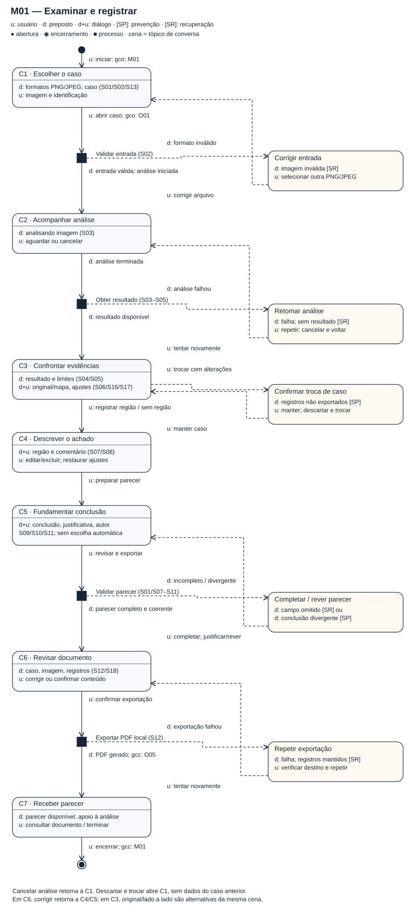

# Entrega 10 — MoLIC

**Data:** {{dd/mm/aaaa}}  
**Status:** 🟨 em andamento  
**Responsabilidade:** 1 solução completa por integrante.

## Objetivo da atividade

Modelar a interação com a interface de simulação semafórica como uma conversa entre o usuário e o preposto do designer. O modelo descreve o que o usuário precisa saber, quais decisões pode tomar e como a interface comunica os resultados dessas decisões, incluindo situações em que é preciso voltar, corrigir uma condição ou encerrar a interação.

A interface desktop documentada na Entrega 6 serve de base para o modelo. As mensagens de recuperação e o destaque do estado da execução seguem as propostas de evolução registradas nas Entregas 8 e 9.

## M01 — Preparar e executar experimentos sob condições comparáveis

**Autor:** Gabriel Koiama de Rocha Lira — 22.125.067-3  
**Cenário de interação de origem:** CI01 — Preparar e executar experimentos sob condições comparáveis.  
**Persona:** P01 — Marina Ribeiro.  
**Objetivos:** OBJ01 — produzir execuções sob condições comparáveis. OBJ02 — preparar as condições da simulação. OBJ03 — validar e iniciar a simulação. OBJ04 — acompanhar e identificar a execução.  
**Tarefas relacionadas:** T01 — selecionar a malha viária. T02 — configurar os parâmetros do experimento. T03 — selecionar a estratégia de controle. T04 — iniciar uma simulação. T05 — verificar o estado da execução.  
**Signos relevantes:** cenário, controlador, seed, modo de execução, parâmetros avançados, mensagem de validação, resumo da configuração, estado da execução e registro da execução.

### Diagrama

**Fonte editável:** [molic_m01.svg](../assets/10_molic/molic_m01.svg).

No diagrama, `u` identifica a fala da usuária, `d` identifica a fala do preposto do designer e `d+u` indica um tópico de diálogo entre ambos. Os retângulos pretos representam o processamento do sistema. As setas tracejadas representam transições de recuperação de ruptura. `[SR]` identifica a recuperação apoiada, em que a mensagem indica o que a usuária precisa revisar para prosseguir.

### Leitura do diagrama

#### Caminho principal

1. **Escolher o cenário de tráfego.** A conversa começa com a escolha do cenário. Marina consulta o catálogo, identifica a interseção do estudo e confirma qual cenário será usado.
2. **Definir as condições da simulação.** Marina configura os parâmetros, escolhe o controlador e informa a seed e o modo de execução. Quando necessário, consulta os parâmetros avançados antes de solicitar a validação.
3. **Validar e revisar a configuração.** O sistema verifica as condições informadas. Quando a configuração é aceita, a interface apresenta o resumo com cenário, controlador, seed e modo de execução. Marina confere as escolhas e confirma o início.
4. **Acompanhar a execução.** Durante o processamento, a interface informa se a simulação está inicializando ou executando. Se Marina tiver escolhido o modo Visual, ela também pode acompanhar a simulação pelo SUMO-GUI.
5. **Identificar a execução concluída.** Ao concluir, a interface informa o resultado do processamento e associa o registro ao cenário, ao controlador e à seed. Marina pode encerrar a interação ou voltar à escolha do cenário para preparar outra execução. Nesse segundo caso, ela confere as condições que devem permanecer equivalentes antes de confirmar o próximo experimento.

#### Alternativas e rupturas

| Situação | Onde ocorre | Como a usuária percebe | Caminho de recuperação/saída |
|---|---|---|---|
| Marina precisa conferir um parâmetro avançado. | Condições da simulação. | A interface oferece acesso à configuração avançada. | Marina consulta ou ajusta o parâmetro e continua a configuração antes de validar. |
| Uma condição é inválida. | Validação da configuração. | A mensagem identifica o campo relacionado e orienta a revisão. | A conversa retorna às condições da simulação. Marina corrige o valor e solicita nova validação. |
| Marina percebe uma escolha diferente da planejada. | Revisão antes de iniciar. | O resumo permite conferir cenário, controlador, seed e modo de execução. | Marina volta à configuração, ajusta a escolha e revisa novamente o resumo antes de confirmar. |
| A simulação falha após a confirmação. | Processamento da simulação. | A interface comunica a falha e apresenta os detalhes disponíveis. | Marina pode voltar à configuração para revisar as condições antes de uma nova tentativa ou encerrar a interação após a falha. |
| Marina precisa executar outro controlador sob condições equivalentes. | Identificação da execução concluída. | O registro identifica as condições da execução anterior. | Marina volta à escolha do cenário, prepara outra execução e confere no resumo quais condições devem ser preservadas. |

### Checklist específico de modelagem

- [x] O ponto de abertura conduz à escolha do cenário.
- [x] As cenas representam tópicos da conversa entre a usuária e a interface.
- [x] As transições identificam as falas da usuária e do preposto do designer.
- [x] Há pontos de encerramento após conclusão ou após falha, conforme a decisão da usuária.
- [ ] Conferir a representação dos processos e das transições com a notação adotada em aula.
- [x] As rupturas relevantes têm feedback e caminho de recuperação ou saída.
- [x] O diagrama cobre alternativas ao caminho principal.
- [x] Os objetivos, tópicos e signos retomam o CI01 da Entrega 9.
- [ ] Conferir a legibilidade do SVG no GitHub depois de publicar.
- [x] O modelo descreve a comunicação da interface durante a validação e a execução.

## M02 — {{nome do cenário/objetivo}}

**Autor(a):** {{nome — matrícula}}  
**Cenário de interação de origem:** {{CI02}}  
**Objetivos:** {{...}}  
**Tarefas relacionadas:** {{...}}  
**Signos relevantes:** {{...}}

### Diagrama

{{diagrama e fonte editável}}

### Leitura do diagrama

#### Caminho principal

{{...}}

#### Alternativas e rupturas

| Situação | Onde ocorre | Como o usuário percebe | Caminho de recuperação/saída |
|---|---|---|---|
| {{...}} | {{...}} | {{...}} | {{...}} |

### Checklist específico de modelagem

{{preencher após a elaboração de M02}}

## Consolidação da equipe

### Cobertura dos objetivos

| Objetivo | MoLIC que cobre | Lacunas/duplicidades | Decisão |
|---|---|---|---|
| {{...}} | {{...}} | {{...}} | {{...}} |

### Preparação para o Figma

{{consolidar os estados e as telas necessários após a revisão de M01 e M02, incluindo confirmação, feedback, erro e recuperação}}

## Referência

- SILVA, Bruno Santana da. BARBOSA, Simone Diniz Junqueira. [*Designing Human-Computer Interaction With MoLIC Diagrams — A Practical Guide*](https://www-di.inf.puc-rio.br/~simone/publications/07_12_silva.pdf). PUC-Rio, 2007.
