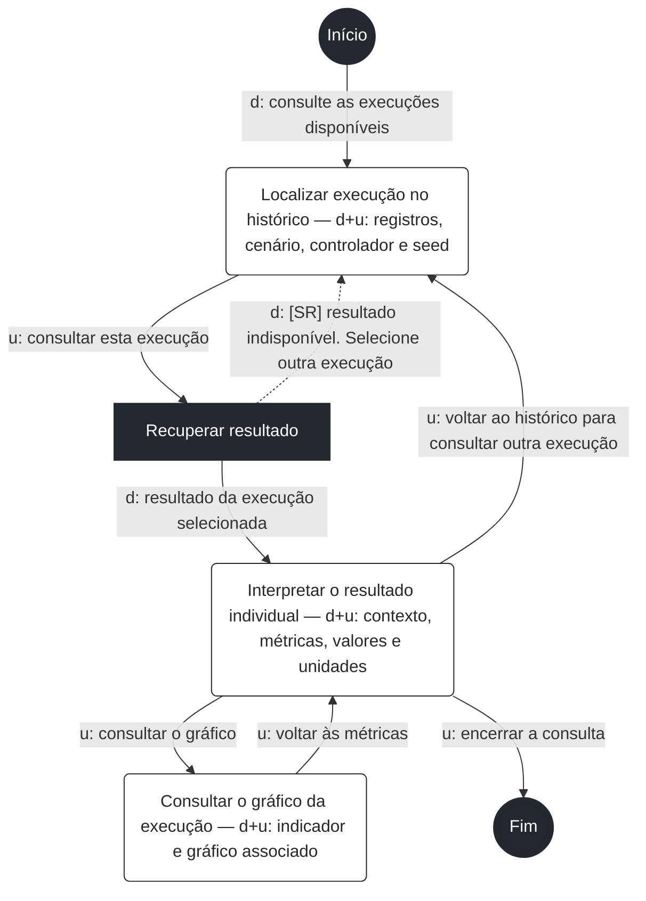

# Entrega 10 — MoLIC

**Data:** 17/11/2026  
**Status:** 🟩 conteúdo concluído  
**Responsabilidade:** 1 solução completa por integrante.

## Objetivo da atividade

Modelar a interação com a interface de simulação semafórica como uma conversa entre o usuário e o preposto do designer. O modelo descreve o que o usuário precisa saber, quais decisões pode tomar e como a interface comunica os resultados dessas decisões, incluindo situações em que é preciso voltar, corrigir uma condição ou encerrar a interação.

A interface desktop documentada na Entrega 6 serve de base para o modelo. As mensagens de recuperação e o destaque do estado da execução seguem as propostas de evolução registradas nas Entregas 8 e 9.

## M01 — Preparar e executar experimentos sob condições comparáveis

**Autor:** Gabriel Koiama de Rocha Lira — 22.125.067-3  
**Cenário de interação de origem:** CI01 — Preparar e executar experimentos sob condições comparáveis.  
**Persona:** P01 — Marina Ribeiro.  
**Objetivos:** OBJ01 — produzir execuções sob condições comparáveis. OBJ02 — preparar as condições da simulação. OBJ03 — validar e iniciar a simulação. OBJ04 — acompanhar e identificar a execução.  
**Tarefas relacionadas:** T01 — selecionar a malha viária. T02 — configurar os parâmetros do experimento. T03 — selecionar a estratégia de controle. T04 — iniciar uma simulação. T05 — verificar o estado da execução.  
**Signos relevantes:** cenário, controlador, seed, modo de execução, parâmetros avançados, mensagem de validação, resumo da configuração, estado da execução e registro da execução.

### Diagrama

**Fonte editável:** [molic_m01.svg](../assets/10_molic/molic_m01.svg).

No diagrama, `u` identifica a fala da usuária, `d` identifica a fala do preposto do designer e `d+u` indica um tópico de diálogo entre ambos. Os retângulos pretos representam o processamento do sistema. As setas tracejadas representam transições de recuperação de ruptura. `[SR]` identifica a recuperação apoiada, em que a mensagem indica o que a usuária precisa revisar para prosseguir.

### Leitura do diagrama

#### Caminho principal

1. **Escolher o cenário de tráfego.** A conversa começa com a escolha do cenário. Marina consulta o catálogo, identifica a interseção do estudo e confirma qual cenário será usado.
2. **Definir as condições da simulação.** Marina configura os parâmetros, escolhe o controlador e informa a seed e o modo de execução. Quando necessário, consulta os parâmetros avançados antes de solicitar a validação.
3. **Validar e revisar a configuração.** O sistema verifica as condições informadas. Quando a configuração é aceita, a interface apresenta o resumo com cenário, controlador, seed e modo de execução. Marina confere as escolhas e confirma o início.
4. **Acompanhar a execução.** Durante o processamento, a interface informa se a simulação está inicializando ou executando. Se Marina tiver escolhido o modo Visual, ela também pode acompanhar a simulação pelo SUMO-GUI.
5. **Identificar a execução concluída.** Ao concluir, a interface informa o resultado do processamento e associa o registro ao cenário, ao controlador e à seed. Marina pode encerrar a interação ou voltar à escolha do cenário para preparar outra execução. Nesse segundo caso, ela confere as condições que devem permanecer equivalentes antes de confirmar o próximo experimento.

#### Alternativas e rupturas

| Situação | Onde ocorre | Como a usuária percebe | Caminho de recuperação/saída |
|---|---|---|---|
| Marina precisa conferir um parâmetro avançado. | Condições da simulação. | A interface oferece acesso à configuração avançada. | Marina consulta ou ajusta o parâmetro e continua a configuração antes de validar. |
| Uma condição é inválida. | Validação da configuração. | A mensagem identifica o campo relacionado e orienta a revisão. | A conversa retorna às condições da simulação. Marina corrige o valor e solicita nova validação. |
| Marina percebe uma escolha diferente da planejada. | Revisão antes de iniciar. | O resumo permite conferir cenário, controlador, seed e modo de execução. | Marina volta à configuração, ajusta a escolha e revisa novamente o resumo antes de confirmar. |
| A simulação falha após a confirmação. | Processamento da simulação. | A interface comunica a falha e apresenta os detalhes disponíveis. | Marina pode voltar à configuração para revisar as condições antes de uma nova tentativa ou encerrar a interação após a falha. |
| Marina precisa executar outro controlador sob condições equivalentes. | Identificação da execução concluída. | O registro identifica as condições da execução anterior. | Marina volta à escolha do cenário, prepara outra execução e confere no resumo quais condições devem ser preservadas. |

### Checklist específico de modelagem

- [x] O ponto de abertura conduz à escolha do cenário.
- [x] As cenas representam tópicos da conversa entre a usuária e a interface.
- [x] As transições identificam as falas da usuária e do preposto do designer.
- [x] Há pontos de encerramento após conclusão ou após falha, conforme a decisão da usuária.
- [ ] Conferir a representação dos processos e das transições com a notação adotada em aula.
- [x] As rupturas relevantes têm feedback e caminho de recuperação ou saída.
- [x] O diagrama cobre alternativas ao caminho principal.
- [x] Os objetivos, tópicos e signos retomam o CI01 da Entrega 9.
- [ ] Conferir a legibilidade do SVG no GitHub depois de publicar.
- [x] O modelo descreve a comunicação da interface durante a validação e a execução.

## M02 — Interpretar e comparar resultados experimentais

**Responsável pelo cenário:** João Pedro Lopes Santana Villas Bôas — 22.125.065-7  
**Cenário de interação de origem:** CI02 — Interpretar e comparar resultados experimentais.  
**Persona:** P02 — Carlos Mendes.  
**Objetivos:** OBJ05 — interpretar e comparar resultados experimentais. OBJ06 — localizar e identificar uma execução. OBJ07 — interpretar as métricas de uma execução. OBJ08 — comparar condições e resultados. OBJ09 — elaborar uma síntese da análise.  
**Tarefas relacionadas:** T06 — consultar as métricas obtidas. T07 — comparar resultados. T08 — consultar ou gerar uma síntese dos resultados.  
**Signos relevantes:** histórico, registro da execução, cenário, condição de demanda, controlador, seed, condições experimentais, métricas, unidades e gráfico/diagnóstico.

### Diagrama

**Fonte editável:** bloco Mermaid acima.

A legenda segue a convenção do M01. As cenas aparecem em caixas de cantos arredondados e o processo de recuperação do resultado aparece em uma caixa escura. A seta tracejada comunica a ruptura e indica o retorno ao histórico. `[SR]` significa recuperação apoiada. A abertura e o encerramento são identificados pelos nós **Início** e **Fim**.

A comparação e a síntese são atividades externas apoiadas pela consulta individual das execuções.

### Leitura do diagrama

#### Caminho principal

1. **Localizar a execução no histórico.** Carlos abre a listagem, identifica o registro de interesse e solicita a consulta daquela execução.
2. **Recuperar e identificar o resultado.** O sistema abre o resultado individual. Carlos confere o registro, o cenário, o controlador, a seed e as demais condições experimentais disponíveis.
3. **Interpretar as métricas.** Carlos lê os valores e suas unidades quando aplicáveis. Se precisar investigar um indicador, consulta o gráfico associado à execução e depois retorna às métricas.
4. **Consultar outra execução.** Quando precisa comparar estratégias, Carlos registra as informações da primeira execução, volta ao histórico e repete a consulta para o segundo registro. Ele verifica se as condições são compatíveis com o protocolo experimental.
5. **Encerrar a consulta e elaborar a síntese.** Carlos encerra a interação quando reúne as informações de que precisa. Ele compara as métricas e registra as conclusões e limitações fora da interface, identificando as execuções usadas.

#### Alternativas e rupturas

| Situação | Onde ocorre | Como o usuário percebe | Caminho de recuperação/saída |
|---|---|---|---|
| O resultado do registro selecionado está indisponível. | Recuperação do resultado. | A interface comunica que o resultado não está disponível e orienta a escolha de outro registro. | Retornar ao histórico e selecionar outra execução. |
| Um indicador precisa de mais contexto. | Interpretação do resultado individual. | O resultado oferece o gráfico ou diagnóstico associado ao indicador, quando disponível. | Consultar o gráfico e voltar às métricas da mesma execução. |
| O contexto da execução é insuficiente para comparar. | Interpretação do resultado individual. | Ao conferir o registro, Carlos percebe que falta uma condição relevante para a análise. | Voltar ao histórico para consultar outra execução ou buscar a informação na documentação experimental. |
| As duas execuções têm condições incompatíveis com o protocolo. | Conferência dos registros, antes da comparação externa. | Carlos identifica uma diferença de cenário, demanda, seed ou outro parâmetro que deveria permanecer equivalente. | Consultar outra execução ou registrar a limitação e encerrar a comparação. A decisão cabe ao usuário. |

### Checklist específico de modelagem

- [x] O ponto de abertura conduz à consulta do histórico.
- [x] As cenas representam a localização da execução, a interpretação do resultado e a consulta ao gráfico.
- [x] As transições identificam as falas do usuário e do preposto do designer.
- [x] O processamento de recuperação do resultado está representado.
- [x] O resultado indisponível tem mensagem e caminho de recuperação.
- [x] Há retorno ao histórico, retorno do gráfico às métricas e ponto de encerramento.
- [x] Os objetivos, tópicos e signos retomam o CI02 da Entrega 9.
- [x] Conferir a representação dos processos e das transições com a notação adotada em aula.
- [x] Conferir a renderização e a legibilidade do Mermaid no GitHub.

## Consolidação da equipe

### Cobertura dos objetivos

| Objetivo | MoLIC que cobre | Lacunas/duplicidades | Decisão |
|---|---|---|---|
| OBJ01 — Produzir execuções sob condições comparáveis. | M01 | A revisão de condições antecede cada execução. A comparabilidade entre registros depende do protocolo. | Permitir preparar outra execução após a conclusão e conferir as condições no resumo. |
| OBJ02 — Preparar as condições da simulação. | M01 | A preparação reúne parâmetros principais e avançados. | Manter cenário, controlador, seed e modo reconhecíveis ao longo da configuração. |
| OBJ03 — Validar e iniciar a simulação. | M01 | Uma condição inválida pode interromper a preparação. | Apresentar o campo relacionado à validação e manter o retorno à configuração antes de iniciar. |
| OBJ04 — Acompanhar e identificar a execução. | M01 | O registro também aparece no M02 como referência da análise. | Preservar cenário, controlador e seed no registro após a execução. |
| OBJ05 — Interpretar e comparar resultados experimentais. | M02 | A interface apresenta resultados individuais. | Apoiar a consulta sucessiva. O usuário reúne os valores para a comparação externa. |
| OBJ06 — Localizar e identificar uma execução. | M02 | O mesmo registro que encerra o M01 serve de entrada para a consulta no M02. | Usar a mesma identificação e o mesmo vocabulário nos dois fluxos. |
| OBJ07 — Interpretar as métricas de uma execução. | M02 | Algumas medidas exigem gráfico ou contexto adicional. | Apresentar métricas e unidades quando aplicáveis e permitir retornar do gráfico ao resultado individual. |
| OBJ08 — Comparar condições e resultados. | M02 | A equivalência das condições depende do protocolo experimental. | Permitir consultar outra execução quando os registros forem incompatíveis ou insuficientes. |
| OBJ09 — Elaborar uma síntese da análise. | M02 | A síntese é elaborada fora da interface. | Manter a relação entre registro, condições e métricas para que a síntese cite as evidências. |

### Preparação para o Figma

| MoLIC | Telas e estados necessários | Interações a representar |
|---|---|---|
| M01 | Catálogo de cenários, configuração principal e avançada, erro de validação, resumo de confirmação, inicialização, execução, conclusão e falha. | Avançar após a validação, corrigir parâmetro, voltar antes de iniciar, revisar a configuração após falha e preparar outra execução. |
| M02 | Histórico, resultado individual com contexto e métricas, gráfico/diagnóstico e estado de resultado indisponível. | Selecionar uma execução, conferir as condições, abrir e fechar o gráfico, voltar ao histórico para consultar outro registro e recuperar a consulta quando o resultado estiver indisponível. |

O ponto de ligação entre os fluxos é o **registro da execução**. A identificação, o cenário, o controlador e a seed devem aparecer com os mesmos rótulos no encerramento do M01 e na consulta do M02. O Figma deve permitir consultar duas execuções sucessivamente para apoiar a comparação externa descrita no CI02.

## Referência

- SILVA, Bruno Santana da. BARBOSA, Simone Diniz Junqueira. [*Designing Human-Computer Interaction With MoLIC Diagrams — A Practical Guide*](https://www-di.inf.puc-rio.br/~simone/publications/07_12_silva.pdf). PUC-Rio, 2007.
