# Entrega 11 — Protótipo no Figma

**Data:** 17/11/2026 
**Status:** 🟩 concluída (pendente: conferir o acesso público ao link do Figma) 
**Responsabilidade:** 1 protótipo integrado por equipe, cobrindo os fluxos MoLIC 
**Autoria:** pranchas SVG e especificação das conexões por Kawan Mark Geronimo Da Silva (22.222.010-5), em 11/11/2026; protótipo navegável e montagem no Figma por Gabriel Albertini Pinheiro (22.122.094-8). A base são os modelos M01 (Kawan), M02 (Gabriel) e M03 (Alexandre Domiciano Pierri, 22.125.061-6) da [Entrega 10](10_molic.md).

## Objetivo da atividade

Materializar a conversa modelada no MoLIC em um protótipo navegável da **Mesa de inspeção**. O protótipo preserva os objetivos O01–O09, os signos S01–S18 e as rupturas da [Entrega 10](10_molic.md), sem acrescentar funcionalidades.

## 1. Origem do protótipo: a interface do TCC

[F] O TCC tem uma interface de demonstração própria (`codigo/interface/` no repositório do TCC). Ela é uma página Web servida localmente que envia a radiografia ao modelo (EfficientNet-B1 com mapa de atenção LayerCAM + Grad-CAM++), aplica os ajustes de imagem no navegador e gera um laudo em PDF. Essa interface foi a base visual e estrutural do protótipo:

| Elemento | Mantido da interface do TCC | Alterado para seguir as Entregas 6, 9 e 10 |
|---|---|---|
| Layout | Três zonas: ajustes à esquerda, mesa de luz no centro, análise/parecer à direita. Barra superior e barra de ferramentas da imagem. | Barra superior com identificação do caso e carga declarada (S01/S13; OBS-01). |
| Visual | Tema escuro “console de sala de leitura”, âmbar como única cor de destaque, Barlow/Barlow Semi Condensed, mesa de luz com régua. | Vermelho e verde só no achado e na conclusão humana; texto escuro sobre vermelho para atingir 4,5:1 (seção 6). |
| Ajustes de imagem | Funções rápidas, exposição, realce, densidade e paleta. | Rotulados como candidatos (S17/H43); a necessidade de cada um continua a ser investigada. |
| Resultado do modelo | Mapa de atenção e região de maior atenção em tracejado âmbar. | Categoria qualitativa “Indício de atipicidade” com explicação de alcance (S04/S05; OBS-03). Probabilidade e limiar **não** são exibidos (S14/S15 candidatos; H31/H37). |
| Comparação | “Segure para comparar (C)”. | Seletor persistente **Sobreposta / Sem mapa / Lado a lado** (S06; OBS-02/H30). |
| Registro | Ferramenta Marcar com comentário por região. | Comentário visível junto da região e obrigatório (S07/S08; OBS-05). |
| Conclusão | “Liberar carga” / “Inspeção física”. | **“Sem ressalvas na imagem” / “Suspeita apontada”**, com justificativa e responsável obrigatórios (S09–S11; OBS-04/H39). |
| Exportação | “Baixar laudo em PDF” direto. | Revisão prévia (F08), validação (F10c), falha recuperável (F10d) e confirmação de sucesso (F09); S12/S18. |

[F] A radiografia é a imagem de teste do TCC (`testes/anomalia.png`, foto do *holdout* com anomalia inserida). O mapa de atenção é a **saída real** do modelo de referência para essa imagem, gerada em 17/11/2026 com o próprio código do servidor do TCC. [H] Caso, unidade de carga, carga declarada, responsável, comentários e datas são **fictícios**.

## 2. Link do Figma

**Protótipo navegável:** https://www.figma.com/proto/9cKfwkCvyasTplQlf90RTC?node-id=1-2&starting-point-node-id=1%3A2 
**Arquivo editável:** https://www.figma.com/design/9cKfwkCvyasTplQlf90RTC 
**Última verificação de permissão:** 20/11/2026 — teste sem login (`HTTP 404`). O compartilhamento “qualquer pessoa com o link pode ver” ainda precisa ser ativado no Figma e retestado em janela anônima.

O arquivo tem uma página, **Protótipo F01–F12**, com as 16 telas e estados organizados em grade, e o fluxo inicial **Mesa de inspeção — P01 (F01)**. As 122 interações são de clique (*On click → Navigate to*).

**Versão HTML equivalente:** [`assets/11_figma/prototipo/index.html`](../assets/11_figma/prototipo/index.html), que abre localmente no navegador. As telas foram geradas em HTML por [`gerar_prototipo.py`](../assets/11_figma/prototipo/gerar_prototipo.py) com o CSS da interface do TCC ([`base_tcc.css`](../assets/11_figma/prototipo/base_tcc.css)) e as revisões em [`prototipo.css`](../assets/11_figma/prototipo/prototipo.css), e depois importadas no Figma. Para alterar uma tela, edite o gerador, gere de novo o HTML e atualize as telas no Figma, mantendo os mesmos IDs F.

### 2.1 Pranchas SVG preparadas antes da montagem

Em 11/11/2026, a equipe preparou 16 pranchas vetoriais editáveis com os mesmos IDs e a especificação das conexões: [F01](../assets/11_figma/f01.svg), [F02](../assets/11_figma/f02.svg), [F03](../assets/11_figma/f03.svg), [F04](../assets/11_figma/f04.svg), [F05](../assets/11_figma/f05.svg), [F06](../assets/11_figma/f06.svg), [F07](../assets/11_figma/f07.svg), [F08](../assets/11_figma/f08.svg), [F09](../assets/11_figma/f09.svg), [F10a](../assets/11_figma/f10a.svg), [F10b](../assets/11_figma/f10b.svg), [F10c](../assets/11_figma/f10c.svg), [F10d](../assets/11_figma/f10d.svg), [F11a](../assets/11_figma/f11a.svg), [F11b](../assets/11_figma/f11b.svg) e [F12](../assets/11_figma/f12.svg). As telas do Figma seguem essas pranchas, com o visual da interface do TCC. As pranchas continuam no repositório como fonte vetorial e registro da especificação.

### 2.2 Interação simulada e funcionalidade real

| No protótipo | Situação |
|---|---|
| Navegação entre F01–F12, abertura de arquivo, análise, falhas, exportação e PDF | **Simulados.** Cada tela é um estado fixo, e as falhas são acionadas pela faixa roxa **“Simulação do protótipo”**, que não faz parte da interface. |
| Mapa de atenção e categoria do resultado | Imagem **real** produzida pelo modelo do TCC. O protótipo não executa inferência. |
| Ajustes, zoom, lupa e arraste da marcação | Mostrados em estado fixo. A interface do TCC já os implementa, mas o protótipo não reproduz o comportamento contínuo. |
| Envio do parecer a P02/P03 | **Fora da Mesa**, sem tela (H28/H39/H42/?08). F12 representa o PDF aberto em um leitor externo. |

## 3. Cobertura MoLIC → Figma

| MoLIC | Objetivo | Fluxo/telas no Figma | Estados de erro/recuperação | Responsável |
|---|---|---|---|---|
| M01 — C1 Escolher o caso | O01/O02 | `F01 → F02` | `F10a` (formato inválido → escolher outro) | Kawan (modelo) · Gabriel (telas) |
| M01 — C2 Acompanhar análise | O01/O08 | `F02 → F03` | `F10b` (falha → tentar novamente/cancelar), cancelar em F02 | Kawan · Gabriel |
| M01 — C3 Confrontar evidências | O03/O07/O08 | `F03 ⇄ F04 ⇄ F05` | `F11a` (troca com registros → manter/descartar) | Kawan · Gabriel |
| M01 — C4 Descrever o achado | O04 | `F03/F04/F05 → F06` | Excluir região (F06 → F03); comentário vazio em F10c | Kawan · Gabriel |
| M01 — C5 Fundamentar conclusão | O01/O04 | `F06 → F07` | `F10c` (incompleto), `F11b` (divergente do modelo → rever/confirmar) | Kawan · Gabriel |
| M01 — C6 Revisar documento | O05 | `F07 → F08` | Voltar e corrigir (F08 → F07) | Kawan · Gabriel |
| M01 — C7 Receber parecer | O05 | `F08 → F09` | `F10d` (falha ao exportar → repetir sem perder dados) | Kawan · Gabriel |
| M02 — C1–C4 Compreender o fundamento | O06/O02/O07/O08 | `F12`: o PDF é a fala do preposto | Caso divergente ou informação insuficiente encerram a leitura e seguem por canal externo, sem tela na Mesa | Gabriel |
| M03 — C1–C5 Preparar a informação para a conferência | O09/O02/O07/O08 | `F06 → F07 → F08 → F09`, reaproveitando M01 | `F10c`, `F11b`, `F10d`, voltar em F08 | Alexandre (modelo) · Gabriel (telas) |

**Caminho principal (P01):** F01 → F02 → F03 → (F04/F05) → F06 → F07 → F08 → F09 → F12. O caminho “Sem ressalvas na imagem” sem região marcada passa por F11b quando a conclusão diverge da indicação do modelo.

Não foram criadas telas sem conversa no MoLIC: dashboard, fila, histórico, login, administração e CRUD continuam fora do recorte (Entregas 6, 9 e 10).

## 4. Catálogo de telas e estados

Capturas em 1440 × 900. A faixa roxa no rodapé é só navegação de simulação, com o ID da tela à direita.

### F01 — Abrir caso (sem imagem)

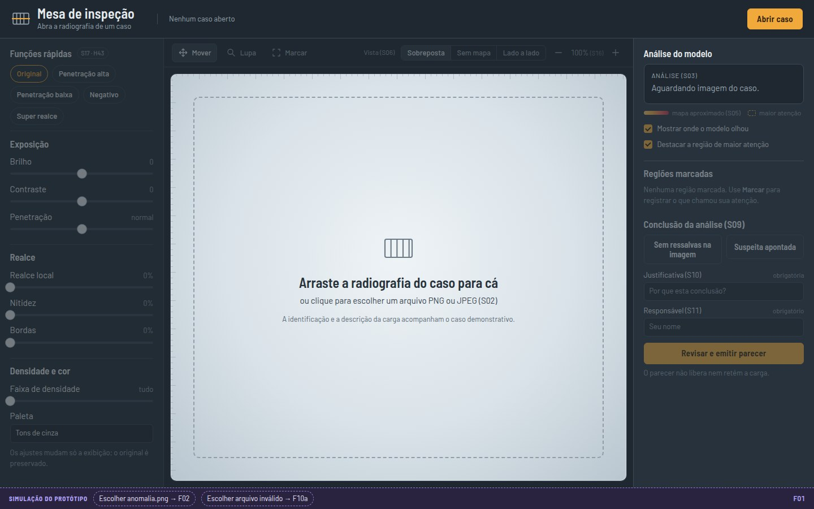

**Objetivo do usuário:** iniciar o exame de um caso (O01/O02). 
**Signos principais:** área para soltar a radiografia com os formatos aceitos (S02, PP); estado da análise “Aguardando imagem do caso” (S03); controles desabilitados até haver imagem (PA). 
**Origem no MoLIC:** M01/C1 · **Transições:** soltar ou escolher arquivo → F02; arquivo inválido → F10a.

### F02 — Analisando imagem

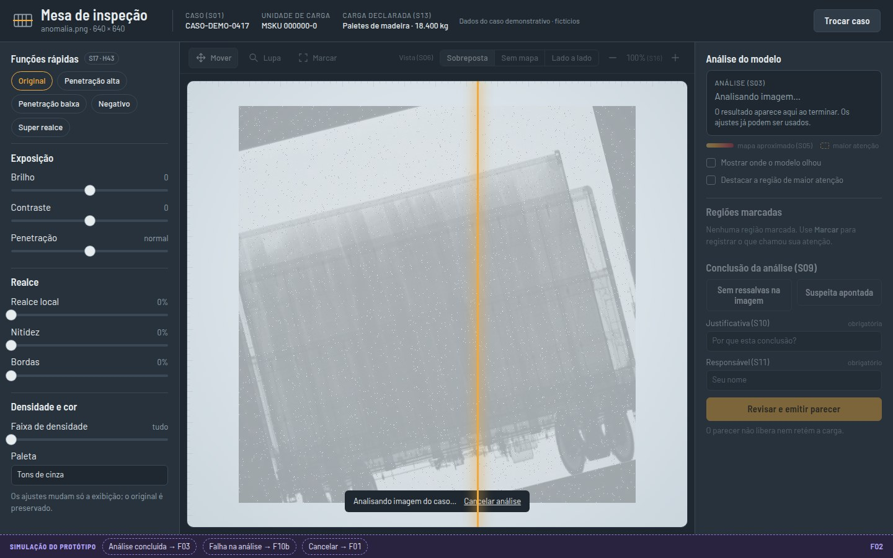

**Objetivo do usuário:** acompanhar a análise sem confundir espera com resultado (O08). 
**Signos principais:** S03 “Analisando imagem…”, linha de varredura herdada do TCC, identificação do caso (S01/S13) e “Cancelar análise”. Vista, marcação e parecer ficam desabilitados (PA para S03: impedir uso de resultado inexistente). 
**Origem no MoLIC:** M01/C2 e processo “Obter resultado” · **Transições:** concluída → F03; falha → F10b; cancelar → F01.

### F03 — Resultado: vista sobreposta

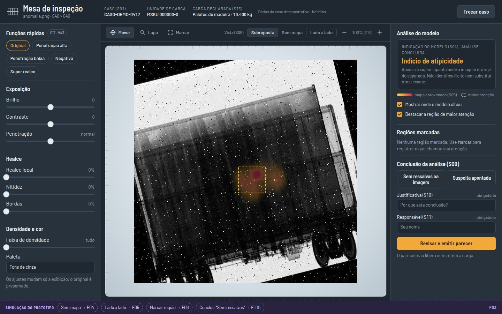

**Objetivo do usuário:** saber onde começar a olhar e o alcance do resultado (O03/O08). 
**Signos principais:** “Indício de atipicidade” com microtexto de limites (S04, PP); mapa e região de maior atenção, com legenda “mapa aproximado” (S05); vista “Sobreposta” ativa (S06); zoom (S16); ajustes candidatos (S17). 
**Origem no MoLIC:** M01/C3 · **Transições:** Sem mapa → F04; Lado a lado → F05; Marcar → F06; Suspeita apontada → F07; Sem ressalvas → F11b; Revisar com campos vazios → F10c; Trocar caso → F01.

### F04 — Comparar sem o mapa

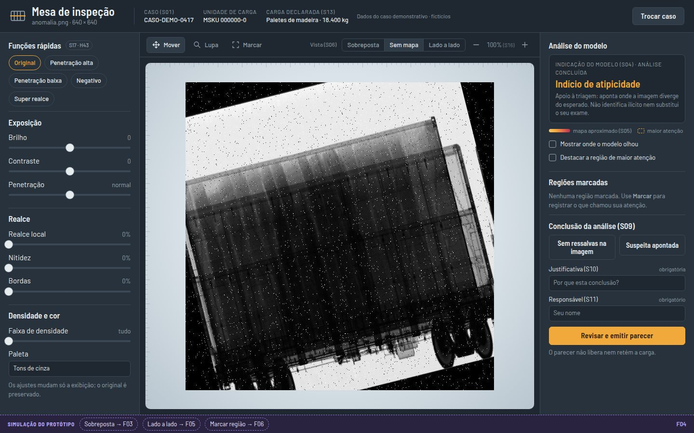

**Objetivo do usuário:** confrontar a radiografia sem a camada do modelo e sem precisar segurar uma tecla (O03; OBS-02). 
**Signos principais:** vista “Sem mapa” (S06) e camadas do modelo desligadas. A radiografia original é preservada. 
**Origem no MoLIC:** M01/C3, diálogo original/mapa · **Transições:** iguais às de F03.

### F05 — Comparar lado a lado

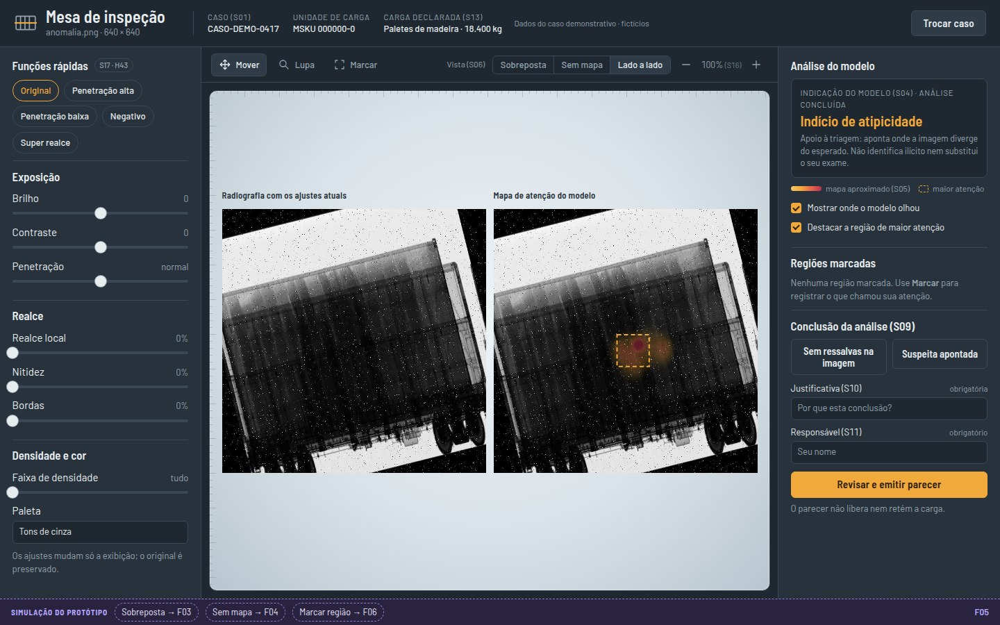

**Objetivo do usuário:** ver ao mesmo tempo os contornos reais e a atenção do modelo (O03/O07; H30). 
**Signos principais:** dois painéis rotulados, “Radiografia com os ajustes atuais” e “Mapa de atenção do modelo” (S05/S06). 
**Origem no MoLIC:** M01/C3 · **Transições:** iguais às de F03.

### F06 — Região marcada e comentada

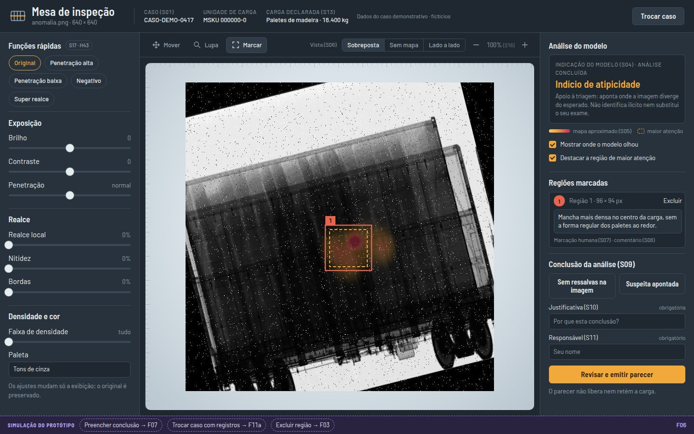

**Objetivo do usuário:** descrever e localizar o achado (O04). 
**Signos principais:** retângulo vermelho numerado, distinto do tracejado âmbar do modelo (S07, PP); comentário visível com rótulo “Marcação humana (S07) · comentário (S08)”; “Excluir” (RA). 
**Origem no MoLIC:** M01/C4; M03/C2 · **Transições:** conclusão → F07; Excluir → F03; Trocar caso → F11a.

### F07 — Conclusão, justificativa e responsável

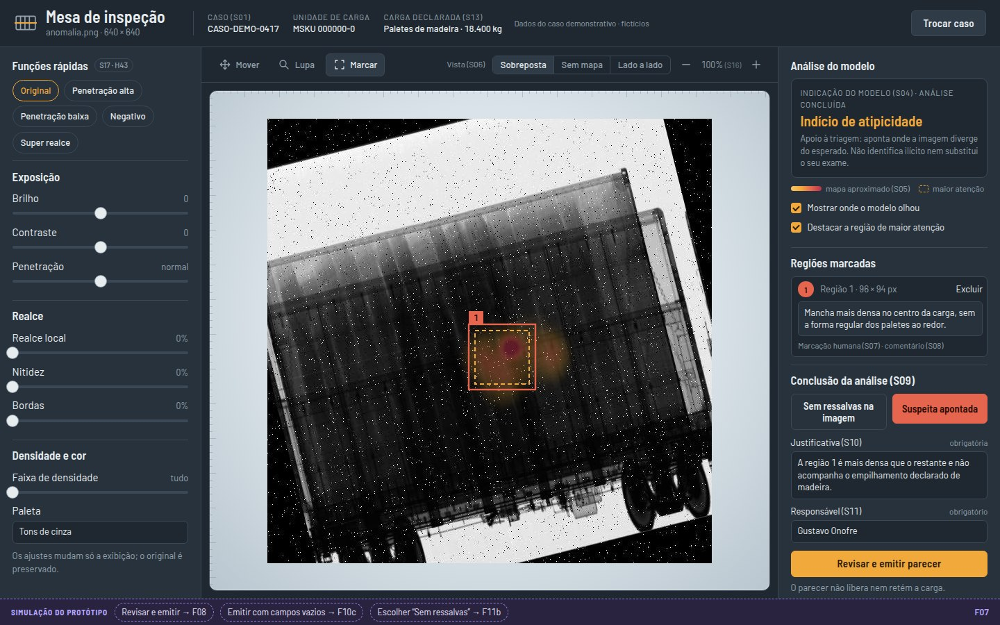

**Objetivo do usuário:** fundamentar a conclusão separada do resultado automático (O01/O05). 
**Signos principais:** conclusão de escolha única (S09), justificativa (S10) e responsável (S11) marcados como obrigatórios (PP); aviso “O parecer não libera nem retém a carga”. 
**Origem no MoLIC:** M01/C5; M03/C3 · **Transições:** Revisar e emitir → F08; campos vazios → F10c; Sem ressalvas → F11b.

### F08 — Revisar o parecer antes de exportar

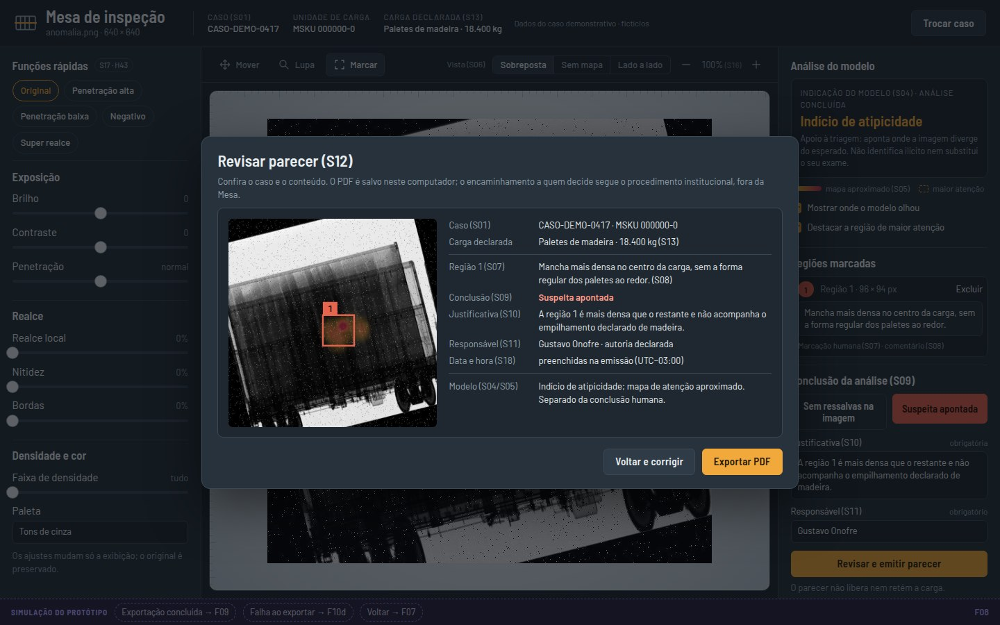

**Objetivo do usuário:** conferir caso e conteúdo antes de emitir (O02/O05). 
**Signos principais:** prévia com caso, carga, região, comentário, conclusão, justificativa, autoria declarada e data/hora preenchida na emissão (S12/S18). O resultado do modelo aparece separado da conclusão humana. 
**Origem no MoLIC:** M01/C6; M03/C4 · **Transições:** Exportar PDF → F09; Voltar e corrigir → F07; falha → F10d.

### F09 — Parecer exportado

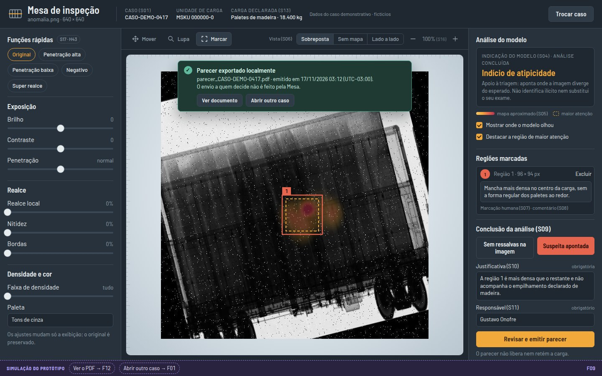

**Objetivo do usuário:** saber que o documento foi salvo e o que acontece depois (O05). 
**Signos principais:** mensagem de sucesso com nome do arquivo, data/hora e fuso (S12/S18) e a fronteira “o envio a quem decide não é feito pela Mesa”. 
**Origem no MoLIC:** M01/C7 e `gcc` O05; M03/C5 · **Transições:** Ver documento → F12; Abrir outro caso → F01.

### F10a — Erro: arquivo inválido

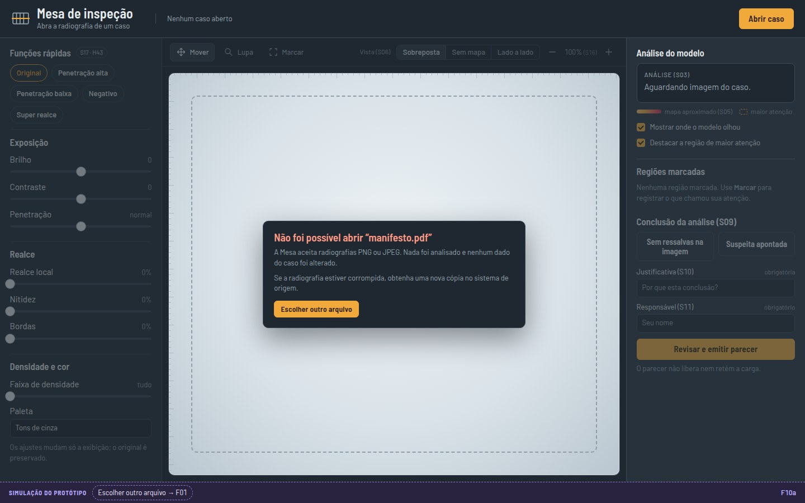

**Ruptura:** formato não aceito (S02). **Fala do preposto:** o que foi recusado, os formatos aceitos e que nada foi analisado. Se o arquivo estiver corrompido, orienta obter nova cópia na origem (CE). 
**Origem no MoLIC:** M01, processo “Validar entrada” → “Corrigir entrada” · **Recuperação:** Escolher outro arquivo → F01.

### F10b — Erro: falha na análise

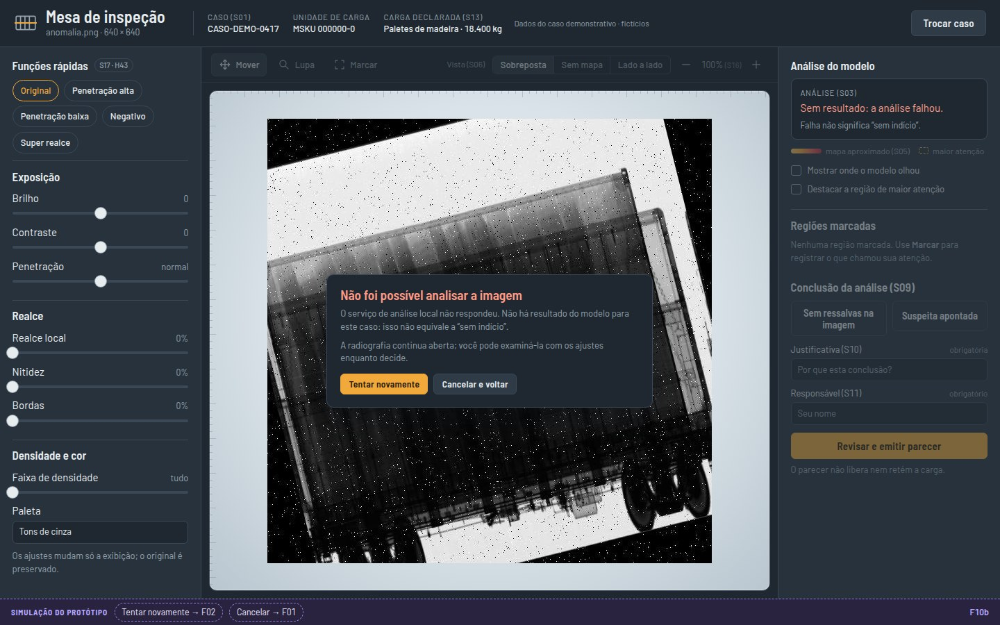

**Ruptura:** o serviço local não respondeu (S03). **Fala do preposto:** não há resultado, e isso “não equivale a ‘sem indício’”. A radiografia continua examinável. 
**Origem no MoLIC:** M01, “Retomar análise” · **Recuperação:** Tentar novamente → F02; Cancelar e voltar → F01.

### F10c — Erro: parecer incompleto

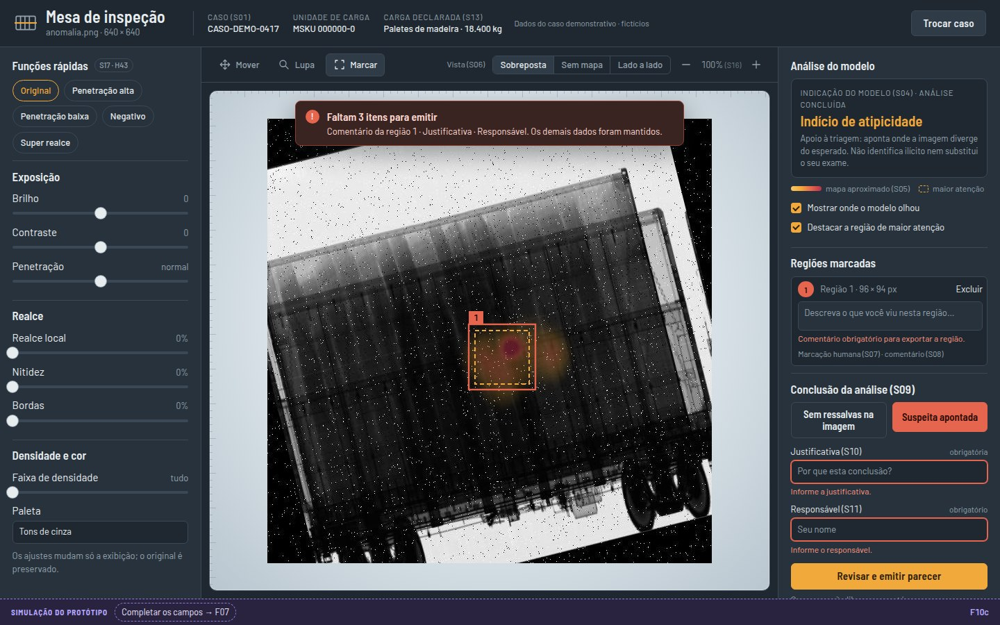

**Ruptura:** campos exigidos vazios (S08, S10, S11). **Fala do preposto:** resumo “Faltam 3 itens para emitir”, cada campo destacado com mensagem própria e os demais dados mantidos (PA + RA). 
**Origem no MoLIC:** M01 “Completar / rever parecer”; M03 “Completar informação” · **Recuperação:** Completar os campos → F07.

### F10d — Erro: falha na exportação

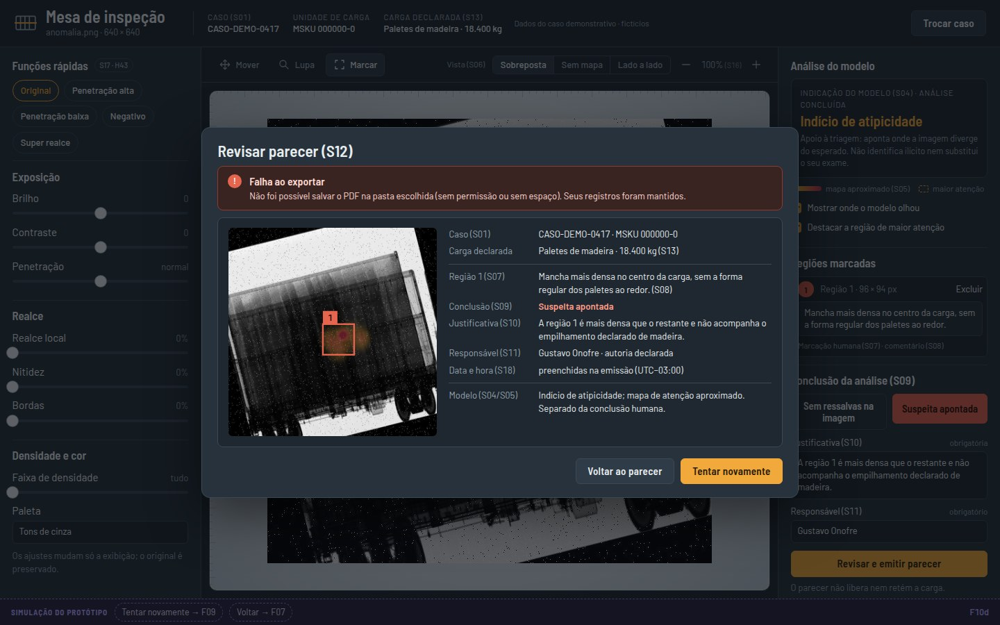

**Ruptura:** o PDF não pôde ser salvo (S12). **Fala do preposto:** causa provável (permissão ou espaço) e “Seus registros foram mantidos” (RA/CE). 
**Origem no MoLIC:** M01 “Repetir exportação”; M03 “Recuperar exportação” · **Recuperação:** Tentar novamente → F09; Voltar ao parecer → F07.

### F11a — Confirmar troca de caso

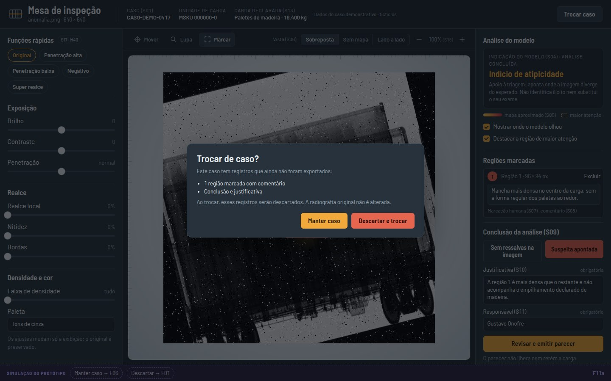

**Situação:** trocar de caso com registros ainda não exportados (S01, AL). **Fala do preposto:** lista o que seria descartado e informa que a radiografia original não é alterada. A ação segura (“Manter caso”) é a primária. 
**Origem no MoLIC:** M01 “Confirmar troca de caso” · **Saídas:** Manter caso → F06; Descartar e trocar → F01.

### F11b — Confirmar conclusão divergente

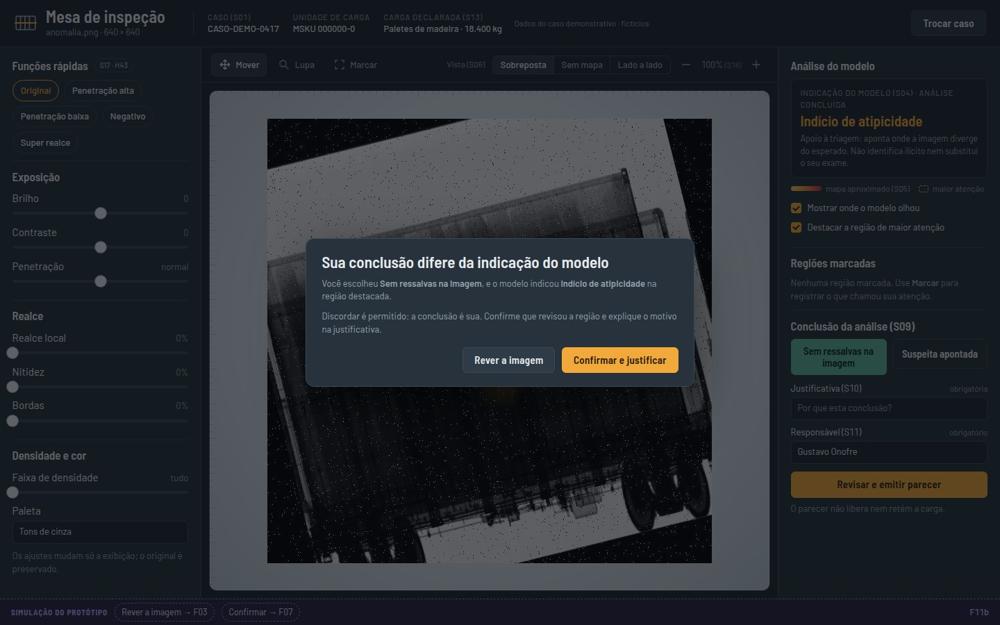

**Situação:** “Sem ressalvas na imagem” quando o modelo indicou atipicidade (S10, AL). **Fala do preposto:** discordar é permitido e a conclusão é do usuário, mas pede revisão e justificativa, sem obrigar concordância. 
**Origem no MoLIC:** M01 “Completar / rever parecer” (conclusão divergente); M03 “Completar informação” · **Saídas:** Rever a imagem → F03; Confirmar e justificar → F07.

### F12 — Parecer em PDF lido pelo destinatário (P02)

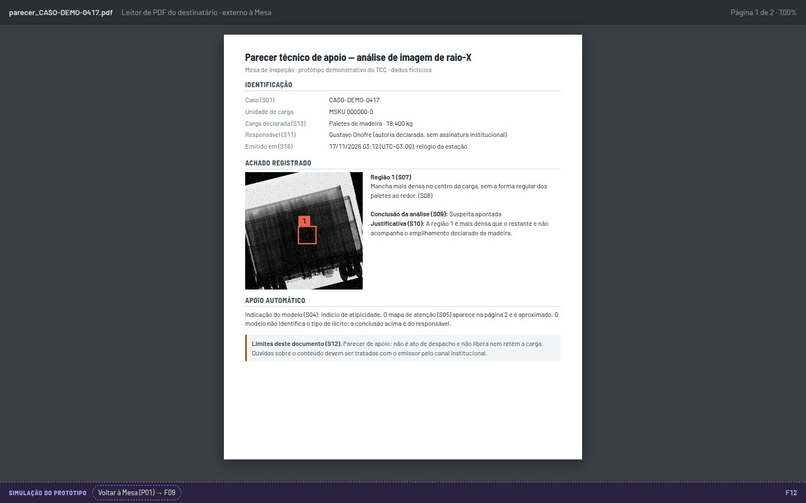

**Objetivo do destinatário:** conferir caso, autoria e data, relacionar região e comentário e distinguir modelo de conclusão humana (O06/O02/O07/O08). 
**Signos principais:** S01/S11/S13/S18 na identificação; S07–S10 no achado; S04/S05 em “Apoio automático”; quadro “Limites deste documento” (S12). 
**Origem no MoLIC:** M02/C1–C4. Em M03, é o documento entregue externamente · **Observação:** a barra superior representa um leitor de PDF externo, não uma tela da Mesa. A faixa de simulação volta para F09 apenas para fechar o protótipo.

## 5. Sistema visual e consistência

| Elemento | Regra adotada | Justificativa |
|---|---|---|
| Tipografia | Barlow 400/500/600 para texto e Barlow Semi Condensed 600 para títulos, botões e números; números tabulares. Texto principal 15 px e secundário 13 px. | Herdada do TCC. As versões condensadas cabem nos painéis laterais sem truncar rótulos. |
| Cores | Console escuro em volta da mesa de luz clara. Âmbar é a cor do **modelo** (mapa, região, ação primária). Vermelho é a **marcação humana** e a “Suspeita apontada”. Verde é “Sem ressalvas”. Roxo tracejado só aparece na faixa de simulação. | Separa visualmente resultado automático e julgamento humano (S04 × S07/S09; RC02/RC07). A cor nunca é o único sinal: há rótulo, legenda e traço (tracejado × contínuo). |
| Componentes | Mesmos botões, segmentados, campos e cartões em todas as telas. Diálogos modais só para confirmação (F11a/F11b) e revisão (F08/F10d). A ação segura aparece como primária na confirmação destrutiva. | Comportamento consistente entre telas equivalentes (heurística de consistência), preparando a Entrega 13. |
| Feedback | Estado da análise sempre no topo do painel direito (S03). Erros no ponto do problema e no resumo. Sucesso em faixa verde sobre a mesa de luz. Todos dizem o que aconteceu, o que foi preservado e o que fazer. | Atende RA/CE do esquema de signos e MU05. |
| Terminologia | Rótulos da Entrega 9: “Conclusão da análise”, “Sem ressalvas na imagem”, “Suspeita apontada”, “Responsável”, “Parecer”. Os IDs S aparecem nos rótulos para facilitar a inspeção e a avaliação heurística; recomenda-se retirá-los na versão usada com participantes (Entrega 14). | Coerência com S01–S18 e com o checklist desta entrega. |

## 6. Verificação de acessibilidade básica

Critérios WCAG 2.2 pertinentes a um produto Web de mesa. As razões de contraste foram calculadas com a fórmula de luminância relativa da WCAG sobre as cores definidas no CSS.

| Critério | Verificação | Resultado |
|---|---|---|
| 1.4.3 Contraste (texto) | Texto 10,97:1; secundário 5,06:1; âmbar 7,49:1; botão primário 8,30:1; erro 6,40:1; “Sem ressalvas” 6,50:1. | ✅ Depois da correção abaixo. |
| 1.4.3 Correção aplicada | Texto branco sobre o vermelho (`#e5654f`), herdado do TCC, dava **3,33:1**. Foi trocado por `#2b0b05` (**5,47:1**) em “Suspeita apontada”, “Descartar e trocar”, nos números das regiões e nos ícones de erro. | ✅ Corrigido no HTML e no Figma. |
| 1.4.1 Uso de cor | Modelo × humano diferenciados também por rótulo, legenda e tipo de traço; erros têm texto e ícone. | ✅ |
| 1.4.11 Contraste não textual | O tracejado âmbar sobre áreas claras da radiografia tem cerca de 1,5:1. Sobre a carga escura, tem bom contraste. | ⚠️ Pendente: avaliar contorno duplo no tracejado na Entrega 13. |
| 2.4.7 / 2.4.11 Foco | A interface do TCC tem `:focus-visible` com contorno de 2 px. O protótipo estático não mostra o foco. | ⚠️ Verificar na implementação, não no Figma. |
| 2.5.8 Tamanho do alvo | Botões e segmentados com pelo menos 24 × 24 px. | ✅ |
| 2.1.1 Teclado | Atalhos do TCC (V, L, M, N, O, C, +/−). “Comparar” deixa de exigir tecla pressionada (vista persistente). | ✅ No desenho. Teclado não é simulado no Figma. |
| 3.3.1 / 3.3.3 Identificação e sugestão de erro | F10a–F10d dizem qual é o erro e como corrigir; F10c indica cada campo. | ✅ |
| 1.1.1 Texto alternativo | A radiografia tem `alt` no HTML. O PDF (F12) traz a descrição textual da região. | ✅ |

## Checklist

- [ ] Link do Figma está acessível. *(Arquivo criado e protótipo publicado; falta ativar “qualquer pessoa com o link pode ver” e testar em janela anônima.)*
- [x] Há screenshots representativos no repositório.
- [x] Todos os MoLIC relevantes estão cobertos.
- [x] Estados de erro, feedback e recuperação foram prototipados.
- [x] Terminologia/signos são consistentes com Entrega 9.
- [x] Componentes equivalentes se comportam de forma consistente.
- [x] Fluxos críticos são clicáveis do início ao fim.
- [x] O protótipo está pronto para inspeção e testes, sem “links mortos” nas tarefas avaliadas. *(Verificado por script: as 16 telas são alcançáveis a partir de F01 e nenhum link aponta para tela inexistente; 122 interações no Figma.)*
- [x] Dashboards, relatórios, históricos, filtros, administração e CRUDs presentes possuem justificativa rastreável. *(Só há o relatório/parecer, justificado por AC03/R03; os demais não foram criados.)*
- [x] Estados de vazio, processamento, erro e recuperação foram considerados quando pertinentes.
- [x] Resultados técnicos são apresentados de forma interpretável para o perfil de usuário.
- [x] A equipe distingue no protótipo o que é interação simulada e o que é funcionalidade técnica realmente integrada, quando necessário.

## Referências

- AQUINO JR., Plinio T. *MoLIC*, partes B e C (“Da Interação para o Design de Interface”, págs. 14–20: cena → unidade de apresentação; falas do preposto → mensagens de status e erro). Material da aula 10, baseado em Barbosa e Silva (2010).
- BARBOSA, S. D. J.; SILVA, B. S. *Interação Humano-Computador*. Elsevier/Campus, 2010.
- W3C. *Web Content Accessibility Guidelines (WCAG) 2.2*. 2023.
- Interface de demonstração do TCC: `codigo/interface/` (README, `static/index.html`, `static/app.css`, `static/app.js`, `servidor.py`), versão de 24/10/2026.
- Entregas [6](06_prototipacao_papel.md), [9](09_modelo_conceitual.md) e [10](10_molic.md); [rastreabilidade](../RASTREABILIDADE.md).
