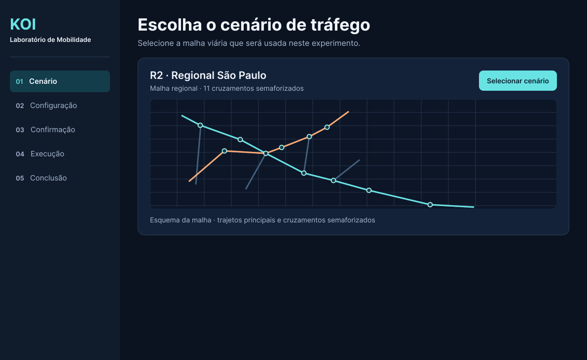

# Entrega 11 — Protótipo no Figma

**Data:** 17/11/2026  
**Status:** 🟨 em andamento  
**Responsabilidade:** 1 protótipo integrado por equipe cobrindo os fluxos MoLIC. Se a turma exigir divisão individual, identifique o responsável por cada fluxo/tela.

## Objetivo da atividade

Materializar o modelo de interação em um protótipo navegável, preservando a lógica dos objetivos, tópicos, signos, feedbacks, alternativas e recuperações definidos anteriormente.

## Biblioteca de possibilidades para projetos técnicos

O protótipo deve materializar os fluxos definidos nas entregas anteriores. Dependendo do escopo, podem fazer sentido:

1. **Dashboard:** indicadores, alertas, estado, tendências e atalhos para tarefas frequentes.
2. **Configuração/parametrização:** escolhas, presets, validação e explicação de opções técnicas.
3. **Entrada de dados:** upload, conexão, seleção, pré-visualização e validação.
4. **Processamento:** fila, status, progresso, cancelamento, falha e reexecução.
5. **Relatório/resultados:** síntese, métricas, gráficos, explicação, exportação e compartilhamento.
6. **Histórico:** busca, filtros, ordenação, paginação, detalhes e repetição de execução.
7. **Comparação:** antes/depois, modelo A/B, execução A/B, baseline ou períodos.
8. **Explicabilidade:** confiança, fatores, evidências, limitações e correção/contestação.
9. **Administração:** usuários, grupos, perfis, permissões, integrações e políticas.
10. **CRUDs de domínio:** somente quando criar/consultar/editar/excluir representa tarefa real.
11. **Auditoria/logs:** histórico de alterações e eventos em linguagem adequada.
12. **Alertas/ocorrências:** severidade, impacto, ação, responsável e resolução.
13. **Ajuda/documentação:** apoio contextual a tarefas complexas.

### Estados que não podem ser esquecidos

Quando aplicável, considere: vazio/sem dados; carregamento/processamento; sucesso; erro de entrada; erro de processamento; filtro sem resultados; permissão insuficiente; confirmação de ação destrutiva; cancelamento/desfazer/recuperação; dados desatualizados/conflito.

> Esta lista é repertório de design, **não uma exigência de quantidade de telas**. A rastreabilidade deve explicar por que cada tela existe.

## Link do Figma

**Protótipo:** [Entrega 11 — Protótipo navegável do M01](https://www.figma.com/proto/YJJhBTujdrsjDY113Iefj4/Sem-t%C3%ADtulo?node-id=4-12&scaling=scale-down-width&content-scaling=fixed&page-id=0%3A1&starting-point-node-id=4%3A12&show-proto-sidebar=1)  
**Arquivo editável:** [Entrega 11 — Arquivo de design do M01](https://www.figma.com/design/YJJhBTujdrsjDY113Iefj4/Sem-t%C3%ADtulo?node-id=4-12)  
**Última verificação de permissão:** {{dd/mm/aaaa}}

> Teste o link em janela anônima. O avaliador deve conseguir abrir o protótipo sem solicitar permissão.

## Cobertura MoLIC → Figma

| MoLIC | Objetivo | Fluxo/telas no Figma | Estados de erro/recuperação | Responsável |
|---|---|---|---|---|
| M01 | OBJ01 — Produzir execuções sob condições comparáveis, cobrindo a preparação (OBJ02), a validação e o início (OBJ03) e o acompanhamento da execução (OBJ04). | `F01 → F01S → F02 → F03 → F04 → F04P → F05`. A configuração avançada fica em `F02A`. A partir de `F05`, é possível preparar outra execução ou encerrar em `F06`. | Em `F02`, limpar a seed e validar leva a `F02E`, de onde é possível corrigir o valor. Em `F03`, é possível voltar à configuração. O fluxo **M01 · Falha e recuperação** passa por `F04T → F04E` e permite revisar a configuração ou encerrar. | Gabriel Koiama de Rocha Lira — 22.125.067-3 |

No M01, o processamento é simulado no Figma. A integração com o SUMO pertence à interface funcional do TCC.

## Catálogo de telas/estados

### F01 — Escolha do cenário de tráfego

**Objetivo do usuário:** localizar e selecionar o cenário correspondente à malha viária que será simulada.  
**Signos principais:** catálogo, cenário **R2 · Regional São Paulo**, esquema da malha e ação **Selecionar cenário**.  
**Origem no MoLIC:** M01, cena «Escolha do cenário de tráfego».

> Documente também estados que muitas equipes esquecem: carregamento, vazio, confirmação, sucesso, erro, permissão negada, cancelamento, desfazer/voltar quando aplicável.

## Sistema visual e consistência

| Elemento | Regra adotada | Justificativa |
|---|---|---|
| Tipografia | No M01, usar Inter para títulos, rótulos, valores e textos de ajuda, com tamanhos e pesos distintos. | Facilita a identificação da etapa e a leitura das condições do experimento. |
| Cores | No M01, usar fundo escuro, ciano para ações principais e seleção, e rótulos de texto para identificar falha e conclusão. | A cor reforça os estados, e os rótulos explicitam o que aconteceu. |
| Componentes | No M01, reutilizar os botões principal e secundário e manter a identificação da etapa na barra lateral. | Ajuda a reconhecer ações equivalentes entre configuração, revisão e encerramento. |
| Feedback | No M01, mostrar a mensagem de validação junto aos controles da seed e destacar o estado durante a execução. | Permite localizar o erro e distinguir inicialização, processamento, conclusão e falha. |

## Verificação de acessibilidade básica

Para produto Web, considere critérios pertinentes da WCAG vigente (por exemplo, contraste, foco, tamanho de alvo, texto alternativo e navegação por teclado quando aplicáveis). Para outras plataformas, use as recomendações adequadas ao contexto.

## Checklist

- [ ] Link do Figma está acessível.
- [ ] Há screenshots representativos no repositório.
- [ ] Todos os MoLIC relevantes estão cobertos.
- [ ] Estados de erro, feedback e recuperação foram prototipados.
- [ ] Terminologia/signos são consistentes com Entrega 9.
- [ ] Componentes equivalentes se comportam de forma consistente.
- [ ] Fluxos críticos são clicáveis do início ao fim.
- [ ] O protótipo está pronto para inspeção e testes, sem “links mortos” nas tarefas avaliadas.
- [ ] Dashboards, relatórios, históricos, filtros, administração e CRUDs presentes possuem justificativa rastreável.
- [ ] Estados de vazio, processamento, erro e recuperação foram considerados quando pertinentes.
- [ ] Resultados técnicos são apresentados de forma interpretável para o perfil de usuário.
- [ ] A equipe distingue no protótipo o que é interação simulada e o que é funcionalidade técnica realmente integrada, quando necessário.
