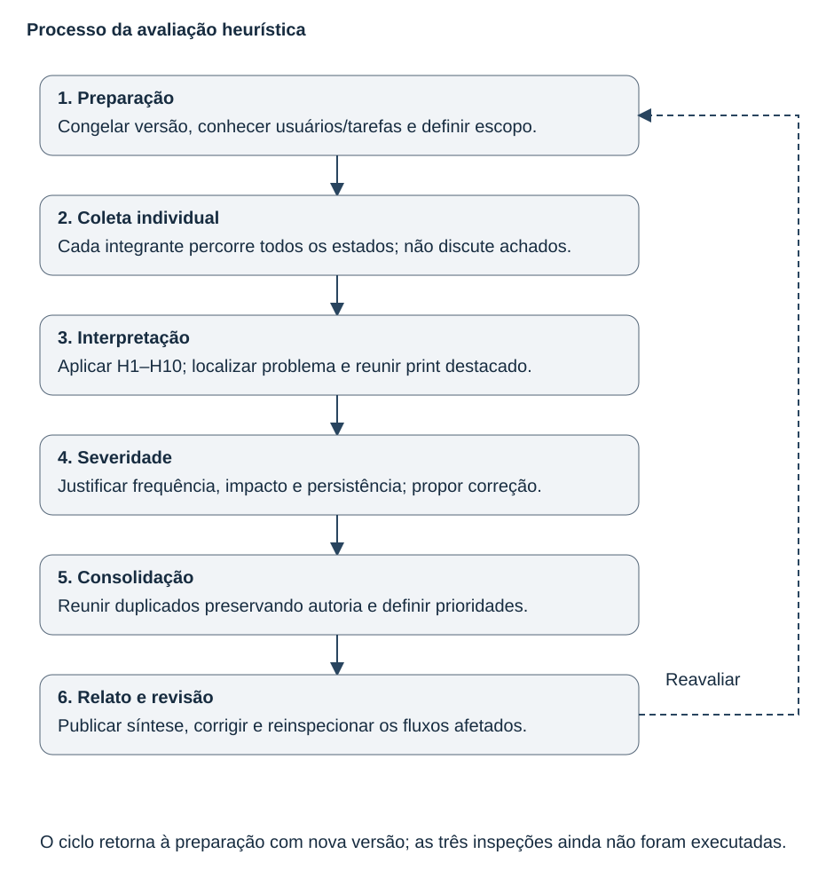

# Entrega 13 — Avaliação heurística

**Data:** 17/11/2026 
**Status:** 🟨 inspeção preliminar do HTML registrada. Achados preliminares consolidados. Fichas individuais da equipe pendentes. 
**Responsabilidade:** uma inspeção completa por integrante, seguida de síntese da equipe.

A inspeção avalia a interação da Mesa de inspeção, não o desempenho científico do modelo. Conforme a aula 13, cada pessoa primeiro examina a interface individualmente; depois a equipe consolida os problemas. Preparar fichas não equivale a executar essas inspeções.

## 1. Processo / fluxograma

[Fonte SVG editável](../assets/13_heuristica/fluxograma_inspecao.svg). A revisão devolve os fluxos afetados à inspeção, mantendo a versão de origem de cada achado.

## 2. Escopo e procedimento

| Item | Definição |
|---|---|
| Versão | Base: [Entrega 11](11_figma.md), versão HTML do commit `f15c58e`, no Chromium a 1440 × 1000. Reproduzir os achados no Figma e registrar URL/node, versão e data nas fichas individuais. |
| Telas/estados | F01–F09, F10A/B/C/D, F11A/B e F12: 16 estados do protótipo. Incluir leitura do documento, vazio, processamento, erro, retorno, confirmação e sucesso. |
| Fluxos | M01 exame/registro; M02 compreensão do parecer; M03 preparação para conferência. |
| Dispositivo | Computador com teclado/mouse; referência 1920 × 1080. Registrar configuração efetiva. |
| Fora do recorte | Dashboard, filtros, histórico, CRUD, permissões e decisão institucional não existem na solução. Não inventar testes para esses padrões. |

Cada integrante faz uma passagem de familiarização e outra verificando H1–H10 em **todos** os estados. Registra ação, localização e print destacado por problema; depois justifica severidade e recomenda correção. Não discutir achados antes de concluir as três fichas. Ausência de observação não pode ser preenchida como “sem violação”.

| Severidade | Significado |
|---:|---|
| 0 | Não é problema de usabilidade. |
| 1 | Cosmético; corrigir se houver tempo. |
| 2 | Menor, com baixa prioridade. |
| 3 | Maior; alta prioridade. |
| 4 | Impede disponibilização até a correção. |

A justificativa considera frequência provável, impacto sobre a tarefa e persistência, conforme págs. 11–14 da aula. Uma inspeção não demonstra a frequência real de erro de usuários.

## 3. Registros individuais

| Avaliador / responsável | Ficha com matriz H1–H10 e declaração de violações | Situação |
|---|---|---|
| A01 — Kawan Mark Geronimo Da Silva, 22.222.010-5 | [Inspeção A01](../instrumentos/13_heuristica/a01.md) | Não realizada. |
| A02 — Gabriel Albertini Pinheiro, 22.122.094-8 | [Inspeção A02](../instrumentos/13_heuristica/a02.md) | Não realizada. |
| A03 — Alexandre Domiciano Pierri, 22.125.061-6 | [Inspeção A03](../instrumentos/13_heuristica/a03.md) | Não realizada. |

Cada ficha inclui cobertura, registro de violações com evidência/severidade/recomendação e boas práticas para heurísticas não violadas. Não há achados atribuídos a integrantes sem que tenham inspecionado. O arquivo ilustrativo antigo `v01.svg` não foi utilizado como evidência.

## 4. Avaliação heurística — inspeção preliminar da versão HTML

Registro técnico preliminar, com prints e destaque em ciano conforme o formato pedido no Modelo 02 da aula 13. As severidades são estimativas da inspeção. Os registros abaixo podem orientar a revisão no Figma e não são atribuídos aos três avaliadores.

| ID | Heurística | Problema localizado e consequência | Severidade e justificativa | Correção proposta |
|---|---|---|---|---|
| V01 | H3 — Controle e liberdade | Em F11b, depois de escolher “Sem ressalvas na imagem”, clicar em “Confirmar e justificar” abre F07 com “Suspeita apontada” selecionada. A confirmação perde a conclusão humana que acabou de ser escolhida. | 3. Repete-se nesse caminho e a seleção pode chegar ao parecer com o sentido invertido se passar despercebida. | Conectar a confirmação a um estado F07 que mantenha “Sem ressalvas na imagem” e permita seguir à prévia com essa conclusão. |
| V02 | H9 — Recuperação de erros | Em F10c, o painel pede comentário, justificativa e responsável. Os campos visíveis são estáticos e “Revisar e emitir parecer” retorna ao próprio erro. A recuperação disponível passa pela faixa roxa “Completar os campos”, que abre um estado já preenchido. | 3. O bloqueio é persistente nesse estado e impede observar a correção espontânea de UT03. É uma limitação do protótipo HTML avaliado. | Antes da coleta, permitir acionar a recuperação pelos elementos da própria interface. Preparar uma variante que isole a autoria ausente quando a tarefa começar com os demais dados preenchidos. |

**V01 — ação e resultado.** O destaque no primeiro print indica a ação. No segundo, indica a conclusão que aparece selecionada após o clique.

**V02 — campos com omissão e saída pela faixa de simulação.**

## 5. Uso das heurísticas — exercício didático

Os slides de fechamento da aula 14 pedem **dez exemplos**, um para cada heurística. A tabela abaixo mostra decisões presentes no protótipo. Não é resultado das inspeções e não significa que cada heurística esteja integralmente atendida.

| Heurística de Nielsen | Exemplo no projeto | Evidência e propósito |
|---|---|---|
| H1 — Visibilidade do estado | “Analisando imagem” separado de sucesso e falha. | [F02](../assets/11_figma/telas/F02.jpg), [F10B](../assets/11_figma/telas/F10b.jpg): evitar interpretar falta de resultado como normalidade. |
| H2 — Correspondência com o mundo real | Caso, carga declarada, região e parecer, sem código técnico como mensagem principal. | [F08](../assets/11_figma/telas/F08.jpg): comunicar o fundamento da observação. Vocabulário ainda requer validação com o perfil. |
| H3 — Controle e liberdade | Cancelar análise, voltar para corrigir e manter caso diante de descarte. | [F02](../assets/11_figma/telas/F02.jpg), [F11A](../assets/11_figma/telas/F11a.jpg): saída explícita. |
| H4 — Consistência e padrões | Mesmos rótulos para original, sobreposição e lado a lado; posição persistente. | [F03](../assets/11_figma/telas/F03.jpg), [F05](../assets/11_figma/telas/F05.jpg): reconhecer ações equivalentes. |
| H5 — Prevenção de erros | Responsável obrigatório e confirmação de conclusão divergente. | [F10C](../assets/11_figma/telas/F10c.jpg), [F11B](../assets/11_figma/telas/F11b.jpg): conferir antes da emissão. |
| H6 — Reconhecimento em vez de memorização | Caso, marcação numerada e comentário aparecem juntos na revisão. | [F08](../assets/11_figma/telas/F08.jpg): relacionar evidência sem depender da lembrança. |
| H7 — Flexibilidade e eficiência | Alternativas original/sobreposição/lado a lado e restauração dos ajustes. | [F05](../assets/11_figma/telas/F05.jpg): adequar a comparação; eficiência ainda será medida. |
| H8 — Estética e minimalismo | Radiografia ocupa o painel principal; registro e resultado agrupados à direita. | [F06](../assets/11_figma/telas/F06.jpg): foco na tarefa, sem indicadores ou cadastros sem objetivo. |
| H9 — Reconhecimento e recuperação de erros | Mensagem explica falha de exportação, preservação dos registros e verificação do destino. | [F10D](../assets/11_figma/telas/F10d.jpg): orientar a próxima ação. |
| H10 — Ajuda e documentação | Passos curtos junto à análise e limites do mapa no painel do resultado. | [F03](../assets/11_figma/telas/F03.jpg): ajuda contextual; não depende de manual externo. |

## 6. Consolidação e plano de melhoria

| Achado | Onde | Severidade preliminar | O que precisa ser conferido no Figma |
|---|---|---:|---|
| V01 · H3 | F11b → F07 | 3 | Escolher “Sem ressalvas na imagem”, confirmar e conferir se a escolha chega à prévia do parecer. Afeta UT02. |
| V02 · H9 | F10c → F07 | 3 | Começar com a autoria vazia e corrigir o campo pela própria interface, preservando o restante. Afeta UT03. |

A revisão do HTML encontrou dois problemas distintos. Primeiro, verificar se a conclusão escolhida é preservada, porque a troca pode mudar o sentido do parecer. Em seguida, conferir a recuperação do campo obrigatório, já que o atalho da simulação interfere na medição de UT03. Se os problemas aparecerem no Figma, corrigir o fluxo afetado e repetir a checagem antes do piloto. Ao reunir as fichas individuais, agrupar relatos da mesma causa e manter a referência de quem observou cada um.

## Checklist

- [x] Escopo, processo iterativo, procedimento individual e escala definidos.
- [x] Ficha completa com H1–H10 preparada para cada integrante.
- [x] Estados de erro, processamento, relatório e retorno incluídos no escopo.
- [x] Exercício didático separado das violações, com dez exemplos do projeto.
- [x] Critérios de evidência, severidade, recomendação e consolidação definidos.
- [ ] Cada integrante executou sua inspeção completa na versão navegável.
- [ ] Matrizes preenchidas com resultados e boas práticas observadas.
- [x] Achados preliminares registrados com print destacado, contexto e justificativa.
- [ ] Achados reproduzidos no Figma e registrados nas fichas individuais.
- [ ] Duplicados consolidados; totais e correções prioritárias definidos.

**Referências:** aula 13, *Avaliação de Usabilidade por Inspeções*, págs. 8–16; aula 14, *Teste de Usabilidade com Observação do Usuário*, pág. 16; [plano DECIDE](12_planejamento_avaliacao.md). Para concluir, a equipe precisa realizar as três inspeções; revisão automatizada das pranchas não as substitui.
