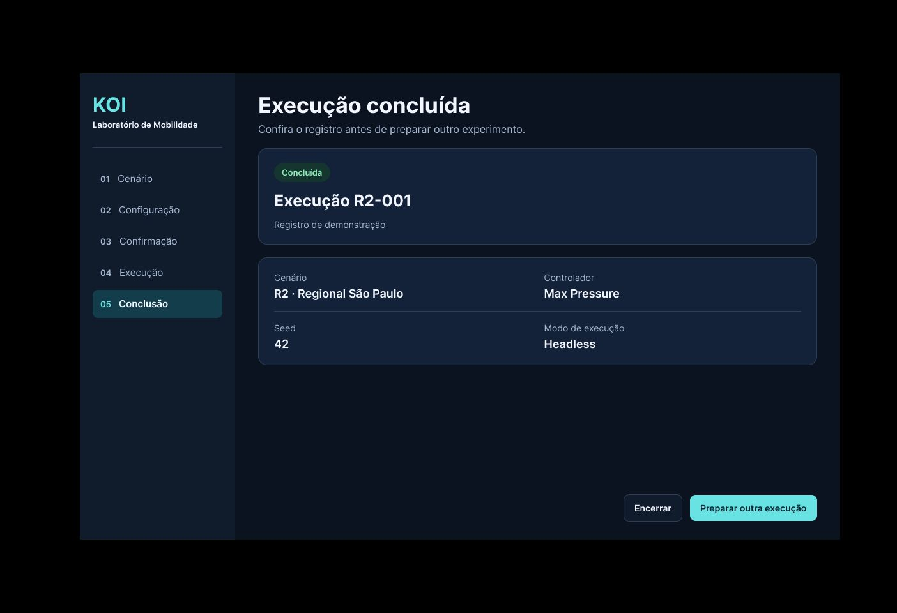

# Entrega 13 — Avaliação de IHC por inspeção heurística

**Data:** 18/11/2026  
**Status:** 🟩 concluída — avaliações individuais e consolidação documental finalizadas  
**Responsabilidade:** 1 avaliação completa por integrante, sobre todas as telas/estados relevantes do projeto.

## Objetivo da atividade

Encontrar problemas de usabilidade por inspeção sistemática da interface com as **10 heurísticas de Nielsen**. Cada avaliador trabalha individualmente primeiro; depois a equipe consolida problemas duplicados e prioridades.

> **Parte de violações:** registre somente problemas reais. Não invente uma violação para “preencher” cada heurística. Para provar que todas foram exercitadas, use a **matriz de cobertura H1–H10**. Para heurísticas sem violação, a disciplina solicita um exemplo didático de boa prática.

## 1. Heurísticas adotadas

1. Visibilidade do status do sistema
2. Compatibilidade entre o sistema e o mundo real
3. Controle e liberdade do usuário
4. Consistência e padrões
5. Prevenção de erros
6. Reconhecimento em vez de memorização
7. Flexibilidade e eficiência de uso
8. Estética e design minimalista
9. Ajudar usuários a reconhecer, diagnosticar e recuperar-se de erros
10. Ajuda e documentação

**Referência:** [10 Usability Heuristics for User Interface Design — Nielsen Norman Group](https://www.nngroup.com/articles/ten-usability-heuristics/).

## Cobertura da interface avaliada

A inspeção contempla as telas e os estados relevantes dos fluxos M01 e M02, incluindo:

- seleção do cenário e configuração principal/avançada;
- validação de dados incompletos, revisão e confirmação;
- inicialização, processamento, conclusão e falha;
- recuperação, encerramento e retorno à configuração;
- histórico de execuções, resultados individuais e gráficos;
- resultado indisponível, terminologia técnica e ajuda contextual;
- continuidade entre a execução e a consulta posterior de resultados.

A comparação de execuções ocorre por consulta individual dos registros e reunião externa dos valores, conforme a Entrega 12. O protótipo não possui comparação automática lado a lado. Administração de usuários, permissões, operações CRUD, exportação e filtros avançados de histórico não integram seu escopo documentado.

## 2. Escopo da inspeção

| Item | Definição |
|---|---|
| Versão avaliada | Protótipo Figma da Entrega 11, observado em 18/11/2026, sem alteração durante a inspeção. Processamento e resultados são demonstrativos. |
| Referência documental | Repositório consultado no commit b1f56a6f5ed2974bc11df9bfa6c6c9d0c23af598. Esse identificador fixa os documentos consultados, não o histórico de versões do Figma. |
| Arquivo editável | [Figma — projeto](https://www.figma.com/design/YJJhBTujdrsjDY113Iefj4/Sem-t%C3%ADtulo?node-id=4-12). |
| M01 | [Cenário, configuração e execução](https://www.figma.com/proto/YJJhBTujdrsjDY113Iefj4/Sem-t%C3%ADtulo?node-id=4-12&scaling=scale-down-width&content-scaling=fixed&page-id=0%3A1&starting-point-node-id=4%3A12). |
| M02 | [Histórico e resultados](https://www.figma.com/proto/YJJhBTujdrsjDY113Iefj4/Sem-t%C3%ADtulo?node-id=16-206&scaling=scale-down-width&content-scaling=fixed&page-id=0%3A1&starting-point-node-id=16%3A206). |
| Estados cobertos | Catálogo, seleção, configuração, configuração avançada, seed ausente, erro de validação, confirmação, inicialização, execução, conclusão, falha, recuperação, encerramento com sucesso/falha, histórico, dois resultados, dois gráficos e resultado indisponível. |
| Alternativas examinadas | Caminhos completos de Híbrido + Headless, Tempo fixo + Visual e Max Pressure + Headless. Também foi verificada a configuração Tempo fixo + Headless. Não foi realizada uma combinação exaustiva de todos os controles, estados e retornos possíveis. |
| Forma de acesso à falha | F04E foi aberto diretamente pelo nó 4:548 do protótipo; a partir dele foram acionados Revisar configuração e Encerrar. Não foi provocada uma falha real do SUMO. |
| Dispositivo/viewport | Navegador em computador; configuração de viewport solicitada de 1440 × 960 pixels. Os arquivos retornados pela captura possuem 1404 × 960 pixels e os quadros do projeto possuem 1190 × 730 pixels. |
| Evidências | Trinta capturas da inspeção assistida, identificadas no Apêndice A, e quatro capturas fornecidas por Gabriel durante a revisão guiada, identificadas no Apêndice B. Os estados de carregamento do próprio Figma foram descartados. |
| Responsável pela seção A01 | Gabriel Koiama de Rocha Lira — 22.125.067-3. |
| Responsável pela seção A02 | João Pedro Lopes Santana Villas Bôas — 22.125.065-7. Conferência individual concluída em 18/11/2026. |

**Limites:** esta avaliação examina a interação do protótipo. Não mede o desempenho do algoritmo ou do SUMO, não reproduz a execução R3 e não comprova o comportamento da aplicação funcional. Navegação por teclado, leitor de tela, contraste calculado e responsividade não foram avaliados sistematicamente. A ausência de uma violação registrada não certifica conformidade de acessibilidade.

## 3. Procedimento individual

Cada avaliador deve:

1. percorrer os fluxos/telas ao menos uma vez para familiarização;
2. inspecionar novamente aplicando sistematicamente H1–H10;
3. registrar cada problema com evidência e contexto;
4. atribuir severidade depois de compreender o problema;
5. preservar a independência da sua inspeção antes da discussão conjunta.

**Registro metodológico desta versão:** a navegação inicial, as capturas e a preparação da análise foram realizadas com assistência de IA. Em 18/11/2026, Gabriel realizou uma revisão guiada dos seis achados, relatou suas próprias interpretações e forneceu quatro capturas. A revisão modificou o relato de V03 e reduziu a severidade proposta de V04. Após essa etapa, Gabriel concluiu sua conferência individual dos caminhos definidos, validando a cobertura das dez heurísticas, os seis achados e os exemplos de boas práticas. A conferência do integrante não integra a amostra de participantes da Entrega 14. João também concluiu a conferência individual de A02 em 18/11/2026, validando os seis achados, a matriz H1–H10 e os exemplos de boas práticas. Os dois registros foram reunidos na consolidação documental, preservando suas identificações e as diferenças entre os achados.

### Escala de severidade (0–4)

| Grau | Interpretação |
|---:|---|
| 0 | não é considerado problema de usabilidade |
| 1 | problema cosmético; corrigir se houver tempo |
| 2 | problema menor; baixa prioridade |
| 3 | problema maior; alta prioridade |
| 4 | catástrofe de usabilidade; correção imperativa antes de disponibilizar |

As justificativas consideram frequência de exposição à condição, impacto sobre a tarefa e persistência. Não são frequências medidas com usuários. Os impactos ainda não observados com participantes são tratados como riscos de interação.

---

## Avaliador A01 — Gabriel Koiama de Rocha Lira

**Matrícula:** 22.125.067-3.  
**Data do registro:** 18/11/2026.  
**Situação:** conferência individual de A01 concluída, com cobertura H1–H10, seis achados e exemplos de boas práticas validados.

### 4. Matriz de cobertura das 10 heurísticas

| Heurística | Telas/fluxos examinados | Houve violação? | IDs dos achados | Exemplo de boa prática se não violada |
|---|---|---|---|---|
| H1 | Seleção, configuração, processamento, conclusão, histórico e indisponibilidade; M01/M02 | Sim | V04 | — |
| H2 | Vocabulário, contexto experimental, unidades e gráficos; M01/M02 | Sim | V05 | — |
| H3 | Voltar, revisar, escolher outro registro e encerrar; M01/M02 | Não observada nos caminhos examinados | — | F03 permite rever a configuração; F08E permite retornar ao histórico; F04E oferece revisão ou encerramento. |
| H4 | Preservação de escolhas, resumos, identidade dos registros e ações nas conclusões; M01/M02 | Sim | V06, V07 | — |
| H5 | Seed ausente, validação, recuperação e confirmação; M01 | Não observada nos caminhos examinados | — | F02E informa a ausência da seed e impede o avanço até a correção demonstrada. |
| H6 | Resumo, contexto durante a execução e condições junto às métricas; M01/M02 | Não observada nos caminhos examinados | — | Cenário, controlador e seed ficam disponíveis nos quadros usados para revisão e interpretação. |
| H7 | Seleção de opções, acesso aos três registros e passagem da conclusão para o histórico; M01/M02 | Sim, como heurística associada | V06 | — |
| H8 | Hierarquia e quantidade de informação nos estados capturados; M01/M02 | Não observada nos caminhos examinados | — | Condições e métricas ocupam grupos separados; títulos e ações principais são destacados. |
| H9 | Validação da seed, falha de processamento e indisponibilidade; M01/M02 | Sim | V02 | — |
| H10 | Apoio contextual para configurar e interpretar indicadores; M01/M02 | Sim | V03 | — |

Não foi criada uma violação para cada heurística. As boas práticas não anulam os problemas de outros estados. V06 é contado uma única vez, com H4 como classificação principal e H7 associada.

### 5. Declaração de violações

| ID | Heurística | Tela/estado | Problema observado | Evidência | Severidade | Justificativa da severidade | Recomendação |
|---|---|---|---|---|---:|---|---|
| V02 | H9 | F04E — falha | O aviso informa que o simulador interrompeu a execução e pede revisão das condições, mas não identifica a causa nem uma verificação concreta. O retorno à configuração funciona, porém o usuário não recebe um diagnóstico que oriente a alteração. | E14 e E26 | 2 | Frequência: ao acessar esta falha demonstrativa. Impacto: tentativa de recuperação sem orientação específica. Persistência: a mensagem permanece genérica; revisão e encerramento estão disponíveis, sem bloqueio total demonstrado. | Representar uma falha específica e indicar causa e ação correspondente. Se a causa for desconhecida, declarar isso e oferecer detalhes ou nova tentativa; não atribuir a falha à configuração sem evidência. |
| V03 | H10 | F08/F08B — métricas | Throughput aparece com valores em veículos/h, mas sem definição contextual da contagem, do intervalo de referência e do alcance na rede. A unidade não informa sozinha como interpretar o indicador. Não foi localizada ajuda correspondente nesses quadros. | E09 e E11 | 2 | Frequência: nos dois resultados consultados. Impacto: risco de interpretar o indicador com uma definição diferente da adotada pelo sistema. Persistência: não há explicação no quadro. O efeito sobre usuários depende de seu conhecimento prévio e deverá ser observado na Entrega 14. | Apresentar nome em português acompanhado do termo técnico e uma definição curta com contagem, unidade e referência temporal, coerente com a métrica efetivamente implementada no TCC. Não inventar essa definição a partir do protótipo. |
| V04 | H1 | F07 → F08E | R2-003 não apresenta um status explícito. Gabriel percebeu antes de abrir que sua condição diferia das demais execuções porque somente as outras exibiam Concluída. Ao abrir, recebeu o aviso de resultado indisponível. A diferença é perceptível, mas o estado precisa ser inferido pela ausência do rótulo. | E08, E13 e G03 | 1 | Frequência: na terceira linha do histórico. Impacto observado na revisão: Gabriel reconheceu a diferença antes de clicar, sem relatar bloqueio ou surpresa. Persistência: a lista continua sem nomear o estado. A severidade foi reduzida de 2 para 1 considerando essa observação; o resultado não é generalizado para outros usuários. | Exibir Resultado indisponível na linha de R2-003, distinguindo explicitamente esse estado de uma execução ainda em andamento. |
| V05 | H2 | F09/F09B — gráficos | As barras e linhas de grade não possuem escala numérica. O texto informa 28 s ou 36 s, mas a altura da barra não pode ser relacionada com segurança a uma referência quantitativa. | E10 e E12 | 2 | Frequência: nos dois gráficos examinados. Impacto: reduz a interpretação e a comparação visual. Persistência: a escala continua ausente; os números em texto permitem recuperar o valor exato. | Incluir valores na escala, unidade e identificação do registro. Utilizar a mesma escala e uma representação proporcional aos valores nos dois gráficos. |
| V06 | H4; associada a H7 | F05 — conclusões alternativas | A conclusão Híbrido + Headless oferece Abrir histórico. As conclusões Tempo fixo + Visual e Max Pressure + Headless oferecem apenas Encerrar e Preparar outra execução. O acesso à consulta desaparece conforme as opções do experimento. | E07, E24 e E30 | 3 | Frequência: em duas combinações alternativas verificadas. Impacto: interrompe a continuidade entre executar e consultar resultados nesses caminhos, exigindo outro ponto de entrada do protótipo. Persistência: encerrar ou preparar outro experimento não oferece, nesses quadros, o mesmo acesso ao histórico. | Disponibilizar acesso consistente ao histórico ou ao resultado após todas as conclusões bem-sucedidas. Conferir as demais variantes e relacionar o comando ao registro correto. |
| V07 | H4 | Conclusões alternativas × histórico | Tempo fixo + Visual e Max Pressure + Headless exibem Execução R2-001. No histórico, R2-001 identifica Híbrido Max Pressure + Actuated e R2-002 identifica Tempo fixo. O mesmo identificador demonstrativo passa a representar condições incompatíveis. | E24, E30, E08 e E09 | 3 | Frequência: nas duas conclusões alternativas verificadas. Impacto: compromete a associação entre condições e resultado, central às tarefas de consulta e comparação. Persistência: o histórico mostra outra estratégia para o mesmo identificador; não se trata de perda de dados reais comprovada. | Usar identificadores e condições coerentes em todos os quadros. Para um protótipo estático, preparar registros demonstrativos compatíveis com cada caminho ou informar claramente quando uma conclusão não gera registro consultável. |

**Qualidade do relato:** os problemas são localizados por estado e por sequência. Impactos previstos não são apresentados como falas ou dificuldades medidas com participantes.

#### Passos de reprodução

**V02 — diagnóstico da falha**

1. Abrir [F04E — falha](https://www.figma.com/proto/YJJhBTujdrsjDY113Iefj4/Sem-t%C3%ADtulo?node-id=4-548&scaling=scale-down-width&content-scaling=fixed&page-id=0%3A1&starting-point-node-id=4%3A12).
2. Ler a orientação e identificar se existe causa ou condição concreta para conferir.
3. Acionar Revisar configuração e verificar a ausência de indicação específica do que deve ser alterado.

**V03 — explicação da métrica**

1. No histórico, consultar R2-001 e R2-002.
2. Localizar Throughput e verificar os textos de apoio disponíveis.
3. Conferir se o quadro esclarece o significado e as referências da medida, além de sua unidade.

**V04 — indisponibilidade**

1. Abrir o histórico e localizar R2-003.
2. Conferir se sua indisponibilidade é informada na lista.
3. Abrir o registro e observar o aviso.
4. Voltar ao histórico e confirmar que o aviso continua ausente da linha.

**V05 — interpretação do gráfico**

1. Consultar o resultado R2-001 e abrir seu gráfico.
2. Conferir quais valores identificam as linhas de grade.
3. Repetir para R2-002 e verificar a referência comum para comparar as barras.

**V06 — consistência do acesso ao histórico**

1. Executar a demonstração padrão Híbrido + Headless até a conclusão e observar Abrir histórico.
2. Preparar Tempo fixo + Visual e concluir.
3. Comparar as ações oferecidas.
4. Repetir com Max Pressure + Headless.
5. Verificar que as duas alternativas examinadas não oferecem o mesmo acesso.

**V07 — coerência da identificação**

1. Conferir o identificador e o controlador nas conclusões Tempo fixo + Visual e Max Pressure + Headless.
2. Abrir o histórico pelo fluxo M02.
3. Comparar o controlador de R2-001 na lista e no resultado individual com os controladores apresentados nas conclusões.

#### Evidências dos problemas prioritários

**E07 — conclusão padrão: existe Abrir histórico.**

**E24 — conclusão Tempo fixo + Visual: R2-001 e ausência de Abrir histórico.**

**E30 — conclusão Max Pressure + Headless: o mesmo identificador e ausência do acesso.**

**E08 — histórico: R2-001 está associado ao controlador híbrido.**

### 6. Boas práticas — heurísticas não violadas (atividade didática)

| Heurística sem violação | Exemplo no sistema | Evidência | Por que atende |
|---|---|---|---|
| H3 | F03 oferece retorno antes da confirmação; F08E retorna ao histórico; F04E oferece revisão e encerramento. | E05, E13, E14, E16, E17 e E26 | Existem saídas explícitas nos estados de revisão, indisponibilidade e falha examinados. |
| H5 | A seed ausente é detectada e o comando Usar 42 permite recuperar o caso demonstrativo. | E25, E04 e E05 | A configuração incompleta recebe feedback e pode ser corrigida antes de confirmar a execução. |
| H6 | O resumo apresenta cenário, controlador, seed e modo; as métricas apresentam condições experimentais. | E05, E09, E11 e E22 | O contexto da tarefa está visível, reduzindo a necessidade de lembrar escolhas de quadros anteriores. A inconsistência de identificação permanece registrada em V07. |
| H8 | Condições e métricas estão agrupadas; títulos e ações principais possuem hierarquia visual. | E05, E09 e E11 | As informações relacionadas são apresentadas em grupos que apoiam a leitura do objetivo corrente. Não equivale a uma medição de contraste ou de acessibilidade. |

**Verificação positiva de alternativa:** Tempo fixo + Visual permanece no quadro avançado e no retorno à configuração, conforme E19–E22. Não foi registrada uma perda de seleção nesse caminho.

### Condição de preparação para a Entrega 14 — L01

O achado V01 da versão anterior foi reclassificado como **L01 — preparação da observação do processamento**. Os estados avançam automaticamente e a janela de observação é curta. Isso exige conferir o protocolo da UT03, mas não prova, por si só, uma violação: concluir rapidamente não é necessariamente um problema de usabilidade.

As capturas E06, E23 e E29 documentam inicialização e execução. Antes do teste com usuários, verificar a janela necessária à pergunta ou preparar uma entrada estável no estado Executando. Registrar qualquer ajuste e manter condições equivalentes entre participantes. L01 não entra na contagem de violações.

---

## Avaliador A02 — João Pedro Lopes Santana Villas Bôas

**Matrícula:** 22.125.065-7.  
**Data da inspeção individual:** 18/11/2026.  
**Situação:** conferência individual concluída; matriz H1–H10, seis achados e exemplos de boas práticas validados.

### Procedimento de verificação

João realizou a conferência individual dos fluxos M01 e M02 do protótipo Figma da Entrega 11, utilizando a pré-análise documental e as capturas como apoio à verificação dos caminhos.

O procedimento contemplou:

1. Percorrer o fluxo M01, da seleção do cenário à conclusão ou à análise do estado demonstrativo de falha.
2. Examinar configuração, parâmetros avançados, validação, confirmação e recuperação.
3. Percorrer o fluxo M02, consultando histórico, resultados individuais, gráficos e indisponibilidade.
4. Aplicar sistematicamente as dez heurísticas de Nielsen.
5. Confirmar os seis problemas registrados e revisar suas severidades, considerando frequência, impacto e persistência.
6. Confirmar os exemplos de boas práticas antes da consolidação documental com A01.

As capturas compartilhadas são referências dos estados observados. A utilização de uma pré-análise não é apresentada como uma avaliação cega ou sem preparação prévia. Esta atividade é uma inspeção da interface, distinta dos testes com participantes da Entrega 14.

### 4. Matriz de cobertura das 10 heurísticas

A matriz registra a aplicação das dez heurísticas aos caminhos examinados por João. Os problemas confirmados receberam identificadores definitivos A02-V01 a A02-V06.

| Heurística | Telas/fluxos examinados | Resultado da inspeção | Achados confirmados | Boa prática quando não houve violação identificada |
|---|---|---|---|---|
| H1 — Visibilidade do status do sistema | Processamento, conclusão, histórico e resultado indisponível; M01/M02 | Violação identificada | A02-V01 | — |
| H2 — Compatibilidade com o mundo real | Configuração, parâmetros avançados, métricas e gráficos; M01/M02 | Violação identificada | A02-V04 | — |
| H3 — Controle e liberdade do usuário | Confirmação, configuração avançada, falha e retorno ao histórico; M01/M02 | Sem violação identificada nos caminhos examinados | — | F03 permite voltar à configuração; F04E apresenta revisão ou encerramento; F08E oferece retorno ao histórico. |
| H4 — Consistência e padrões | Conclusões alternativas, histórico e resultados; M01/M02 | Violações identificadas | A02-V02, A02-V06 | — |
| H5 — Prevenção de erros | Seed ausente, validação e confirmação; M01 | Sem violação identificada nos caminhos examinados | — | F02E comunica a ausência da seed e permite corrigir o caso demonstrativo antes da confirmação. |
| H6 — Reconhecimento em vez de memorização | Configuração, resumo e resultado individual; M01/M02 | Sem violação identificada nos caminhos examinados | — | Cenário, controlador e seed aparecem nos quadros de revisão e consulta. |
| H7 — Flexibilidade e eficiência de uso | Configuração, conclusões alternativas e histórico; M01/M02 | Violação associada a H4 | A02-V06 | — |
| H8 — Estética e design minimalista | Configuração, confirmação, histórico e resultados; M01/M02 | Sem violação identificada nos caminhos examinados | — | As informações são organizadas em grupos, com títulos, valores e ações destacados. |
| H9 — Reconhecimento, diagnóstico e recuperação de erros | Validação, falha e resultado indisponível; M01/M02 | Violação identificada | A02-V03 | — |
| H10 — Ajuda e documentação | Parâmetros avançados, métricas e resultados; M01/M02 | Violação identificada | A02-V05 | — |

A matriz contempla as dez heurísticas, sem pressupor que todas apresentem violações. A ausência de problema nas evidências disponíveis não garante ausência de problemas em outros caminhos do protótipo.

### 5. Declaração de violações

Os seis problemas abaixo foram confirmados na conferência individual de João. As consequências previstas são riscos de interação e não resultados medidos com participantes.

| ID | Heurística | Tela/estado | Problema observado | Evidência | Severidade | Justificativa | Recomendação |
|---|---|---|---|---|---:|---|---|
| A02-V01 | H1 | F07 — histórico | O registro R2-003 não informa explicitamente que seu resultado está indisponível. As outras execuções apresentam o estado Concluída, mas a ausência desse rótulo não identifica qual é a condição de R2-003. | E08 e E13 | 1 | Frequência: no terceiro registro. Impacto: o estado precisa ser inferido, embora a diferença em relação aos registros concluídos seja perceptível e não impeça a recuperação. Persistência: a lista não nomeia a condição ao retornar. | Apresentar o status Resultado indisponível diretamente na linha do registro. |
| A02-V02 | H4 | Conclusões alternativas e histórico | O identificador R2-001 aparece em conclusões de diferentes controladores, embora o histórico associe esse registro ao controlador híbrido. As condições experimentais apresentadas deixam de corresponder à mesma identidade. | E07, E08, E24 e E30 | 3 | Frequência: nas duas conclusões alternativas examinadas. Impacto: compromete a correspondência entre identificador, condições e resultado. Persistência: o histórico associa o mesmo identificador a outro controlador, podendo induzir uma associação incorreta. | Manter identificadores únicos e coerentes com controlador, seed e demais condições demonstradas. |
| A02-V03 | H9 | F04E — falha | A mensagem comunica que a execução foi interrompida, mas não esclarece a causa nem apresenta uma verificação específica. A ação Revisar configuração permite voltar, mas não orienta qual condição precisa ser investigada. | E14 e E26 | 2 | Frequência: ao acessar a falha demonstrativa. Impacto: o retorno funciona, mas não orienta uma alteração concreta. Persistência: a mensagem e a configuração não apresentam diagnóstico específico. | Informar a causa quando conhecida e indicar a ação correspondente. Se a causa for desconhecida, comunicar essa limitação e oferecer detalhes ou uma tentativa adequada. |
| A02-V04 | H2 | F09/F09B — gráficos | Os gráficos exibem barras e linhas de grade sem valores numéricos na escala. Embora o valor em segundos apareça no texto, a representação gráfica não oferece referência quantitativa suficiente para interpretar sua magnitude. | E10 e E12 | 2 | Frequência: nos dois gráficos examinados. Impacto: reduz a interpretação quantitativa e a comparação visual; os valores textuais continuam acessíveis. Persistência: as linhas permanecem sem escala. | Incluir escala numérica, unidade e referência comum entre os gráficos das diferentes execuções. |
| A02-V05 | H10 | F02A — configuração avançada | O campo Projeção regional apresenta o valor Off, mas o quadro não explica seu significado nem as consequências dessa opção para a configuração demonstrativa. | E03 e E20 | 1 | Frequência: ao consultar a configuração avançada. Impacto: risco de dúvida para perfis menos familiarizados, sem bloqueio de tarefa demonstrado. Persistência: o quadro não apresenta explicação do parâmetro. | Apresentar uma descrição curta do parâmetro, explicando o significado da opção e sua relação com o cenário, conforme a implementação efetiva do sistema. |
| A02-V06 | H4; associada a H7 | F05 — conclusões alternativas | O comando Abrir histórico está disponível na conclusão Híbrido + Headless, mas não aparece nas conclusões Tempo fixo + Visual e Max Pressure + Headless. | E07, E24 e E30 | 3 | Frequência: nas conclusões Tempo fixo + Visual e Max Pressure + Headless. Impacto: interrompe o acesso direto à consulta posterior. Persistência: os comandos oferecidos não disponibilizam o mesmo acesso ao histórico nesses quadros. | Disponibilizar acesso consistente ao histórico ou ao resultado nas conclusões bem-sucedidas das combinações suportadas. |

As severidades foram mantidas após a conferência individual. São classificações de inspeção, não medidas obtidas com participantes, e consideram frequência de exposição à condição, impacto na tarefa e persistência do problema.

#### Passos de reprodução e verificação

**A02-V01 — Comunicação do estado indisponível**

1. Abrir F07 — Histórico.
2. Localizar R2-003 e observar as informações apresentadas.
3. Abrir o registro e conferir a mensagem de indisponibilidade.
4. Retornar ao histórico e verificar se a condição está indicada na listagem.

**A02-V02 — Consistência da identificação**

1. Consultar a conclusão padrão Híbrido + Headless.
2. Examinar as conclusões Tempo fixo + Visual e Max Pressure + Headless.
3. Comparar os identificadores exibidos com os controladores selecionados.
4. Consultar o histórico e verificar a correspondência das condições de R2-001.

**A02-V03 — Diagnóstico de falha**

1. Abrir F04E — Falha.
2. Ler a mensagem e identificar quais informações explicam a interrupção.
3. Acionar Revisar configuração.
4. Conferir se existe indicação concreta sobre a condição que precisa ser investigada.

**A02-V04 — Representação gráfica**

1. Consultar R2-001 e abrir seu gráfico.
2. Conferir se as linhas de grade possuem valores numéricos.
3. Repetir a consulta para R2-002.
4. Verificar se as duas representações permitem comparar magnitudes utilizando uma escala comum.

**A02-V05 — Ajuda contextual**

1. Abrir a configuração avançada.
2. Localizar Projeção regional e seu valor Off.
3. Verificar se existe uma explicação sobre a função do parâmetro.
4. Conferir se o usuário encontra informação suficiente para compreender a opção sem recorrer à documentação externa.

**A02-V06 — Acesso ao histórico**

1. Concluir a demonstração Híbrido + Headless.
2. Identificar os comandos apresentados na conclusão.
3. Repetir com Tempo fixo + Visual.
4. Repetir com Max Pressure + Headless.
5. Comparar a disponibilidade de Abrir histórico nos caminhos examinados.

### 6. Boas práticas — heurísticas sem violação identificada

Os exemplos abaixo foram conferidos por João nos estados examinados e estão apoiados nas capturas identificadas.

| Heurística | Exemplo no protótipo | Evidência | Justificativa |
|---|---|---|---|
| H3 — Controle e liberdade do usuário | A confirmação permite voltar à configuração, enquanto o resultado indisponível oferece retorno ao histórico. | E05 e E13 | O usuário dispõe de caminhos para rever escolhas ou continuar a consulta sem permanecer bloqueado no estado atual. |
| H5 — Prevenção de erros | A configuração com seed ausente apresenta uma mensagem específica e oferece recuperação antes da execução. | E25, E04 e E05 | O sistema demonstrativo ajuda a identificar uma configuração incompleta antes de confirmar o experimento. |
| H6 — Reconhecimento em vez de memorização | O resumo reúne cenário, controlador, seed e modo de execução. O resultado individual reapresenta as condições experimentais. | E05, E09 e E11 | As informações necessárias para conferir a tarefa permanecem visíveis no contexto correspondente, reduzindo a necessidade de memorização. |
| H8 — Estética e design minimalista | Os resultados organizam condições experimentais e métricas em grupos visuais distintos. | E09 e E11 | A separação favorece a identificação do contexto e a leitura dos indicadores, sem misturá-los com as ações de navegação. |

Os exemplos representam condições positivas nos estados examinados. Não demonstram conformidade integral das heurísticas em todas as combinações possíveis.

### Síntese da A02

A conferência individual confirmou os seis problemas registrados:

| Critério | Resultado da inspeção |
|---|---|
| Problemas confirmados | 6 |
| Heurísticas principais envolvidas | H1, H2, H4, H9 e H10 |
| Heurística associada | H7, relacionada a A02-V06 |
| Severidade 1 | 2 problemas |
| Severidade 2 | 2 problemas |
| Severidade 3 | 2 problemas |
| Severidade 4 | Nenhum problema identificado |
| Boas práticas documentadas | H3, H5, H6 e H8 |
| Situação | Conferência individual concluída |

Os achados de maior prioridade são A02-V02 e A02-V06, pois tratam da consistência entre a execução, sua identificação e a consulta posterior dos resultados.

A02-V05 foi mantido com severidade 1. A explicação contextual pode apoiar perfis menos familiarizados com os parâmetros avançados; seu efeito com o público-alvo deverá ser observado na Entrega 14.

A coincidência com A01 foi tratada na consolidação, preservando os identificadores dos dois avaliadores. A confirmação individual de João está registrada sem atribuir ao procedimento um caráter cego.

### Registro final da inspeção individual

**Data da conferência:** 18/11/2026.  
**Caminhos examinados:** M01 e M02, incluindo configuração, revisão, estados demonstrativos de execução/falha, recuperação, histórico, resultados, gráficos e indisponibilidade.  
**Achados confirmados:** A02-V01, A02-V02, A02-V03, A02-V04, A02-V05 e A02-V06.  
**Severidades finais:** 1, 3, 2, 2, 1 e 3, respectivamente.  
**Boas práticas conferidas:** H3, H5, H6 e H8.  
**Situação:** conferência individual concluída.

Os seis registros foram encaminhados à consolidação documental. Cinco correspondem a problemas também registrados em A01; A02-V05 acrescenta a falta de explicação de Projeção regional.

## 7. Consolidação da equipe

A consolidação documental compara os seis achados de A01 e os seis de A02. Cinco problemas coincidem entre os registros; agrupados sem duplicidade, resultam em sete problemas distintos. Os identificadores individuais são preservados para rastreabilidade.

As severidades das cinco duplicidades coincidem nos dois registros. Os responsáveis pelas correções abaixo são propostas de divisão de trabalho, considerando os fluxos do projeto; a execução das correções ainda não foi registrada.

| ID consolidado | Achados individuais | Heurística | Problema | Severidade final | Prioridade | Responsável pela correção — proposta |
|---|---|---|---|---:|---|---|
| HC01 | V04 (A01); A02-V01 | H1 | R2-003 não apresenta status explícito na lista; sua condição é inferida pela ausência de Concluída. | 1 | Baixa; melhoria de clareza | João |
| HC02 | V07 (A01); A02-V02 | H4 | R2-001 identifica controladores diferentes nas conclusões alternativas e no histórico. | 3 | Alta | Gabriel e João |
| HC03 | V02 (A01); A02-V03 | H9 | A falha oferece retorno, mas não informa causa ou verificação concreta. | 2 | Baixa, após os problemas maiores | Gabriel |
| HC04 | V05 (A01); A02-V04 | H2 | Os dois gráficos apresentam barras e linhas de grade sem escala numérica. | 2 | Baixa, após os problemas maiores | João |
| HC05 | A02-V05 | H10 | Projeção regional / Off não possui explicação contextual na configuração avançada. | 1 | Baixa; melhoria de clareza | Gabriel |
| HC06 | V06 (A01); A02-V06 | H4; H7 associada | Abrir histórico desaparece nas conclusões Tempo fixo + Visual e Max Pressure + Headless. | 3 | Alta | Gabriel |
| HC07 | V03 (A01) | H10 | Throughput apresenta unidade, mas não esclarece a definição contextual da medida. | 2 | Baixa, após os problemas maiores | João |

### Decisões de agrupamento

- HC01 preserva a severidade 1: a diferença de R2-003 é perceptível, mas o estado não é nomeado.
- HC02 e HC06 permanecem separados: um trata da identidade do registro e o outro da disponibilidade de navegação.
- HC05 e HC07 permanecem separados: ambos envolvem ajuda contextual, mas estão em estados distintos e exigem explicações de conceitos diferentes.
- H7 é associada a HC06 e não aumenta a contagem de problemas.
- L01 continua como condição de preparação da UT03, fora da contagem de violações.

## 8. Síntese e plano de melhoria

### Síntese da seção A01 — após conferência individual

| Medida | Resultado desta análise |
|---|---|
| Problemas distintos | 6: V02, V03, V04, V05, V06 e V07. |
| Por heurística principal | H1: 1; H2: 1; H4: 2; H9: 1; H10: 1. |
| Heurística associada | H7 associada a V06, sem duplicar sua contagem. |
| Por severidade | Grau 1: 1; grau 2: 3; grau 3: 2; grau 4: 0. Não foram registrados itens de grau 0 como violações. V04 foi reclassificado após a revisão com Gabriel. |
| Condição de avaliação | L01, fora da contagem de problemas. |
| Prioridade imediata | Corrigir a continuidade para o histórico e a coerência dos identificadores, V06 e V07. |
| Outras melhorias | Diagnóstico da falha, definição de Throughput, status de indisponibilidade e escala dos gráficos. |
| Situação das correções | Recomendações propostas; nenhuma foi implementada nesta inspeção. |

A severidade é uma classificação de inspeção, não um resultado de teste com participantes. Os dois problemas de grau 3 afetam a consulta do resultado correspondente à execução, um objetivo central do projeto. Não foi demonstrada uma catástrofe de usabilidade.

### Percurso e condição observada

1. **Catálogo e seleção:** cenário e seleção comunicados; E01 e E15.
2. **Configuração e avanço:** opções e contexto apresentados; valores avançados declarados como demonstrativos; E02, E03 e E18–E22.
3. **Validação e recuperação:** seed ausente reconhecida e corrigida nos caminhos examinados; E25, E04 e E05.
4. **Execução:** estados e condições visíveis; preparar observação da UT03; E06, E23 e E29.
5. **Conclusão:** caminho padrão permite consultar histórico; alternativas têm problemas de continuidade e identidade; E07, E24 e E30.
6. **Falha e encerramento:** saídas funcionam, mas o diagnóstico é genérico; E14, E16, E17 e E26.
7. **Histórico:** consulta disponível; indisponibilidade não sinalizada e identidade incoerente com conclusões alternativas; E08 e E13.
8. **Resultados e gráficos:** valores e condições textuais disponíveis; definição de métrica e escala incompletas; E09–E12.

### Plano de verificação das melhorias

| Problema consolidado | Critério para considerar a recomendação verificada |
|---|---|
| HC01 | A lista sinaliza explicitamente a indisponibilidade de R2-003 antes da abertura do registro e mantém uma recuperação coerente. |
| HC02 | Identificador, controlador, seed e demais condições se mantêm coerentes entre conclusão, histórico, resultado individual e gráfico. |
| HC03 | A falha comunica a causa conhecida e a ação correspondente, ou informa que a causa é desconhecida e apresenta uma saída adequada. |
| HC04 | As duas representações gráficas possuem escala numérica legível e comum, unidade e proporção coerente com os valores. |
| HC05 | A explicação de Projeção regional corresponde ao comportamento efetivo do parâmetro no TCC e está acessível na configuração avançada. |
| HC06 | Todas as conclusões bem-sucedidas das combinações suportadas oferecem acesso consistente ao histórico ou ao resultado correspondente. |
| HC07 | A definição contextual de Throughput corresponde à implementação técnica e está acessível nos resultados. |
| L01 — condição de avaliação | O piloto confirma que a pergunta UT03 pode ser apresentada e respondida durante um estado de execução observável em condições equivalentes para os participantes. |

### Síntese consolidada da equipe

| Medida | Resultado consolidado |
|---|---|
| Avaliações individuais | A01 e A02 concluídas, conforme confirmações dos integrantes. |
| Registros individuais | 12: seis de A01 e seis de A02. |
| Duplicidades agrupadas | Cinco pares de achados equivalentes. |
| Problemas distintos | 7: HC01–HC07. |
| Severidade 1 | 2: HC01 e HC05. |
| Severidade 2 | 3: HC03, HC04 e HC07. |
| Severidade 3 | 2: HC02 e HC06. |
| Severidade 4 | Nenhum problema registrado. |
| Por heurística principal | H1: 1; H2: 1; H4: 2; H9: 1; H10: 2. |
| Heurística associada | H7, associada a HC06 e sem duplicar a contagem. |
| Condição de preparação | L01 permanece fora da contagem de violações. |
| Padrão recorrente | Continuidade e identidade entre execução e consulta; ausência de explicações contextuais e referências de interpretação. |
| Correções prioritárias | HC02 e HC06, que afetam a associação e o acesso ao resultado da execução. |
| Situação das correções | Propostas documentadas; implementação e verificação posterior ainda não registradas. |

As avaliações examinam o protótipo e não demonstram desempenho do algoritmo ou dificuldades medidas com usuários externos. A avaliação da Entrega 14 deverá utilizar uma versão identificada, com registro das correções realizadas e dos problemas mantidos.

Antes da UT03, conferir L01 no piloto. Para HC05, a explicação de Projeção regional deve corresponder à implementação efetiva do TCC; sua compreensão poderá ser observada com o público-alvo.

## Checklist

- [x] A01 concluiu sua conferência individual, validando H1–H10, os seis achados e os exemplos de boas práticas.
- [x] Cada integrante concluiu sua conferência individual identificada, conforme os registros A01 e A02.
- [x] Os estados principais e as rupturas especificados no escopo possuem evidências. (As combinações não foram examinadas exaustivamente.)
- [x] Histórico, processamento, validação, falha, recuperação e indisponibilidade foram incluídos.
- [x] A análise avalia a interação do protótipo, distinguindo-a da validade científica do TCC.
- [x] H1–H10 aparecem preenchidas e validadas nas matrizes A01 e A02.
- [x] A declaração de violações contém problemas localizados, sem exigir um por heurística.
- [x] Cada problema tem captura identificada, contexto e passos de reprodução.
- [x] As severidades possuem justificativas de frequência, impacto e persistência.
- [x] As recomendações incluem critérios de verificação.
- [x] Os achados duplicados foram consolidados, preservando os registros de origem e sem duplicar as contagens.

## Apêndice A — Registro das capturas

Todas as capturas abaixo foram obtidas do protótipo em 18/11/2026. A numeração identifica a evidência; a sequência de navegação é descrita no procedimento e nos passos de reprodução.

| Evidência | Estado | Observação |
|---|---|---|
| [E01](../assets/13_heuristica/01-catalogo.jpg) | Catálogo do cenário R2 | Seleção disponível; identificação e esquema apresentados. |
| [E02](../assets/13_heuristica/02-configuracao.jpg) | Configuração Híbrido + Headless | Contexto e opções visíveis; base do caminho principal. |
| [E03](../assets/13_heuristica/03-avancada.jpg) | Configuração avançada padrão | Valores declarados como demonstração; retorno disponível. |
| [E04](../assets/13_heuristica/04-validacao.jpg) | Seed ausente após validar | Erro localizado e ação Usar 42; recuperação demonstrada. |
| [E05](../assets/13_heuristica/05-confirmacao.jpg) | Resumo Híbrido + Headless | Condições reunidas e retorno antes de confirmar. |
| [E06](../assets/13_heuristica/06-processamento.jpg) | Inicialização Híbrido + Headless | Estado e condições visíveis; preparar janela de observação da UT03. |
| [E07](../assets/13_heuristica/07-conclusao.jpg) | Conclusão Híbrido + Headless | Exibe R2-001 e Abrir histórico; referência para V06. |
| [E08](../assets/13_heuristica/08-historico.jpg) | Histórico com três registros | R2-003 sem status; R2-001 identificado como híbrido. |
| [E09](../assets/13_heuristica/09-resultado-a.jpg) | Resultado R2-001 | Condições e métricas demonstrativas; Throughput sem definição contextual. |
| [E10](../assets/13_heuristica/10-grafico-a.jpg) | Gráfico R2-001 | Valor textual 28 s; escala numérica ausente. |
| [E11](../assets/13_heuristica/11-resultado-b.jpg) | Resultado R2-002 | Tempo fixo e métricas em disposição consistente com R2-001. |
| [E12](../assets/13_heuristica/12-grafico-b.jpg) | Gráfico R2-002 | Valor textual 36 s; escala numérica ausente. |
| [E13](../assets/13_heuristica/13-indisponivel.jpg) | Resultado R2-003 indisponível | Impedimento comunicado e retorno ao histórico disponível. |
| [E14](../assets/13_heuristica/14-falha.jpg) | Falha de processamento F04E | Acesso direto ao estado; diagnóstico genérico e saídas explícitas. |
| [E15](../assets/13_heuristica/15-cenario-selecionado.jpg) | Cenário R2 selecionado | Seleção explicitada e comando Usar este cenário. |
| [E16](../assets/13_heuristica/16-encerramento-sucesso.jpg) | Encerramento após sucesso | Comunica último estado e oferece voltar ao catálogo. |
| [E17](../assets/13_heuristica/17-encerramento-falha.jpg) | Encerramento após falha | Distingue falha de sucesso e permite voltar ao catálogo. |
| [E18](../assets/13_heuristica/18-configuracao-tempo-fixo.jpg) | Configuração Tempo fixo + Headless | Troca de controlador refletida no texto e na seleção. |
| [E19](../assets/13_heuristica/19-configuracao-fixo-visual.jpg) | Configuração Tempo fixo + Visual | Duas escolhas alternativas apresentadas no quadro. |
| [E20](../assets/13_heuristica/20-avancada-fixo-visual.jpg) | Avançada Tempo fixo + Visual | Preserva o controlador e o modo escolhidos. |
| [E21](../assets/13_heuristica/21-retorno-fixo-visual.jpg) | Retorno da configuração avançada | Escolhas preservadas no retorno. |
| [E22](../assets/13_heuristica/22-confirmacao-fixo-visual.jpg) | Resumo Tempo fixo + Visual | Resumo corresponde à configuração. |
| [E23](../assets/13_heuristica/23-execucao-fixo-visual.jpg) | Execução Tempo fixo + Visual | Estado Executando e condições correspondentes. |
| [E24](../assets/13_heuristica/24-conclusao-fixo-visual.jpg) | Conclusão Tempo fixo + Visual | R2-001 reutilizado; acesso ao histórico ausente. |
| [E25](../assets/13_heuristica/25-seed-ausente.jpg) | Configuração antes da validação | Seed vazia explicitada; permite iniciar a validação demonstrativa. |
| [E26](../assets/13_heuristica/26-recuperacao-falha.jpg) | Retorno de F04E à configuração | Comando de recuperação funciona; não identifica o que precisa mudar. |
| [E27](../assets/13_heuristica/27-configuracao-max-headless.jpg) | Configuração Max Pressure + Headless | Terceiro controlador selecionado. |
| [E28](../assets/13_heuristica/28-confirmacao-max-headless.jpg) | Resumo Max Pressure + Headless | Escolhas preservadas no resumo. |
| [E29](../assets/13_heuristica/29-processamento-max-headless.jpg) | Execução Max Pressure + Headless | Estado Executando e condições correspondentes. |
| [E30](../assets/13_heuristica/30-conclusao-max-headless.jpg) | Conclusão Max Pressure + Headless | R2-001 reutilizado; acesso ao histórico ausente. |

## Apêndice B — Evidências complementares da inspeção A01

**Data:** 18/11/2026.  
**Responsável:** Gabriel Koiama de Rocha Lira — 22.125.067-3.

### Procedimento de revisão

A preparação inicial da inspeção contou com assistência de IA para navegação pelo protótipo, registro de capturas e organização preliminar dos achados. Posteriormente, Gabriel realizou uma revisão guiada, examinou as evidências e apresentou suas interpretações. Em seguida, concluiu a conferência individual dos caminhos definidos, validando as dez heurísticas, os seis achados e os exemplos de boas práticas.

As quatro capturas complementares fornecidas por Gabriel permanecem identificadas separadamente das evidências da preparação assistida no Apêndice A. Essas atividades não fazem parte da amostra de usuários da Entrega 14.

### Síntese dos ajustes realizados

| Achado | Verificação complementar | Decisão adotada |
|---|---|---|
| V02 — Diagnóstico da falha | O retorno à configuração funciona, mas a mensagem não identifica a causa da interrupção nem orienta uma correção específica. | Mantida a violação de H9, com severidade 2. |
| V03 — Explicação da métrica | A unidade de Throughput está presente, mas não há definição contextual suficiente sobre contagem e referência temporal. | Refinada a descrição para avaliar a ausência de ajuda contextual, sem presumir dificuldade de compreensão do termo. Mantida a severidade 2. |
| V04 — Estado indisponível | A ausência do rótulo Concluída permite distinguir R2-003 dos demais, mas não comunica explicitamente a indisponibilidade. | Reformulada a justificativa e reduzida a severidade de 2 para 1, considerando a revisão realizada. |
| V06 — Acesso ao histórico | Abrir histórico está disponível na conclusão padrão, mas não na conclusão Tempo fixo + Visual examinada. | Mantida a severidade 3; a alternativa Max Pressure + Headless segue documentada na inspeção assistida. |
| V07 — Identificação da execução | A conclusão Tempo fixo + Visual utiliza R2-001, enquanto o histórico associa esse identificador ao controlador híbrido. | Confirmada a inconsistência entre registro e condições experimentais. Mantida a severidade 3. |

O achado V05 permanece sustentado pelas evidências E10 e E12 do Apêndice A, que mostram a ausência de escala numérica nos gráficos. Sua classificação e recomendação não foram alteradas.

As decisões acima complementam a matriz de heurísticas e a declaração de violações da A01, sem substituir suas justificativas.

### Capturas complementares

**G01 — Retorno à configuração após o aviso de falha**

**G02 — Resultado individual e indicador Throughput**

**G03 — Histórico com identificação das execuções**

**G04 — Conclusão da execução Tempo fixo + Visual**

### Situação final da inspeção A01

A conferência individual de Gabriel foi concluída, contemplando as dez heurísticas, os seis problemas registrados e os exemplos de boas práticas. Os achados possuem evidências, justificativas de severidade e recomendações específicas. Os resultados não representam observações de participantes externos nem medições de usabilidade.

A conferência individual de João está documentada na seção A02. A consolidação dos resultados das duas avaliações consta nas seções 7 e 8.
