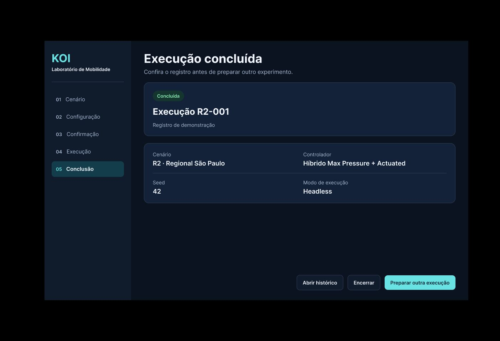
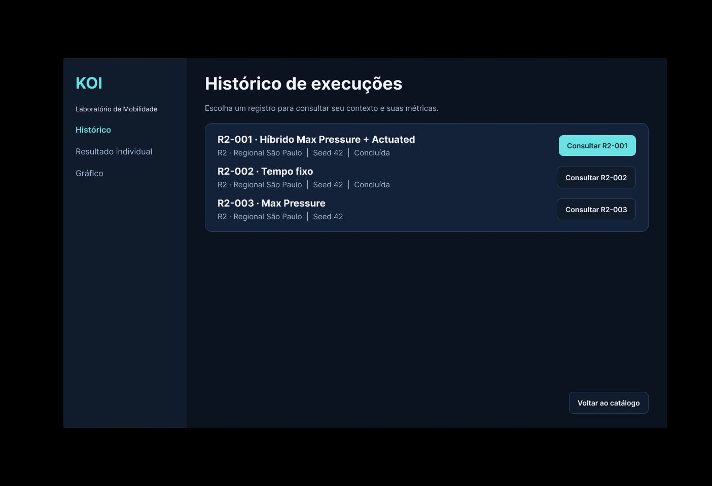
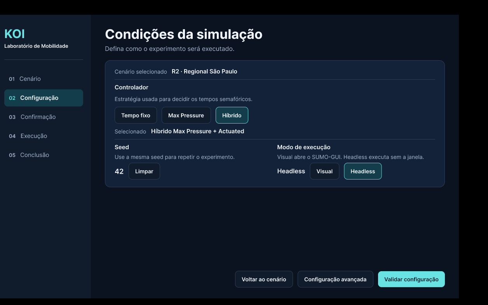
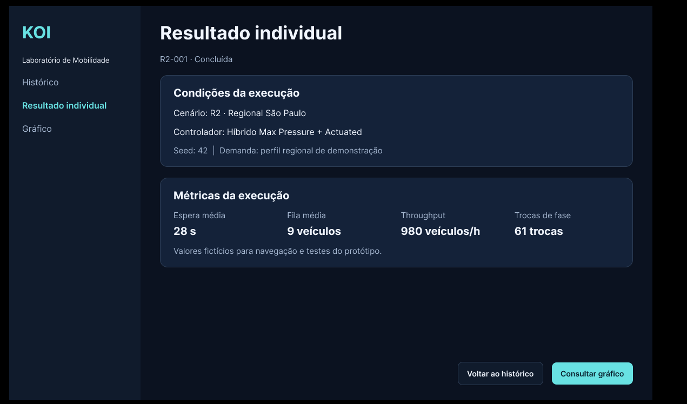
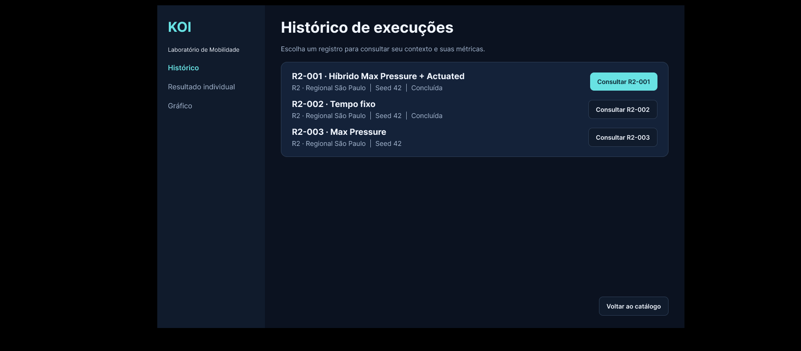
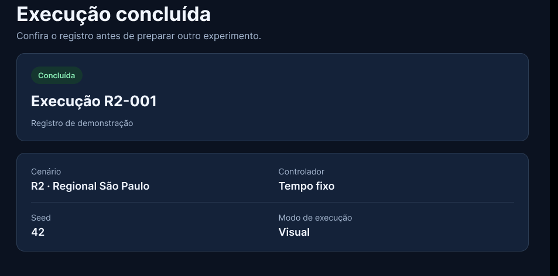

# Entrega 13 — Avaliação de IHC por inspeção heurística

**Data:** 18/11/2026  
**Status:** 🟨 em andamento  
**Responsabilidade:** 1 avaliação completa por integrante, sobre todas as telas/estados relevantes do projeto.

## Objetivo da atividade

Encontrar problemas de usabilidade por inspeção sistemática da interface com as **10 heurísticas de Nielsen**. Cada avaliador trabalha individualmente primeiro; depois a equipe consolida problemas duplicados e prioridades.

> **Parte de violações:** registre somente problemas reais. Não invente uma violação para “preencher” cada heurística. Para provar que todas foram exercitadas, use a **matriz de cobertura H1–H10**. Para heurísticas sem violação, a disciplina solicita um exemplo didático de boa prática.

## 1. Heurísticas adotadas

1. Visibilidade do status do sistema
2. Compatibilidade entre o sistema e o mundo real
3. Controle e liberdade do usuário
4. Consistência e padrões
5. Prevenção de erros
6. Reconhecimento em vez de memorização
7. Flexibilidade e eficiência de uso
8. Estética e design minimalista
9. Ajudar usuários a reconhecer, diagnosticar e recuperar-se de erros
10. Ajuda e documentação

**Referência:** [10 Usability Heuristics for User Interface Design — Nielsen Norman Group](https://www.nngroup.com/articles/ten-usability-heuristics/).

## Cobertura especial para interfaces administrativas e analíticas

Quando existirem, não limite a avaliação às “telas principais”. Inspecione também:

- dashboard em estados normal, vazio e erro;
- filtros sem resultado e filtros combinados;
- relatórios e exportação;
- histórico/listas longas;
- formulários CRUD (criação, edição, exclusão, validação);
- alteração de perfil/permissão;
- confirmações de ações destrutivas;
- processamento/loading/progresso;
- falha e recuperação;
- comparação de resultados;
- mensagens de termos técnicos, métricas e recomendações;
- ajuda/documentação contextual.

Em TCCs técnicos, observe especialmente se a interface comunica o estado do processamento e traduz informações técnicas para o vocabulário do usuário escolhido.

**Aplicação no projeto:** foram considerados configuração, validação, confirmação, processamento, falha, conclusão, histórico, resultados e gráficos. A comparação consiste na consulta individual dos registros e na reunião externa dos valores, conforme o planejamento da Entrega 12. Não foi exigida uma tela de comparação integrada. Administração, permissões, CRUD, exportação e filtros de histórico não fazem parte dos quadros examinados.

## 2. Escopo da inspeção

| Item | Definição |
|---|---|
| Versão avaliada | Protótipo Figma da Entrega 11, observado em 18/11/2026, sem alteração durante a inspeção. Processamento e resultados são demonstrativos. |
| Referência documental | Repositório consultado no commit b1f56a6f5ed2974bc11df9bfa6c6c9d0c23af598. Esse identificador fixa os documentos consultados, não o histórico de versões do Figma. |
| Arquivo editável | [Figma — projeto](https://www.figma.com/design/YJJhBTujdrsjDY113Iefj4/Sem-t%C3%ADtulo?node-id=4-12). |
| M01 | [Cenário, configuração e execução](https://www.figma.com/proto/YJJhBTujdrsjDY113Iefj4/Sem-t%C3%ADtulo?node-id=4-12&scaling=scale-down-width&content-scaling=fixed&page-id=0%3A1&starting-point-node-id=4%3A12). |
| M02 | [Histórico e resultados](https://www.figma.com/proto/YJJhBTujdrsjDY113Iefj4/Sem-t%C3%ADtulo?node-id=16-206&scaling=scale-down-width&content-scaling=fixed&page-id=0%3A1&starting-point-node-id=16%3A206). |
| Estados cobertos | Catálogo, seleção, configuração, configuração avançada, seed ausente, erro de validação, confirmação, inicialização, execução, conclusão, falha, recuperação, encerramento com sucesso/falha, histórico, dois resultados, dois gráficos e resultado indisponível. |
| Alternativas examinadas | Caminhos completos de Híbrido + Headless, Tempo fixo + Visual e Max Pressure + Headless. Também foi verificada a configuração Tempo fixo + Headless. Não foi realizada uma combinação exaustiva de todos os controles, estados e retornos possíveis. |
| Forma de acesso à falha | F04E foi aberto diretamente pelo nó 4:548 do protótipo; a partir dele foram acionados Revisar configuração e Encerrar. Não foi provocada uma falha real do SUMO. |
| Dispositivo/viewport | Navegador em computador; configuração de viewport solicitada de 1440 × 960 pixels. Os arquivos retornados pela captura possuem 1404 × 960 pixels e os quadros do projeto possuem 1190 × 730 pixels. |
| Evidências | Trinta capturas da inspeção assistida, identificadas no Apêndice A, e quatro capturas fornecidas por Gabriel durante a revisão guiada, identificadas no Apêndice B. Os estados de carregamento do próprio Figma foram descartados. |
| Responsável pela seção A01 | Gabriel Koiama de Rocha Lira — 22.125.067-3. |
| Responsável pela seção A02 | João Pedro Lopes Santana Villas Bôas — 22.125.065-7. Seção ainda não preenchida. |

**Limites:** esta avaliação examina a interação do protótipo. Não mede o desempenho do algoritmo ou do SUMO, não reproduz a execução R3 e não comprova o comportamento da aplicação funcional. Navegação por teclado, leitor de tela, contraste calculado e responsividade não foram avaliados sistematicamente. A ausência de uma violação registrada não certifica conformidade de acessibilidade.

## 3. Procedimento individual

Cada avaliador deve:

1. percorrer os fluxos/telas ao menos uma vez para familiarização;
2. inspecionar novamente aplicando sistematicamente H1–H10;
3. registrar cada problema com evidência e contexto;
4. atribuir severidade depois de compreender o problema;
5. preservar a independência da sua inspeção antes da discussão conjunta.

**Registro metodológico desta versão:** a navegação inicial, as capturas e a preparação da análise foram realizadas com assistência de IA. Em 18/11/2026, Gabriel realizou uma revisão guiada dos seis achados, relatou suas próprias interpretações e forneceu quatro capturas. A revisão modificou o relato de V03 e reduziu a severidade proposta de V04. Esse procedimento não é apresentado como inspeção sem assistência nem como teste com participantes externos. A parte de João e a consolidação permanecem abertas; a cobertura individual completa ainda deve ser conferida.

### Escala de severidade (0–4)

| Grau | Interpretação |
|---:|---|
| 0 | não é considerado problema de usabilidade |
| 1 | problema cosmético; corrigir se houver tempo |
| 2 | problema menor; baixa prioridade |
| 3 | problema maior; alta prioridade |
| 4 | catástrofe de usabilidade; correção imperativa antes de disponibilizar |

As justificativas consideram frequência de exposição à condição, impacto sobre a tarefa e persistência. Não são frequências medidas com usuários. Os impactos ainda não observados com participantes são tratados como riscos de interação.

---

## Avaliador A01 — Gabriel Koiama de Rocha Lira

**Matrícula:** 22.125.067-3.  
**Data do registro:** 18/11/2026.  
**Situação:** seis achados revisados com Gabriel em procedimento guiado; cobertura e boas práticas ainda em conferência.

### 4. Matriz de cobertura das 10 heurísticas

| Heurística | Telas/fluxos examinados | Houve violação? | IDs dos achados | Exemplo de boa prática se não violada |
|---|---|---|---|---|
| H1 | Seleção, configuração, processamento, conclusão, histórico e indisponibilidade; M01/M02 | Sim | V04 | — |
| H2 | Vocabulário, contexto experimental, unidades e gráficos; M01/M02 | Sim | V05 | — |
| H3 | Voltar, revisar, escolher outro registro e encerrar; M01/M02 | Não observada nos caminhos examinados | — | F03 permite rever a configuração; F08E permite retornar ao histórico; F04E oferece revisão ou encerramento. |
| H4 | Preservação de escolhas, resumos, identidade dos registros e ações nas conclusões; M01/M02 | Sim | V06, V07 | — |
| H5 | Seed ausente, validação, recuperação e confirmação; M01 | Não observada nos caminhos examinados | — | F02E informa a ausência da seed e impede o avanço até a correção demonstrada. |
| H6 | Resumo, contexto durante a execução e condições junto às métricas; M01/M02 | Não observada nos caminhos examinados | — | Cenário, controlador e seed ficam disponíveis nos quadros usados para revisão e interpretação. |
| H7 | Seleção de opções, acesso aos três registros e passagem da conclusão para o histórico; M01/M02 | Sim, como heurística associada | V06 | — |
| H8 | Hierarquia e quantidade de informação nos estados capturados; M01/M02 | Não observada nos caminhos examinados | — | Condições e métricas ocupam grupos separados; títulos e ações principais são destacados. |
| H9 | Validação da seed, falha de processamento e indisponibilidade; M01/M02 | Sim | V02 | — |
| H10 | Apoio contextual para configurar e interpretar indicadores; M01/M02 | Sim | V03 | — |

Não foi criada uma violação para cada heurística. As boas práticas não anulam os problemas de outros estados. V06 é contado uma única vez, com H4 como classificação principal e H7 associada.

### 5. Declaração de violações

| ID | Heurística | Tela/estado | Problema observado | Evidência | Severidade | Justificativa da severidade | Recomendação |
|---|---|---|---|---|---:|---|---|
| V02 | H9 | F04E — falha | O aviso informa que o simulador interrompeu a execução e pede revisão das condições, mas não identifica a causa nem uma verificação concreta. O retorno à configuração funciona, porém o usuário não recebe um diagnóstico que oriente a alteração. | E14 e E26 | 2 | Frequência: ao acessar esta falha demonstrativa. Impacto: tentativa de recuperação sem orientação específica. Persistência: a mensagem permanece genérica; revisão e encerramento estão disponíveis, sem bloqueio total demonstrado. | Representar uma falha específica e indicar causa e ação correspondente. Se a causa for desconhecida, declarar isso e oferecer detalhes ou nova tentativa; não atribuir a falha à configuração sem evidência. |
| V03 | H10 | F08/F08B — métricas | Throughput aparece com valores em veículos/h, mas sem definição contextual da contagem, do intervalo de referência e do alcance na rede. A unidade não informa sozinha como interpretar o indicador. Não foi localizada ajuda correspondente nesses quadros. | E09 e E11 | 2 | Frequência: nos dois resultados consultados. Impacto: risco de interpretar o indicador com uma definição diferente da adotada pelo sistema. Persistência: não há explicação no quadro. O efeito sobre usuários depende de seu conhecimento prévio e deverá ser observado na Entrega 14. | Apresentar nome em português acompanhado do termo técnico e uma definição curta com contagem, unidade e referência temporal, coerente com a métrica efetivamente implementada no TCC. Não inventar essa definição a partir do protótipo. |
| V04 | H1 | F07 → F08E | R2-003 não apresenta um status explícito. Gabriel percebeu antes de abrir que sua condição diferia das demais execuções porque somente as outras exibiam Concluída. Ao abrir, recebeu o aviso de resultado indisponível. A diferença é perceptível, mas o estado precisa ser inferido pela ausência do rótulo. | E08, E13 e G03 | 1 | Frequência: na terceira linha do histórico. Impacto observado na revisão: Gabriel reconheceu a diferença antes de clicar, sem relatar bloqueio ou surpresa. Persistência: a lista continua sem nomear o estado. A severidade foi reduzida de 2 para 1 considerando essa observação; o resultado não é generalizado para outros usuários. | Exibir Resultado indisponível na linha de R2-003, distinguindo explicitamente esse estado de uma execução ainda em andamento. |
| V05 | H2 | F09/F09B — gráficos | As barras e linhas de grade não possuem escala numérica. O texto informa 28 s ou 36 s, mas a altura da barra não pode ser relacionada com segurança a uma referência quantitativa. | E10 e E12 | 2 | Frequência: nos dois gráficos examinados. Impacto: reduz a interpretação e a comparação visual. Persistência: a escala continua ausente; os números em texto permitem recuperar o valor exato. | Incluir valores na escala, unidade e identificação do registro. Utilizar a mesma escala e uma representação proporcional aos valores nos dois gráficos. |
| V06 | H4; associada a H7 | F05 — conclusões alternativas | A conclusão Híbrido + Headless oferece Abrir histórico. As conclusões Tempo fixo + Visual e Max Pressure + Headless oferecem apenas Encerrar e Preparar outra execução. O acesso à consulta desaparece conforme as opções do experimento. | E07, E24 e E30 | 3 | Frequência: em duas combinações alternativas verificadas. Impacto: interrompe a continuidade entre executar e consultar resultados nesses caminhos, exigindo outro ponto de entrada do protótipo. Persistência: encerrar ou preparar outro experimento não oferece, nesses quadros, o mesmo acesso ao histórico. | Disponibilizar acesso consistente ao histórico ou ao resultado após todas as conclusões bem-sucedidas. Conferir as demais variantes e relacionar o comando ao registro correto. |
| V07 | H4 | Conclusões alternativas × histórico | Tempo fixo + Visual e Max Pressure + Headless exibem Execução R2-001. No histórico, R2-001 identifica Híbrido Max Pressure + Actuated e R2-002 identifica Tempo fixo. O mesmo identificador demonstrativo passa a representar condições incompatíveis. | E24, E30, E08 e E09 | 3 | Frequência: nas duas conclusões alternativas verificadas. Impacto: compromete a associação entre condições e resultado, central às tarefas de consulta e comparação. Persistência: o histórico mostra outra estratégia para o mesmo identificador; não se trata de perda de dados reais comprovada. | Usar identificadores e condições coerentes em todos os quadros. Para um protótipo estático, preparar registros demonstrativos compatíveis com cada caminho ou informar claramente quando uma conclusão não gera registro consultável. |

**Qualidade do relato:** os problemas são localizados por estado e por sequência. Impactos previstos não são apresentados como falas ou dificuldades medidas com participantes.

#### Passos de reprodução

**V02 — diagnóstico da falha**

1. Abrir [F04E — falha](https://www.figma.com/proto/YJJhBTujdrsjDY113Iefj4/Sem-t%C3%ADtulo?node-id=4-548&scaling=scale-down-width&content-scaling=fixed&page-id=0%3A1&starting-point-node-id=4%3A12).
2. Ler a orientação e identificar se existe causa ou condição concreta para conferir.
3. Acionar Revisar configuração e verificar a ausência de indicação específica do que deve ser alterado.

**V03 — explicação da métrica**

1. No histórico, consultar R2-001 e R2-002.
2. Localizar Throughput e verificar os textos de apoio disponíveis.
3. Conferir se o quadro esclarece o significado e as referências da medida, além de sua unidade.

**V04 — indisponibilidade**

1. Abrir o histórico e localizar R2-003.
2. Conferir se sua indisponibilidade é informada na lista.
3. Abrir o registro e observar o aviso.
4. Voltar ao histórico e confirmar que o aviso continua ausente da linha.

**V05 — interpretação do gráfico**

1. Consultar o resultado R2-001 e abrir seu gráfico.
2. Conferir quais valores identificam as linhas de grade.
3. Repetir para R2-002 e verificar a referência comum para comparar as barras.

**V06 — consistência do acesso ao histórico**

1. Executar a demonstração padrão Híbrido + Headless até a conclusão e observar Abrir histórico.
2. Preparar Tempo fixo + Visual e concluir.
3. Comparar as ações oferecidas.
4. Repetir com Max Pressure + Headless.
5. Verificar que as duas alternativas examinadas não oferecem o mesmo acesso.

**V07 — coerência da identificação**

1. Conferir o identificador e o controlador nas conclusões Tempo fixo + Visual e Max Pressure + Headless.
2. Abrir o histórico pelo fluxo M02.
3. Comparar o controlador de R2-001 na lista e no resultado individual com os controladores apresentados nas conclusões.

#### Evidências dos problemas prioritários

**E07 — conclusão padrão: existe Abrir histórico.**

**E24 — conclusão Tempo fixo + Visual: R2-001 e ausência de Abrir histórico.**

**E30 — conclusão Max Pressure + Headless: o mesmo identificador e ausência do acesso.**

**E08 — histórico: R2-001 está associado ao controlador híbrido.**

### 6. Boas práticas — heurísticas não violadas (atividade didática)

| Heurística sem violação | Exemplo no sistema | Evidência | Por que atende |
|---|---|---|---|
| H3 | F03 oferece retorno antes da confirmação; F08E retorna ao histórico; F04E oferece revisão e encerramento. | E05, E13, E14, E16, E17 e E26 | Existem saídas explícitas nos estados de revisão, indisponibilidade e falha examinados. |
| H5 | A seed ausente é detectada e o comando Usar 42 permite recuperar o caso demonstrativo. | E25, E04 e E05 | A configuração incompleta recebe feedback e pode ser corrigida antes de confirmar a execução. |
| H6 | O resumo apresenta cenário, controlador, seed e modo; as métricas apresentam condições experimentais. | E05, E09, E11 e E22 | O contexto da tarefa está visível, reduzindo a necessidade de lembrar escolhas de quadros anteriores. A inconsistência de identificação permanece registrada em V07. |
| H8 | Condições e métricas estão agrupadas; títulos e ações principais possuem hierarquia visual. | E05, E09 e E11 | As informações relacionadas são apresentadas em grupos que apoiam a leitura do objetivo corrente. Não equivale a uma medição de contraste ou de acessibilidade. |

**Verificação positiva de alternativa:** Tempo fixo + Visual permanece no quadro avançado e no retorno à configuração, conforme E19–E22. Não foi registrada uma perda de seleção nesse caminho.

### Condição de preparação para a Entrega 14 — L01

O achado V01 da versão anterior foi reclassificado como **L01 — preparação da observação do processamento**. Os estados avançam automaticamente e a janela de observação é curta. Isso exige conferir o protocolo da UT03, mas não prova, por si só, uma violação: concluir rapidamente não é necessariamente um problema de usabilidade.

As capturas E06, E23 e E29 documentam inicialização e execução. Antes do teste com usuários, verificar a janela necessária à pergunta ou preparar uma entrada estável no estado Executando. Registrar qualquer ajuste e manter condições equivalentes entre participantes. L01 não entra na contagem de violações.

---

## Avaliador A02 — João Pedro Lopes Santana Villas Bôas

**Matrícula:** 22.125.065-7.  
**Data:** {{dd/mm/aaaa}}

### 4. Matriz de cobertura das 10 heurísticas

| Heurística | Telas/fluxos examinados | Houve violação? | IDs dos achados | Exemplo de boa prática se não violada |
|---|---|---|---|---|
| H1 | | | | |
| H2 | | | | |
| H3 | | | | |
| H4 | | | | |
| H5 | | | | |
| H6 | | | | |
| H7 | | | | |
| H8 | | | | |
| H9 | | | | |
| H10 | | | | |

### 5. Declaração de violações

| ID | Heurística | Tela/estado | Problema observado | Evidência | Severidade | Justificativa da severidade | Recomendação |
|---|---|---|---|---|---:|---|---|
| | | | | | | | |

### 6. Boas práticas — heurísticas não violadas (atividade didática)

| Heurística sem violação | Exemplo no sistema | Evidência | Por que atende |
|---|---|---|---|
| | | | |

## 7. Consolidação da equipe

Problemas iguais ou muito semelhantes encontrados por avaliadores diferentes devem ser consolidados, preservando quem os encontrou.

| ID consolidado | Achados individuais | Heurística | Problema | Severidade final | Prioridade | Responsável pela correção |
|---|---|---|---|---:|---|---|
| | | | | | | |

## 8. Síntese e plano de melhoria

### Síntese da seção A01 — após revisão guiada dos achados

| Medida | Resultado desta análise |
|---|---|
| Problemas distintos | 6: V02, V03, V04, V05, V06 e V07. |
| Por heurística principal | H1: 1; H2: 1; H4: 2; H9: 1; H10: 1. |
| Heurística associada | H7 associada a V06, sem duplicar sua contagem. |
| Por severidade | Grau 1: 1; grau 2: 3; grau 3: 2; grau 4: 0. Não foram registrados itens de grau 0 como violações. V04 foi reclassificado após a revisão com Gabriel. |
| Condição de avaliação | L01, fora da contagem de problemas. |
| Prioridade imediata | Corrigir a continuidade para o histórico e a coerência dos identificadores, V06 e V07. |
| Outras melhorias | Diagnóstico da falha, definição de Throughput, status de indisponibilidade e escala dos gráficos. |
| Situação das correções | Recomendações propostas; nenhuma foi implementada nesta inspeção. |

A severidade é uma classificação de inspeção, não um resultado de teste com participantes. Os dois problemas de grau 3 afetam a consulta do resultado correspondente à execução, um objetivo central do projeto. Não foi demonstrada uma catástrofe de usabilidade.

### Percurso e condição observada

1. **Catálogo e seleção:** cenário e seleção comunicados; E01 e E15.
2. **Configuração e avanço:** opções e contexto apresentados; valores avançados declarados como demonstrativos; E02, E03 e E18–E22.
3. **Validação e recuperação:** seed ausente reconhecida e corrigida na inspeção assistida; E25, E04 e E05.
4. **Execução:** estados e condições visíveis; preparar observação da UT03; E06, E23 e E29.
5. **Conclusão:** caminho padrão permite consultar histórico; alternativas têm problemas de continuidade e identidade; E07, E24 e E30.
6. **Falha e encerramento:** saídas funcionam, mas o diagnóstico é genérico; E14, E16, E17 e E26.
7. **Histórico:** consulta disponível; R2-003 difere dos demais pela ausência de Concluída, mas não apresenta status explícito; a identidade dos registros é incoerente com conclusões alternativas; E08 e E13.
8. **Resultados e gráficos:** valores e condições textuais disponíveis; definição de métrica e escala incompletas; E09–E12.

### Plano de verificação das melhorias

| Problema | Critério para considerar a recomendação verificada |
|---|---|
| V02 | A falha comunica causa conhecida e ação correspondente, ou informa causa desconhecida com saída adequada. |
| V03 | A definição contextual da métrica corresponde à implementação técnica e está acessível no resultado. |
| V04 | A lista sinaliza explicitamente a indisponibilidade antes da abertura de R2-003 e mantém uma recuperação coerente. |
| V05 | As duas representações possuem escala legível e comum, unidade e proporção coerente com os valores. |
| V06 | Conclusões das combinações suportadas oferecem acesso consistente ao histórico ou ao resultado. |
| V07 | Identificador e condições se mantêm coerentes entre conclusão, histórico, resultado e gráfico. |
| L01 | O piloto confirma que a pergunta da UT03 pode ser aplicada e respondida durante o estado observado. |

### Síntese consolidada da equipe

{{preencher após as inspeções individuais}}

## Checklist

- [ ] Cada integrante fez uma inspeção completa e identificada. (A revisão guiada dos seis achados de A01 foi registrada; falta confirmar sua cobertura individual completa. A02 permanece em branco.)
- [x] Os estados principais e as rupturas especificados no escopo possuem evidências. (As combinações não foram examinadas exaustivamente.)
- [x] Histórico, processamento, validação, falha, recuperação e indisponibilidade foram incluídos.
- [x] A análise avalia a interação do protótipo, distinguindo-a da validade científica do TCC.
- [ ] H1–H10 aparecem preenchidas na matriz de cada avaliador. (A matriz A01 foi preparada; falta A02.)
- [x] A declaração de violações contém problemas localizados, sem exigir um por heurística.
- [x] Cada problema tem captura identificada, contexto e passos de reprodução.
- [x] As severidades possuem justificativas de frequência, impacto e persistência.
- [x] As recomendações incluem critérios de verificação.
- [ ] Achados individuais duplicados foram consolidados. (Aguarda conclusão das avaliações individuais.)

## Apêndice A — Registro das capturas

Todas as capturas abaixo foram obtidas do protótipo em 18/11/2026. A numeração identifica a evidência; a sequência de navegação é descrita no procedimento e nos passos de reprodução.

| Evidência | Estado | Observação |
|---|---|---|
| [E01](../assets/13_heuristica/01-catalogo.jpg) | Catálogo do cenário R2 | Seleção disponível; identificação e esquema apresentados. |
| [E02](../assets/13_heuristica/02-configuracao.jpg) | Configuração Híbrido + Headless | Contexto e opções visíveis; base do caminho principal. |
| [E03](../assets/13_heuristica/03-avancada.jpg) | Configuração avançada padrão | Valores declarados como demonstração; retorno disponível. |
| [E04](../assets/13_heuristica/04-validacao.jpg) | Seed ausente após validar | Erro localizado e ação Usar 42; recuperação demonstrada. |
| [E05](../assets/13_heuristica/05-confirmacao.jpg) | Resumo Híbrido + Headless | Condições reunidas e retorno antes de confirmar. |
| [E06](../assets/13_heuristica/06-processamento.jpg) | Inicialização Híbrido + Headless | Estado e condições visíveis; preparar janela de observação da UT03. |
| [E07](../assets/13_heuristica/07-conclusao.jpg) | Conclusão Híbrido + Headless | Exibe R2-001 e Abrir histórico; referência para V06. |
| [E08](../assets/13_heuristica/08-historico.jpg) | Histórico com três registros | R2-003 sem status explícito; R2-001 identificado como híbrido. |
| [E09](../assets/13_heuristica/09-resultado-a.jpg) | Resultado R2-001 | Condições e métricas demonstrativas; Throughput sem definição contextual. |
| [E10](../assets/13_heuristica/10-grafico-a.jpg) | Gráfico R2-001 | Valor textual 28 s; escala numérica ausente. |
| [E11](../assets/13_heuristica/11-resultado-b.jpg) | Resultado R2-002 | Tempo fixo e métricas em disposição consistente com R2-001. |
| [E12](../assets/13_heuristica/12-grafico-b.jpg) | Gráfico R2-002 | Valor textual 36 s; escala numérica ausente. |
| [E13](../assets/13_heuristica/13-indisponivel.jpg) | Resultado R2-003 indisponível | Impedimento comunicado e retorno ao histórico disponível. |
| [E14](../assets/13_heuristica/14-falha.jpg) | Falha de processamento F04E | Acesso direto ao estado; diagnóstico genérico e saídas explícitas. |
| [E15](../assets/13_heuristica/15-cenario-selecionado.jpg) | Cenário R2 selecionado | Seleção explicitada e comando Usar este cenário. |
| [E16](../assets/13_heuristica/16-encerramento-sucesso.jpg) | Encerramento após sucesso | Comunica último estado e oferece voltar ao catálogo. |
| [E17](../assets/13_heuristica/17-encerramento-falha.jpg) | Encerramento após falha | Distingue falha de sucesso e permite voltar ao catálogo. |
| [E18](../assets/13_heuristica/18-configuracao-tempo-fixo.jpg) | Configuração Tempo fixo + Headless | Troca de controlador refletida no texto e na seleção. |
| [E19](../assets/13_heuristica/19-configuracao-fixo-visual.jpg) | Configuração Tempo fixo + Visual | Duas escolhas alternativas apresentadas no quadro. |
| [E20](../assets/13_heuristica/20-avancada-fixo-visual.jpg) | Avançada Tempo fixo + Visual | Preserva o controlador e o modo escolhidos. |
| [E21](../assets/13_heuristica/21-retorno-fixo-visual.jpg) | Retorno da configuração avançada | Escolhas preservadas no retorno. |
| [E22](../assets/13_heuristica/22-confirmacao-fixo-visual.jpg) | Resumo Tempo fixo + Visual | Resumo corresponde à configuração. |
| [E23](../assets/13_heuristica/23-execucao-fixo-visual.jpg) | Execução Tempo fixo + Visual | Estado Executando e condições correspondentes. |
| [E24](../assets/13_heuristica/24-conclusao-fixo-visual.jpg) | Conclusão Tempo fixo + Visual | R2-001 reutilizado; acesso ao histórico ausente. |
| [E25](../assets/13_heuristica/25-seed-ausente.jpg) | Configuração antes da validação | Seed vazia explicitada; permite iniciar a validação demonstrativa. |
| [E26](../assets/13_heuristica/26-recuperacao-falha.jpg) | Retorno de F04E à configuração | Comando de recuperação funciona; não identifica o que precisa mudar. |
| [E27](../assets/13_heuristica/27-configuracao-max-headless.jpg) | Configuração Max Pressure + Headless | Terceiro controlador selecionado. |
| [E28](../assets/13_heuristica/28-confirmacao-max-headless.jpg) | Resumo Max Pressure + Headless | Escolhas preservadas no resumo. |
| [E29](../assets/13_heuristica/29-processamento-max-headless.jpg) | Execução Max Pressure + Headless | Estado Executando e condições correspondentes. |
| [E30](../assets/13_heuristica/30-conclusao-max-headless.jpg) | Conclusão Max Pressure + Headless | R2-001 reutilizado; acesso ao histórico ausente. |

## Apêndice B — Revisão guiada com Gabriel

**Data:** 18/11/2026.  
**Natureza:** revisão dos achados por integrante da equipe, com orientação do assistente. Não integra a amostra de participantes da Entrega 14 e não constitui uma inspeção sem assistência.

| Achado | Registro da revisão | Consequência para a análise |
|---|---|---|
| V02 | Gabriel acionou o retorno à configuração e informou que não identificou a causa da falha. Sua captura não mostra campo destacado como responsável pelo erro. | Mantida a observação de diagnóstico insuficiente. O retorno funciona, mas não orienta uma correção específica. |
| V03 | Gabriel informou que já conhecia Throughput e interpretou a unidade como quantidade de veículos por hora. | Não atribuir a Gabriel dificuldade para reconhecer o termo. A recomendação permanece restrita à definição contextual da medida, a conferir com a implementação do TCC. |
| V04 | Gabriel reconheceu antecipadamente que R2-003 diferia das demais porque não apresentava Concluída. Depois da abertura, viu o aviso de indisponibilidade. | Reformulado como falta de status explícito, sem alegar surpresa ou bloqueio na revisão. Severidade proposta reduzida para 1. |
| V05 | Gabriel informou que não existem números nas linhas do gráfico; o valor em segundos por veículo aparece no texto superior. | Confirmada a ausência de escala numérica. Não foi afirmado que Gabriel deixou de compreender o valor textual. |
| V06 | Gabriel informou que Abrir histórico não está disponível em Tempo fixo + Visual, enquanto as outras ações permanecem iguais. | Confirmada a diferença nesse caminho. A evidência adicional de Max Pressure + Headless continua identificada como parte da inspeção assistida. |
| V07 | A captura da conclusão enviada por Gabriel mostra R2-001, Tempo fixo e Visual; sua captura do histórico associa R2-001 ao Híbrido. | Confirmada a inconsistência do identificador entre esses dois estados. |

### Capturas fornecidas durante a revisão

**G01 — retorno à configuração após o aviso de falha.**

**G02 — resultado individual e indicador Throughput.**

**G03 — histórico: R2-001 é Híbrido e R2-003 não apresenta o rótulo Concluída.**

**G04 — conclusão Tempo fixo + Visual identificada como R2-001.**

### Conferências ainda pendentes

Confirmar as boas práticas e a cobertura do percurso individual, incluindo validação e recuperação da seed ausente. Manter separadas as evidências fornecidas por Gabriel e as capturas da inspeção assistida. A matriz e os resultados de João continuam em branco.
