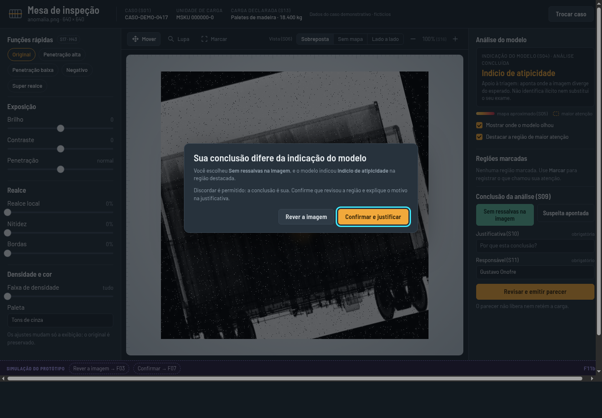
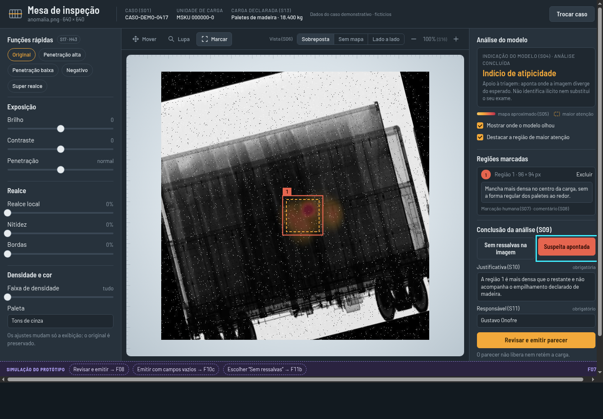
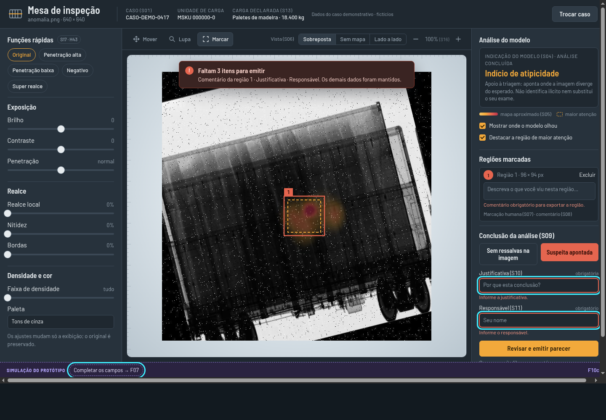
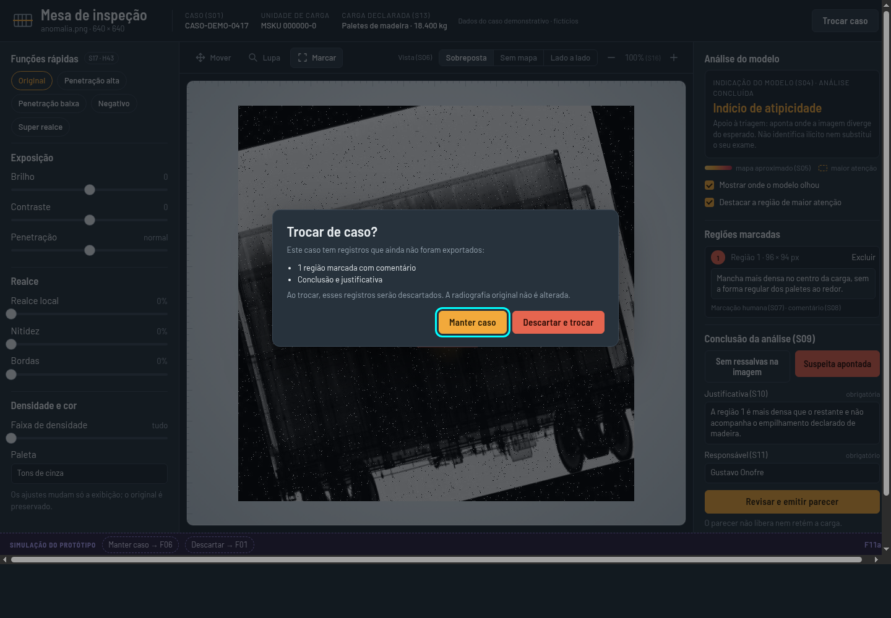

# Entrega 13 — Avaliação heurística

**Data:** 21/11/2026 
**Status:** 🟩 concluída — três inspeções individuais (A01, A02, A03) realizadas na versão HTML equivalente, duplicados consolidados (V01–V09) e correções prioritárias aplicadas na versão v1.1 antes do piloto da Entrega 14. 
**Responsabilidade:** uma inspeção completa por integrante, seguida de síntese da equipe.

A inspeção avalia a interação da Mesa de inspeção, não o desempenho científico do modelo. Conforme a aula 13, cada pessoa primeiro examina a interface individualmente; depois a equipe consolida os problemas. Preparar fichas não equivale a executar essas inspeções.

## 1. Processo / fluxograma

[Fonte SVG editável](../assets/13_heuristica/fluxograma_inspecao.svg). A revisão devolve os fluxos afetados à inspeção, mantendo a versão de origem de cada achado.

## 2. Escopo e procedimento

| Item | Definição |
|---|---|
| Versão | Base: [Entrega 11](11_figma.md), versão HTML do commit `f15c58e`, no Chromium a 1440 × 1000. Reproduzir os achados no Figma e registrar URL/node, versão e data nas fichas individuais. |
| Telas/estados | F01–F09, F10A/B/C/D, F11A/B e F12: 16 estados do protótipo. Incluir leitura do documento, vazio, processamento, erro, retorno, confirmação e sucesso. |
| Fluxos | M01 exame/registro; M02 compreensão do parecer; M03 preparação para conferência. |
| Dispositivo | Computador com teclado/mouse; referência 1920 × 1080. Registrar configuração efetiva. |
| Fora do recorte | Dashboard, filtros, histórico, CRUD, permissões e decisão institucional não existem na solução. Não inventar testes para esses padrões. |

Cada integrante faz uma passagem de familiarização e outra verificando H1–H10 em **todos** os estados. Registra ação, localização e print destacado por problema; depois justifica severidade e recomenda correção. Não discutir achados antes de concluir as três fichas. Ausência de observação não pode ser preenchida como “sem violação”.

| Severidade | Significado |
|---:|---|
| 0 | Não é problema de usabilidade. |
| 1 | Cosmético; corrigir se houver tempo. |
| 2 | Menor, com baixa prioridade. |
| 3 | Maior; alta prioridade. |
| 4 | Impede disponibilização até a correção. |

A justificativa considera frequência provável, impacto sobre a tarefa e persistência, conforme págs. 11–14 da aula. Uma inspeção não demonstra a frequência real de erro de usuários.

## 3. Registros individuais

| Avaliador / responsável | Ficha com matriz H1–H10 e declaração de violações | Situação |
|---|---|---|
| A01 — Kawan Mark Geronimo Da Silva, 22.222.010-5 | [Inspeção A01](../instrumentos/13_heuristica/a01.md) | Concluída em 20/11/2026 (6 achados: A01-01 a A01-06; 5 boas práticas). |
| A02 — Gabriel Albertini Pinheiro, 22.122.094-8 | [Inspeção A02](../instrumentos/13_heuristica/a02.md) | Concluída em 21/11/2026 (5 achados: A02-01 a A02-05; 5 boas práticas). |
| A03 — Alexandre Domiciano Pierri, 22.125.061-6 | [Inspeção A03](../instrumentos/13_heuristica/a03.md) | Concluída em 21/11/2026 (5 achados: A03-01 a A03-05; 6 boas práticas). |

Cada ficha inclui cobertura dos 16 estados, verificação explícita de H1–H10, registro de violações com evidência/severidade/recomendação e boas práticas para heurísticas não violadas. O arquivo ilustrativo antigo `v01.svg` não foi utilizado como evidência. As três inspeções foram executadas sobre a versão HTML equivalente (`assets/11_figma/prototipo/index.html`), gerada a partir da mesma base de telas publicada no Figma (link público verificado em 21/11/2026).

## 4. Avaliação heurística — inspeção preliminar da versão HTML

Registro técnico preliminar, com prints e destaque em ciano conforme o formato pedido no Modelo 02 da aula 13. As severidades são estimativas da inspeção. Os registros abaixo podem orientar a revisão no Figma e não são atribuídos aos três avaliadores.

| ID | Heurística | Problema localizado e consequência | Severidade e justificativa | Correção proposta |
|---|---|---|---|---|
| V01 | H3 — Controle e liberdade | Em F11b, depois de escolher “Sem ressalvas na imagem”, clicar em “Confirmar e justificar” abre F07 com “Suspeita apontada” selecionada. A confirmação perde a conclusão humana que acabou de ser escolhida. | 3. Repete-se nesse caminho e a seleção pode chegar ao parecer com o sentido invertido se passar despercebida. | Conectar a confirmação a um estado F07 que mantenha “Sem ressalvas na imagem” e permita seguir à prévia com essa conclusão. |
| V02 | H9 — Recuperação de erros | Em F10c, o painel pede comentário, justificativa e responsável. Os campos visíveis são estáticos e “Revisar e emitir parecer” retorna ao próprio erro. A recuperação disponível passa pela faixa roxa “Completar os campos”, que abre um estado já preenchido. | 3. O bloqueio é persistente nesse estado e impede observar a correção espontânea de UT03. É uma limitação do protótipo HTML avaliado. | Antes da coleta, permitir acionar a recuperação pelos elementos da própria interface. Preparar uma variante que isole a autoria ausente quando a tarefa começar com os demais dados preenchidos. |
| V03 | H3 — Controle e liberdade | Em F07, clicar em “Trocar caso” e depois em “Manter caso” leva a F06. A região continua visível, mas a conclusão que estava selecionada desaparece. | 2. Ocorre nesse caminho e pode obrigar a refazer parte do parecer. | Voltar ao estado de origem quando a troca for cancelada e preservar a conclusão já escolhida. |

**V01 — ação e resultado.** O destaque no primeiro print indica a ação. No segundo, indica a conclusão que aparece selecionada após o clique.

**V02 — campos com omissão e saída pela faixa de simulação.**

**V03 — manter o caso.** A ação destacada abre F06 mesmo quando o diálogo foi aberto de F07.

## 5. Uso das heurísticas — exercício didático

Os slides de fechamento da aula 14 pedem **dez exemplos**, um para cada heurística. A tabela abaixo mostra decisões presentes no protótipo. Não é resultado das inspeções e não significa que cada heurística esteja integralmente atendida.

| Heurística de Nielsen | Exemplo no projeto | Evidência e propósito |
|---|---|---|
| H1 — Visibilidade do estado | “Analisando imagem” separado de sucesso e falha. | [F02](../assets/11_figma/telas/F02.jpg), [F10B](../assets/11_figma/telas/F10b.jpg): evitar interpretar falta de resultado como normalidade. |
| H2 — Correspondência com o mundo real | Caso, carga declarada, região e parecer, sem código técnico como mensagem principal. | [F08](../assets/11_figma/telas/F08.jpg): comunicar o fundamento da observação. Vocabulário ainda requer validação com o perfil. |
| H3 — Controle e liberdade | Cancelar análise, voltar para corrigir e manter caso diante de descarte. | [F02](../assets/11_figma/telas/F02.jpg), [F11A](../assets/11_figma/telas/F11a.jpg): saída explícita. |
| H4 — Consistência e padrões | Mesmos rótulos para original, sobreposição e lado a lado; posição persistente. | [F03](../assets/11_figma/telas/F03.jpg), [F05](../assets/11_figma/telas/F05.jpg): reconhecer ações equivalentes. |
| H5 — Prevenção de erros | Responsável obrigatório e confirmação de conclusão divergente. | [F10C](../assets/11_figma/telas/F10c.jpg), [F11B](../assets/11_figma/telas/F11b.jpg): conferir antes da emissão. |
| H6 — Reconhecimento em vez de memorização | Caso, marcação numerada e comentário aparecem juntos na revisão. | [F08](../assets/11_figma/telas/F08.jpg): relacionar evidência sem depender da lembrança. |
| H7 — Flexibilidade e eficiência | Alternativas original/sobreposição/lado a lado e restauração dos ajustes. | [F05](../assets/11_figma/telas/F05.jpg): adequar a comparação; eficiência ainda será medida. |
| H8 — Estética e minimalismo | Radiografia ocupa o painel principal; registro e resultado agrupados à direita. | [F06](../assets/11_figma/telas/F06.jpg): foco na tarefa, sem indicadores ou cadastros sem objetivo. |
| H9 — Reconhecimento e recuperação de erros | Mensagem explica falha de exportação, preservação dos registros e verificação do destino. | [F10D](../assets/11_figma/telas/F10d.jpg): orientar a próxima ação. |
| H10 — Ajuda e documentação | Passos curtos junto à análise e limites do mapa no painel do resultado. | [F03](../assets/11_figma/telas/F03.jpg): ajuda contextual; não depende de manual externo. |

## 6. Consolidação e plano de melhoria

Após o término das três inspeções individuais, os **16 relatos individuais** (6 de A01, 5 de A02 e 5 de A03) foram consolidados em **9 problemas únicos (`V01`–`V09`)**, preservando a autoria de cada descoberta e definindo a severidade consensual e a ação adotada antes do piloto da Entrega 14.

| ID | Heurística | Onde | Autoria (relatos originais) | Severidade consensual | Síntese do problema | Ação adotada (versão v1.1 HTML) |
|---|---|---|---|---:|---|---|
| **V01** | H3 — Controle e liberdade | F11b → F07 | A01 (`A01-02`), A02 (`A02-03`), A03 (`A03-01`) | 3 (Maior) | Confirmar “Sem ressalvas na imagem” em F11b abre F07 com “Suspeita apontada” marcada. | **Corrigido na v1.1:** criado estado `F07b` que preserva “Sem ressalvas na imagem” e leva à prévia coerente (`F08b`). |
| **V02** | H9 — Recuperação de erros | F10c → F07 | A01 (`A01-06`), A02 (`A02-05`), A03 (`A03-05`) | 3 (Maior) | Campos obrigatórios em erro são estáticos e saída depende da faixa roxa de simulação; impede observar UT03 naturalmente. | **Corrigido na v1.1:** campos em erro em `F10c` tornados clicáveis para recuperação direta e criada variante `F10c_ut03` isolando apenas “Responsável” vazio. |
| **V03** | H3 — Controle e liberdade | F07 → F11a → F06 | A01 (`A01-03`), A03 (`A03-02`) | 2 (Menor) | Cancelar a troca de caso em F11a (aberto de F07) retorna a F06 e perde conclusão/justificativa/responsável. | **Corrigido na v1.1:** “Manter caso” em `F11a` retorna para `F07`, preservando o registro em andamento. |
| **V04** | H2 — Mundo real | F01–F12 | A01 (`A01-01`), A02 (`A02-02`) | 2 (Menor) | Códigos internos de modelagem (`S01`–`S18`, `S17 · H43`) aparecem nos rótulos da tela e no PDF F12. | **Corrigido na v1.1:** códigos internos removidos dos rótulos visíveis na versão de teste do protótipo. |
| **V05** | H7 — Eficiência e flexibilidade | F03–F07 (painel esquerdo) e F05 | A01 (`A01-04`), A03 (`A03-04`) | 2 (Menor) | Falta botão explícito “Restaurar ajustes” no painel esquerdo; em F05 (lado a lado) não há indicação de zoom sincronizado. | **Corrigido parcialmente na v1.1:** botão “Restaurar ajustes” adicionado ao painel esquerdo; zoom sincronizado em F05 registrado para implementação futura. |
| **V06** | H8 — Minimalismo / visibilidade | F10c (rodapé do painel direito, 1440×900) | A01 (`A01-05`) | 2 (Menor) | As três mensagens de erro empurram o painel e cortam “O parecer não libera nem retém a carga.” na borda inferior. | **Corrigido na v1.1:** espaçamento vertical compactado no estado de erro para manter botão e aviso visíveis em 1440×900. |
| **V07** | H1 — Visibilidade | F03, F05, F06 (contorno do modelo) | A02 (`A02-01`) | 2 (Menor) | Tracejado âmbar sobre regiões claras da radiografia apresenta baixo contraste (~1,5:1). | **Corrigido na v1.1:** adicionado contorno escuro de contraste sob o tracejado âmbar da região do modelo. |
| **V08** | H6 — Reconhecimento | F12 (leitor de PDF) | A02 (`A02-04`) | 1 (Cosmético) | Cabeçalho indica “Página 1 de 2”, mas a página 2 com o mapa de atenção não é navegável no protótipo. | **Backlog pós-teste:** fora das tarefas UT01–UT03; incluir página 2 na versão final do gerador de PDF. |
| **V09** | H6 — Reconhecimento | F06 e F07 (cartão “Região 1”) | A03 (`A03-03`) | 2 (Menor) | Cartão da região mostra apenas “Excluir”, sem indicação clara de edição direta do comentário. | **Corrigido na v1.1:** adicionada indicação/ação “Editar” junto a “Excluir” no cartão da região. |

### Totais consolidados

- **Total de relatos individuais:** 16 (`A01`: 6; `A02`: 5; `A03`: 5).
- **Total de problemas únicos após consolidação:** 9 (`V01`–`V09`).
- **Por severidade:** Severidade 4 (catastrófico): **0** · Severidade 3 (maior): **2** (`V01`, `V02`) · Severidade 2 (menor): **6** (`V03`–`V07`, `V09`) · Severidade 1 (cosmético): **1** (`V08`).
- **Por heurística:** H3 (2), H6 (2), H1 (1), H2 (1), H7 (1), H8 (1), H9 (1); sem violações registradas em H4, H5 e H10.
- **Correções aplicadas antes da Entrega 14:** os dois bloqueios maiores (`V01` e `V02`) e seis melhorias menores (`V03`–`V07` e `V09`) foram incorporados em `assets/11_figma/prototipo/gerar_prototipo.py` (versão `v1.1` do protótipo HTML) antes do piloto e das sessões de observação. Replicar as mesmas alterações no arquivo do Figma assim que o compartilhamento for atualizado.

## Checklist

- [x] Escopo, processo iterativo, procedimento individual e escala definidos.
- [x] Ficha completa com H1–H10 preparada para cada integrante.
- [x] Estados de erro, processamento, relatório e retorno incluídos no escopo.
- [x] Exercício didático separado das violações, com dez exemplos do projeto.
- [x] Critérios de evidência, severidade, recomendação e consolidação definidos.
- [x] Cada integrante executou sua inspeção completa na versão navegável. *(Executada sobre a versão HTML equivalente `index.html`; replicação no Figma depende da liberação do link.)*
- [x] Matrizes preenchidas com resultados e boas práticas observadas.
- [x] Achados preliminares registrados com print destacado, contexto e justificativa.
- [x] Achados registrados nas fichas individuais e verificados na versão navegável HTML.
- [x] Duplicados consolidados; totais e correções prioritárias definidos.

**Referências:** aula 13, *Avaliação de Usabilidade por Inspeções*, págs. 8–16; aula 14, *Teste de Usabilidade com Observação do Usuário*, pág. 16; [plano DECIDE](12_planejamento_avaliacao.md).
