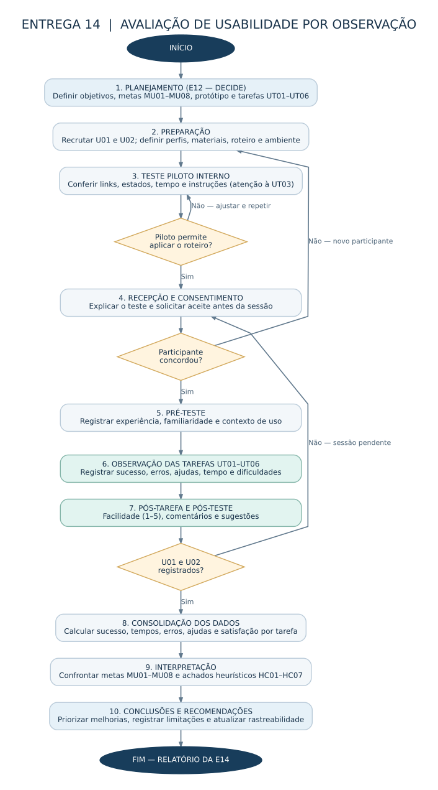

# Entrega 14 — Avaliação de usabilidade por observação de usuários

**Data:** 18/11/2026  
**Status:** 🟨 em andamento  
**Responsabilidade:** solução consolidada por equipe. O número de participantes finais observados deve ser igual ao número de integrantes, conforme o modelo da disciplina; recomenda-se que cada integrante seja responsável por conduzir/analisar ao menos um participante.

## Objetivo da atividade

Observar usuários representativos realizando tarefas reais ou realisticamente simuladas para identificar problemas de eficácia, eficiência, compreensão e satisfação que não podem ser inferidos apenas por inspeção.

> **Participantes finais não devem ser membros da equipe.** Um integrante pode participar do teste piloto apenas para validar roteiro/equipamentos, sem contar na amostra final.

### Quando o usuário é um perfil profissional especializado

Em TCCs técnicos, o público pode ser DBA, analista, pesquisador, administrador, técnico ou outro especialista. Priorize participantes que possuam relação real com as tarefas. Se não for possível recrutar o perfil ideal, qualquer participante aproximado/proxy deve ser **justificado previamente e tratado como limitação**; não apresente o resultado como equivalente ao de especialistas reais.

O teste avalia a **interação com o protótipo**. Não é necessário que o participante valide o desempenho científico do algoritmo. Resultados simulados podem ser usados quando declarados e coerentes com a tarefa.

Tarefas podem envolver, por exemplo, interpretar um dashboard, configurar uma análise, encontrar uma execução no histórico usando filtros, comparar resultados, gerar relatório, revisar alerta ou administrar permissões.

## A. Fluxograma do processo — equipe

O fluxograma deve representar, no mínimo: planejamento → recrutamento → consentimento → preparação → execução das tarefas/observação → pós-teste → consolidação/análise → recomendações.

**Arquivo:** `assets/14_testes/fluxograma_avaliacao.svg`, a ser adicionado manualmente.

## B. Procedimento de preparação e execução — equipe

### Passo 1 — Objetivos e versão avaliada

**Versão/commit/Figma:** protótipo da Entrega 11. Registrar a data da sessão e qualquer alteração realizada antes da aplicação.

- [Arquivo editável](https://www.figma.com/design/YJJhBTujdrsjDY113Iefj4/Sem-t%C3%ADtulo?node-id=4-12).
- [M01 — preparação e execução](https://www.figma.com/proto/YJJhBTujdrsjDY113Iefj4/Sem-t%C3%ADtulo?node-id=4-12&scaling=scale-down-width&content-scaling=fixed&page-id=0%3A1&starting-point-node-id=4%3A12).
- [M02 — histórico e resultados](https://www.figma.com/proto/YJJhBTujdrsjDY113Iefj4/Sem-t%C3%ADtulo?node-id=16-206&scaling=scale-down-width&content-scaling=fixed&page-id=0%3A1&starting-point-node-id=16%3A206).

**Metas de usabilidade relacionadas:** MU01–MU08, conforme a Entrega 8 e o plano DECIDE da Entrega 12.

| Meta | Medida prevista |
|---|---|
| MU01 | 100% dos participantes concluem a preparação sem ajuda. |
| MU02 | 100% identificam a ação correta para recuperar a configuração inválida. |
| MU03 | Mediana de preparação de até 5 minutos. |
| MU04 | 100% reconhecem o estado da execução e o controlador utilizado. |
| MU05 | 100% identificam o registro e suas condições solicitadas. |
| MU06 | Mediana de localização de uma execução de até 3 minutos. |
| MU07 | Mediana de facilidade percebida de pelo menos 4 em 5. |
| MU08 | 100% compreendem a consulta individual e a reunião externa dos dados para comparação. |

O Figma simula processamento e apresenta resultados fictícios: R2-001 possui espera média de 28 s e R2-002 de 36 s. Esses valores servem à avaliação da interação e não demonstram superioridade científica de um controlador.

**Distinção da exploração anterior:** em 15/11/2026, U01 e U02 exploraram presencialmente a aplicação funcional do TCC e executaram o cenário R3 — Vila Mariana, no computador de Gabriel. Houve concordância para participar, sem gravação ou ensaio prévio. O resultado técnico foi preservado, mas não foram fornecidos registros sistemáticos de sucesso por tarefa, erros, ajudas, tempo ou satisfação. Essa exploração não é apresentada como aplicação das tarefas padronizadas do Figma.

### Passo 2 — Participantes

| ID | Perfil | Critérios que justificam participação | Integrante responsável |
|---|---|---|---|
| U01 | Participante externo à equipe, previsto na Entrega 12. Experiência com simulação, mobilidade e leitura de gráficos a registrar no pré-teste. | Concordância e disponibilidade devem ser confirmadas para a nova sessão. A adequação ao público-alvo precisa ser verificada antes da aplicação; eventual participação como proxy deverá ser justificada e tratada como limitação. | Gabriel Koiama de Rocha Lira — 22.125.067-3. |
| U02 | | | |

O relatório público utilizará os identificadores U01 e U02. A previsão de dois participantes não equivale a duas sessões padronizadas já realizadas.

### Passo 3 — Consentimento e privacidade

- Termo/registro de consentimento: [instrumento de consentimento](../instrumentos/termo_consentimento_modelo.md).
- Para a sessão padronizada, registrar concordância, data, versão utilizada e responsável antes de iniciar.
- Gravação de tela/áudio/vídeo: não prevista. O registro será feito por anotações.
- Forma de anonimização: IDs `U01` e `U02` nas tabelas e nos comentários publicados.
- Local de armazenamento: computador de Gabriel para os registros da sessão sob sua responsabilidade, com consentimento separado das tabelas de observação.
- Preservação dos resultados técnicos: arquivos salvos automaticamente pela aplicação do TCC, sem exclusão programada, conforme a Entrega 12. Essa regra não torna público o consentimento nem os dados identificáveis dos participantes.
- O participante poderá interromper a sessão e deixar de responder às perguntas.

### Passo 4 — Teste piloto

**Data:** não informado como realizado.  
**O que será validado:** abertura dos links, instruções, estados iniciais, funcionamento dos caminhos, anotação das medidas e duração das transições.  
**Mudanças após piloto:** ainda não registradas.

Antes da UT02, preparar a configuração com a seed vazia. Antes da UT03, conferir a permanência do estado Executando. A inspeção da Entrega 13 identificou transições rápidas; qualquer ajuste deve ser documentado antes da coleta e mantido equivalente entre os participantes.

O piloto não será contado como participante final. A exploração de 15/11 ocorreu sem ensaio prévio e não será renomeada como piloto.

### Passo 5 — Tarefas

Gabriel utilizará as tarefas previstas na Entrega 12 com U01, incluindo M01 e M02.

| ID | Cenário/instrução apresentada | Critério de sucesso | Métricas | Ligação com modelo |
|---|---|---|---|---|
| UT01 | Prepare um experimento para Regional São Paulo, usando o controlador híbrido, seed 42 e execução sem abrir a janela gráfica do simulador. Confira as condições antes de iniciar. | Chegar ao resumo com R2, controlador híbrido, seed 42 e modo Headless. | Sucesso, tempo até a revisão, erros, ajudas e facilidade. | T01–T03; OBJ02–OBJ03; M01; F01–F03. |
| UT02 | Um colega preparou uma configuração. Ao tentar deixá-la pronta para execução, você encontra um problema. Descubra o que precisa corrigir. | Identificar a seed ausente, recuperar o valor 42 e validar novamente. | Sucesso, tempo, erros, ajudas e facilidade. | T02/T04; OBJ03; M01; F02/F02E/F03. |
| UT03 | O experimento já foi confirmado. Diga em que estado se encontra e qual estratégia está sendo usada. | Identificar corretamente o estado mostrado e o controlador. | Acerto, tempo de resposta, ajudas e facilidade; registrar interferências das transições. | T05; OBJ04; M01; F04/F04P/F05. |
| UT04 | Encontre R2-001 e identifique seu cenário, sua estratégia e sua seed. | Abrir R2-001 e identificar Regional São Paulo, híbrido e seed 42. | Sucesso, tempo de localização, erros, ajudas e facilidade. | T06; OBJ06; M02; F07/F08. |
| UT05 | Compare o tempo médio de espera de R2-001 e R2-002. Explique quais condições precisam ser conferidas antes de interpretar a diferença. | Identificar 28 s e 36 s nos registros corretos e explicar a verificação das condições e a reunião externa dos dados. | Sucesso, valores identificados, explicação, erros, ajudas, tempo e facilidade. | T06–T08; OBJ07–OBJ09; M02; F07/F08/F08B/F09/F09B. |
| UT06 | Consulte R2-003. Se encontrar um impedimento, explique o que aconteceu e continue com outro registro. | Reconhecer a indisponibilidade, voltar ao histórico e abrir outro resultado. | Sucesso, erros, ajudas, tempo e facilidade. | T06; OBJ06; M02; F07/F08E/F08. |

**Regras de registro:**

- Sucesso total: critério atendido sem orientação sobre a solução.
- Sucesso parcial: critério parcialmente atendido ou conclusão após ajuda direta.
- Falha: critério não atendido, resposta incorreta ou abandono.
- Erro: ação que desvia do objetivo ou exige correção.
- Ajuda: intervenção do moderador que orienta a solução; repetição do enunciado será registrada separadamente.
- Tempo: medir após a instrução até o critério ou encerramento. Na UT01, parar no resumo correto; na UT04, medir também o tempo até abrir o registro correto.
- Facilidade pós-tarefa: 1 = muito difícil; 2 = difícil; 3 = nem fácil nem difícil; 4 = fácil; 5 = muito fácil.
- Sem tempo-limite; as metas de tempo serão utilizadas na análise.

### Passo 6 — Protocolo do moderador

1. Receber participante e explicar que **o produto está sendo avaliado, não a pessoa**.
2. Obter consentimento e registrar data, responsável e versão.
3. Perguntar sobre experiência com simulação, mobilidade e leitura de gráficos.
4. Ler as instruções padronizadas, sem indicar controles ou caminhos.
5. Observar sem ensinar; registrar ações, dificuldades e pedidos de ajuda.
6. Solicitar comentários espontâneos, sem exigir verbalização contínua que altere a medição do tempo.
7. Registrar o resultado e perguntar a facilidade de 1 a 5 após cada tarefa, seguida de justificativa.
8. Perguntar qual momento foi mais difícil, qual informação faltou e como reuniria os dados para comparar execuções.
9. Encerrar, explicar o uso dos registros e salvar as anotações pelo identificador do participante.

## C. Resultados — por participante

### U01 — Participante sob responsabilidade de Gabriel

**Data da sessão padronizada:** a registrar.  
**Perfil confirmado no pré-teste:** a registrar.  
**Moderador previsto:** Gabriel Koiama de Rocha Lira — 22.125.067-3.

| Tarefa | Grau de sucesso | Erros | Tipos de erro/dificuldade | Ajudas | Tempo | Satisfação | Evidência/observação |
|---|---|---:|---|---:|---|---|---|
| UT01 | N/D | N/D | N/D | N/D | N/D | N/D | Registro da sessão ainda não fornecido. |
| UT02 | N/D | N/D | N/D | N/D | N/D | N/D | Registro da sessão ainda não fornecido. |
| UT03 | N/D | N/D | N/D | N/D | N/D | N/D | Registrar se a duração do estado interferiu na resposta. |
| UT04 | N/D | N/D | N/D | N/D | N/D | N/D | Registro da sessão ainda não fornecido. |
| UT05 | N/D | N/D | N/D | N/D | N/D | N/D | Registrar os valores identificados e a explicação sobre as condições. |
| UT06 | N/D | N/D | N/D | N/D | N/D | N/D | Registro da sessão ainda não fornecido. |

**N/D:** dado não disponível; não significa zero, falha nem sucesso.

**Link da gravação:** não se aplica ao protocolo sem gravação.  
**Resposta pós-teste:** ainda não fornecida.

### U02 — {{perfil resumido}}

| Tarefa | Grau de sucesso | Erros | Tipos de erro/dificuldade | Ajudas | Tempo | Satisfação | Evidência/observação |
|---|---|---:|---|---:|---|---|---|
| | | | | | | | |

**Link da gravação (se autorizado):** {{...}}  
**Resposta pós-teste:** {{...}}

## D. Consolidação por tarefa

| Tarefa | Taxa de sucesso | Tempo típico | Erros recorrentes | Satisfação | Meta atendida? | Problemas prioritários |
|---|---:|---|---|---|---|---|
| | | | | | | |

## E. Achados e recomendações

| ID | Achado | Evidência (quant. + qual.) | Impacto | Recomendação | Artefatos a revisar |
|---|---|---|---|---|---|
| | | | | | |

## F. Comparação com a avaliação heurística

| Problema | Detectado na heurística? | Detectado por usuários? | O que aprendemos |
|---|---|---|---|
| | | | |

## G. Conclusão

A conclusão consolidada será preenchida após a análise das sessões, respondendo:

1. Quais metas de usabilidade foram atingidas?
2. Quais problemas foram recorrentes e com quais perfis/tarefas?
3. O que surpreendeu a equipe?
4. Quais mudanças são prioritárias?
5. Que limitações do teste impedem generalizações amplas?

**Situação da parte de Gabriel:** o procedimento, as tarefas e os critérios estão preparados. Os registros disponíveis da exploração de 15/11 não permitem calcular as medidas previstas para as tarefas do Figma. Até o preenchimento dos resultados de U01, não há base para declarar metas atingidas ou problemas observados com esse participante na aplicação padronizada.

## Checklist

- [ ] Número de participantes finais atende ao enunciado. (Dois previstos; sessões padronizadas ainda sem registros fornecidos.)
- [ ] Participantes são representativos do público e não são membros da equipe. (São previstos participantes externos; a adequação dos perfis precisa ser registrada.)
- [ ] Se foram usados participantes proxy, a justificativa e a limitação estão explícitas. (Condição a verificar no recrutamento.)
- [x] O procedimento avalia a interação, distinguindo-a do desempenho técnico do TCC.
- [x] As tarefas propostas são rastreáveis a objetivos, tarefas e fluxos.
- [ ] Há consentimento e anonimização. (IDs definidos; falta registrar o aceite da sessão padronizada.)
- [ ] Foi realizado teste piloto. (Ainda não informado como realizado.)
- [x] Tarefas têm critérios de sucesso definidos antes do teste.
- [ ] Moderadores não ensinaram o caminho durante a tarefa. (Conduta prevista; falta o registro da aplicação.)
- [ ] Resultados estão separados por usuário e por tarefa. (Estrutura preparada, sem dados fornecidos.)
- [ ] Foram registrados sucesso, erros, ajudas, tempo e satisfação quando aplicáveis. (A coletar ou fornecer.)
- [ ] Conclusão combina evidência quantitativa e qualitativa. (Aguarda resultados.)
- [ ] Achados geram recomendações e atualização da rastreabilidade. (Aguarda análise e consolidação.)
