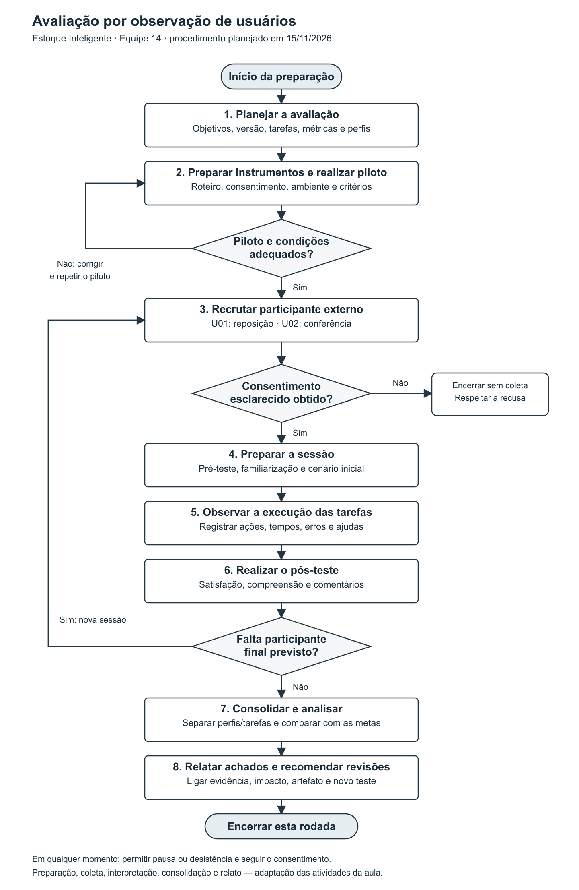

# Entrega 14 — Avaliação de usabilidade por observação de usuários

**Data:** 15/11/2026
**Status:** 🟨 iniciada 
**Responsabilidade:** solução consolidada por equipe. O número de participantes finais observados deve ser igual ao número de integrantes, conforme o modelo da disciplina; recomenda-se que cada integrante seja responsável por conduzir/analisar ao menos um participante.

## Objetivo da atividade

Observar usuários representativos realizando tarefas reais ou realisticamente simuladas para identificar problemas de eficácia, eficiência, compreensão e satisfação que não podem ser inferidos apenas por inspeção.

> **Participantes finais não devem ser membros da equipe.** Um integrante pode participar do teste piloto apenas para validar roteiro/equipamentos, sem contar na amostra final.

### Quando o usuário é um perfil profissional especializado

Em TCCs técnicos, o público pode ser DBA, analista, pesquisador, administrador, técnico ou outro especialista. Priorize participantes que possuam relação real com as tarefas. Se não for possível recrutar o perfil ideal, qualquer participante aproximado/proxy deve ser **justificado previamente e tratado como limitação**; não apresente o resultado como equivalente ao de especialistas reais.

O teste avalia a **interação com o protótipo**. Não é necessário que o participante valide o desempenho científico do algoritmo. Resultados simulados podem ser usados quando declarados e coerentes com a tarefa.

Tarefas podem envolver, por exemplo, interpretar um dashboard, configurar uma análise, encontrar uma execução no histórico usando filtros, comparar resultados, gerar relatório, revisar alerta ou administrar permissões.

## A. Fluxograma do processo — equipe

[Abrir o fluxograma em tamanho original](../assets/14_testes/fluxograma_avaliacao.png).

O fluxo organiza as atividades de preparação, coleta, interpretação, consolidação e relato apresentadas na aula. O piloto antecede a coleta final; uma recusa de consentimento encerra a participação sem coleta. O percurso será repetido para o segundo participante. O diagrama representa o **procedimento previsto**, não etapas já executadas.

## B. Procedimento de preparação e execução — equipe

### Passo 1 — Objetivos e versão avaliada

**Versão/commit/Figma:** referência documental da Entrega 11, de 11/11/2026, com 28 quadros de 1280 × 780 px. [Abrir o protótipo](https://www.figma.com/proto/jgB0Bk5BLQ3XM2W9tgZDmd/Estoque-Inteligente?page-id=0%3A1&node-id=2-2&starting-point-node-id=2%3A2&scaling=scale-down). O repositório foi consultado no commit [`c8e5000`](https://github.com/poulison/Projeto-ihc2026/commit/c8e5000ac3f80c4bc50a7064955ed6af2483ea36). Esse commit identifica a documentação consultada; não congela o conteúdo do Figma. Antes do piloto, registrar a revisão efetiva do protótipo e preservar uma cópia identificada. Depois do piloto, manter a mesma revisão nas duas sessões.

**Perguntas:** a pessoa distingue estoque físico, comprometido e disponível? Entende o alcance da previsão e do registro de uma decisão? Investiga a origem da diferença antes de corrigir o saldo? Reconhece uma pendência e retoma sem duplicar o trabalho?

**Metas de usabilidade relacionadas:**

| Meta | Critério definido antes da coleta | Cobertura nesta rodada |
|---|---|---|
| MU01 — eficácia | Pelo menos 80% de primeiras tentativas avaliáveis concluídas corretamente e sem ajuda. Com um elegível por tarefa, exige 1/1, sem generalização. | UT01 e UT03, separadamente. |
| MU02 — compreensão | Todos os elegíveis explicam quatro pontos: 4 garrafas disponíveis; estimativa não é garantia; ausência de previsão não é demanda zero; salvar não envia compra ao fornecedor. | Respostas após UT01 e UT02. |
| MU03 — eficiência | Conclusão independente em até 180 s na reposição e 300 s na conferência. | Primeira tentativa de UT01 e UT03; guardar também tempo total, pausas e esperas. |
| MU04 — segurança | Zero erros críticos por tentativa. | UT01–UT05, inclusive os casos com informação insuficiente. |
| MU05 — satisfação | Nota mínima 4/5 por pessoa e tarefa; registrar motivo. | Cada tarefa aplicada. Escala própria de satisfação, não SUS nem SEQ. |
| MU06 — aprendizagem | Segunda execução equivalente sem ajuda e sem erro crítico. | **Não avaliada nesta versão:** falta outro produto/caso de complexidade equivalente. UT06 não será aplicada. |
| MU07 — retomada | Identificar item, estado de salvamento e próxima ação em até 30 s após o retorno, sem duplicar registro. | UT05, aplicada separadamente em cada perfil. |

**Ambiente e recursos:** sessão presencial individual, sala tranquila, notebook, navegador, mouse, cronômetro e fichas de registro. Prever 25–35 minutos, a ajustar no piloto. Registrar resolução, área visível, zoom e adaptações de leitura. Oferecer dois minutos de familiarização com a entrada do protótipo, sem demonstrar os caminhos avaliados. Reiniciar o caso entre tarefas; o Figma simula registros, não persiste compras ou movimentações reais.

Será mantido o formato presencial da E12. Uma eventual aplicação remota exige pilotar compartilhamento de tela, conexão e recursos de acessibilidade, registrar as condições e separar esperas de rede; não misturar tempos de modalidades diferentes sem explicitar essa diferença. Falhas de gravação e estados de permissão previstos na E13 não serão provocados nesta rodada de observação.

### Passo 2 — Participantes

| ID | Perfil | Critérios que justificam participação | Integrante responsável |
|---|---|---|---|
| U01 — a recrutar | Adulto responsável por reposição em pequeno comércio; perfil relacionado a P01/Mariana. | Decide quantidades ou prioridades de compra e consulta estoque/procura. Registrar familiaridade digital e contato prévio com o projeto. Preferir pouca familiaridade com sistemas de estoque, sem deduzi-la da idade. | Paulo Andre de Oliveira Hirata modera e analisa; Victor Merker Binda observa e cronometra. |
| U02 — a recrutar | Adulto que confere mercadorias e movimentações; perfil relacionado a P02/Rafael. | Tem experiência de comparar contagem física e registros ou investigar diferenças. Não precisa decidir compras. Registrar ferramentas utilizadas e experiência prévia. | Victor Merker Binda modera e analisa; Paulo Andre de Oliveira Hirata observa e cronometra. |

**Amostra:** dois participantes finais previstos; **zero observados** até esta revisão. Recrutamento por conveniência, condicionado à experiência na tarefa. Não apresentar um colega sem experiência como representante do comércio. Cada participante fará somente os casos de seu perfil; UT05 será identificada também por M01 ou M02 para manter os resultados separados.

No pré-teste, perguntar quais atividades de estoque a pessoa realiza, com que frequência, quais ferramentas utiliza, se já conhece o protótipo e se precisa de adaptações de leitura ou comunicação. Registrar as respostas nas notas da sessão. Não solicitar documentos pessoais, renda, dados de clientes ou nome do estabelecimento no relatório público.

### Passo 3 — Consentimento e privacidade

- **Termo/registro de consentimento:** [modelo adaptado ao Estoque Inteligente](../assets/14_testes/termo_consentimento.md). Ler, esclarecer dúvidas, entregar uma cópia e obter aceite antes do pré-teste. O contato do responsável será registrado na cópia de uso antes do convite; nenhum aceite foi obtido nesta preparação.
- **Gravação de tela/áudio/vídeo:** não prevista, conforme E12. Um observador registrará ações, tempos e respostas. Não ligar gravação automática. A orientação de fechamento da aula (*Teste Usabilidade Observacao Usuario*, p. 16) solicita gravação do processo: **a compatibilidade da opção sem gravação com essa exigência precisa ser resolvida pela equipe com o docente antes da coleta**. Se for necessária gravação, revisar este plano e o termo antes de convidar os participantes; a participação não autoriza gravação implicitamente.
- **Identificação:** usar U01 e U02 nas notas e no relatório. Manter aceites e eventual chave de identificação separados. Esses códigos representam pseudonimização enquanto existir vínculo identificável; retirar detalhes que permitam reconhecer a pessoa na versão pública.
- **Local e período de armazenamento:** planeja-se pasta local protegida por senha, fora do repositório e sem compartilhamento público, sob responsabilidade de Paulo, com acesso da dupla. Aceites em subpasta separada. Descartar notas individuais, chave e aceites em até 30 dias após a divulgação da correção final da atividade; manter somente a síntese desidentificada no projeto. Confirmar o local antes do recrutamento.
- **Voluntariedade:** permitir pausa, recusa de pergunta e desistência, sem penalidade. Se houver retirada de consentimento, excluir os registros individuais ainda identificáveis e refazer a consolidação antes da publicação. Não transformar a retirada em falha de usabilidade. Oferecer leitura em voz alta ou formato acessível sem revelar soluções.

### Passo 4 — Teste piloto

**Data:** não realizado; agendamento pendente, antes das sessões finais.  
**O que foi validado:** ainda nada por execução. Estão definidos os itens a verificar: neutralidade das instruções, acesso aos estados A/B, simulação da consulta à proprietária, legibilidade, duração, cronometragem, classificação das ocorrências e coleta por notas.  
**Mudanças após piloto:** inexistentes até o momento; registrar somente após aplicá-lo.

Paulo representará U01 enquanto Victor conduz UT01, UT02 e UT05/M01. Em seguida, Victor representará U02 e Paulo conduz UT03, UT04 e UT05/M02. Nenhum deles entra na amostra final. Registrar nas notas do piloto as falhas do procedimento e divergências de classificação entre avaliadores; esses registros não entram nos resultados dos participantes finais.

**Condição para iniciar a coleta final:** caminhos necessários acessíveis, dados consistentes, condições de consentimento resolvidas e roteiro compreensível sem pistas de navegação. Conferir especialmente F02B, F11, F12P, F14 e os estados de pausa. Uma tela ausente ou simulação incoerente deve ser corrigida e novamente verificada; não será contada como incapacidade do participante. Registrar revisão e ajustes antes de congelar o protocolo.

### Passo 5 — Tarefas

Somente a coluna **Cenário/instrução apresentada** será lida ao participante. Critérios, estados e respostas esperadas pertencem ao material do avaliador. Os pontos de partida e as respostas da consulta simulada estão definidos abaixo.

| ID | Cenário/instrução apresentada | Critério de sucesso | Métricas | Ligação com modelo |
|---|---|---|---|---|
| UT01 · reposição com dados | “É segunda-feira. O fornecedor recebe pedidos até o meio-dia e prevê entregar na quinta. Veja a situação da garrafa térmica azul de 500 ml e deixe registrado como pretende proceder.” | Identifica item/unidade e 4 disponíveis, considera prazo e dados de procura, justifica uma decisão coerente e confere seu registro. Não existe quantidade única obrigatória; as opções 4 e 6 ou outro desfecho representado exigem justificativa. | Sucesso, tempo total/ativo, erros, ajudas, satisfação e compreensão. | E4-C01 → T01-A → O01/M01; F01/F02 até confirmação do desfecho. MU01–MU05. |
| UT02 · reposição com lacuna | “Em outro ciclo, você precisa decidir sobre a mesma garrafa. Use as informações disponíveis hoje e deixe registrado como dará continuidade ao trabalho.” | Reconhece informação insuficiente, registra pendência com motivo/próxima verificação e confere o registro. Não interpreta falta de previsão como demanda zero. | Sucesso, erros, ajudas, satisfação e compreensão; tempo descritivo, sem meta MU03. | E4-C01 → T01-B → O01/M01; F02B, F05P e F05PS. MU02/MU04/MU05. |
| UT03 · divergência confirmável | “A loja está conferindo 14 registros. A proprietária quer saber por que há uma diferença no estoque do conjunto de três potes. Investigue o que aconteceu e diga a ela como ficou esse item.” | Trata um conjunto como uma unidade; confirma a origem nas fontes e na consulta simulada; desfaz somente a segunda dedução da mesma saída de 2 conjuntos; confere saldo 10 e comunica que apenas esse item foi resolvido. | Sucesso, tempo total/ativo, erros, ajudas, satisfação e explicação do desfecho. | E4-C02 → T02-A → O02/M02; F01/F10/F11/F12/F13. MU01/MU03/MU04/MU05. |
| UT04 · divergência sem confirmação | “Em outra conferência do mesmo item, os registros e a contagem também divergem. Hoje você dispõe apenas dos documentos apresentados. Deixe o caso em condições de ser acompanhado pela proprietária.” | Mantém saldo registrado 8 diante da contagem 10 sem causa confirmada, registra motivo e próxima verificação, confere a pendência e comunica o alcance. | Sucesso, erros, ajudas e satisfação; tempo descritivo, sem meta MU03. | E4-C02 → T02-B → O02/M02; F10/F11/F12P/F14. MU04/MU05. |
| UT05 · retomada | “Você está no meio dessa atividade quando precisa atender alguém no balcão. Ao voltar, identifique onde parou e continue o trabalho.” | Após pausa de 30 s em execução separada, identifica item, estado não salvo e próxima ação em até 30 s; prossegue sem duplicação. Registrar desempenho em cada fluxo separadamente. | Tempo de retomada, contexto identificado, duplicação/erros, ajudas e satisfação. | O09; M01/F02P ou M02/F10P. MU04/MU05/MU07. |
| UT06 · repetição equivalente | **Não aplicada nesta versão.** A tarefa exige outro produto e valores com complexidade equivalente. | Critério reservado: segunda execução sem ajuda e sem erro crítico. Não usar UT02/UT04 ou a retomada como substitutos. | MU06 permanecerá não avaliada. | T01/M01 ou T02/M02; falta variante equivalente no protótipo atual. |

**Ordem:** U01 realiza UT01 → UT02 → UT05/M01; U02 realiza UT03 → UT04 → UT05/M02. Fazer perguntas após cada tentativa e reiniciar o cenário antes da próxima. Não misturar retomada com o tempo da primeira execução. A pausa disponível ocorre durante a análise, antes de salvar; esta versão não testa retomada após uma confirmação de gravação.

**Dados de referência:** garrafa com 6 unidades físicas, 2 comprometidas, 4 disponíveis, vendas confirmadas de 4 unidades nos últimos três dias e estimativa fictícia de 5 nos próximos três dias. Os potes têm saldo 8 e contagem 10; o pedido 1042 representa saída de 2 conjuntos. Mesmos produto, data e quantidade não provam duplicação: é necessária a confirmação da origem. Em UT04 essa confirmação não existe.

**Preparação dos casos:** iniciar UT01 e UT03 em F01; UT02 diretamente em F02B, sem medir a descoberta do acesso a esse caso; UT04 em F10. Na execução separada de UT05, preparar F02P ou F10P, desviar a atenção da tela por 30 s com um recado neutro e iniciar a medida de retomada quando a pessoa voltar a ver o estado. O preparo da pausa pelo avaliador não mede a descoberta do controle de pausar.

**Consulta simulada a Mariana:** informar que a pessoa pode consultar a proprietária dirigindo a pergunta ao observador. Responder apenas se solicitado. Em UT03: “A anotação é uma cópia do pedido 1042 já enviado. Houve uma única saída de dois conjuntos, sem outra venda ou cancelamento.” Se perguntar sobre autorização: “Você pode corrigir essa transcrição após confirmar a origem.” Em UT04: “Hoje não consigo confirmar a origem da anotação; não há outro documento disponível nem autorização para alterar o saldo sem esclarecer a causa.” Registrar a consulta como informação prevista do cenário, sem fornecer dicas de navegação.

**Critérios comuns:** sucesso total = resultado correto, conferido e independente; parcial = progresso pertinente sem todos os critérios ou conclusão com orientação; falha = resultado incorreto, erro crítico ou abandono por dificuldade. Registrar separadamente se a tentativa foi assistida. Falha técnica/tela ausente que impeça a tarefa = não avaliada, com motivo. Pedidos de ajuda, dicas efetivamente dadas e consultas à ajuda da interface são contagens distintas. Um desvio recuperado é diferente de erro crítico; silêncio isolado não prova confusão.

**Tempo:** começar após a leitura do cenário, com a tela inicial pronta. Encerrar quando a pessoa conferir o desfecho e indicar que terminou, ou no encerramento da tentativa independente. Tempo ativo = total menos pausas e esperas comprovadas. Não descontar hesitação ou procura. Aos 6 min de UT01 ou 10 min de UT03, oferecer encerramento ou ajuda e registrar a escolha; esses limites de conforto não substituem metas de 3 e 5 min. Casos B não têm meta de eficiência, e a pessoa pode interrompê-los a qualquer momento.

### Passo 6 — Protocolo do moderador

1. Receber a pessoa e explicar: “Estamos avaliando o protótipo, não você. As informações são fictícias; nenhuma compra ou alteração real será feita. Você pode pedir uma pausa ou encerrar quando quiser.” Informar a duração prevista e a pausa simulada, sem revelar hipóteses ou respostas.
2. Ler o termo, esclarecer dúvidas, fornecer cópia e obter consentimento. Sem aceite, encerrar sem aplicar questionário ou coletar desempenho. Registrar somente o código nas fichas de observação.
3. Aplicar o pré-teste mínimo e combinar adaptações. Preparar o dispositivo, fechar conteúdos pessoais e oferecer a familiarização geral. Não treinar reposição, correção ou retomada.
4. Ler um cenário por vez, confirmar entendimento da situação e iniciar o cronômetro. Esclarecer fatos do cenário sem explicar botões, conceitos que estão sendo avaliados ou caminho de solução. Na consulta a Mariana, usar apenas a resposta prevista para o caso, quando solicitada; isso é dado do cenário, não dica.
5. Observar sem ensinar. Anotar ação, quadro, instante e consequência. Diante de pedido de orientação, oferecer continuar ou encerrar a tentativa independente para receber ajuda; registrar antes de orientar. Não deixar o participante desconfortável para preservar uma métrica.
6. **Não exigir think aloud contínuo nesta rodada**, para preservar a medição de tempo. Registrar verbalizações espontâneas e esclarecer dúvidas retrospectivamente após a tentativa. Aplicar a mesma regra aos dois perfis.
7. Fora da cronometragem, perguntar: “Quão satisfeito(a) ficou com a experiência de realizar esta tarefa?” Usar 1 muito insatisfeito(a), 2 insatisfeito(a), 3 nem satisfeito(a) nem insatisfeito(a), 4 satisfeito(a), 5 muito satisfeito(a). Pedir o motivo. Após UT01, perguntar quantas unidades estão livres e por quê, o que a estimativa informa e o que aconteceu ao salvar. Após UT02, perguntar o que significa não haver previsão e o que ficou pendente. Conferir os quatro pontos de MU02 sem antecipar ou ensinar as respostas. Após UT03/UT04, perguntar o que explica a diferença, como ficou o saldo e o que seria comunicado à proprietária.
8. Realizar o pós-teste breve: “Em qual momento teve mais dúvida?”, “O que ajudou ou atrapalhou ao retomar?” e “O que mudaria primeiro?”. Distinguir fala literal anotada com segurança de síntese do observador. Não inferir satisfação por sorriso, silêncio ou rapidez.
9. Agradecer, explicar a destinação dos registros e lembrar o canal de contato. A dupla confere as notas imediatamente após a sessão, sem completar lacunas por suposição. Preservar evidências individuais e produzir uma versão desidentificada para o relatório.

## C. Resultados — por participante

**Nenhuma sessão final foi realizada.** “NR” significa não realizado; “—” indica ausência de medição, não zero. Usar as tabelas desta seção para registrar os resultados. Nas notas de cada sessão, guardar data, versão, ambiente, início/fim, pausas/esperas, ações e intervenções; resumir tempo total e ativo na coluna Tempo e indicar quadro/instante nas evidências. UT06 não aparece nas tentativas previstas porque foi excluída do escopo desta versão.

### U01 — responsável por reposição, a recrutar

| Tarefa | Grau de sucesso | Erros | Tipos de erro/dificuldade | Ajudas | Tempo | Satisfação | Evidência/observação |
|---|---|---:|---|---:|---|---|---|
| UT01 | NR | — | Não observado | — | Não medido | Não coletada | Sessão não realizada. |
| UT02 | NR | — | Não observado | — | Não medido | Não coletada | Sessão não realizada. |
| UT05/M01 | NR | — | Não observado | — | Não medido | Não coletada | Sessão não realizada. |

**Link da gravação (se autorizado):** não há; o plano vigente prevê notas, sem gravação.  
**Resposta pós-teste:** não coletada. Perfil efetivo, data, versão, consentimento e condições de uso serão registrados na sessão, sem nome no relatório público.

### U02 — responsável por conferência, a recrutar

| Tarefa | Grau de sucesso | Erros | Tipos de erro/dificuldade | Ajudas | Tempo | Satisfação | Evidência/observação |
|---|---|---:|---|---:|---|---|---|
| UT03 | NR | — | Não observado | — | Não medido | Não coletada | Sessão não realizada. |
| UT04 | NR | — | Não observado | — | Não medido | Não coletada | Sessão não realizada. |
| UT05/M02 | NR | — | Não observado | — | Não medido | Não coletada | Sessão não realizada. |

**Link da gravação (se autorizado):** não há; o plano vigente prevê notas, sem gravação.  
**Resposta pós-teste:** não coletada. A relação com P02 depende da experiência real confirmada no recrutamento; Rafael é uma persona, não um participante do teste.

## D. Consolidação por tarefa

| Tarefa | Taxa de sucesso | Tempo típico | Erros recorrentes | Satisfação | Meta atendida? | Problemas prioritários |
|---|---|---|---|---|---|---|
| UT01 | Não calculável; 0 tentativas avaliadas | Não medido | Não observados | Não coletada | Não avaliada | Não identificados por teste. |
| UT02 | Não calculável; 0 tentativas avaliadas | Não medido; sem meta MU03 | Não observados | Não coletada | Não avaliada | Não identificados por teste. |
| UT03 | Não calculável; 0 tentativas avaliadas | Não medido | Não observados | Não coletada | Não avaliada | Não identificados por teste. |
| UT04 | Não calculável; 0 tentativas avaliadas | Não medido; sem meta MU03 | Não observados | Não coletada | Não avaliada | Não identificados por teste. |
| UT05/M01 | Não calculável; 0 tentativas avaliadas | Retomada não medida | Não observados | Não coletada | Não avaliada | Não identificados por teste. |
| UT05/M02 | Não calculável; 0 tentativas avaliadas | Retomada não medida | Não observados | Não coletada | Não avaliada | Não identificados por teste. |
| UT06 | Não se aplica à rodada | Não se aplica | Não se aplica | Não se aplica | MU06 não avaliada | Falta variante equivalente, não é achado de uso. |

Após a coleta, apresentar sucessos independentes como **x de n**, por tarefa e perfil, informando elegíveis, tentativas iniciadas, avaliáveis e não avaliadas. Incluir falhas e tentativas assistidas no denominador; excluir impedimentos técnicos somente com justificativa explícita. Com denominador zero, manter “não avaliada”, nunca 0% ou 100%. Se faltar um caso previsto por limitação do protótipo, o resultado parcial não autoriza declarar a meta global atingida. MU01 considera apenas a primeira tentativa dos casos A. Casos B e retomada serão apresentados separadamente.

Com uma pessoa por perfil, apresentar o **tempo individual**, sem chamá-lo de tempo típico da população. Caso existam várias observações comparáveis, mostrar distribuição e mediana. Para satisfação, manter notas e motivos individuais; eventual recusa é dado ausente. Não calcular média aritmética da escala ordinal nem somar satisfação a erros em um índice único.

Em MU02, conferir os quatro pontos nas respostas de U01. Em MU03, tentativa assistida ou encerrada por dificuldade não atende à meta; relatar seu tempo até interrupção. Em MU04, um único erro crítico exige revisão. Em MU07, relatar contexto identificado, tempo após retorno e ocorrência de duplicação para cada fluxo. Segurança prevalece sobre rapidez e satisfação.

## E. Achados e recomendações

Ainda não existem achados de observação. Os riscos investigados pelo roteiro não serão apresentados como problemas comprovados, nem a preparação documental será contada como resultado de teste.

| ID | Achado | Evidência (quant. + qual.) | Impacto | Recomendação | Artefatos a revisar |
|---|---|---|---|---|---|
| Não atribuído | Nenhum achado de uso registrado; coleta pendente. | Não há tentativas, contagens ou falas de participantes. | Não estimado por observação. | Executar o protocolo após piloto e recrutamento. Recomendações de interface dependerão das ocorrências. | A definir a partir de cada evidência. |

Após observar, numerar AU01, AU02 etc. Cada linha deve reunir participante/tarefa, quadro e instante, comportamento observado, frequência sobre elegíveis e explicação pós-tarefa. Separar descrição do fato e interpretação da causa. Priorizar risco de saldo incorreto, duplicação ou falsa conclusão; depois bloqueio, ajuda e dificuldades recuperáveis. Uma ocorrência crítica pode ser prioritária mesmo sem recorrência.

Associar cada recomendação ao signo da E9, trecho M01/M02 da E10, quadro da E11 e meta afetada; indicar quem revisará e como repetir o caso. Atualizar a matriz de rastreabilidade somente com achados efetivos. As ligações de planejamento já estão na tabela de tarefas; nenhuma hipótese do projeto foi validada nesta preparação.

## F. Comparação com a avaliação heurística

Na [Entrega 13 consultada](13_avaliacao_heuristica.md), as fichas dos dois avaliadores e a consolidação ainda estão sem resultados preenchidos. Portanto, não é possível afirmar que uma dificuldade já foi detectada por inspeção. A tabela abaixo organiza **questões de comparação futuras**, não violações confirmadas.

| Problema | Detectado na heurística? | Detectado por usuários? | O que aprendemos |
|---|---|---|---|
| Possível confusão entre físico, comprometido e disponível ou entre previsão e garantia — UT01/UT02; H1/H2/H6. | Ainda sem registro na E13. | Não avaliado. | Sem conclusão empírica; comparar interpretação dos signos em F02/F02B. |
| Possível interpretação de decisão salva como compra enviada — UT01; H1/H2. | Ainda sem registro na E13. | Não avaliado. | Sem conclusão empírica; confrontar o feedback com a explicação pós-tarefa. |
| Possível correção de saldo sem origem confirmada ou falsa conclusão de toda a conferência — UT03/UT04; H2/H5. | Ainda sem registro na E13. | Não avaliado. | Sem conclusão empírica; comparar ações, fontes consultadas e alcance comunicado. |
| Possível perda de contexto ou duplicação após pausa — UT05; H1/H6/H7. | Ainda sem registro na E13. | Não avaliado. | Sem conclusão empírica; registrar contexto, tempo e ação após retorno. |

Ao consolidar, usar o ID real da E13 e da E14, a versão e a cobertura da tarefa. Problema previsto e não observado não significa problema inexistente: a amostra ou o caminho pode não tê-lo exposto. Dificuldade observada sem correspondente na inspeção constitui informação nova para revisão, não prova de que um método substitui o outro.

## G. Conclusão

1. **Metas atingidas:** nenhuma foi avaliada com participantes até esta revisão. MU01–MU05 e MU07 têm protocolo definido; MU06 está fora da rodada por falta de variante equivalente. Preparar o teste não demonstra que as metas foram atingidas.
2. **Problemas recorrentes e perfis:** ainda não há ocorrências ou recorrências observadas. A rodada prevê um participante de reposição e um de conferência; repetições da mesma pessoa não aumentarão artificialmente a amostra.
3. **Surpresas:** não há descobertas de uso a relatar antes da execução. Expectativas da equipe permanecem hipóteses.
4. **Prioridades:** resolver a modalidade de registro frente à orientação da aula, confirmar o canal de contato e o armazenamento, preservar a versão do protótipo, realizar o piloto, recrutar e obter consentimento. Após a coleta, priorizar alterações sustentadas por evidência, começando por erros críticos e bloqueios.
5. **Limitações:** amostra pequena e por conveniência, um elegível por tarefa principal, dados e decisões simulados, escolhas limitadas do Figma, presença dos autores como avaliadores, ausência de gravação no plano vigente e cenário sem a pressão real do balcão. A retomada cobre apenas o momento anterior ao salvamento. A rodada não permite generalizar para o comércio, certificar acessibilidade, demonstrar aprendizagem ou validar o algoritmo. O conteúdo audiovisual dos dois vídeos não pôde ser verificado integralmente; suas páginas e descrições foram identificadas, mas as transcrições não foram recuperadas.
## Checklist

- [ ] Número de participantes finais atende ao enunciado.
- [ ] Participantes são representativos do público e não são membros da equipe.
- [ ] Se foram usados participantes proxy, a justificativa e a limitação estão explícitas.
- [ ] O teste avalia a interação; não confunde usabilidade do protótipo com desempenho técnico do TCC.
- [ ] Tarefas administrativas/analíticas usadas no teste são rastreáveis a objetivos e cenários.
- [ ] Há consentimento e anonimização.
- [ ] Foi realizado teste piloto.
- [ ] Tarefas têm critérios de sucesso definidos antes do teste.
- [ ] Moderadores não ensinaram o caminho durante a tarefa.
- [ ] Resultados estão separados por usuário e por tarefa.
- [ ] Foram registrados sucesso, erros, ajudas, tempo e satisfação quando aplicáveis.
- [ ] Conclusão combina evidência quantitativa e qualitativa.
- [ ] Achados geram recomendações e atualização da rastreabilidade.
